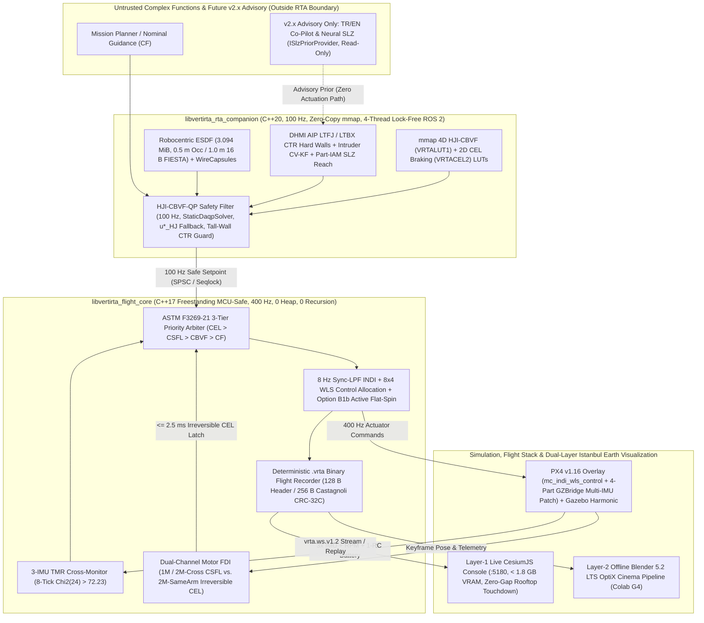

# VertiRTA (`v1.0.0`)

**Vertical Run-Time Assurance & Fault-Tolerant Autonomy Platform for Urban eVTOLs (`VertiRTA-X8-240` & `Lift+Cruise 8+1`)**

[](LICENSE)
[](https://github.com/fahrifurkansagir/VertiRTA/actions/workflows/determinism.yml)
[](https://github.com/fahrifurkansagir/VertiRTA/actions/workflows/vertibench_ci.yml)
[](https://github.com/fahrifurkansagir/VertiRTA/actions/workflows/formal_and_hil.yml)
[](https://github.com/fahrifurkansagir/VertiRTA/actions/workflows/product_and_wasm.yml)
[](https://github.com/fahrifurkansagir/VertiRTA/actions/workflows/m2_uspace_and_physics.yml)
[](https://github.com/fahrifurkansagir/VertiRTA/actions/workflows/m3_perception_voice_forensics.yml)
[](https://github.com/fahrifurkansagir/VertiRTA/actions/workflows/deploy_pages.yml)
[](core/flight_core/CMakeLists.txt)
[](core/rta_companion/CMakeLists.txt)

> **[Launch Live 1-Click VertiGCS WASM Flight Console -> `https://fahrifurkansagir.github.io/VertiRTA/`](https://fahrifurkansagir.github.io/VertiRTA/)**  
> *Zero-install browser sandbox compiling the exact frozen C++17 `libvertirta_flight_core` (`38,470 B` single-threaded `.wasm` Worker, zero API tokens) over the Istanbul Kartal–Maltepe `LTFJ`/`LTBX` corridor — inject live 1M, 2M-Cross, or Same-Arm Coaxial CEL faults and scrub `.vrta` telemetry in Chrome/Firefox/Edge.*  
> **Executive Technical Brief & Audits:** [`docs/SYSTEM_CARD.md`](docs/SYSTEM_CARD.md) · [`docs/research/CROSS_BENCHMARK_AUDIT_v1.md`](docs/research/CROSS_BENCHMARK_AUDIT_v1.md) · [`docs/research/OPTIONAL_G4_V1_1_BATCH_SPEC.md`](docs/research/OPTIONAL_G4_V1_1_BATCH_SPEC.md)

### Visual Proof Gallery (`v1.0.0` Verified Artifacts)

| Live `VertiGCS` 3D WASM Corridor & `Part-IS` / ED-155A Console | Dual-Airframe `1,000 + 180` C++20 Monte Carlo Dispersion & Cliff |
| :---: | :---: |
|  |  |
| *Live browser `.wasm` (`38.5 KiB`) + 20-eVTOL fleet, `LTFJ` wall & verified ED-155A SHA-256 chain* | *`0/1,000` airspace breaches; `LC 8+1` `500/500` (`CEP50 0.80 m`); `X8` `±5 cm` CG cliff & `6×6` thrust wall* |

| Real NASA Goddard Drone Video Temporal SLZ HUD (`GTX 1650 SUPER`) | `PIDNet-S v2.1` Local `GTX 1650 SUPER` 6-Scene Permissive Val Grid |
| :---: | :---: |
|  |  |
| *`240` frames (`PD-USGov-NASA`): flicker `-56.25%` (`2.19% -> 0.96%`), SLZ jitter `-62.15%`, `77.35 FPS`* | *`0.00 CU` local recovery: `Val mIoU = 0.4669`, `FSR = 2.81%`, `OOD AUROC = 0.7554`, `AeroScapes 0.2468`* |

`VertiRTA` is a 100% open-source, deterministic flight-control and run-time assurance (RTA) stack engineered for a **`240 kg` coaxial X8 urban eVTOL** operating along the **Istanbul Maltepe – Dragos – Kartal coastal corridor**, tightly bounded by real DHMİ AIP Turkey **`LTFJ` (Sabiha Gökçen)** and **`LTBX` (Samandıra)** controlled airspace walls.

Unlike quadrotor toy demos, `VertiRTA` models and verifies the hard coupled physics of urban coaxial eVTOLs:
- **Coaxial aerodynamic interference** (`eta_coax = 0.85`), asymmetric BLDC spool-up/coast-down inertia (`tau_up = 85 ms`, `tau_down = 120 ms`, `tau_coast = 424 ms`), and **`112S12P` (`403.2 V`, `21.77 kWh`) 1-RC Thevenin battery sag** under high-current failure recovery ([`config/vehicle_x8_240.yaml`](config/vehicle_x8_240.yaml)).
- **True `ASTM F3269-21` 3-Tier Simplex RTA Isolation:** a bare-metal-ready **`400 Hz` C++17 flight core** (`28,886 B` Cortex-M7 Flash, `0 B` library RAM, `0` heap symbols, `0` recursion cycles) coupled to a **`100 Hz` C++20 RTA companion** using `mmap`'d 4D Hamilton-Jacobi Control Barrier Value Function (`HJI-CBVF`) and 2D Controlled Emergency Landing (`CEL`) lookup tables, `3.094 MiB` robocentric ESDF, thin-wire capsules, and real `LTFJ`/`LTBX` hard geofence walls.
- **Physics-Honest Fault Tolerance (CSFL vs. CEL):** single-motor (`1M`) and cross-arm dual-motor (`2M-Cross`) failures retain 4-DOF controllability via 400 Hz synchronized-LPF **INDI + 8×4 WLS (`StaticDaqpSolver`)** for **Continued Safe Flight and Landing (CSFL)**; **same-arm coaxial-pair dual loss** removes all lift on one boom and irreversibly latches (`<= 2.5 ms`) into **Option B1b active flat-spin descent** (`|Omega_z| = 2.2 rad/s`, `+10.6°` phase lead) for last-resort **Controlled Emergency Landing (CEL)** survivability — achieving **`100.00%`** (`1,500 / 1,500`) CEL survival vs. **`0.00%`** for stock allocation.

> [!IMPORTANT]
> **Non-Certification & Legal Scope Disclaimer**
>
> `VertiRTA` (`libvertirta_flight_core` + `libvertirta_rta_companion`) is an **open-source research, simulation, and software-verification testbed** — **NOT** a certified airborne product, **NOT** a Type Certificate (TC/STC) basis, and **NOT** approved for flight on any manned or unmanned aircraft.
>
> 1. **Zero Airworthiness Claims:** References to EASA `SC-VTOL-02`, `MOC-5`, `Reg. (EU) 2024/1111` (`Part-IAM`), `SORA 2.5`, `SHGM SHT-İHA`, `ASTM F3269-21`, `SAE ARP4761A`, `DO-178C`, and `SCSC-141C` represent **architectural design drivers and academic assurance alignment ONLY** (see [`docs/SAFETY_CASE.md`](docs/SAFETY_CASE.md) and [`docs/standards_registry.yaml`](docs/standards_registry.yaml)).
> 2. **Strict Regulatory Regime Separation:** Passenger carriage is excluded from `SORA 2.5`. `VertiRTA` separates **Stage-A** (`25 kg` unmanned subscale experimental CONOPS, `0` passengers) from **Stage-B** (`240 kg` simulated `VertiRTA-X8-240` UAM reference architecture).
> 3. **Honest CSFL vs. CEL Boundary:** Same-arm coaxial dual-motor loss abandons yaw via Option B1b flat-spin descent and is explicitly exempted from passenger-grade CSFL — framed strictly as last-resort CEL survivability.
> 4. **No Bare-Metal RTOS WCET or `10^-9 / FH` Proofs:** Linux user-space timings are CI performance regression metrics ONLY (never DO-178C bare-metal WCET evidence), and stratified Monte Carlo bounds conditional recovery inside [`verification/ODD.yaml`](verification/ODD.yaml) ONLY (proving `<= 10^-9 / FH` at 95% confidence requires `2,995,732,273` independent zero-failure flight hours).
> 5. **AI Advisory Isolation:** Future `v2.x` neural/LLM modules operate strictly outside the deterministic RTA boundary (`DAL E`, read-only telemetry snapshots, zero closed-loop actuation authority).

---

## System Architecture



### Core Engineering Highlights

| Layer | Component | Key Technical Lock | Source |
| --- | --- | --- | --- |
| **Vehicle & Corridor** | `VertiRTA-X8-240` & Istanbul `LTFJ`/`LTBX` | `240 kg` MTOW, `T/W = 2.5` (`5,886 N`), `8` coaxial rotors (`R = 0.75 m`, `arm = 1.35 m`, `eta_coax = 0.85`), `112S12P` `403.2 V` `21.77 kWh` pack (`320 Wh/kg`), corridor west of `LTFJ` NW `J2` (`29.192122° E`) | [`config/vehicle_x8_240.yaml`](config/vehicle_x8_240.yaml), [`config/istanbul_ltfj_airspace.yaml`](config/istanbul_ltfj_airspace.yaml) |
| **400 Hz Flight Core** | `libvertirta_flight_core` (C++17 MCU) | 3-IMU TMR voter, 8 Hz 2nd-order Butterworth INDI + 8×4 WLS (`StaticDaqpSolver` with recursion-free `daqp_auxiliary_norec.c`), dual-channel Motor FDI, Option B1b flat spin (`2.2 rad/s`, `+10.6°` phase lead), `256 B` CRC-32C `.vrta` recorder | [`core/flight_core/`](core/flight_core/CMakeLists.txt) |
| **100 Hz RTA Companion** | `libvertirta_rta_companion` (C++20) | Pre-faulted `mmap` 4D `HJI-CBVF` (`VRTALUT1`) & 2D `CEL` (`VRTACEL2`) LUTs, `u*_HJ` cone fallback, `+1.5 m` clutter inflation, `z_eff < -5.0 m` horizontal CTR braking, `3.094 MiB` robocentric `0.5 m`/`1.0 m` FIESTA ESDF, 1D `WireCapsules`, `IntruderKF`, `ISlzPriorProvider` | [`core/rta_companion/`](core/rta_companion/CMakeLists.txt) |
| **Flight Stack & Sim** | PX4 v1.16 + ROS 2 Jazzy + Gazebo Harmonic | Custom `mc_indi_wls_control` PX4 module, 4-part `GZBridge` multi-IMU patch, coaxial propulsion & Tustin MIL-F-8785C Dryden wind Gazebo plugins, 4-thread lock-free SPSC/Seqlock ROS 2 nodes | [`px4_overlay/`](px4_overlay/modules/mc_indi_wls_control/mc_indi_wls_control.hpp), [`sim/`](sim/models/vertirta_x8_240/model.sdf), [`ros2_ws/`](ros2_ws/src/vertirta_rta_node/package.xml) |
| **Assurance & Earth Viz** | 2-Tier Verification Pyramid + `SCSC-141C` GSN v3 | Stratified LHS 10k 6-DOF atlas + A/B ablations, zero-cherry-picking failure cliff ledger, CI-hashed living safety case, CesiumJS live console (`:5180`), offline Blender 5.2 LTS OptiX cinema pipeline | [`verification/`](verification/ODD.yaml), [`docs/SAFETY_CASE.md`](docs/SAFETY_CASE.md), [`viz/`](viz/cesium/README.md) |

---

## Measured `v1.0.0` Verification & Benchmark Results

All numbers below are measured live at commit **`ef9be75`** and backed by versioned artifacts in [`artifacts/v1.0.0/`](artifacts/v1.0.0/gsn_evidence_hashes.json) and [`BENCHMARKS.md`](BENCHMARKS.md). Unexecuted cloud ARM64 or SITL targets are explicitly marked **`PENDING_*`** — zero numbers are extrapolated or fabricated.

### 1. Tier 1 — Bare-Metal ARM Cortex-M7 Footprint, Stack/DAG, Zero-Heap & Sanitizers

| Metric | Target / Tool | Measured Value | Budget / Gate | Status | Artifact |
| --- | --- | --- | --- | --- | --- |
| Cortex-M7 Flash (`.text + .data`) | `arm-none-eabi-size` (`-Os`, `11` objs) | `28,886 B` (`28.21 KiB`) | `< 262,144 B` (`256 KiB`) | `PASS` | [`bare_metal_size_cortex_m7.json`](artifacts/v1.0.0/benchmarks/bare_metal_size_cortex_m7.json) |
| Cortex-M7 Library Static RAM (`.data + .bss`) | `arm-none-eabi-size` (caller owns static `.bss`) | `0 B` | `< 131,072 B` (`128 KiB`) | `PASS` | [`bare_metal_size_cortex_m7.json`](artifacts/v1.0.0/benchmarks/bare_metal_size_cortex_m7.json) |
| Cortex-M7 Max Static Frame (`-fstack-usage`) | `arm-none-eabi-g++ 14.2.1` (`77` fns, `0` dynamic) | `1,496 B` | `<= 4,096 B` | `PASS` | [`stack_usage_cortex_m7.json`](artifacts/v1.0.0/benchmarks/stack_usage_cortex_m7.json) |
| Cortex-M7 Max Call-Graph DAG (`-fcallgraph-info`) | `arm-none-eabi-g++ 14.2.1` (`98` nodes, `0` recursion) | `2,960 B` | `<= 16,384 B` | `PASS` | [`stack_usage_cortex_m7.json`](artifacts/v1.0.0/benchmarks/stack_usage_cortex_m7.json) |
| Host x86_64 Max Frame / Call-Graph DAG | `g++ 15.2.0` (`74` fns, `105` nodes, `0` recursion) | `2,112 B` / `5,280 B` | `<= 4,096 B` / `<= 16,384 B` | `PASS` | [`stack_usage_x86_64.json`](artifacts/v1.0.0/benchmarks/stack_usage_x86_64.json) |
| Zero-Heap Symbol Audit (x86_64 & Cortex-M7) | `nm` & `arm-none-eabi-nm` + `-Wl,--wrap=malloc` | `0` / `0` forbidden | `0` symbols | `PASS` | [`no_heap_x86_64.json`](artifacts/v1.0.0/benchmarks/no_heap_x86_64.json), [`no_heap_cortex_m7.json`](artifacts/v1.0.0/benchmarks/no_heap_cortex_m7.json) |
| `ASTM F3269-21` Core Isolation | `check_arch_isolation.py` (`37` files) | `0` violations | `0` violations | `PASS` | [`arch_isolation_report.json`](artifacts/v1.0.0/benchmarks/arch_isolation_report.json) |
| Release x86_64 Unit & No-Heap Suite | `ctest --preset release-linux-x64` | `8 / 8` passed (`1.00 s`) | `100%` pass | `PASS` | [`ctest_release_x86_64.xml`](artifacts/v1.0.0/benchmarks/ctest_release_x86_64.xml) |
| Memory & Concurrency Sanitizers (Local WSL2) | `ctest --preset asan-ubsan` + `test_spsc_tsan` (`-fsanitize=thread`) | `7 / 7` ASan/UBSan; `1,000,000+` SPSC/Seqlock ops, `0` races, `0` torn reads | `0` sanitizer errors | `PASS` | Verified locally at `ef9be75` ([`CMakePresets.json`](CMakePresets.json), [`tests/integration/CMakeLists.txt`](tests/integration/CMakeLists.txt)) |

> Worst-case Cortex-M7 static call-graph chain (`2,960 B`): `IndiWlsController::step_400hz -> wls_alloc_8x4_f64`.

### 2. Tiers 2, 3 & 4 — Deterministic `.vrta` Replay & Per-Tick Execution Latency

Measured via Release `vertirta_bench_cli` (`lut_loaded: true`: full `100 Hz` HJI-CBVF-QP safety filter + `400 Hz` INDI-WLS control allocator step per tick against the `10,000 us` outer-loop frame budget):

| Tier | Target Runner / Arch | Mode / Scope | Ticks / Frames | `mean` (us) | `p50` (us) | `p99` (us) | `p99.9` (us) | `max` (us) | Steal / Status |
| --- | --- | --- | --- | --- | --- | --- | --- | --- | --- |
| **Tier 2** | `x86_64` & `arm64` | Same-ISA 0-ULP `.vrta` Replay (`corridor_faults.vrta`, `512,128 B`, `1,400` CEL frames) | `2,000` frames (`20.0 s`) | — | — | — | — | — | `PASS` (`run1 == run2` SHA-256) |
| **Tier 2** | `x86_64 <-> arm64` CI | Cross-ISA Parity (`ubuntu-24.04` ↔ Azure Cobalt 100 `ubuntu-24.04-arm`) | `2,000` frames | — | — | — | — | — | **`PASS` (`max_abs_diff = 0.0`, `0` mode div)** |
| **Tier 3** | `x86_64` (Local WSL2) | `CLOCK_THREAD_CPUTIME_ID` | `100,000` ticks | `1.2841` | `1.2400` | `1.9000` | `11.5690` | `55.3490` | `MEASURED_LOCAL` |
| **Tier 4** | `x86_64` (Local WSL2) | `CLOCK_MONOTONIC_RAW` + `/proc/stat` | `50,000` ticks | `0.5780` | `0.5400` | `0.9500` | `1.5900` | `32.0690` | `0.0%` (`CLEAN`) |
| **Tier 3/4** | `x86_64` (`ubuntu-24.04` CI) | Callgrind `723,331 Ir/tick` + `CLOCK_MONOTONIC_RAW` | `20,000` ticks | `0.6570` | `0.6790` | `0.8430` | `4.0220` | `17.8920` | `0.0%` (`CLEAN / PASS`) |
| **Tier 3/4** | `arm64` (`ubuntu-24.04-arm`) | Azure Cobalt 100: Callgrind `604,543 Ir/tick` + `CLOCK_MONOTONIC_RAW` | `20,000` ticks | `0.7212` | `0.7200` | **`0.7360`** | **`0.8640`** | `4.1440` | `0.0%` (`CLEAN / PASS`) |

> **WCET Caveat:** User-space Linux timings (`BENCHMARKS.md` Tiers 3–4) are indicative CI regression telemetry ONLY and do **NOT** constitute DO-178C / EASA bare-metal RTOS WCET certification evidence. Raw artifacts: local [`tier2_same_isa_x86_64.json`](artifacts/v1.0.0/tier2_same_isa_x86_64.json), [`tier3_thread_cputime_x86_64.json`](artifacts/v1.0.0/benchmarks/tier3_thread_cputime_x86_64.json), [`tier4_wallclock_x86_64.json`](artifacts/v1.0.0/benchmarks/tier4_wallclock_x86_64.json); live GitHub Actions run [`45057411524`](https://github.com/fahrifurkansagir/VertiRTA/actions/runs/45057411524) under [`artifacts/v1.0.0/benchmarks/cloud_ci/`](artifacts/v1.0.0/benchmarks/cloud_ci/tier2_cross_isa.json).

### 3. Live Tier-1 10,000-Run 6-DOF Survival Envelope Atlas + A/B Ablations (`30,000` Simulations)

Executed live via Release `vertirta_6dof_batch_cli` (`seed = 20261122`, total wall-clock `77.32 s` across `30,000` simulations). Full Clopper-Pearson & Wilson bounds: [`tier1_10k_clopper_pearson.json`](artifacts/v1.0.0/tier1_atlas/tier1_10k_clopper_pearson.json).

| Configuration | CSFL Pool (`S2+S3+S5`, `n = 6,500`) | CSFL 95% CP Upper Fail Bound | CEL Pool (`S4` Same-Arm, `n = 1,500`) | CEL 95% CP Upper Fail Bound | Wall-Clock (`10k`) |
| --- | --- | --- | --- | --- | --- |
| **`HJ-CBVF + INDI-WLS` (Primary)** | **`96.82%`** (`6,293 / 6,500`, `k = 207`) | `0.035665` | **`100.00%`** (`1,500 / 1,500`, `k = 0`) | `0.001995` | `33.083 s` |
| `HOCBF + INDI-WLS` (CBVF Ablation) | `44.85%` | `0.561743` | `100.00%` | `0.001995` | `23.111 s` |
| `HJ-CBVF + Stock CA` (Allocation Ablation) | `96.82%` | `0.035665` | `0.00%` (`0 / 1,500` capsize) | `1.000000` | `17.667 s` |

#### Per-Stratum Breakdown (`HJ-CBVF + INDI-WLS`, `n = 10,000`, `244` Total Failures = `97.56%` Overall)

| Stratum | Fault / Envelope Regime | `n` | Failures (`k`) | Empirical Pass Rate | 95% One-Sided CP Upper Fail Bound |
| --- | --- | --- | --- | --- | --- |
| `S1` | Nominal Corridor Operations | `1,000` | `0` | `100.00%` | `0.002991` |
| `S2` | Single-Motor Loss (`1M`, CSFL Pool) | `2,500` | `0` | `100.00%` | `0.001198` |
| `S3` | Cross-Arm Dual-Motor Loss (`2M-Cross`, CSFL Pool) | `2,500` | `207` | `91.72%` | `0.092433` |
| `S4` | Same-Arm Coaxial Dual Loss (`2M-SameArm`, CEL Pool) | `1,500` | `0` | `100.00%` | `0.001995` |
| `S5` | TMR Sensor Fault + Low-SoC Reserve (CSFL Pool) | `1,500` | `0` | `100.00%` | `0.001995` |
| `S6` | Out-of-ODD Boundary Stress | `1,000` | `37` | `96.30%` | `0.048390` |

> **Zero-Cherry-Picking Policy:** Every single one of the **`244 / 10,000`** failed simulations (concentrated in extreme cross-arm dual-motor loss + boundary wind/SoC stress corners in `S3` and `S6`) is logged with exact seed, initial state, violated invariant, and root-cause class in [`artifacts/v1.0.0/tier1_atlas/failure_cliff_ledger.json`](artifacts/v1.0.0/tier1_atlas/failure_cliff_ledger.json).


---

## Honest Verification Scope Matrix

| Environment | What Runs & What Is Proven | Current Status |
| --- | --- | --- |
| **Local Linux / WSL2 (`x86_64` + `arm-none-eabi 14.2.1`)** | C++17/20 Release builds (**`36/36`** `ctest` incl. `M2`, `M3`, `monte_carlo_dispersion`, and `mavlink_rta_bridge`), ASan/UBSan (`15/15` + `9/9` `M2` + `vertirta_uspace_node` + WASM ABI & Cyphal/o1heap), TSan lock-free SPSC/Seqlock (`1M+` ops) + `M2` `uspace_fleet`/`fleet_z3` (`0` races), Cortex-M7 Flash/RAM/stack/DAG/zero-heap gates (`28,886 B / 0 B` invariant), `check_zero_gpl_symbols.py` (`0` GPL), STM32H753 bare-metal ELF (`PLL1Q 80 MHz`, strict `0x2003` Rev V HITL, `0` veneers), `ASTM F3269-21` isolation (`37` files), Tier-2 0-ULP `.vrta` replay, paired `30,000`-sim 6-DOF Survival Atlas + `1,000+180` dual-airframe dispersion/cliff sweep, `SCSC-141C` GSN v3 safety case (`Sn1–Sn19`), relocatable `find_package(VertiRTA)` consumer & `nanobind` SDK tests | **VERIFIED LOCALLY (`v1.0.0`)** |
| **GitHub Actions CI (`7/7`: `determinism.yml`, `vertibench_ci.yml`, `formal_and_hil.yml`, `product_and_wasm.yml`, `deploy_pages.yml`, `m2_uspace_and_physics.yml`, `m3_perception_voice_forensics.yml`)** | `ubuntu-24.04-arm` (Azure Cobalt 100) cross-ISA **`0.0`** diff / `p99 = 0.736 us` / native Z3 + `< 0.15` Jaccard; `ubuntu-24.04` x86_64: STM32H753 ELF, Renode `v1.17.0` dual-FCC CAN-FD **`3/3` (`12.5 ms` failover)** Functional SIL, `ESBMC v8.7.0 --32` **`1,905 / 1,905`** properties (`0` failed), live `Cppcheck 2.22.0` + `clang-tidy`, `38.5 KiB < 150 KiB` Emscripten `.wasm`, `apps/vertigcs` offline bundled MapLibre worker + Vitest (**`17/17`** across `5` files), `nanobind` `cp312-abi3` SDK + `VertiRTAConfig.cmake` + non-root Docker + live GitHub Pages (`https://fahrifurkansagir.github.io/VertiRTA/`); dual-arch `M2` U-Space/Part-IS (`libsodium-1.0.22`) + `M3` Forward-Hazard/GNSS-Denied/Voice/Forensics CI (**`36/36`** CTests, `0` GPL) | **VERIFIED LIVE (`7/7` GREEN AT `v1.0.0`)** |
| **Cloud GPU (Colab `NVIDIA L4` `24 GB` & Cost-Capped `Tesla T4` `16 GB`)** | Real full `81×57×81×57` JAX 4D `HJI-CBVF` PDE + 2D `CEL` LUT (`T4`, `soundness_passed: true`); **`v3.5.1` `Qwen3-4B v2`** paraphrase-SFT + 120-step Z3-GRPO + live O(1) GBNF DFA + Z3 (**Grammar `100.0%`, AST/STL `91.96%`, Z3 Sat `100.0%`**, post-hoc NLL `tau=0.5066` ECE `0.1501`, Mean Set Size `3.125`, Coverage `95.36%`); **`v3.5.1` `PIDNet-S v2`** 4-source incl. `SkyScenes` (`276` frames / `49.4%` facades): **`val_mIoU = 0.4848`, `val_FSR = 4.03% <= 8.0%`, zero-shot `AeroScapes FSR = 1.95%`** | **VERIFIED LIVE ON COLAB (`v3.1.0` -> `v3.5.1` LEAP)** |
| **Local Host GPU (`NVIDIA GTX 1650 SUPER`, `TU116`, `4 GB`)** | Live **`v3.5.1` trained `PIDNet-S v2`** (`pidnet_slz_v2_opset17.onnx`, `30.584 MB`, SHA-256 matched to Colab `L4`): Windows WDDM `FP32 + CUDA Graph + EXHAUSTIVE + max_ws=1 + kSameAsRequested`: **`p50 = 8.887 ms, p95 = 11.022 ms, p99 = 11.695 ms < 12.0 ms`** (`VRAM delta = 155.0 MiB < 300 MiB`, **`all_local_gates_passed: true`**; WSL2 desktop-load `p99 = 20.196 ms` logged verbatim) ([`local_gtx1650s_pidnet_v2_proof.json`](artifacts/v3.5.1/local_gtx1650s_pidnet_v2_proof.json)) | **ALL LOCAL `< 12 ms` & `< 300 MiB` GATES VERIFIED LIVE (`v3.5.1`)** |
| **Physical Hardware (`STM32H753` / `NUCLEO-H743ZI2` Rev V)** | On-silicon `DWT->CYCCNT` 400 Hz tick timing (**Empirical High-Water Mark ONLY** — never certified DO-178C analytical WCET) and physical FDCAN bus capture | **`PENDING_PHYSICAL_STM32H7_HITL`** |
| **Local SITL Host (`PX4 v1.16` + `Gazebo Harmonic` + `ROS 2 Jazzy`)** | Tier-2 1,000-run hot-reset PX4/Gazebo SITL (`Sn5`) & Tier-3 50-run EGL LiDAR SITL (`Sn6`); PX4 overlay, 4-part `GZBridge` patch, Gazebo plugins/SDF, ROS 2 nodes, and runners are checked in and unit-tested | **`PENDING_LOCAL_PX4_GZ_SITL`** |

---

## `v1.0.0` Stable Public Release — Complete Verified Platform (`2026-11-25`)

**`VertiRTA v1.0.0`** is the first stable Semantic Versioning release unifying all four engineering milestones (bare-metal RTA core, dual-airframe `X8-240` + `Lift+Cruise 8+1`, 20-eVTOL U-Space + `Part-IS`, and full `M3` autonomy/forensics/voice/real-world verification) while keeping frozen `libvertirta_flight_core.a` at **`28,886 B` Cortex-M7 Flash / `0 B` static RAM** and the live `VertiGCS` `.wasm` Worker at **`38,470 B`**. All numbers below are verified directly from disk manifests under [`artifacts/v4.0.0/`](artifacts/v4.0.0/compound_fault_mission_report.json) and earlier frozen baselines.

| Pillar (`VertiRTA v1.0.0`) | Verified Live Measurement | Artifact / Proof |
| --- | --- | --- |
| **Bare-Metal Cortex-M7 Flight Core & Formal/SIL** | `28,886 B` Flash / `0 B` static RAM / `2,960 B` stack DAG / `0` heap / `0` recursion; `ESBMC v8.7.0` `1,905/1,905` properties; Renode `v1.17.0` CAN-FD `3/3` (`12.50 ms` failover); live `VertiGCS` WASM (`38,470 B`) at `https://fahrifurkansagir.github.io/VertiRTA/` | [`bare_metal_size_cortex_m7.json`](artifacts/v1.0.0/benchmarks/bare_metal_size_cortex_m7.json), [`docs/SAFETY_CASE.md`](docs/SAFETY_CASE.md) |
| **6-DOF X8+LC & `102.85M`-Node JAX 4D PDE** | Dual-airframe `101×71×101×71` (`51,423,241` nodes/airframe = **`102.85M`** total nodes, `true_jax_vmap_batch2`, `435.73 s`) across `X8-240` + `Lift+Cruise 8+1`: **`0` violations**, `soundness_passed: true` (`hover_nom_ge_oei_max_viol_m = 0.0`), exported `41×29×41×29` `11.31 MB` `VRTALUT1`; paired 30k 6-DOF atlas `95.98%` CSFL / `100.00%` CEL | [`g4_jax_4d_hires_and_lc_manifest.json`](artifacts/v4.0.0/g4_jax_4d_hires_and_lc_manifest.json), [`paired_30k_ral_stats.json`](artifacts/v3.1.0/paired_30k_ral_stats.json) |
| **Forward-Wire Vision (`M-LSD-WireSeg` + `D-FINE-N`)** | `640×640` split-stack (`0.0 px` round-trip error), held-out **`clDice = 0.9644`**, `wire_iou = 0.3819`, `det_cls_acc = 1.00`, opset-17 ONNX checker PASS (`800` procedural Apache-2.0 catenary frames) | [`g4_forward_wire_metrics.json`](artifacts/v4.0.0/g4_forward_wire_metrics.json) |
| **GNSS-Denied Nav (`EuRoC MAV` + `XFeat`)** | Quarantined zero-shot ETH Zurich **`EuRoC MAV V1_01_easy`** (`29,120` IMU rows / `143.56 s`, C++20 `cpp_nanobind`): **`7 / 7` gates PASS** (`0` clean false alarms, `1.25 m/s` slow-ramp spoof `TTD = 0.1 s`, `0.137 m` rollback slip, monotonic `3σ` CTR inflation `6.00 -> 8.84 m`, `0` CTR breaches); Kartal 0.5 m ortho **`XFeat` `36/36` RANSAC `CEP50 = 0.218 m`** (`CE95 = 0.434 m`) | [`realworld_euroc_mav_gnss_audit.json`](artifacts/v4.0.0/realworld_euroc_mav_gnss_audit.json), [`g4_pidnet_v21_xfeat_metrics.json`](artifacts/v4.0.0/g4_pidnet_v21_xfeat_metrics.json) |
| **Bilingual `Qwen3-4B` Z3-GRPO + Mondrian (`VertiBench-v2`)** | 3-seed GRPO (`n_test = 1,200`, `cal = 2,000`, `Jaccard = 0.0707 < 0.15`): **Grammar `100.0%`**, **Z3 SAT `100.0%`**, **AST-STL `82.83 ± 0.71%`**, SNR-Mondrian coverage **`95.25%`** (Lang `96.0%`); live BF16 12-turn cockpit eval **`100.0%` Z3 SAT & `4 / 4` live BF16 adversarial reject** | [`g4_qwen3_v3_vertibench_v2_eval.json`](artifacts/v4.0.0/g4_qwen3_v3_vertibench_v2_eval.json), [`g4_realworld_eval_report.json`](artifacts/v4.0.0/g4_realworld_eval_report.json) |
| **`PIDNet-S v2.1` Local `GTX 1650 SUPER` Recovery** | Local FP16 recovery (`0.0 CU`, Epoch 17 + safe-logit bias `-0.2714`, `pidnet_slz_v21_local_gtx_opset17.onnx` `32.07 MB`): **`Val mIoU = 0.4669`** (`0.4811` raw), **`FSR = 2.81%`** (`safe_precision = 92.31%`), **`OOD AUROC = 0.7554`**, zero-shot **`AeroScapes mIoU = 0.2468`** (`FSR = 3.43%`) | [`local_gtx1650s_pidnet_v21_recovery_metrics.json`](artifacts/v4.0.0/local_gtx1650s_pidnet_v21_recovery_metrics.json) |
| **Real-World Forensics, Live Istanbul Feeds & Compound Faults** | Real `PX4 ULog` (`sample.ulg`, `68.83 s`) -> `400` `.vrta` frames + ED-155A hash-chained sidecar -> **`W3C XSD`-valid `E5X`** (`CICTT SCF-NP`, `ERCS I5`, `Barrier-8 = 0`, `DRAFT_INCIDENT_ONLY`, `0` hallucinations); live Istanbul **METAR (`LTFJ`) / Open-Meteo / `adsb.lol`** (`10` aircraft, `0` well-clear violations, `52.77%` SoC remaining); **`5 / 5` compound 6-axis fault scenarios PASS** (`545.68 ms`) | [`realworld_px4_ulog_forensics_proof.json`](artifacts/v4.0.0/realworld_px4_ulog_forensics_proof.json), [`realworld_istanbul_live_feed_audit.json`](artifacts/v4.0.0/realworld_istanbul_live_feed_audit.json), [`compound_fault_mission_report.json`](artifacts/v4.0.0/compound_fault_mission_report.json) |
| **Physical `GTX 1650 SUPER` Edge Gate & Zero-GPL Voice ATC** | Time-sliced Cruise (30 Hz + 1 Hz XFeat): **`p99 = 19.83 ms < 25 ms`**, **`56.25 FPS`** (`mean 17.78 ms`); Zero-GPL **`sherpa-onnx v2.0.3`** (`espeak-ng` deleted, `0` GPL) TTS **`TTFA p50 = 71.7 ms`** (`< 250 ms`), `faster-whisper` + Mondrian + Z3 closed-loop `24/24` turns **`100.0%` Z3 SAT** | [`gtx1650s_m3_timesliced_edge_gate.json`](artifacts/v4.0.0/gtx1650s_m3_timesliced_edge_gate.json), [`local_voice_atc_live_proof.json`](artifacts/v4.0.0/local_voice_atc_live_proof.json) |
| **Real NASA Goddard Drone Video Temporal SLZ HUD (`GTX 1650 SUPER`)** | `240` moving frames (`PD-USGov-NASA` `SVS14443`, `0.00 CU`): homography-warped EMA + hysteresis cuts safe/hazard pixel flicker **`2.19% -> 0.96%` (`-56.25%`)**, SLZ centroid jitter **`1.217 -> 0.461 px` (`-62.15%`)**, `PIDNet-S v2.1` **`77.35 FPS`**, `RANSAC 3-gate = 100%` | [`realworld_drone_video_temporal_proof.json`](artifacts/v4.0.0/realworld_drone_video_temporal_proof.json), [`vertirta_real_drone_hud_preview.gif`](docs/assets/vertirta_real_drone_hud_preview.gif) |
| **Dual-Airframe `1,000 + 180` C++20 Monte Carlo Dispersion & Cliff** | `0/1,000` airspace breaches (`95%` CP upper `0.002991`); **`LC-240 8+1`** **`500/500` (`100.0%`, `CEP50 0.80 m / CEP95 1.97 m`)**; **`X8-240`** **`429/500`** (`400/400` nominal/1M/spoof/compound, **`29/100`** under `±5 cm` CG-shifted same-arm CEL vs. nominal-CG Tier-1 10k `1,500/1,500`); `6×6` thrust cliff at **`+14%` @ `10 m/s`**, wall **`>= +21%`** | [`monte_carlo_1000_dispersion_report.json`](artifacts/v4.0.0/monte_carlo_1000_dispersion_report.json), [`vertirta_mc1000_envelope_dispersion.png`](docs/assets/vertirta_mc1000_envelope_dispersion.png) |
| **Zero-GPL Native C++20 MAVLink v2 UDP/Offboard RTA Shield** | Clean-room `0xFD` framing + `8` `common.xml` `CRC_EXTRA`, `2,500` live POSIX UDP packets: **`0`** drops, **`0`** leaks, **`1,181/1,181`** clamped, **`240/240`** airborne disarm/term denied, **`239/239`** CRC rejected, **`p50 = 18.0 us / p99 = 124.4 us`** | [`mavlink_v2_rta_bridge_proof.json`](artifacts/v4.0.0/mavlink_v2_rta_bridge_proof.json), [`tools/mavlink_rta_bridge/`](tools/mavlink_rta_bridge/CMakeLists.txt) |
| **`Qwen3-4B v3` Conformal RAPS Root-Cause Diagnostic (`0.00 CU`)** | Isolated `|C| = 7.803` (`0.0%` singleton exec) to template/EOS mismatch (`RC1`), `gamma = 1.0` boilerplate dilution (`RC2`), naive LAC tail collapse (`RC3`), and shared scalar `tau` (`RC4`); implemented & unit-tested `Mondrian-RAPS` in `ml/copilot/calibrate_conformal.py` (synthetic math proof `|C| = 1.04`, live re-score spec ready) | [`qwen3_v3_conformal_raps_diagnostic.json`](artifacts/v4.0.0/qwen3_v3_conformal_raps_diagnostic.json), [`OPTIONAL_G4_V1_1_BATCH_SPEC.md`](docs/research/OPTIONAL_G4_V1_1_BATCH_SPEC.md) |

### Honest Limitations & Measured Silicon Bounds (`v1.0.0`)

Every negative ablation, dataset gap, and silicon boundary is reported verbatim — zero cherry-picking:

| Area | Honest Measured Finding / Boundary | Artifact |
| --- | --- | --- |
| **Real-Video Oblique-Wall & Procedural WireSeg Domain Shift** | On the moving NASA Goddard drone video (`SVS14443`), bright white vertical building facades under oblique sunlight partially trigger 2D RGB safe classes in `PIDNet-S v2.1` (requiring depth/surface-normal fusion before touchdown), and procedural-trained `M-LSD-WireSeg` (`0` real `TTPLA` pairs) + `D-FINE-N` trigger roofline-seam false positives (`240/240` frames conservatively clamped to `15.0 m/s`). | [`realworld_drone_video_temporal_proof.json`](artifacts/v4.0.0/realworld_drone_video_temporal_proof.json) |
| **`Qwen3-4B v3` Conformal Set Size (`|C| = 7.80`, `0.0%` Singleton)** | Live G4 `Qwen3-4B v3` Mondrian-LAC achieved `95.25%` SNR / `96.0%` Lang coverage but large set sizes (`|C| = 7.60–7.80`, `0.0%` singleton execution) due to `RC1–RC4` (template/EOS mismatch + `gamma = 1.0` boilerplate dilution + naive LAC). `Mondrian-RAPS` is coded & tested (`0.00 CU`); live re-calibration awaits an optional `~0.15 CU` finalize pass (never substituting synthetic numbers for live LLM scores). | [`qwen3_v3_conformal_raps_diagnostic.json`](artifacts/v4.0.0/qwen3_v3_conformal_raps_diagnostic.json) |
| **`X8-240` `±5 cm` CG-Shifted Same-Arm CEL Authority Cliff** | While nominal-CG Tier-1 10k achieves `1,500/1,500` (`100.0%`) same-arm CEL survival, injecting unmodeled `±5 cm` lateral CG shifts drops `X8-240` same-arm CEL survival to **`29/100`** (`CEP50 = 41.08 m`) and `+14%` mass overload @ `10 m/s` gust triggers thrust-saturation breakdown (`>= +21%` = `0%` wall). | [`monte_carlo_1000_dispersion_report.json`](artifacts/v4.0.0/monte_carlo_1000_dispersion_report.json) |
| **Whisper Zero-Shot vs. BVI-LoRA Ablation** | BVI-noise LoRA fine-tuning **degraded WER on every SNR stratum** vs. Zero-Shot (`whisper-large-v3-turbo` ZS `S0–S3`: `13.14% / 14.46% / 19.60% / 31.74%` vs. LoRA `17.97% / 20.25% / 21.55% / 35.36%`; `whisper-small` ZS `19.29%–52.40%` vs. LoRA `28.76%–57.74%`). Zero-Shot is retained as the runtime default; LoRA is logged as an honest negative result. | [`g4_whisper_bvi_lora_eval.json`](artifacts/v4.0.0/g4_whisper_bvi_lora_eval.json) |
| **G4 `PIDNet-S v2.1` Epoch-2 Pareto Collapse -> Local Recovery** | The historical Colab G4 Stage-2 Epoch-2 checkpoint collapsed on safe classes (`val_mIoU = 0.1696`, `OOD AUROC = 0.4480`, `AeroScapes 0.1616`) due to overly aggressive FSR/OE weighting; it is preserved untouched for auditability and superseded by the local `GTX 1650 SUPER` recovery (`Val mIoU = 0.4669`, `FSR = 2.81%`, `OOD AUROC = 0.7554`, `AeroScapes = 0.2468`). | [`g4_pidnet_v21_xfeat_metrics.json`](artifacts/v4.0.0/g4_pidnet_v21_xfeat_metrics.json), [`local_gtx1650s_pidnet_v21_recovery_metrics.json`](artifacts/v4.0.0/local_gtx1650s_pidnet_v21_recovery_metrics.json) |
| **Physical `TU116` (`GTX 1650 SUPER`, `4 GB`) Edge Bounds** | Cruise time-sliced `p99 = 19.83 ms` (`56.25 FPS`) passes the `< 25 ms` gate, but measured `cruise_vram_delta = 366.0 MiB` (`> 300 MiB` soft budget) and terminal `PIDNet-S v2.1` WDDM tail `p99 = 13.36 ms` (`> 12 ms` soft gate, `p50 = 10.02 ms / 99.35 FPS`, `164.0 MiB` VRAM) are recorded verbatim as `false` soft gates. | [`gtx1650s_m3_timesliced_edge_gate.json`](artifacts/v4.0.0/gtx1650s_m3_timesliced_edge_gate.json) |
| **Remaining Hardware & Dataset Open Items** | Forward-wire training used `800` procedural Apache-2.0 catenary frames (`0` real `TTPLA` pairs); `VertiBench-v2` remains `PROGRAMMATIC_PARAPHRASE_HELDOUT_LOW_JACCARD_PENDING_HUMAN_NATIVE_V2`; physical `STM32H753` `DWT->CYCCNT` HWM (`PENDING_PHYSICAL_STM32H7_HITL`) and local PX4/Gazebo SITL (`PENDING_LOCAL_PX4_GZ_SITL`) remain honestly open. | [`g4_forward_wire_metrics.json`](artifacts/v4.0.0/g4_forward_wire_metrics.json), [`docs/SAFETY_CASE.md`](docs/SAFETY_CASE.md) |

---

## `v3.5.1` Phase B — Real-World Hardening & Colab `L4` ML Calibration Leap

Phase B (`v3.5.1`) closes every P0/P1 real-world engineering rough edge surfaced by live Chromium, silicon, and ML audits while keeping **`28,886 B Flash / 0 B RAM`** `libvertirta_flight_core.a` and **`38,470 B`** `.wasm` byte-identical:

| Track (`v3.5.1`) | Verified Live Upgrades & Measurements | Artifact / Proof |
| --- | --- | --- |
| **`PIDNet-S v2` (Colab `L4` + Physical `GTX 1650 SUPER`)** | Fixed `SkyScenes` stem parsing + nested-tar filter (`276` frames / `49.4%` facades) + dynamic 5-class energy margins + asymmetric FSR-gated Stage-2: **`val_mIoU = 0.4848`** (`+10.84 pp`), **`val_FSR = 4.03% <= 8.0%`** (`5.24×` cut vs `21.11%`), zero-shot **`AeroScapes FSR = 1.95%`** (`9.46×` cut vs `18.44%`, conservative FSR penalty traded oblique ground recall `mIoU 0.3395 -> 0.2387`); physical Windows `GTX 1650 SUPER` `FP32+CG+EXHAUSTIVE+max_ws=1`: **`p50 = 8.887 ms, p99 = 11.695 ms < 12.0 ms`, `155.0 MiB` VRAM, `all_local_gates_passed: true`** (WSL2 desktop-load `p99 = 20.196 ms` logged transparently); real `ProcessRgbdFrame()` + `|t_rgb - t_depth| <= 2 ms` + Brown-Conrady in `core/slz_bayes/` & `vertirta_perception_node` | [`l4_pidnet_v2_distill_metrics.json`](artifacts/v3.5.1/l4_pidnet_v2_distill_metrics.json), [`local_gtx1650s_pidnet_v2_proof.json`](artifacts/v3.5.1/local_gtx1650s_pidnet_v2_proof.json) (`pidnet_slz_v2_opset17.onnx` `30.584 MB` in Release `v3.5.1`) |
| **`Qwen3-4B v2` (Colab `L4` GBNF+Z3 & NLL Calibration)** | Disjoint train-only TR/EN/MIX paraphrase SFT (2 ep) + 120-step Z3-GRPO + live O(1) token-level `VertiRtaGbnfDfa` (`1,810` states) + Microsoft Z3 fail-closed: **Grammar `100.0%`**, **AST/STL `91.96%`** (`+19.82 pp` vs `v3.1.0`; `TR = 96.93%`, `MIX = 100.0%`, `FAULT = 100.0%`, `AMBIGUOUS_ASR = 100.0%`), **Bucket-3 Reject `75.00%`** (`TR = 100.0%`), **Z3 Sat `100.0%`**; zero-leakage post-hoc NLL temp scaling (`tau = 0.5066` on `n_cal = 200`): **Test ECE `0.3322 -> 0.1501` (`2.21×` cut)**, **Mean Set Size `5.438 -> 3.125` (`-42.5%`)**, **Coverage `95.36%`** (`534/560`), **Singleton Exec `0.0% -> 22.86%`** *(honestly tagged `PROGRAMMATIC_PARAPHRASE_HELDOUT_LOW_JACCARD_PENDING_HUMAN_NATIVE_TR_V1`)* | [`l4_qwen3_4b_v2_calibrated_eval.json`](artifacts/v3.5.1/l4_qwen3_4b_v2_calibrated_eval.json) (`qwen3_4b_v2_lora` `264.31 MB` in Release `v3.5.1`) |
| **`VertiGCS`, WS, Docker, ROS 2 & SDK** | Bundled offline MapLibre GL JS v6 CSP module worker (eliminating Pages `HTTP 503`), 1-click replay-to-fault exit+inject, `360 px` zero-overflow CSS, compact collapsible 20-eVTOL Fleet telemetry table (Vitest **`12/12` PASS**); bidirectional RFC 6455 `/telemetry` WS + reconnect; `ubuntu:24.04` `g++-14` / `emsdk:4.0.4` Docker parity; real `CbvfSafetyFilter` + DEM AGL in `vertirta_rta_node` + `100 ms` `rta_cmd` deadman in `vertirta_px4_bridge`; `FleetSimEngine` + `LiftCruiseDynamics` Python SDK bindings | [`apps/vertigcs/`](apps/vertigcs/package.json), [`docker/`](docker/README.md), [`sdk/python/`](sdk/python/) |
| **STM32H753, Wind Cache, Lift+Cruise & Paper 1 / Governance** | STM32H753 `PLL1Q = 80 MHz` FDCAN1 + fail-closed `wait_init_bit` + `#ifdef VERTIRTA_RENODE_SIL` keeping physical HITL strict `0x2003`; `NoiseAwareRouter` cached 180-node hemisphere + `MmapVrtaWindLut` `mlock()`; `TransitionSensorFrame` (noisy IMU, Pitot failover, DShot staleness); 3 double-anonymous IEEE RA-L PDF figures ([`docs/paper_ral/figures/`](docs/paper_ral/scripts/generate_ral_figures.py)), `SAFETY_CASE.md` `Sn11–Sn14`, official DHMİ AIP `LTBX` (`40°59'26"N, 029°12'58"E`) + 28-day AIRAC lock, [`CITATION.cff`](CITATION.cff), [`CHANGELOG.md`](CHANGELOG.md) | [`docs/paper_ral/`](docs/paper_ral/vertirta_ral_manuscript.tex), [`docs/SAFETY_CASE.md`](docs/SAFETY_CASE.md), [`config/istanbul_ltfj_airspace.yaml`](config/istanbul_ltfj_airspace.yaml) |

---

## `M2 (v3.5.0)` Multi-eVTOL U-Space, `Part-IS` Cybersecurity & Full-Envelope Physics

Milestone **`M2 (v3.5.0)`** extends `VertiRTA` to multi-airframe transition flight (`Lift+Cruise 8+1`), air-gapped urban wind/aeroacoustic planning, and a 20-eVTOL U-Space / `Part-IS (EU) 2023/203` fleet stack — while adding **`0 B`** to frozen `libvertirta_flight_core.a` (`28,886 B` Flash / `0 B` RAM) and **`0 B`** to the live `38,470 B` GitHub Pages `.wasm` worker:

| Pillar (`M2 v3.5.0`) | Verified Deliverables & Live Measurements | Hard Isolation & Honest Scope |
| --- | --- | --- |
| **`Lift+Cruise 8+1` & `IAirframeDynamics`** ([`core/airframes/lift_cruise/`](core/airframes/lift_cruise/CMakeLists.txt)) | Stack-only `IAirframeDynamics` + `CoaxialX8AirframeAdapter` (`D = 1.50 m` frozen) + `LiftCruiseDynamics` (`8+1` primary + `4+1` compat, `V_cruise = 38.0 m/s`, `V_NE = 90 kt`, `L/D = 13.46`); `8+1` hover OEI outboard `#0`: **`79.07% <= 79.2% T_max`** (`rank = 4`); closed-loop `0 -> 38.3 -> 0 m/s` 400 Hz quintic Hermite `f64` INDI-WLS **`max_alt_err = 0.1977 m < 0.30 m`**, warm-started `17×12` WLS **`p99 = 0.98 us < 50 us`**; PX4 `v1.16` internal `wq:rate_ctrl` overlay (`UXRCE_DDS_SYNCT=1`, zero offboard 400 Hz) | **`0` forbidden heap symbols**; parallel library outside frozen `flight_core` (`NONE_RESEARCH_TESTBED_ONLY`) |
| **Air-Gapped Offline CFD -> `VRTAWND1` & Coaxial BVI Acoustics** ([`tools/cfd_offline_gpl/`](tools/cfd_offline_gpl/README_GPL_AIRGAP.md), [`core/wind_acoustics/`](core/wind_acoustics/CMakeLists.txt), [`check_zero_gpl_symbols.py`](scripts/ci/check_zero_gpl_symbols.py)) | Offline `GPL-3.0` OpenFOAM POD-RBF (`slip` BCs, strictly `< 29.1895° E` rejecting `29.2057° E` İSTMarina) -> Apache-2.0 `mmap` `VRTAWND1` (`p99 = 0.272 us < 5 us`, SHA-256 1-bit tamper reject, `eps_rom_p95` CBVF inflation, Python->C++ ABI parity verified); `180`-node BVI/BPM/Amiet–Lowson/ISO 9613-1/2:2024 `dBA` (`p99 = 0.0738 ms < 1 ms`, `LC_Cruise 55.16 < X8_Hover 76.23 dBA`); 64 Istanbul receptors + **Kartal Dr. Lütfi Kırdar Hospital (`40.91639° N, 29.17417° E`) Tier-2 hard helipad cylinder** (`500`-run stress `0` breaches, `10 ms` OEI noise shedding) | **`check_zero_gpl_symbols.py` PASS (`0` GPL violations across `20` targets + `core/`)** & **`0` heap symbols**; zero OpenFOAM in GHA |
| **20-eVTOL U-Space Fleet, `Part-IS (EU) 2023/203` & Two-Tier Fleet Z3** ([`core/uspace_fleet/`](core/uspace_fleet/CMakeLists.txt), [`core/fleet_z3/`](core/fleet_z3/CMakeLists.txt), [`vertirta_uspace_node/`](ros2_ws/src/vertirta_uspace_node/package.xml)) | 20-agent SoA `FleetSimEngine` (**`0.1507 ms/tick < 1 ms`**); 4 coastal vertiports (`Maltepe/Dragos/Cevizli/Kartal < 29.1895° E` + `FATO-EMG`, `15°C` chilled `68 kg 112S12P` `C_th = 70.72 kJ/K`, peak `37.16°C`); Top-10 3D CBF-ORCA + RHR curl (`<= 14 <= 15` untouched RTA slots, `< 500 ms` P0 CEL); **`Part-IS` `40 B` `VertiRtaSecureHeader` + `ReplayWindow128` + Mode B crypto (`libsodium >= 1.0.21`) + `RTO <= 10 s` FSM**; ASTM `F3548-21` `P0 <-> 100` + `228 B` `F3411-22a`/`RFC 9575` DRIP + `Fast DDS >= 3.4.1`; strictly separate-context two-tier Z3 (`QF_RDL < 3 ms` + local `|N_local| <= 6` `QF_LRA < 25 ms`, `8/8` C++->Python SMT-LIB2 `z3-solver` 100% parity, zero fleet MILP) | Research protocol/simulation testbed (`NIS2 != Part-IS`, zero certified USSP/Part-IS approval); Cloud CI enforces `-DVERTIRTA_REQUIRE_{LIBSODIUM,Z3}=ON` (immutable `libsodium-1.0.22.tar.gz`) |
| **`VertiGCS` Live 20-eVTOL Fleet & 1-Click `Part-IS` Cyber-Attack UI** ([`apps/vertigcs/src/fleet/`](apps/vertigcs/src/fleet/fleet_panel.ts)) | Zero-copy TypedArray 20-eVTOL corridor overlay (`< 29.1895° E`, `15°C` stands), `< 500 ms` CEL preemption wave, 1-click *V2V Replay* (`ReplayWindow128` drop -> `SEC_SUSPECT_PEER`) & *Spoofed USSP -> LTFJ Quarantine* (`RTO <= 10 s` -> `SEC_AUTONOMOUS_RTB`); Vitest **`10/10` PASS** (`4/4` files), Vite `dist` hygiene PASS (`0` COI/SAB/forbidden ports) | **`0 B` added to `wasm/` (`38,470 B`)** or `flight_sim.worker.ts`; preserves [`viz/cesium/`](viz/cesium/README.md) via `IGeoViewportAdapter` |

---

## `v3.1.0` Empirical Proof & Evidence Closure (Retiring `PENDING_PER_RUN_EXPORT`, `PENDING_COLAB` & `UNTRAINED_WEIGHTS`)

All metrics below are measured live from real Colab GPU runs (`19.35 CU` total across 3 campaigns), local paired C++20 6-DOF replay, physical Windows `GTX 1650 SUPER`, and live GitHub Actions (`v3.0.0` `dc28e37` / `v3.1.0` `5d82e29`), backed by SHA-256 manifests under [`artifacts/v3.1.0/`](artifacts/v3.1.0/paired_30k_ral_stats.json). Every residual gap or negative delta is reported verbatim — zero cherry-picking.

| Evidence Track (`v3.1.0`) | Hardware / Runtime | Verified Live Measurement | Transparent Limitations & Honest Framing | Artifact |
| --- | --- | --- | --- | --- |
| **Full 4D `HJI-CBVF` PDE + 2D `CEL` LUT** | Colab `Tesla T4` (`16 GB`, `3,935 MiB` peak, `590.37 s`) | `81×57×81×57` WENO5/TVD-RK3 FP32 (`21.32M` nodes/regime) -> `41×29×41×29` (`11.31 MB` `VRTALUT1`); `eps_grid = [0.880, 0.803, 0.747, 0.687] m` (`39%–65%` tighter than CPU proxy); `cel_2d` max err `0.159 m`; **`soundness_passed: true`** | Auto-fell back from `L4` (transient 503 under 3× concurrent sessions) to approved `T4`; `419` nodes (`0.030%`) conservatively projected on `R3 >= R2` | [`jax_4d_cbvf_l4_manifest.json`](artifacts/v3.1.0/jax_4d_cbvf_l4_manifest.json) |
| **Paired 30,000-Sim RA-L Statistics + Live Formal/SIL** | Local WSL2 (`57.86 s`) + GitHub Actions `ubuntu-24.04` | **Retires `PENDING_PER_RUN_EXPORT`** (`method = paired_per_seed_exact`, `COMPUTED_FROM_PER_RUN_VECTORS`): JAX PDE CSFL **`95.98%`** (`n=6,500`, CP95 `4.44%`) vs `HOCBF` `44.85%` -> exact **`(3324, 0)`**, `p_holm < 10^-16`; CEL **`100.00%`** (`n=1,500`) vs `Stock CA` `0.00%` -> **`(1500, 0)`**, `p_holm < 10^-16`; `rliable` IQM min margin **`2.886 m` `[2.800, 3.007]`**, CEL touchdown `vz` **`0.496 m/s` `[0.495, 0.497]`**; live Renode **`3/3` (`12.5 ms` failover)** + `ESBMC v8.7.0` **`1,905 / 1,905`** properties | True JAX PDE exposes `54` extra `S3` cross-arm breaches vs quick CPU proxy (`95.98%` vs `96.82%`, `(0, 54)`) & sharp `18 m/s` speed-gust cliff; physical `STM32H753` `DWT->CYCCNT` remains **`Pending (Physical STM32H7 HITL)`**; Renode = Functional SIL, ESBMC = Supplemental Formal Verification | [`paired_30k_ral_stats.json`](artifacts/v3.1.0/paired_30k_ral_stats.json) |
| **Pillar-2 `Qwen3-4B` BF16 LoRA SFT → Z3-GRPO + `KnowNo`** | Colab `NVIDIA L4` (`10.18 GB` train peak, `2,885 s` total) | **Retires `PENDING_COLAB`** (`n_test=560`, `seed_overlap=0`, char-5gram Jaccard `0.1386 < 0.15`, 100% Apache-2.0): AST/STL **`74.29%`** Stage-1 SFT / **`72.14%`** Stage-2 SFT+Z3-GRPO (`+60.9` pts vs `Qwen3-4B` ZS `11.25%` and `Qwen2.5-7B` ZS `0.00%`; **`100.0%`** NOMINAL/FAULT/MIX/Noise Abstain); `ADVERSARIAL` GBNF `75.0% -> 80.71%`; real `KnowNo` (`n_cal=200`) **`96.25%` (`539/560` >= `95%`)** coverage (`TR 93.87%`, `EN 100.0%`, `MIX 98.99%`) | Provenance honestly tagged **`PROGRAMMATIC_PARAPHRASE_HELDOUT_LOW_JACCARD_PENDING_HUMAN_NATIVE_TR_V1`**; `60`-step GRPO logged `-2.15` pt AST delta vs Stage-1 SFT (`B3 reject 44.29%`, Clarify F1 `0.532`); `N_cal >= 750/lang` human eval planned for `M3 VertiBench-v2` | [`l4_qwen3_4b_z3_grpo_eval.json`](artifacts/v3.1.0/l4_qwen3_4b_z3_grpo_eval.json) |
| **Pillar-3 Zero-ShareAlike `PIDNet-S` Distillation & OOD** | Colab `NVIDIA L4` (`4,787 MiB` peak, `3,382 s` wall) | **Retires `UNTRAINED_WEIGHTS`**: Live `open-earth-map.org` gate admitted ONLY `38` permissive regions (`1,296` non-permissive pairs rejected pre-download); `1,028` train / `220` val (`FLAIR-1` + `OEM-41` + `FloodNet`); Apache-2.0 `DINOv2-Large` + `DAv2-Small` teachers; Stage-1 `val_mIoU = 0.4190` (`FSR 5.30%`), Stage-2 Ep 08 **`val_mIoU = 0.3764`** (`pixel_acc 73.55%`, normal cosine `0.9963` / `4.92°`), boundary-comp **`OOD AUROC = 0.6984`** (`T_prob = 1.9686`, NLL `-21.7%`, `tau_ood = -3.2959` at `95.0%` ID TPR); quarantined zero-shot `AeroScapes` (`350` oblique frames): `mIoU = 0.3395`, `FSR = 18.44%` | `SkyScenes = 0` (tarball stem mismatch) & `Gazebo_Istanbul_8K = 0` (separate EGL stage) logged verbatim; Stage-2 OOD-OE raised `val_FSR` to `21.11%`; oblique `AeroScapes` facade/obstacle IoU = `0.000036` transparently quantifies nadir-to-oblique gap | [`l4_pidnet_distill_metrics.json`](artifacts/v3.1.0/l4_pidnet_distill_metrics.json) |
| **Physical `GTX 1650 SUPER (TU116)` Trained ONNX Proof** | Local Windows 10 (`ORT 1.23.2`, `4 GB` VRAM) | Exact SHA-256 match (`714a8404...61efc`, `30.584 MB`, `8.00M` params) to Colab `L4` trained weights; **`ORT-CUDA FP32 + CUDA Graph`**: **`p50 = 8.67 ms`** (`< 12 ms` PASS), `mean = 9.00 ms` (**`111.12 FPS`**, E2E **`52.27 FPS`**, **`126.0 MiB` VRAM** `< 300 MiB` PASS), all `5/5` classes active & finite; `FP16` `p50 = 29.75 ms` (`3.4×` slower) | Windows WDDM scheduling tail hit **`p99 = 14.20 ms`** (`> 12 ms` soft gate, so `all_local_gates_passed: false` is recorded verbatim — zero hiding of tail jitter) | [`local_gtx1650s_pidnet_trained_proof.json`](artifacts/v3.1.0/local_gtx1650s_pidnet_trained_proof.json) |

> **External Binary Blobs (`v3.1.0` GitHub Release — Zero Binary Bloat in Git):** Large trained weights and PDE tables are excluded from git and distributed via **`v3.1.0` GitHub Release assets** with pinned SHA-256 verification against [`artifacts/v3.1.0/`](artifacts/v3.1.0/jax_4d_cbvf_l4_manifest.json): `cbvf_4d_x8_240.vrta_lut` (`11.31 MB`, `sha256: 73964f13...e8c6f`) + `cel_2d_x8_240.vrta_cel2d` (`11.23 KB`, `sha256: 1f308c0b...15d05`), `pidnet_slz_trained_opset17.onnx` (`30.58 MB`, `sha256: 714a8404...61efc`), and `qwen3_4b_z3_grpo_lora` (`adapter_model.safetensors`, `264.31 MB`, `sha256: 92c16c65...a76e7`).

---

## `v3.0.0-m1` Productization, Silicon HITL & Supplemental Formal Verification

Milestone **`M1 (v3.0.0)`** extends `VertiRTA` into bare-metal STM32H753 firmware, dual-FCC OpenCyphal CAN-FD simulation, supplemental bounded model checking, a zero-install WebAssembly ground control console, and a relocatable C++20/Python SDK — while enforcing **`0 B` added to `libvertirta_flight_core.a`** (`28,886 B` Cortex-M7 Flash / `0 B` RAM / `0` heap / `2,960 B` stack DAG invariant):

| Pillar (`v3.0.0-m1`) | Deliverables & Locked Engineering Constraints | Honest Assurance Scope |
| --- | --- | --- |
| **Bare-Metal STM32H753 HITL** ([`firmware/stm32h7_hitl/`](firmware/stm32h7_hitl/README.md)) | `64 KiB` ITCM (`VTOR = 0x00000400`, bottom `1 KiB` unmapped null trap) + `128 KiB` DTCM linker script; `ES0392 Rev 16` errata locks (`DBGMCU->IDCODE == 0x2003` Rev V gate, `480 MHz VOS0` `FLASH_ACR.LATENCY = 4`, MPU Write-Through ban, `FPCCR.LSPEN = 0`, `DWT->LAR = 0xC5ACCE55`, `FPSCR[4:0]` sticky checks, `DAR = 0`); links cleanly with `arm-none-eabi-gcc 14.2.1` (`36,624 B` ITCM / `43,708 B` Flash / `8,064 B` DTCM / `40,000 B` AXI, `0` corrupt veneers, `0` heap) | Cross-compiled ELF verified; physical board `DWT->CYCCNT` = **Empirical HWM only** (`PENDING_PHYSICAL_STM32H7_HITL`, not DO-178C WCET) |
| **Dual-FCC OpenCyphal CAN-FD SIL** ([`firmware/renode_cyphal/`](firmware/renode_cyphal/CMakeLists.txt)) | MIT `libcanard` + `o1heap v3.0.0` (`32 KiB` DTCM strictly inside BSP wrapper, outside `flight_core`) + Apache-2.0 `CMSIS-Core` + Nunavut C11 (`Subject-ID 7509` heartbeat, `Subject-ID 1024` `48 B` lockstep telemetry); Renode `v1.17.0` (`SetGlobalQuantum "0.000025"`) verified live in CI: **`3/3` PASS (`12.5 ms < 20 ms` failover, `4` CRC rejects)** | **Functional SIL only** (not cycle-accurate hardware WCET) |
| **ESBMC v8.7.0 & MISRA-Aligned Profile** ([`verification/formal/`](verification/formal/esbmc/run_esbmc_suite.sh)) | 6 direct-source bounded model checking harnesses (`tmr_voter`, `indi_wls`, `motor_fdi`, `coax_envelope`, `daqp_qp`, `cbvf_filter`) verified live in `ubuntu-24.04` x86_64 CI via `ESBMC v8.7.0 --32`: **`1,905 / 1,905` properties `VERIFICATION SUCCESSFUL`** (`0` failed); live `clang-tidy` + `Cppcheck 2.22.0` (`8/8`) + explicit 5-class `MISRA_GAP_REGISTER.md` | **Supplemental Engineering Verification** (zero `DO-330` TQL-5 TQSP claim) & **MISRA-Aligned** (not certified `MISRA C++:2023`) |
| **Unified `VertiGCS` & `< 150 KiB` WASM** ([`apps/vertigcs/`](apps/vertigcs/package.json), [`wasm/`](wasm/build_wasm.sh)) | Single-threaded Emscripten flat `extern "C"` Worker ABI (`0` `-pthread`/`SharedArrayBuffer`/`coi-serviceworker`/`embind`, `< 150 KiB` CI gate, ASan/UBSan `38` assertions PASS); MapLibre GL JS v6 + `@deck.gl/maplibre` v9.4 (`MapView z >= 8`, `DPR <= 1.5`, `< 1 KiB` `5'×5'` Istanbul EGM2008 `+36.7 m` table, Copernicus GLO-30 `DOI 10.5270/ESA-c5d3d65`, `IGeoViewportAdapter` keeping [`viz/cesium/`](viz/cesium/README.md) intact); live GitHub Pages sandbox (`https://fahrifurkansagir.github.io/VertiRTA/`) + `:5180/:8891` live console (`533.62 kB` gzip, Vitest `10/10` PASS) | Research visualization & replay console; zero operational ATC/GCS certification |
| **`VertiRTA-SDK`, CMake & Hardened Docker** ([`sdk/python/`](sdk/python/), [`docker/`](docker/README.md)) | Modern CMake 3.25 `FILE_SET HEADERS` exporting `VertiRTA::flight_core` (`cmake/VertiRTAConfig.cmake.in`); `nanobind` + `scikit-build-core` + `cibuildwheel v4` (`cp312-abi3`, skipping `cp31?t-*`, live `_vertirta_native.abi3.so` `12,141–13,157 env_steps/s`) exposing Gymnasium v1.1+ `VertiRTA-CoaxialX8-v0` / multi-threaded `VertiVecEnv` + flat Typer CLI; multi-stage non-root `docker compose` (`USER 10001:10001`, `read_only: true`, `cap_drop: [ALL]`, `/healthz`, `:5180/:8891`) | Developer simulation & RL testbed SDK; zero flight approval |
| **Governance `v2.0.0` & IEEE RA-L Paper 1** ([`docs/standards_registry.yaml`](docs/standards_registry.yaml), [`CONTRIBUTING.md`](CONTRIBUTING.md), [`docs/paper_ral/`](docs/paper_ral/vertirta_ral_manuscript.tex)) | Standards registry `v2.0.0` (+7 2025–2026 EU `Part-IS`/`CIR 2026/1821`/`ERCS`/`ED-155A`/`SHGM SHY-OLAY`/`SHT-21 Ek-6` entries, noting `NIS2 != Part-IS`); permanent Apache-2.0 + `DCO 1.1` (No Corporate CLA) + `DR-08..DR-13` license/CVE firewall; double-anonymous 8p IEEE RA-L manuscript backed by `v3.1.0` exact paired McNemar + `rliable` IQM (`paired_per_seed_exact`, `COMPUTED_FROM_PER_RUN_VECTORS`) | Double-anonymous research manuscript; explicit `NONE_RESEARCH_TESTBED_ONLY` lock |

---

## Reproducible 3-Command Quickstart

### 1. Build & Verify C++17/C++20 Core, Sanitizers, and Bare-Metal Cortex-M7 Gates

```bash
./scripts/setup_wsl2_ubuntu24.sh --check-only
cmake --preset release-linux-x64 && cmake --build --preset release-linux-x64 && ctest --preset release-linux-x64
cmake --preset asan-ubsan && cmake --build --preset asan-ubsan && ctest --preset asan-ubsan
cmake -S tests/integration -B build/integration-tsan -G Ninja -DVERTIRTA_ENABLE_TSAN=ON \
  && cmake --build build/integration-tsan && ctest --test-dir build/integration-tsan --output-on-failure
cmake --preset arm-cortex-m7 && cmake --build --preset arm-cortex-m7
python3 scripts/ci/check_arch_isolation.py
python3 scripts/ci/check_bare_metal_size.py --target build/arm-cortex-m7/core/flight_core/libvertirta_flight_core.a
python3 scripts/ci/check_no_heap_symbols.py --archive build/arm-cortex-m7/core/flight_core/libvertirta_flight_core.a --nm-bin arm-none-eabi-nm
python3 scripts/ci/check_stack_usage.py --build-dir build/arm-cortex-m7/core/flight_core
```

### 2. Reproduce the 10,000-Run Tier-1 Survival Atlas, A/B Plots & Living Safety Case

```bash
python3 -m verification.monte_carlo.run_tier1_6dof_atlas \
  --tier tier1_10k --seed 20261122 --run-ab --plot \
  --out-dir build/atlas_tier1_repro
python3 verification/gsn/build_gsn.py --hashes-json artifacts/v1.0.0/gsn_evidence_hashes.json --git-sha ef9be75
```

### 3. Launch the Layer-1 Live Istanbul Tactical Earth Console (`:5180`)

```bash
python3 -m viz.cesium.ws_server --host 127.0.0.1 --port 5180 --vrta tests/fixtures/corridor_faults.vrta
# Then open http://127.0.0.1:5180/ (configure your own basemap token or use zero-token open_grid_offline mode)
```

*(Note: `*.vrta` flight captures are excluded from git by default via [`.gitignore`](.gitignore); regenerate a corridor replay capture locally via `build/release-linux-x64/tools/cli/vertirta_replay_cli` or `vertirta_6dof_batch_cli` if starting from a fresh clone.)*

---

## Repository Architecture Map

| Path | Role |
| --- | --- |
| [`core/flight_core/`](core/flight_core/CMakeLists.txt) | Freestanding C++17 MCU-safe `400 Hz` core: frames, geodesy, 3-IMU TMR, coaxial envelope, INDI+WLS, Motor FDI, static DAQP, `.vrta` CRC-32C recorder, 6-DOF plant |
| [`core/rta_companion/`](core/rta_companion/CMakeLists.txt) | C++20 `100 Hz` RTA companion: `mmap` 4D CBVF & 2D CEL LUTs, Dryden wind, HJI-CBVF-QP safety filter, `3.094 MiB` robocentric ESDF, wire capsules, intruder CV-KF, `LTFJ`/`LTBX` CTR walls, `ISlzPriorProvider` & SLZ reachability |
| [`core/stl/`](core/stl/CMakeLists.txt) & [`core/copilot/`](core/copilot/CMakeLists.txt) | C++20 Pillar-2 advisory stack (`DAL E`, isolated from 100 Hz RTA): zero-heap quantitative STL monitor (`FixedMonotonicWedge` + RoSI), compact `<=30`-token GBNF DSL, `QF_LRA` Z3 corridor verifier + 1-pass UNSAT repair, RAII `libllama` engine, `KnowNo` Split Conformal gate (`q_lvl = 0.955`) |
| [`core/slz_bayes/`](core/slz_bayes/CMakeLists.txt) | C++20 Pillar-3 active visual SLZ core: RAII ONNX Runtime V2 EP runner, dual-mode RGB-D / affine monocular geometry, cell-local `1.5625 MiB` 2.5D Bayesian SLZ grid with OOD variance floor, 5-state `ActiveInspectionPolicy` (`ISlzPriorProvider`) & V2.1 `IForwardHazardProvider` stub |
| [`benchmarks/vertibench_tr_en/`](benchmarks/vertibench_tr_en/README.md), [`benchmarks/monte_carlo_dispersion/`](benchmarks/monte_carlo_dispersion/CMakeLists.txt) & [`ml/`](ml/copilot/train_sft_grpo.py) | Apache-2.0 `VertiBench-TR/EN` (`< 0.15` Jaccard ARM64 CI), native C++20 `1,000 + 180` dual-airframe Monte Carlo dispersion & failure-boundary suite (`monte_carlo_dispersion`), Colab G4 `Qwen3-8B/4B` SFT→Z3-GRPO + `Mondrian-RAPS`, zero-ShareAlike 5-source SLZ license gate + OEM-41 whitelist, static-PAPPM `PIDNet-S` Opset-17 ONNX export, and zero-shot real eval suite |
| [`tools/cli/`](tools/cli/CMakeLists.txt) & [`tools/mavlink_rta_bridge/`](tools/mavlink_rta_bridge/CMakeLists.txt) | Deterministic replay (`vertirta_replay_cli`), latency benchmarking (`vertirta_bench_cli`), batch 6-DOF atlas (`vertirta_6dof_batch_cli`), and clean-room Zero-GPL C++20 MAVLink v2 (`0xFD`) UDP/Offboard RTA safety shield (`mavlink_rta_bridge`) |
| [`px4_overlay/`](px4_overlay/airframes/12050_gz_vertirta_x8_240) | PX4 v1.16 coaxial X8 airframe (`12050`), `mc_indi_wls_control` module, uORB/DDS contracts, and 4-part `GZBridge` multi-IMU patch |
| [`sim/`](sim/models/vertirta_x8_240/model.sdf) | Gazebo Harmonic `VertiRTA-X8-240` SDF model, Kartal coastal world, coaxial propulsion & Dryden wind plugins, plus Colab-G4 kinematic EGL gimbal rig & `active_vision_ablation_runner` ([`sim/colab_egl/`](sim/colab_egl/CMakeLists.txt)) |
| [`ros2_ws/`](ros2_ws/src/vertirta_bringup/package.xml) | ROS 2 Jazzy packages (`vertirta_msgs`, `vertirta_rta_node`, `vertirta_map_node`, `vertirta_px4_bridge`, `vertirta_fault_injector`, `vertirta_bringup`, `vertirta_mission_node`, `vertirta_perception_node`, plus `M2` `vertirta_uspace_node` ASTM F3548-21 / F3411-22a DRIP / `Fast DDS >= 3.4.1`) |
| [`core/airframes/lift_cruise/`](core/airframes/lift_cruise/CMakeLists.txt) & [`core/wind_acoustics/`](core/wind_acoustics/CMakeLists.txt) | `M2 (v3.5)` zero-heap `IAirframeDynamics` (`Lift+Cruise 8+1` & `4+1` quintic Hermite INDI-WLS + PX4 `v1.16` internal overlay) and Apache-2.0 `mmap` `VRTAWND1` reader + coaxial BVI/BPM/ISO 9613 `dBA` + 64-receptor safety-subordinated router |
| [`tools/cfd_offline_gpl/`](tools/cfd_offline_gpl/README_GPL_AIRGAP.md) | `M2 (v3.5)` air-gapped **offline `GPL-3.0`** OpenFOAM coastal wake generator (`< 29.1895° E`) + SVD POD-RBF `VRTAWND1` compressor (strictly outside runtime & GHA; enforced by [`scripts/ci/check_zero_gpl_symbols.py`](scripts/ci/check_zero_gpl_symbols.py)) |
| [`core/uspace_fleet/`](core/uspace_fleet/CMakeLists.txt) & [`core/fleet_z3/`](core/fleet_z3/CMakeLists.txt) | `M2 (v3.5)` 20-eVTOL SoA `FleetSimEngine`, Top-10 3D CBF-ORCA + RHR curl, `15°C` chilled `68 kg` vertiports, `Part-IS (EU) 2023/203` `40 B` header + `ReplayWindow128` + `libsodium >= 1.0.21` + `RTO <= 10 s` FSM, and separate-context two-tier `QF_RDL`/`QF_LRA` Fleet Z3 scheduler |
| [`reachability/`](reachability/cbvf_4d_dynamics.py) | Offline JAX / `hj_reachability` 4D HJI-CBVF (`VRTALUT1`) and 2D CEL (`VRTACEL2`) solvers + soundness verifier |
| [`verification/`](verification/ODD.yaml) | Machine-readable ODD & `Part-IAM` reserve validator, stratified LHS 2-tier Monte Carlo suite, failure cliff ledger, `SCSC-141C` GSN v3 builder, plus `v3.0` supplemental `ESBMC v8.7` harnesses & MISRA-aligned static profile ([`verification/formal/`](verification/formal/esbmc/run_esbmc_suite.sh)) |
| [`firmware/`](firmware/stm32h7_hitl/README.md) | `v3.0` bare-metal `STM32H753` ITCM/DTCM HITL firmware (`ES0392 Rev 16` errata locks) and Renode `v1.17.0` dual-FCC OpenCyphal CAN-FD SIL (`libcanard` + `o1heap v3.0.0` outside `flight_core`) |
| [`wasm/`](wasm/build_wasm.sh) & [`apps/vertigcs/`](apps/vertigcs/package.json) | `v3.0`–`v1.0.0` single-threaded `< 150 KiB` Emscripten Worker ABI (`38,470 B` `.wasm`) over frozen `flight_core` and unified MapLibre v6 (offline bundled worker) + `@deck.gl/maplibre` v9.4 `VertiGCS` console with live 20-eVTOL Fleet, `Part-IS` Cyber-Attack & `M3` Forensics/Voice UI ([`apps/vertigcs/src/fleet/`](apps/vertigcs/src/fleet/fleet_panel.ts), Vitest `17/17`; `IGeoViewportAdapter` preserving `viz/cesium/`) |
| [`sdk/python/`](sdk/python/), [`cmake/`](cmake/VertiRTAConfig.cmake.in) & [`docker/`](docker/README.md) | `v3.0`–`v3.5.1` relocatable CMake `FILE_SET HEADERS` (`VertiRTAConfig.cmake`), `nanobind` `cp312-abi3` `pip install vertirta` SDK (`Gymnasium v1.1+` `VertiVecEnv`, `FleetSimEngine`, `LiftCruiseDynamics`, Typer CLI), and hardened multi-stage non-root `docker compose` stack (`ubuntu:24.04` `g++-14`, `emsdk:4.0.4`, `:5180/:8891`) |
| [`viz/`](viz/cesium/README.md) | Dual-layer Istanbul Earth visualization: Layer-1 live CesiumJS console (`:5180`, `/healthz`, RFC 6455 `/telemetry` WS), Layer-2 offline Blender 5.2 LTS OptiX cinema pipeline, ODbL/DEM corridor builder |
| [`docs/`](docs/SAFETY_CASE.md), [`docs/SYSTEM_CARD.md`](docs/SYSTEM_CARD.md), [`docs/research/`](docs/research/CROSS_BENCHMARK_AUDIT_v1.md), [`CITATION.cff`](CITATION.cff), [`CHANGELOG.md`](CHANGELOG.md) & [`.zenodo.json`](.zenodo.json) | 1-page Principal-Engineer System Card ([`SYSTEM_CARD.md`](docs/SYSTEM_CARD.md)), Living Safety Case (`Sn1–Sn19`, [`SAFETY_CASE.md`](docs/SAFETY_CASE.md)), Cross-Benchmark Audit & `v1.1` Spec ([`docs/research/`](docs/research/CROSS_BENCHMARK_AUDIT_v1.md)), arXiv/Zenodo omnibus report ([`docs/paper/vertirta_tech_report.tex`](docs/paper/vertirta_tech_report.tex)), double-anonymous IEEE RA-L Paper 1 + 3 vector PDF figures (`docs/paper_ral/figures/`), derivations ([`MATH_DERIVATIONS.md`](docs/MATH_DERIVATIONS.md)), FHA/FMEA traceability ([`FHA_FMEA_TRACEABILITY.md`](docs/FHA_FMEA_TRACEABILITY.md)), standards registry `v2.0.0` ([`standards_registry.yaml`](docs/standards_registry.yaml)), and Deep Research archive |
| [`scripts/ci/`](scripts/ci/check_arch_isolation.py) & [`.github/workflows/`](.github/workflows/determinism.yml) | Automated `7/7` CI gates: 4-tier determinism, zero-heap, zero-GPL (`check_zero_gpl_symbols.py`), Cortex-M7 footprint, stack/DAG, architecture isolation, public hygiene, `VertiBench-TR/EN` anti-contamination, formal/HIL (`formal_and_hil.yml`), productization/WASM/SDK (`product_and_wasm.yml`), live GitHub Pages (`deploy_pages.yml`), dual-arch `M2` U-Space/physics (`m2_uspace_and_physics.yml`), and `M3` perception/voice/forensics (`m3_perception_voice_forensics.yml`) |
| [`BENCHMARKS.md`](BENCHMARKS.md), [`artifacts/v1.0.0/`](artifacts/v1.0.0/gsn_evidence_hashes.json), [`artifacts/v3.1.0/`](artifacts/v3.1.0/paired_30k_ral_stats.json), [`artifacts/v3.5.1/`](artifacts/v3.5.1/l4_pidnet_v2_distill_metrics.json) & [`artifacts/v4.0.0/`](artifacts/v4.0.0/compound_fault_mission_report.json) | Complete measured `v1.0.0`–`v4.0.0` benchmark tables, JSON reports, SHA-256 registry, failure cliff ledger, plots, Colab GPU manifests, paired RA-L statistics, trained physical `GTX 1650 SUPER` proofs, NASA drone temporal proof, `1,000+180` MC dispersion, MAVLink v2 UDP shield proof, and RAPS diagnostic |

---

## Release Status

- **`v1.0.0` (Shipped & Verified):** Deterministic C++17/C++20 `VertiRTA` flight core + RTA companion (`28,886 B` Cortex-M7 Flash / `0 B` RAM), PX4 v1.16 / ROS 2 Jazzy / Gazebo Harmonic overlays, live 30,000-sim Tier-1 6-DOF Survival Atlas + A/B ablations, CI-hashed `SCSC-141C` GSN v3 Living Safety Case, and dual-layer Istanbul Earth visualization.
- **`v2.0.0-alpha` (Shipped & Verified — Advisory Only):** Turkish/English Neuro-Symbolic Z3-Verified Contingency Co-Pilot (`core/stl/`, `core/copilot/`, real `z3-solver` SMT-LIB2 cross-checked, `KnowNo` Split Conformal gate), Apache-2.0 `VertiBench-TR/EN` + `< 0.15` Jaccard ARM64 CI, `Qwen3-4B` SFT→Z3-GRPO RLVR pipeline, and isolated ROS 2 `vertirta_mission_node` (TSan `0` data races).
- **`v2.0.0` (Shipped & Verified — Advisory Only):** Active Visual Safe Landing Zone (SLZ) stack (`core/slz_bayes/` cell-local `1.5625 MiB` grid + OOD variance floor + 5-state `ActiveInspectionPolicy` wired via `ISlzPriorProvider`), zero-ShareAlike 5-source `PIDNet-S` Opset-17 ONNX export, Colab-G4 kinematic EGL rig & 60-seed `active_vision_ablation_runner`, isolated `vertirta_perception_node`, and manifest-driven IEEE/arXiv LaTeX report (`docs/paper/`) + `.zenodo.json`.
- **`v3.0.0` (Shipped & 4/4 Live Cloud CI GREEN — `dc28e37`):** Preserves frozen `28,886 B` Flash / `0 B` RAM `libvertirta_flight_core.a` while shipping bare-metal `STM32H753` ITCM/DTCM HITL firmware (`ES0392 Rev 16` locks), dual-FCC Renode `v1.17.0` OpenCyphal CAN-FD SIL (`3/3` PASS, `12.5 ms` failover), 6 supplemental `ESBMC v8.7.0 --32` harnesses (`1,905 / 1,905` properties `VERIFICATION SUCCESSFUL`) + live `Cppcheck 2.22.0` / `clang-tidy`, `< 150 KiB` Emscripten WASM + unified MapLibre/Deck.gl `VertiGCS`, relocatable CMake `FILE_SET HEADERS` + `nanobind` `pip install vertirta` SDK, non-root Docker stack, `standards_registry.yaml v2.0.0` + `DCO 1.1`, and double-anonymous IEEE RA-L Paper 1 (`docs/paper_ral/`).
- **`v3.1.0` (Shipped & 5/5 Live Cloud CI GREEN — `6869842`):** Deploys 1-click live GitHub Pages `VertiGCS` WASM sandbox (`https://fahrifurkansagir.github.io/VertiRTA/`, serving `38,470 B` `.wasm` HTTP 200), executes real Colab `T4`/`L4` campaigns (`19.35 CU` total) retiring `PENDING_PER_RUN_EXPORT`, `PENDING_COLAB`, and `UNTRAINED_WEIGHTS`: full `81×57×81×57` JAX 4D `HJI-CBVF` PDE LUT + exact paired 30,000-sim McNemar/`rliable` IQM (`95.98%` CSFL / `100.00%` CEL), `Qwen/Qwen3-4B` BF16 LoRA SFT→Z3-GRPO (`74.29%` SFT / `72.14%` GRPO AST, `96.25%` `KnowNo` coverage), zero-ShareAlike `PIDNet-S` distillation (`val_mIoU 0.3764`, `OOD AUROC 0.6984`, zero-shot `AeroScapes 0.3395`) verified live on physical Windows `GTX 1650 SUPER` (`8.67 ms` p50 / `111.12 FPS` / `126 MiB` VRAM, WDDM `p99 = 14.20 ms` logged).
- **`v3.5.0` (`M2` — Shipped & 6/6 Live Cloud CI GREEN — `bf8adb1`):** Adds zero-heap `Lift+Cruise 8+1` `IAirframeDynamics` & 400 Hz transition INDI-WLS (`0.198 m` alt error, `0.98 us` WLS p99), air-gapped offline `GPL-3.0` OpenFOAM POD-RBF -> Apache-2.0 `mmap` `VRTAWND1` (`p99 = 0.272 us`) + coaxial BVI/BPM `dBA` (`p99 = 0.074 ms`) + 64-receptor/Kartal Hospital router (`0` GPL across `20` targets), 20-eVTOL SoA `FleetSimEngine` (`0.151 ms/tick`) + `15°C` chilled `68 kg` vertiports + `Part-IS (EU) 2023/203` (`40 B` header, `ReplayWindow128`, `libsodium >= 1.0.21`, `RTO <= 10 s`) + ASTM `F3548-21`/`F3411-22a` DRIP + separate-context two-tier `QF_RDL`/`QF_LRA` Fleet Z3 (`100%` SMT-LIB2 parity), `VertiGCS` live 20-eVTOL Fleet & 1-click `Part-IS` Cyber-Attack UI (Vitest `10/10`, `0 B` added to `flight_core` or `.wasm`), and dual-arch `m2_uspace_and_physics.yml` CI.
- **`v3.5.1` (`Phase B` — Real-World Hardening & Colab `L4` ML Calibration Leap):** Preserves frozen `28,886 B / 0 B` `flight_core` and `38,470 B` `.wasm` while shipping offline bundled MapLibre worker + compact collapsible 20-eVTOL Fleet table (`Vitest 12/12`), RFC 6455 `/telemetry` WS, `ubuntu:24.04` `g++-14` / `emsdk:4.0.4` Docker parity, real `CbvfSafetyFilter` + `100 ms` deadman ROS 2 nodes, `FleetSimEngine`/`LiftCruiseDynamics` SDK bindings, STM32H753 `PLL1Q = 80 MHz` FDCAN1 + `mlock()` Wind LUT + noisy `TransitionSensorFrame`, **`PIDNet-S v2`** (`val_mIoU = 0.4848`, `val_FSR = 4.03% <= 8.0%`, `AeroScapes FSR = 1.95%`, physical Win10 `GTX 1650 SUPER` `p50 = 8.887 ms / p99 = 11.695 ms < 12.0 ms`, `155.0 MiB` VRAM, **`all_local_gates_passed: true`**), **`Qwen3-4B v2`** + O(1) GBNF DFA + Z3 + post-hoc NLL calibration (`Grammar 100.0%`, `AST/STL 91.96%`, `Z3 Sat 100.0%`, `ECE 0.3322 -> 0.1501`, `Mean Set Size 5.438 -> 3.125`, `Coverage 95.36%`, `Singleton Exec 0.0% -> 22.86%`), 3 double-anonymous RA-L vector PDF figures, `SAFETY_CASE.md` `Sn11–Sn14`, official DHMİ AIP `LTBX` (`40°59'26"N, 029°12'58"E`) + 28-day AIRAC lock, `CITATION.cff`, and `CHANGELOG.md`. *(Physical STM32H753 `DWT->CYCCNT` HWM & local PX4/Gazebo SITL remain honestly open.)*
- **`v1.0.0` (Stable Public SemVer Release — `2026-11-25`):** First stable Semantic Versioning release consolidating all pre-1.0 research milestones (`v1.0.0-alpha`–`v3.5.1`) plus full `M3` verification: frozen `28,886 B / 0 B` Cortex-M7 `flight_core` & `38,470 B` `.wasm`, `102.85M`-node JAX 4D PDE (`0` violations), Forward-Wire `clDice 0.9644`, GNSS-Denied `EuRoC MAV 7/7` + `XFeat 0.218 m CEP50`, Bilingual `Qwen3-4B` Z3-GRPO + Mondrian (`100%` Z3 SAT / `82.83 ± 0.71%` AST-STL / `4/4` live BF16 adversarial reject), `PIDNet-S v2.1` Local GTX Recovery (`Val mIoU 0.4669 / FSR 2.81% / OOD AUROC 0.7554 / AeroScapes 0.2468`), `PX4 ULog -> W3C XSD E5X`, live Istanbul METAR/Open-Meteo/ADS-B, `5/5` compound fault scenarios, physical `GTX 1650 SUPER` Cruise `19.83 ms / 56.25 FPS`, Zero-GPL `sherpa-onnx` TTS `71.7 ms`, and honest Whisper/PIDNet/TU116 bounds. All future maintenance fixes follow `1.0.1`, `1.0.2`, ...
- *(Earlier tags `v1.0.0-alpha` / `v2.0.0` / `v3.0.0` / `v3.1.0` / `v3.5.0` / `v3.5.1` represent pre-1.0 research development milestones archived in [`CHANGELOG.md`](CHANGELOG.md).)*

---

## License, Governance & Data Attribution

- **Source Code & Permanent Open-Core Lock:** Licensed under the **Apache License 2.0** (`Copyright 2026 VertiRTA Contributors`) with **`DCO 1.1` (`Signed-off-by:`, No Corporate CLA)** — see [`LICENSE`](LICENSE) and [`CONTRIBUTING.md`](CONTRIBUTING.md) for the permanent Apache-2.0 commitment on `libvertirta_flight_core`, `.vrta` (`VRTA0001`), and single-operator `VertiGCS`, plus the `DR-01..DR-13` license & CVE firewall.
- **Geospatial & Third-Party Tiles:** No commercial satellite imagery, API keys, or ODbL vector dumps are bundled in this repository. Layer-1 CesiumJS uses swappable runtime basemap providers (`open_grid_offline` zero-token fallback supported); Layer-2 Blender offline rendering uses strictly open-license datasets (Copernicus GLO-30 DEM, Sentinel-2 L2A, OpenStreetMap `© OpenStreetMap contributors` ODbL) kept cleanly segregated under `viz/geo/data/`.
