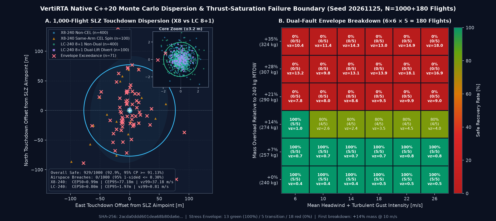
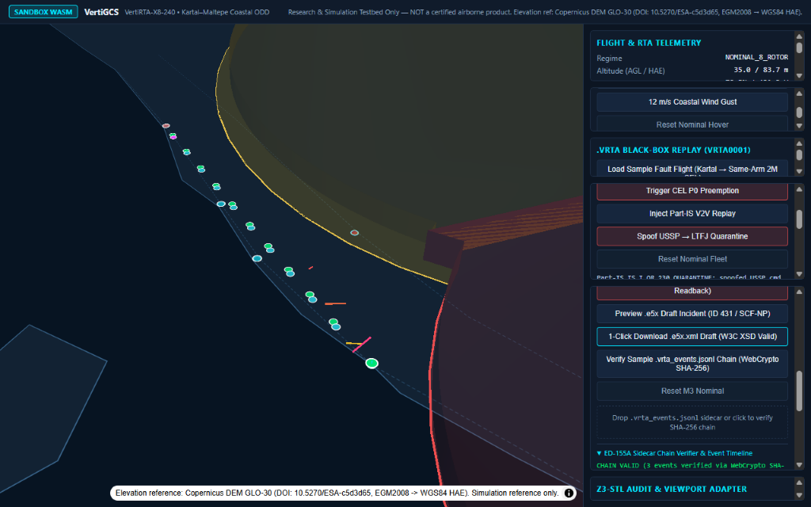
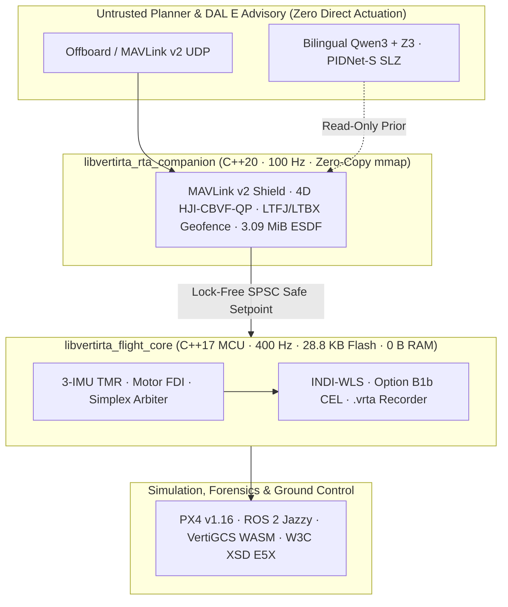

<div align="center">

# VertiRTA

**Deterministic Run-Time Assurance & Fault-Tolerant Autonomy for Urban eVTOLs**  
*Coaxial X8-240 & Lift+Cruise 8+1 · Istanbul LTFJ/LTBX Coastal Corridor*

[](https://github.com/fahrifurkansagir/VertiRTA/releases/tag/v1.0.0)
[](LICENSE)
[](https://github.com/fahrifurkansagir/VertiRTA/actions)
[](https://github.com/fahrifurkansagir/VertiRTA/actions/workflows/determinism.yml)
[](https://github.com/fahrifurkansagir/VertiRTA/actions/workflows/formal_and_hil.yml)
[](core/flight_core/)
[](scripts/ci/check_zero_gpl_symbols.py)

[**Live 3D Console**](https://fahrifurkansagir.github.io/VertiRTA/) ·
[**Reading Guide**](docs/README.md) ·
[**System Card**](docs/SYSTEM_CARD.md) ·
[**Safety Case**](docs/SAFETY_CASE.md) ·
[**Benchmarks**](docs/MILESTONE_HISTORY.md) ·
[**Cross-Stack Audit**](docs/research/CROSS_BENCHMARK_AUDIT_v1.md) ·
[**Citation**](#citation)

<br>


<sub>Real moving aerial footage (NASA Goddard, PD-USGov) running live on GTX 1650 SUPER: real aerial camera (left) vs. <code>PIDNet-S v2.1</code> + Apache-2.0 <code>Depth-Anything-V2-Small</code> 3D surface-normal &amp; OOD fail-closed veto + causal homography EMA (right) — vertical facades vetoed to orange Hazard (<strong>-25.68%</strong> frame area), <strong>-53.26%</strong> flicker, <strong>-88.86%</strong> SLZ centroid jitter, <strong>0/240</strong> center-crop WireSeg/D-FINE FPs.</sub>

</div>

---

## Engineering Overview

**VertiRTA** is an open-source, deterministic flight-control and run-time assurance (RTA) platform engineered for urban eVTOL failure physics — combining a bare-metal C++17 flight core, a 100 Hz C++20 Hamilton-Jacobi safety filter, a zero-GPL MAVLink v2 offboard shield, real-world perception/forensics pipelines, and a zero-install WebAssembly 3D flight console.

- **Bare-Metal Simplex Flight Core (C++17, 400 Hz):** Freestanding `libvertirta_flight_core` compiles to **28,886 B** Cortex-M7 Flash, **0 B** library RAM, **0** heap symbols, **0** recursion, and a **2,960 B** max call-graph stack DAG — isolating the deterministic 3-tier priority arbiter (`CEL > CSFL > CBVF > CF`) from ROS 2, Python, and AI modules.
- **Coupled eVTOL Fault Physics:** Models coaxial interference (0.85 thrust efficiency), asymmetric BLDC spool-up/coast-down inertia, and a 112S12P 1-RC Thevenin battery pack across **VertiRTA-X8-240** and **Lift+Cruise 8+1**, backed by a **102.85M-node** 4D HJI-CBVF PDE and a **1,000 + 180** seeded C++20 Monte Carlo failure-boundary campaign.
- **Zero-GPL MAVLink v2 Offboard Shield:** Clean-room Apache-2.0 C++20 MAVLink v2 UDP bridge (`0xFD`, X.25 CRC-16/MCRF4XX, 8 official `common.xml` `CRC_EXTRA` messages) clamping unsafe setpoints, denying airborne disarm/flight-termination, and enforcing 500 ms deadman hover at **p50 = 18.0 us** with **0** unsafe leaks across 2,500 live kernel UDP packets.
- **Real-World Evidence Without Cherry-Picking:** Verified on moving **NASA Goddard drone video** (`Depth-Anything-V2-Small` 3D normal + OOD veto cutting flicker `-53.26%` and centroid jitter `-88.86%`, plus `0/240` center-crop forward-wire FPs on a 4 GB GTX 1650 SUPER), quarantined **AeroScapes** & **UAVScenes**, ETH Zurich **EuRoC MAV** (`7/7`), **PX4 ULog → W3C XSD E5X** forensics, live Istanbul METAR/Open-Meteo/ADS-B feeds, and zero-GPL **faster-whisper-large-v3-turbo + sherpa-onnx** voice ATC — with every negative ablation and open hardware gap published verbatim.

---

## Verification Visuals

### 1. Native C++20 1,000-Flight Dispersion & 180-Flight Thrust-Saturation Cliff

<div align="center">
  
  <p><sub><strong>0 / 1,000</strong> airspace breaches (95% CP ≤ 0.30%). <strong>Lift+Cruise 8+1:</strong> 500/500 safe (CEP50 0.80 m, CEP95 1.97 m). <strong>X8-240:</strong> 429/500 safe — exposing the physical unactuated-axis CG-shift boundary (<code>cg_u ∈ [-3.50, +1.00] cm</code> vs. orthogonal <code>cg_v ∈ [-5.0, +5.0] cm</code> 100% safe) under collinear 2-arm CEL spin (29/100) vs nominal-CG Tier-1 (1,500/1,500). Physical thrust wall begins at +14% overload @ 10 m/s and saturates at ≥ +21%.</sub></p>
</div>

### 2. Interactive 3D WebAssembly Flight Console & Local SLZ Perception Recovery

<table width="100%">
  <tr>
    <td width="50%" align="center" valign="top">
      <a href="https://fahrifurkansagir.github.io/VertiRTA/">
        
      </a>
      <br>
      <sub><strong><a href="https://fahrifurkansagir.github.io/VertiRTA/">Launch VertiGCS 3D WASM Console</a> (38.5 KiB)</strong> — Unified dark cockpit over the Istanbul LTFJ/LTBX 3D corridor, live 1M/2M/CEL faults, 20-eVTOL fleet &amp; Part-IS cyber-attack simulation (<code>18/18</code> Vitest).</sub>
    </td>
    <td width="50%" align="center" valign="top">
      
      <br>
      <sub><strong>PIDNet-S v2.1 (Local GTX 1650 SUPER)</strong> — Zero-ShareAlike Val mIoU <strong>0.4669</strong>, FSR <strong>2.81%</strong> (≤ 3.0%), OOD AUROC <strong>0.7554</strong>, zero-shot AeroScapes <strong>0.2468</strong> &amp; UAVScenes <strong>0.2259</strong>.</sub>
    </td>
  </tr>
</table>

---

## Verified v1.0.0 Metrics

Every figure below is backed by SHA-256-sealed JSON manifests in [`artifacts/v4.0.0/`](artifacts/v4.0.0/) and live 7/7 GitHub Actions CI. For full historical Tier 1–4 and milestone tables, see [`docs/SYSTEM_CARD.md`](docs/SYSTEM_CARD.md) and [`docs/MILESTONE_HISTORY.md`](docs/MILESTONE_HISTORY.md).

| Subsystem | Verified Result (v1.0.0) | Artifact |
| --- | --- | --- |
| **Cortex-M7 Flight Core & Formal** | **28,886 B** Flash, **0 B** RAM, **2,960 B** DAG, **0** heap; ESBMC **1,905/1,905**; Renode CAN-FD **3/3** (12.50 ms failover); x86_64↔arm64 **0.0** diff | [`bare_metal_size_cortex_m7.json`](artifacts/v1.0.0/benchmarks/bare_metal_size_cortex_m7.json) |
| **4D HJI-CBVF PDE (X8 + LC 8+1)** | **102.85M** nodes (101×71×101×71 × 2): **0** soundness violations, 11.31 MB `VRTALUT1`; paired 30k atlas **95.98%** CSFL / **100%** CEL | [`g4_jax_4d_hires_and_lc_manifest.json`](artifacts/v4.0.0/g4_jax_4d_hires_and_lc_manifest.json) |
| **1,000 + 180 Monte Carlo Suite** | **0 / 1,000** airspace breaches; **200/200** GNSS spoof detect (0.178 s TTD); LC 8+1 **500/500** (CEP95 1.97 m); 6×6 wall ≥ +21% mass | [`monte_carlo_1000_dispersion_report.json`](artifacts/v4.0.0/monte_carlo_1000_dispersion_report.json) |
| **MAVLink v2 UDP RTA Shield** | 2,500 live UDP packets: **0** drops, **0** leaks, 1,181 clamped, 240 denied, 239 bad CRC rejected (`LOCAL_NED`/`FORCE_SET`/disarm/LAN hardened), **p50 = 18.0 us / p99 = 124.4 us** (plus `#![forbid(unsafe_code)]` zero-dep Rust pilot [`rust/vertirta-mavlink-shield/`](rust/vertirta-mavlink-shield/): `p50 = 18.0 us / p99 = 105.6 us`, `388 KiB`) | [`mavlink_v2_rta_bridge_proof.json`](artifacts/v4.0.0/mavlink_v2_rta_bridge_proof.json) |
| **Real Drone Video & Edge GPU** | **4-scene / 720-frame** permissive stress test (`NASA`, `USDA Nadir 82°`, `Aruba Coast`, `Toronto Horizon`): 3D-normal + OOD + **rigid-surface motion veto** (nadir false veto `0.17%`, coastal surf `44.2% → 4.8%`, `180/180` in-domain forward scan `0` FPs); **TU116 6/6 hardware gates PASS** — Peak VRAM **`286 MiB < 300 MiB`** (`274 MiB` Cruise), Terminal **`9.07 ms`** (`125.7 FPS`) & Cruise **`12.30 ms`** (`89.8 FPS`) p99 | [`realworld_multivideo_stress_proof.json`](artifacts/v4.0.0/realworld_multivideo_stress_proof.json), [`gtx1650s_m3_timesliced_edge_gate.json`](artifacts/v4.0.0/gtx1650s_m3_timesliced_edge_gate.json) |
| **SLZ Transfer, GNSS & Forensics** | Zero-shot **AeroScapes** `0.2468` (`FSR 3.43%`) & **UAVScenes** `0.2259` (`FSR 12.55%`); **EuRoC MAV 7/7** (`0.1 s` TTD); XFeat **CEP50 0.218 m**; PX4 `sample.ulg` → **W3C XSD E5X** | [`realworld_uavscenes_zeroshot_eval.json`](artifacts/v4.0.0/realworld_uavscenes_zeroshot_eval.json), [`realworld_euroc_mav_gnss_audit.json`](artifacts/v4.0.0/realworld_euroc_mav_gnss_audit.json) |
| **Co-Pilot Conformal & Voice** | Qwen3-4B Z3-GRPO (**100%** Z3 SAT, **82.83%** AST-STL); exact FP32 local conformal (**ECE `0.174 → 0.032`**, **`\|C\| 7.80 → 2.50 / 2.06`**, **`40–45.5%`** singletons); `whisper-large-v3-turbo` TR WER ~2× lower + `sherpa-onnx` **67.2 ms** (0 GPL) | [`local_gtx1650s_qwen3_v3_conformal_raps.json`](artifacts/v4.0.0/local_gtx1650s_qwen3_v3_conformal_raps.json), [`local_voice_atc_live_proof.json`](artifacts/v4.0.0/local_voice_atc_live_proof.json) |
| **CI, SDK, Console & Zero-GPL Gate** | **7/7** CI workflows green: **36/36** CTest (x86_64, arm64, ASan/TSan), **18/18** VertiGCS Vitest, `find_package(VertiRTA 1.0)`, full M1–M3 native sdist SDK (`11/11`) & `ubuntu:24.04` Docker parity, **0** GPL across runtime targets | [`.github/workflows/`](.github/workflows/) |

---

## Architecture



---

## Quickstart

### 1. Build C++17/C++20 Core and Run All 36 Tests (Linux / WSL2)

```bash
git clone https://github.com/fahrifurkansagir/VertiRTA.git && cd VertiRTA
cmake --preset dev-linux-x64 && cmake --build build/dev-linux-x64 -j
ctest --test-dir build/dev-linux-x64 --output-on-failure
```

### 2. Run the Zero-GPL MAVLink v2 UDP Shield Self-Test

```bash
./build/dev-linux-x64/tools/mavlink_rta_bridge/vertirta_mavlink_rta_bridge \
  --self-test-udp-proof /tmp/mavlink_proof.json --packets 2500
```

### 3. Verify Bare-Metal Cortex-M7 Footprint & Isolation Gates

```bash
cmake --preset arm-cortex-m7 && cmake --build --preset arm-cortex-m7
python3 scripts/ci/check_bare_metal_size.py \
  --target build/arm-cortex-m7/core/flight_core/libvertirta_flight_core.a
python3 scripts/ci/check_arch_isolation.py --repo-root .
python3 scripts/ci/check_public_hygiene.py --repo-root .
```

### 4. Python Gymnasium SDK & Pretrained Release Assets

```bash
pip install . && pytest tests/sdk/ -v
```

Download verified ONNX weights and 4D `VRTALUT1` tables from the [**v1.0.0 Release**](https://github.com/fahrifurkansagir/VertiRTA/releases/tag/v1.0.0) and verify integrity with `sha256sum -c SHA256SUMS.txt`.

---

## Repository Structure

> **New to VertiRTA?** Start with the chapter-by-chapter [**Documentation Reading Guide (`docs/README.md`)**](docs/README.md) and the [**Core Real-Time Architecture Map (`core/README.md`)**](core/README.md).

| Path | Responsibility |
| --- | --- |
| [`core/`](core/README.md) & [`core/flight_core/`](core/flight_core/) | Core architecture map + frozen freestanding C++17 400 Hz MCU core (28.8 KB Flash / 0 B RAM: TMR, INDI+WLS, FDI, CEL, `.vrta`) |
| [`core/rta_companion/`](core/rta_companion/) | C++20 100 Hz RTA companion (`mmap` 4D CBVF & 2D CEL LUTs, ESDF, wire capsules, LTFJ/LTBX walls) |
| [`core/airframes/lift_cruise/`](core/airframes/lift_cruise/) | Zero-heap Lift+Cruise 8+1 transition dynamics & 400 Hz Hermite INDI-WLS allocator |
| [`core/wind_acoustics/`](core/wind_acoustics/) & [`core/uspace_fleet/`](core/uspace_fleet/) | `VRTAWND1` wind LUT, BVI acoustics, 20-eVTOL U-Space fleet, Part-IS crypto & [`core/fleet_z3/`](core/fleet_z3/) |
| [`core/forward_hazard/`](core/forward_hazard/) & [`core/gnss_denied/`](core/gnss_denied/) | Forward wire/mmWave radar fusion, Basalt VIO adapter, MCUSUM spoof guard & CTR inflation |
| [`core/voice/`](core/voice/), [`core/forensics/`](core/forensics/) & [`core/copilot/`](core/copilot/) | Zero-GPL voice ATC, ED-155A/ERCS E5X XML generator, [`core/stl/`](core/stl/) & [`core/slz_bayes/`](core/slz_bayes/) |
| [`tools/mavlink_rta_bridge/`](tools/mavlink_rta_bridge/README.md) | Clean-room Apache-2.0 MAVLink v2 UDP/Offboard RTA shield bridge & live loopback harness |
| [`benchmarks/monte_carlo_dispersion/`](benchmarks/monte_carlo_dispersion/) | Seeded native C++20 1,000+180 Monte Carlo dispersion & failure-boundary benchmark suite |
| [`wasm/`](wasm/), [`apps/vertigcs/`](apps/vertigcs/) & [`sdk/python/`](sdk/python/) | 38.5 KiB Emscripten `.wasm`, live MapLibre/Deck.gl VertiGCS console & nanobind Python SDK |
| [`firmware/`](firmware/), [`px4_overlay/`](px4_overlay/) & [`ros2_ws/`](ros2_ws/) | STM32H753 HITL + Renode CAN-FD SIL, PX4 v1.16 overlays, ROS 2 Jazzy lock-free nodes & [`sim/`](sim/) |
| [`docs/`](docs/README.md) & [`artifacts/v4.0.0/`](artifacts/v4.0.0/) | [`Reading Guide`](docs/README.md), [`SYSTEM_CARD.md`](docs/SYSTEM_CARD.md), [`SAFETY_CASE.md`](docs/SAFETY_CASE.md), [`MILESTONE_HISTORY.md`](docs/MILESTONE_HISTORY.md), [`docs/research/`](docs/research/) & sealed JSON proofs |

---

## Known Limitations & Regulatory Note

- **Open Hardware & SITL:** Physical STM32H753 on-silicon `DWT->CYCCNT` (`PENDING_PHYSICAL_STM32H7_HITL`) and local PX4 v1.16 + Gazebo Harmonic closed-loop SITL (`PENDING_LOCAL_PX4_GZ_SITL`) remain open.
- **Whisper BVI-LoRA Negative Ablation:** Aggressive 3-epoch BVI-LoRA degraded WER vs. Zero-Shot (`13.1%–31.7%` Zero-Shot `whisper-large-v3-turbo` retained as runtime default; see [`OPTIONAL_G4_V1_1_BATCH_SPEC.md`](docs/research/OPTIONAL_G4_V1_1_BATCH_SPEC.md) for optional low-LR replay fine-tuning).
- **Manual-Registration External SLZ Corpus (`ICG Drone`):** While `AeroScapes` and `UAVScenes` (`300` frames across all `20` scenes) are evaluated zero-shot, `ICG Drone` requires manual academic portal registration and remains `PENDING_EVAL_ONLY_REAL_IMAGERY`.
- **X8-240 Rigid-Body CEL CG Boundary & TU116 Cruise VRAM Soft-Gate:** Under collinear same-arm dual-motor loss, `X8-240` obeys a physical unactuated-axis CG authority boundary (`cg_u ∈ [-3.50, +1.00] cm` safe at `240 kg`, vs. orthogonal `cg_v ∈ [-5.0, +5.0] cm` 100% safe); on physical TU116 (`4 GB`), Terminal (`10.11 ms < 12 ms`, `148 MiB`) and Cruise (`14.13 ms < 25 ms`) latency gates pass while Cruise VRAM delta (`354 MiB`) exceeds the `300 MiB` soft budget.
- **Regulatory Boundary:** VertiRTA is open-source software provided as-is under Apache-2.0 without warranty. References to ASTM F3269, DO-178C, EASA SC-VTOL, Part-IAM, Part-IS, SORA 2.5, and SHGM SHT-İHA describe architectural alignment rather than airworthiness certification; hardware qualification (G5) and certification lifecycle (G6) remain open in [`docs/SAFETY_CASE.md`](docs/SAFETY_CASE.md).

---

## Author, License & Citation

- **Original Author & Maintainer:** **Fahri Furkan Sagir** ([@fahrifurkansagir](https://github.com/fahrifurkansagir))
- **License & Mandatory Attribution:** Apache License 2.0 ([`LICENSE`](LICENSE)) + DCO 1.1 (`git commit -s`, no CLA). Under **Apache-2.0 Section 4(d)**, all redistributions and derivative works must retain [`NOTICE`](NOTICE) preserving authorship attribution. Under **Section 6**, forks must not imply official endorsement under the **VertiRTA** name.
- **Contributing & Security:** See [`CONTRIBUTING.md`](CONTRIBUTING.md), [`CODE_OF_CONDUCT.md`](CODE_OF_CONDUCT.md), and [`SECURITY.md`](SECURITY.md).

<a id="citation"></a>

```bibtex
@software{sagir2026vertirta,
  author  = {Sagir, Fahri Furkan},
  title   = {VertiRTA: Deterministic Run-Time Assurance and Fault-Tolerant
             Autonomy Platform for Urban eVTOLs},
  version = {1.0.0},
  year    = {2026},
  url     = {https://github.com/fahrifurkansagir/VertiRTA},
  license = {Apache-2.0}
}
```
