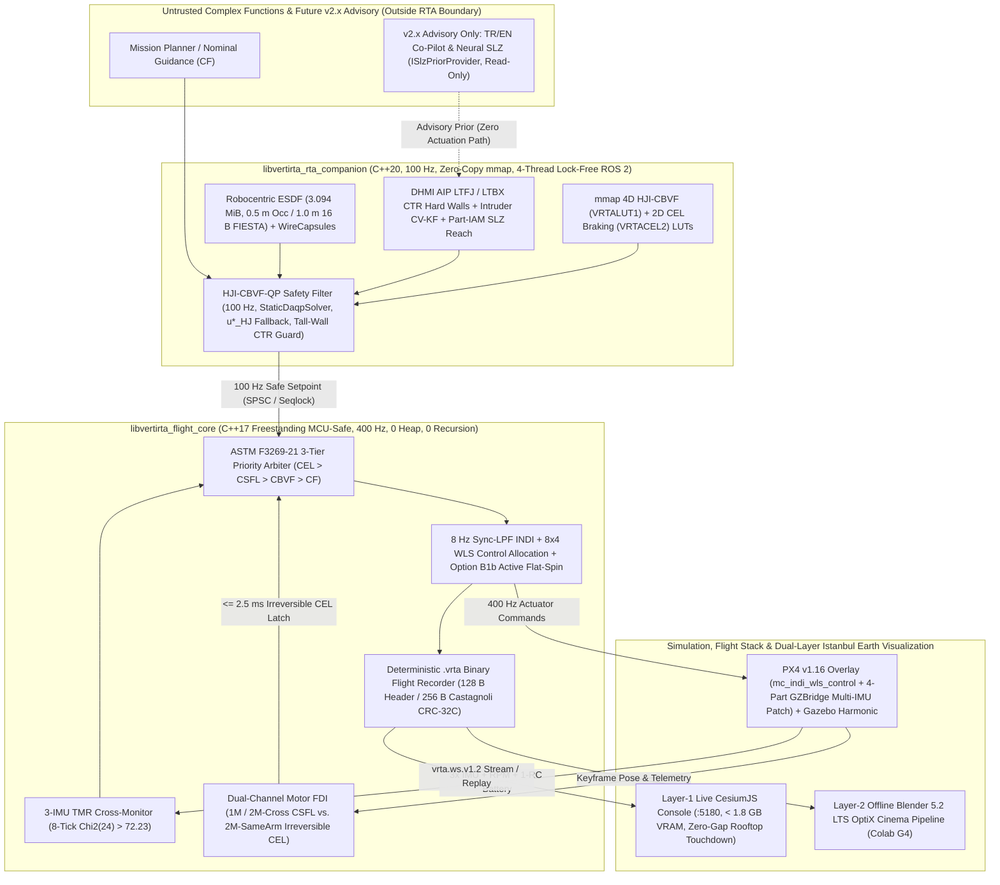
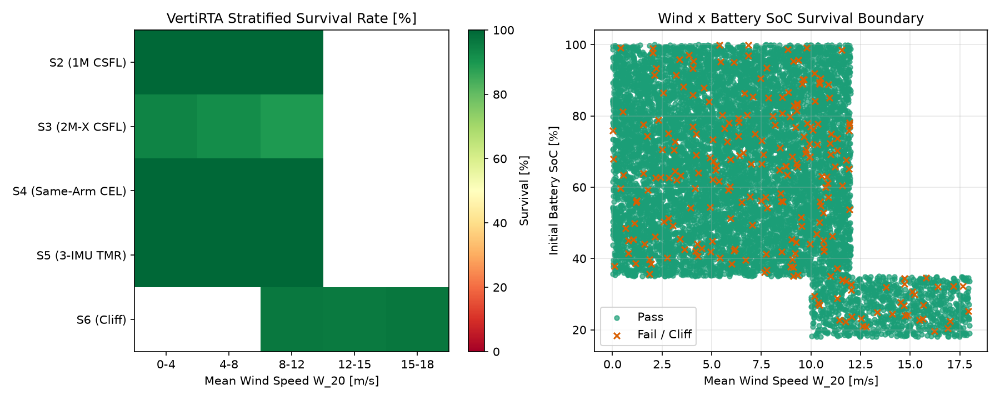

# VertiRTA

**Vertical Run-Time Assurance & Fault-Tolerant Flight Control for a 240 kg Coaxial X8 Urban eVTOL (`VertiRTA-X8-240`)**

[](LICENSE)
[](core/flight_core/CMakeLists.txt)
[](core/rta_companion/CMakeLists.txt)
[](BENCHMARKS.md)

`VertiRTA` is a 100% open-source, deterministic flight-control and run-time assurance (RTA) stack engineered for a **`240 kg` coaxial X8 urban eVTOL** operating along the **Istanbul Maltepe – Dragos – Kartal coastal corridor**, tightly bounded by real DHMİ AIP Turkey **`LTFJ` (Sabiha Gökçen)** and **`LTBX` (Samandıra)** controlled airspace walls.

Unlike quadrotor toy demos, `VertiRTA` models and verifies the hard coupled physics of urban coaxial eVTOLs:
- **Coaxial aerodynamic interference** (`eta_coax = 0.85`), asymmetric BLDC spool-up/coast-down inertia (`tau_up = 85 ms`, `tau_down = 120 ms`, `tau_coast = 424 ms`), and **`112S12P` (`403.2 V`, `21.77 kWh`) 1-RC Thevenin battery sag** under high-current failure recovery ([`config/vehicle_x8_240.yaml`](config/vehicle_x8_240.yaml)).
- **True `ASTM F3269-21` 3-Tier Simplex RTA Isolation:** a bare-metal-ready **`400 Hz` C++17 flight core** (`28,886 B` Cortex-M7 Flash, `0 B` library RAM, `0` heap symbols, `0` recursion cycles) coupled to a **`100 Hz` C++20 RTA companion** using `mmap`'d 4D Hamilton-Jacobi Control Barrier Value Function (`HJI-CBVF`) and 2D Controlled Emergency Landing (`CEL`) lookup tables, `3.094 MiB` robocentric ESDF, thin-wire capsules, and real `LTFJ`/`LTBX` hard geofence walls.
- **Physics-Honest Fault Tolerance (CSFL vs. CEL):** single-motor (`1M`) and cross-arm dual-motor (`2M-Cross`) failures retain 4-DOF controllability via 400 Hz synchronized-LPF **INDI + 8×4 WLS (`StaticDaqpSolver`)** for **Continued Safe Flight and Landing (CSFL)**; **same-arm coaxial-pair dual loss** removes all lift on one boom and irreversibly latches (`<= 2.5 ms`) into **Option B1b active flat-spin descent** (`|Omega_z| = 2.2 rad/s`, `+10.6°` phase lead) for last-resort **Controlled Emergency Landing (CEL)** survivability — achieving **`100.00%`** (`1,500 / 1,500`) CEL survival vs. **`0.00%`** for stock allocation.

> [!IMPORTANT]
> **Non-Certification & Legal Scope Disclaimer**
>
> `VertiRTA` (`libvertirta_flight_core` + `libvertirta_rta_companion`) is an **open-source research, simulation, and software-verification testbed** — **NOT** a certified airborne product, **NOT** a Type Certificate (TC/STC) basis, and **NOT** approved for flight on any manned or unmanned aircraft.
>
> 1. **Zero Airworthiness Claims:** References to EASA `SC-VTOL-02`, `MOC-5`, `Reg. (EU) 2024/1111` (`Part-IAM`), `SORA 2.5`, `SHGM SHT-İHA`, `ASTM F3269-21`, `SAE ARP4761A`, `DO-178C`, and `SCSC-141C` represent **architectural design drivers and academic assurance alignment ONLY** (see [`docs/SAFETY_CASE.md`](docs/SAFETY_CASE.md) and [`docs/standards_registry.yaml`](docs/standards_registry.yaml)).
> 2. **Strict Regulatory Regime Separation:** Passenger carriage is excluded from `SORA 2.5`. `VertiRTA` separates **Stage-A** (`25 kg` unmanned subscale experimental CONOPS, `0` passengers) from **Stage-B** (`240 kg` simulated `VertiRTA-X8-240` UAM reference architecture).
> 3. **Honest CSFL vs. CEL Boundary:** Same-arm coaxial dual-motor loss abandons yaw via Option B1b flat-spin descent and is explicitly exempted from passenger-grade CSFL — framed strictly as last-resort CEL survivability.
> 4. **No Bare-Metal RTOS WCET or `10^-9 / FH` Proofs:** Linux user-space timings are CI performance regression metrics ONLY (never DO-178C bare-metal WCET evidence), and stratified Monte Carlo bounds conditional recovery inside [`verification/ODD.yaml`](verification/ODD.yaml) ONLY (proving `<= 10^-9 / FH` at 95% confidence requires `2,995,732,273` independent zero-failure flight hours).
> 5. **AI Advisory Isolation:** Future `v2.x` neural/LLM modules operate strictly outside the deterministic RTA boundary (`DAL E`, read-only telemetry snapshots, zero closed-loop actuation authority).

---

## System Architecture



### Core Engineering Highlights

| Layer | Component | Key Technical Lock | Source |
| --- | --- | --- | --- |
| **Vehicle & Corridor** | `VertiRTA-X8-240` & Istanbul `LTFJ`/`LTBX` | `240 kg` MTOW, `T/W = 2.5` (`5,886 N`), `8` coaxial rotors (`R = 0.75 m`, `arm = 1.35 m`, `eta_coax = 0.85`), `112S12P` `403.2 V` `21.77 kWh` pack (`320 Wh/kg`), corridor west of `LTFJ` NW `J2` (`29.192122° E`) | [`config/vehicle_x8_240.yaml`](config/vehicle_x8_240.yaml), [`config/istanbul_ltfj_airspace.yaml`](config/istanbul_ltfj_airspace.yaml) |
| **400 Hz Flight Core** | `libvertirta_flight_core` (C++17 MCU) | 3-IMU TMR voter, 8 Hz 2nd-order Butterworth INDI + 8×4 WLS (`StaticDaqpSolver` with recursion-free `daqp_auxiliary_norec.c`), dual-channel Motor FDI, Option B1b flat spin (`2.2 rad/s`, `+10.6°` phase lead), `256 B` CRC-32C `.vrta` recorder | [`core/flight_core/`](core/flight_core/CMakeLists.txt) |
| **100 Hz RTA Companion** | `libvertirta_rta_companion` (C++20) | Pre-faulted `mmap` 4D `HJI-CBVF` (`VRTALUT1`) & 2D `CEL` (`VRTACEL2`) LUTs, `u*_HJ` cone fallback, `+1.5 m` clutter inflation, `z_eff < -5.0 m` horizontal CTR braking, `3.094 MiB` robocentric `0.5 m`/`1.0 m` FIESTA ESDF, 1D `WireCapsules`, `IntruderKF`, `ISlzPriorProvider` | [`core/rta_companion/`](core/rta_companion/CMakeLists.txt) |
| **Flight Stack & Sim** | PX4 v1.16 + ROS 2 Jazzy + Gazebo Harmonic | Custom `mc_indi_wls_control` PX4 module, 4-part `GZBridge` multi-IMU patch, coaxial propulsion & Tustin MIL-F-8785C Dryden wind Gazebo plugins, 4-thread lock-free SPSC/Seqlock ROS 2 nodes | [`px4_overlay/`](px4_overlay/modules/mc_indi_wls_control/mc_indi_wls_control.hpp), [`sim/`](sim/models/vertirta_x8_240/model.sdf), [`ros2_ws/`](ros2_ws/src/vertirta_rta_node/package.xml) |
| **Assurance & Earth Viz** | 2-Tier Verification Pyramid + `SCSC-141C` GSN v3 | Stratified LHS 10k 6-DOF atlas + A/B ablations, zero-cherry-picking failure cliff ledger, CI-hashed living safety case, CesiumJS live console (`:5180`), offline Blender 5.2 LTS OptiX cinema pipeline | [`verification/`](verification/ODD.yaml), [`docs/SAFETY_CASE.md`](docs/SAFETY_CASE.md), [`viz/`](viz/cesium/README.md) |

---

## Measured `v1.0.0` Verification & Benchmark Results

All numbers below are measured live at commit **`ef9be75`** and backed by versioned artifacts in [`artifacts/v1.0.0/`](artifacts/v1.0.0/gsn_evidence_hashes.json) and [`BENCHMARKS.md`](BENCHMARKS.md). Unexecuted cloud ARM64 or SITL targets are explicitly marked **`PENDING_*`** — zero numbers are extrapolated or fabricated.

### 1. Tier 1 — Bare-Metal ARM Cortex-M7 Footprint, Stack/DAG, Zero-Heap & Sanitizers

| Metric | Target / Tool | Measured Value | Budget / Gate | Status | Artifact |
| --- | --- | --- | --- | --- | --- |
| Cortex-M7 Flash (`.text + .data`) | `arm-none-eabi-size` (`-Os`, `11` objs) | `28,886 B` (`28.21 KiB`) | `< 262,144 B` (`256 KiB`) | `PASS` | [`bare_metal_size_cortex_m7.json`](artifacts/v1.0.0/benchmarks/bare_metal_size_cortex_m7.json) |
| Cortex-M7 Library Static RAM (`.data + .bss`) | `arm-none-eabi-size` (caller owns static `.bss`) | `0 B` | `< 131,072 B` (`128 KiB`) | `PASS` | [`bare_metal_size_cortex_m7.json`](artifacts/v1.0.0/benchmarks/bare_metal_size_cortex_m7.json) |
| Cortex-M7 Max Static Frame (`-fstack-usage`) | `arm-none-eabi-g++ 14.2.1` (`77` fns, `0` dynamic) | `1,496 B` | `<= 4,096 B` | `PASS` | [`stack_usage_cortex_m7.json`](artifacts/v1.0.0/benchmarks/stack_usage_cortex_m7.json) |
| Cortex-M7 Max Call-Graph DAG (`-fcallgraph-info`) | `arm-none-eabi-g++ 14.2.1` (`98` nodes, `0` recursion) | `2,960 B` | `<= 16,384 B` | `PASS` | [`stack_usage_cortex_m7.json`](artifacts/v1.0.0/benchmarks/stack_usage_cortex_m7.json) |
| Host x86_64 Max Frame / Call-Graph DAG | `g++ 15.2.0` (`74` fns, `105` nodes, `0` recursion) | `2,112 B` / `5,280 B` | `<= 4,096 B` / `<= 16,384 B` | `PASS` | [`stack_usage_x86_64.json`](artifacts/v1.0.0/benchmarks/stack_usage_x86_64.json) |
| Zero-Heap Symbol Audit (x86_64 & Cortex-M7) | `nm` & `arm-none-eabi-nm` + `-Wl,--wrap=malloc` | `0` / `0` forbidden | `0` symbols | `PASS` | [`no_heap_x86_64.json`](artifacts/v1.0.0/benchmarks/no_heap_x86_64.json), [`no_heap_cortex_m7.json`](artifacts/v1.0.0/benchmarks/no_heap_cortex_m7.json) |
| `ASTM F3269-21` Core Isolation | `check_arch_isolation.py` (`37` files) | `0` violations | `0` violations | `PASS` | [`arch_isolation_report.json`](artifacts/v1.0.0/benchmarks/arch_isolation_report.json) |
| Release x86_64 Unit & No-Heap Suite | `ctest --preset release-linux-x64` | `8 / 8` passed (`1.00 s`) | `100%` pass | `PASS` | [`ctest_release_x86_64.xml`](artifacts/v1.0.0/benchmarks/ctest_release_x86_64.xml) |
| Memory & Concurrency Sanitizers (Local WSL2) | `ctest --preset asan-ubsan` + `test_spsc_tsan` (`-fsanitize=thread`) | `7 / 7` ASan/UBSan; `1,000,000+` SPSC/Seqlock ops, `0` races, `0` torn reads | `0` sanitizer errors | `PASS` | Verified locally at `ef9be75` ([`CMakePresets.json`](CMakePresets.json), [`tests/integration/CMakeLists.txt`](tests/integration/CMakeLists.txt)) |

> Worst-case Cortex-M7 static call-graph chain (`2,960 B`): `IndiWlsController::step_400hz -> wls_alloc_8x4_f64`.

### 2. Tiers 2, 3 & 4 — Deterministic `.vrta` Replay & Per-Tick Execution Latency

Measured via Release `vertirta_bench_cli` (`lut_loaded: true`: full `100 Hz` HJI-CBVF-QP safety filter + `400 Hz` INDI-WLS control allocator step per tick against the `10,000 us` outer-loop frame budget):

| Tier | Target Runner / Arch | Mode / Scope | Ticks / Frames | `mean` (us) | `p50` (us) | `p99` (us) | `p99.9` (us) | `max` (us) | Steal / Status |
| --- | --- | --- | --- | --- | --- | --- | --- | --- | --- |
| **Tier 2** | `x86_64` (Local WSL2) | Same-ISA 0-ULP `.vrta` Replay (`corridor_faults.vrta`, `512,128 B`, `1,400` CEL frames) | `2,000` frames (`20.0 s`) | — | — | — | — | — | `PASS` (`run1 == run2` SHA-256) |
| **Tier 2** | `x86_64 <-> arm64` CI | Cross-ISA Parity (`< 1e-12` continuous, `0` mode divergence) | `2,000` frames | — | — | — | — | — | `PENDING_GITHUB_ACTIONS_ARM64` |
| **Tier 3** | `x86_64` (Local WSL2) | `CLOCK_THREAD_CPUTIME_ID` | `100,000` ticks | `1.2841` | `1.2400` | `1.9000` | `11.5690` | `55.3490` | `MEASURED_LOCAL` |
| **Tier 4** | `x86_64` (Local WSL2) | `CLOCK_MONOTONIC_RAW` + `/proc/stat` | `50,000` ticks | `0.5780` | `0.5400` | `0.9500` | `1.5900` | `32.0690` | `0.0%` (`CLEAN`) |
| **Tier 3** | `x86_64` (`ubuntu-24.04` CI) | `perf stat` / `valgrind --tool=callgrind` `Ir/tick` | `1,000` ticks | `PENDING` | `PENDING` | `PENDING` | `PENDING` | `PENDING` | `PENDING_GITHUB_ACTIONS_X86_PMU` |
| **Tier 3/4** | `arm64` (`ubuntu-24.04-arm`) | Azure Cobalt 100 (`Ir/tick` + `CLOCK_MONOTONIC_RAW`) | `PENDING` | `PENDING` | `PENDING` | `PENDING` | `PENDING` | `PENDING` | `PENDING_GITHUB_ACTIONS_ARM64` |

> **WCET Caveat:** User-space Linux timings (`BENCHMARKS.md` Tiers 3–4) are indicative CI regression telemetry ONLY and do **NOT** constitute DO-178C / EASA bare-metal RTOS WCET certification evidence. Raw artifacts: [`tier2_same_isa_x86_64.json`](artifacts/v1.0.0/tier2_same_isa_x86_64.json), [`tier3_thread_cputime_x86_64.json`](artifacts/v1.0.0/benchmarks/tier3_thread_cputime_x86_64.json), [`tier4_wallclock_x86_64.json`](artifacts/v1.0.0/benchmarks/tier4_wallclock_x86_64.json).

### 3. Live Tier-1 10,000-Run 6-DOF Survival Envelope Atlas + A/B Ablations (`30,000` Simulations)

Executed live via Release `vertirta_6dof_batch_cli` (`seed = 20261122`, total wall-clock `77.32 s` across `30,000` simulations). Full Clopper-Pearson & Wilson bounds: [`tier1_10k_clopper_pearson.json`](artifacts/v1.0.0/tier1_atlas/tier1_10k_clopper_pearson.json).

| Configuration | CSFL Pool (`S2+S3+S5`, `n = 6,500`) | CSFL 95% CP Upper Fail Bound | CEL Pool (`S4` Same-Arm, `n = 1,500`) | CEL 95% CP Upper Fail Bound | Wall-Clock (`10k`) |
| --- | --- | --- | --- | --- | --- |
| **`HJ-CBVF + INDI-WLS` (Primary)** | **`96.82%`** (`6,293 / 6,500`, `k = 207`) | `0.035665` | **`100.00%`** (`1,500 / 1,500`, `k = 0`) | `0.001995` | `33.083 s` |
| `HOCBF + INDI-WLS` (CBVF Ablation) | `44.85%` | `0.561743` | `100.00%` | `0.001995` | `23.111 s` |
| `HJ-CBVF + Stock CA` (Allocation Ablation) | `96.82%` | `0.035665` | `0.00%` (`0 / 1,500` capsize) | `1.000000` | `17.667 s` |

#### Per-Stratum Breakdown (`HJ-CBVF + INDI-WLS`, `n = 10,000`, `244` Total Failures = `97.56%` Overall)

| Stratum | Fault / Envelope Regime | `n` | Failures (`k`) | Empirical Pass Rate | 95% One-Sided CP Upper Fail Bound |
| --- | --- | --- | --- | --- | --- |
| `S1` | Nominal Corridor Operations | `1,000` | `0` | `100.00%` | `0.002991` |
| `S2` | Single-Motor Loss (`1M`, CSFL Pool) | `2,500` | `0` | `100.00%` | `0.001198` |
| `S3` | Cross-Arm Dual-Motor Loss (`2M-Cross`, CSFL Pool) | `2,500` | `207` | `91.72%` | `0.092433` |
| `S4` | Same-Arm Coaxial Dual Loss (`2M-SameArm`, CEL Pool) | `1,500` | `0` | `100.00%` | `0.001995` |
| `S5` | TMR Sensor Fault + Low-SoC Reserve (CSFL Pool) | `1,500` | `0` | `100.00%` | `0.001995` |
| `S6` | Out-of-ODD Boundary Stress | `1,000` | `37` | `96.30%` | `0.048390` |

> **Zero-Cherry-Picking Policy:** Every single one of the **`244 / 10,000`** failed simulations (concentrated in extreme cross-arm dual-motor loss + boundary wind/SoC stress corners in `S3` and `S6`) is logged with exact seed, initial state, violated invariant, and root-cause class in [`artifacts/v1.0.0/tier1_atlas/failure_cliff_ledger.json`](artifacts/v1.0.0/tier1_atlas/failure_cliff_ledger.json).




---

## Honest Verification Scope Matrix

| Environment | What Runs & What Is Proven | Current `v1.0.0` Status |
| --- | --- | --- |
| **Local Linux / WSL2 (`x86_64` + `arm-none-eabi`)** | C++17/20 Release builds (`8/8` `ctest`), ASan/UBSan (`7/7`), TSan lock-free SPSC/Seqlock (`1M+` ops), Cortex-M7 Flash/RAM/stack/DAG/zero-heap gates, `ASTM F3269-21` isolation (`37` files), Tier-2 Same-ISA 0-ULP `.vrta` replay, Tier-3/4 local latency, live `30,000`-sim Tier-1 6-DOF Survival Atlas & A/B plots, `SCSC-141C` GSN v3 safety case generation | **VERIFIED LOCALLY (`ef9be75`)** |
| **GitHub Actions CI (`.github/workflows/determinism.yml`)** | `ubuntu-24.04-arm` (Azure Cobalt 100) cross-ISA `< 1e-12` `.vrta` replay parity, ARM64 latency (`Sn8`–`Sn10`), and `ubuntu-24.04` `perf stat` / `callgrind` `Ir/tick` | **`PENDING_GITHUB_ACTIONS_ARM64` / `PENDING_GITHUB_ACTIONS_X86_PMU`** |
| **Local SITL Host (`PX4 v1.16` + `Gazebo Harmonic` + `ROS 2 Jazzy`)** | Tier-2 1,000-run hot-reset PX4/Gazebo SITL (`Sn5`) & Tier-3 50-run EGL LiDAR SITL (`Sn6`); PX4 overlay, 4-part `GZBridge` patch, Gazebo plugins/SDF, ROS 2 nodes, and runners are checked in and unit-tested | **`PENDING_LOCAL_PX4_GZ_SITL`** |
| **Cloud GPU (Google Colab G4 Blackwell / L4)** | High-resolution JAX 4D HJI-CBVF & 2D CEL LUT synthesis ([`reachability/solve_cbvf_luts.py`](reachability/solve_cbvf_luts.py)) and offline Blender 5.2 LTS OptiX cinema renders ([`viz/blender/colab_render_cinema.ipynb`](viz/blender/colab_render_cinema.ipynb)) | **READY (ON-DEMAND COLAB)** |

---

## Reproducible 3-Command Quickstart

### 1. Build & Verify C++17/C++20 Core, Sanitizers, and Bare-Metal Cortex-M7 Gates

```bash
./scripts/setup_wsl2_ubuntu24.sh --check-only
cmake --preset release-linux-x64 && cmake --build --preset release-linux-x64 && ctest --preset release-linux-x64
cmake --preset asan-ubsan && cmake --build --preset asan-ubsan && ctest --preset asan-ubsan
cmake -S tests/integration -B build/integration-tsan -G Ninja -DVERTIRTA_ENABLE_TSAN=ON \
  && cmake --build build/integration-tsan && ctest --test-dir build/integration-tsan --output-on-failure
cmake --preset arm-cortex-m7 && cmake --build --preset arm-cortex-m7
python3 scripts/ci/check_arch_isolation.py
python3 scripts/ci/check_bare_metal_size.py --target build/arm-cortex-m7/core/flight_core/libvertirta_flight_core.a
python3 scripts/ci/check_no_heap_symbols.py --archive build/arm-cortex-m7/core/flight_core/libvertirta_flight_core.a --nm-bin arm-none-eabi-nm
python3 scripts/ci/check_stack_usage.py --build-dir build/arm-cortex-m7/core/flight_core
```

### 2. Reproduce the 10,000-Run Tier-1 Survival Atlas, A/B Plots & Living Safety Case

```bash
python3 -m verification.monte_carlo.run_tier1_6dof_atlas \
  --tier tier1_10k --seed 20261122 --run-ab --plot \
  --out-dir build/atlas_tier1_repro
python3 verification/gsn/build_gsn.py --hashes-json artifacts/v1.0.0/gsn_evidence_hashes.json --git-sha ef9be75
```

### 3. Launch the Layer-1 Live Istanbul Tactical Earth Console (`:5180`)

```bash
python3 -m viz.cesium.ws_server --host 127.0.0.1 --port 5180 --vrta tests/fixtures/corridor_faults.vrta
# Then open http://127.0.0.1:5180/ (configure your own basemap token or use zero-token open_grid_offline mode)
```

*(Note: `*.vrta` flight captures are excluded from git by default via [`.gitignore`](.gitignore); regenerate a corridor replay capture locally via `build/release-linux-x64/tools/cli/vertirta_replay_cli` or `vertirta_6dof_batch_cli` if starting from a fresh clone.)*

---

## Repository Architecture Map

| Path | Role |
| --- | --- |
| [`core/flight_core/`](core/flight_core/CMakeLists.txt) | Freestanding C++17 MCU-safe `400 Hz` core: frames, geodesy, 3-IMU TMR, coaxial envelope, INDI+WLS, Motor FDI, static DAQP, `.vrta` CRC-32C recorder, 6-DOF plant |
| [`core/rta_companion/`](core/rta_companion/CMakeLists.txt) | C++20 `100 Hz` RTA companion: `mmap` 4D CBVF & 2D CEL LUTs, Dryden wind, HJI-CBVF-QP safety filter, `3.094 MiB` robocentric ESDF, wire capsules, intruder CV-KF, `LTFJ`/`LTBX` CTR walls, `ISlzPriorProvider` & SLZ reachability |
| [`core/stl/`](core/stl/CMakeLists.txt) & [`core/copilot/`](core/copilot/CMakeLists.txt) | C++20 Pillar-2 advisory stack (`DAL E`, isolated from 100 Hz RTA): zero-heap quantitative STL monitor (`FixedMonotonicWedge` + RoSI), compact `<=30`-token GBNF DSL, `QF_LRA` Z3 corridor verifier + 1-pass UNSAT repair, RAII `libllama` engine, `KnowNo` Split Conformal gate (`q_lvl = 0.955`) |
| [`core/slz_bayes/`](core/slz_bayes/CMakeLists.txt) | C++20 Pillar-3 active visual SLZ core: RAII ONNX Runtime V2 EP runner, dual-mode RGB-D / affine monocular geometry, cell-local `1.5625 MiB` 2.5D Bayesian SLZ grid with OOD variance floor, 5-state `ActiveInspectionPolicy` (`ISlzPriorProvider`) & V2.1 `IForwardHazardProvider` stub |
| [`benchmarks/vertibench_tr_en/`](benchmarks/vertibench_tr_en/README.md) & [`ml/`](ml/copilot/train_sft_grpo.py) | Apache-2.0 `VertiBench-TR/EN` (`< 0.15` Jaccard ARM64 CI), Colab G4 `Qwen3-8B/4B` SFT→Z3-GRPO (`spawn` Z3 pool), zero-ShareAlike 5-source SLZ license gate + OEM-41 whitelist, static-PAPPM `PIDNet-S` Opset-17 ONNX export, and zero-shot real eval suite |
| [`tools/cli/`](tools/cli/CMakeLists.txt) | Deterministic replay (`vertirta_replay_cli`), latency benchmarking (`vertirta_bench_cli`), and batch 6-DOF atlas (`vertirta_6dof_batch_cli`) CLIs |
| [`px4_overlay/`](px4_overlay/airframes/12050_gz_vertirta_x8_240) | PX4 v1.16 coaxial X8 airframe (`12050`), `mc_indi_wls_control` module, uORB/DDS contracts, and 4-part `GZBridge` multi-IMU patch |
| [`sim/`](sim/models/vertirta_x8_240/model.sdf) | Gazebo Harmonic `VertiRTA-X8-240` SDF model, Kartal coastal world, coaxial propulsion & Dryden wind plugins, plus Colab-G4 kinematic EGL gimbal rig & `active_vision_ablation_runner` ([`sim/colab_egl/`](sim/colab_egl/CMakeLists.txt)) |
| [`ros2_ws/`](ros2_ws/src/vertirta_bringup/package.xml) | ROS 2 Jazzy packages (`vertirta_msgs`, `vertirta_rta_node`, `vertirta_map_node`, `vertirta_px4_bridge`, `vertirta_fault_injector`, `vertirta_bringup`, `vertirta_mission_node`, `vertirta_perception_node`) |
| [`reachability/`](reachability/cbvf_4d_dynamics.py) | Offline JAX / `hj_reachability` 4D HJI-CBVF (`VRTALUT1`) and 2D CEL (`VRTACEL2`) solvers + soundness verifier |
| [`verification/`](verification/ODD.yaml) | Machine-readable ODD & `Part-IAM` reserve validator, stratified LHS 2-tier Monte Carlo suite, failure cliff ledger, `SCSC-141C` GSN v3 builder |
| [`viz/`](viz/cesium/README.md) | Dual-layer Istanbul Earth visualization: Layer-1 live CesiumJS console (`:5180`), Layer-2 offline Blender 5.2 LTS OptiX cinema pipeline, ODbL/DEM corridor builder |
| [`docs/`](docs/SAFETY_CASE.md) & [`.zenodo.json`](.zenodo.json) | Living Safety Case ([`SAFETY_CASE.md`](docs/SAFETY_CASE.md)), reproducible 6–8p IEEE/arXiv LaTeX report ([`docs/paper/vertirta_tech_report.tex`](docs/paper/vertirta_tech_report.tex)), derivations ([`MATH_DERIVATIONS.md`](docs/MATH_DERIVATIONS.md)), FHA/FMEA traceability ([`FHA_FMEA_TRACEABILITY.md`](docs/FHA_FMEA_TRACEABILITY.md)), standards registry ([`standards_registry.yaml`](docs/standards_registry.yaml)), and Deep Research archive |
| [`scripts/ci/`](scripts/ci/check_arch_isolation.py) & [`.github/workflows/`](.github/workflows/determinism.yml) | Automated 4-tier determinism, zero-heap, Cortex-M7 footprint, stack/DAG, architecture isolation, and `VertiBench-TR/EN` anti-contamination ARM64 CI gates |
| [`BENCHMARKS.md`](BENCHMARKS.md) & [`artifacts/v1.0.0/`](artifacts/v1.0.0/gsn_evidence_hashes.json) | Complete measured `v1.0.0` benchmark tables, JSON reports, SHA-256 registry, failure cliff ledger, and plots |

---

## Release Status

- **`v1.0.0` (Shipped & Verified):** Deterministic C++17/C++20 `VertiRTA` flight core + RTA companion (`28,886 B` Cortex-M7 Flash / `0 B` RAM), PX4 v1.16 / ROS 2 Jazzy / Gazebo Harmonic overlays, live 30,000-sim Tier-1 6-DOF Survival Atlas + A/B ablations, CI-hashed `SCSC-141C` GSN v3 Living Safety Case, and dual-layer Istanbul Earth visualization.
- **`v2.0.0-alpha` (Shipped & Verified — Advisory Only):** Turkish/English Neuro-Symbolic Z3-Verified Contingency Co-Pilot (`core/stl/`, `core/copilot/`, real `z3-solver` SMT-LIB2 cross-checked, `KnowNo` Split Conformal gate), Apache-2.0 `VertiBench-TR/EN` + `< 0.15` Jaccard ARM64 CI, Colab G4 `Qwen3-8B/4B` SFT→Z3-GRPO RLVR pipeline, and isolated ROS 2 `vertirta_mission_node` (TSan `0` data races). *(Colab G4 GPU fine-tuning & human-audited benchmark eval pending Colab run.)*
- **`v2.0.0` (Shipped & Verified — Advisory Only):** Active Visual Safe Landing Zone (SLZ) stack (`core/slz_bayes/` cell-local `1.5625 MiB` grid + OOD variance floor + 5-state `ActiveInspectionPolicy` wired via `ISlzPriorProvider`), zero-ShareAlike 5-source `PIDNet-S` Opset-17 ONNX export, Colab-G4 kinematic EGL rig & 60-seed `active_vision_ablation_runner`, isolated `vertirta_perception_node`, and manifest-driven 6–8p IEEE/arXiv LaTeX report (`docs/paper/`) + `.zenodo.json`. *(Colab G4 distillation/EGL ablation & local GTX 1650 SUPER ORT smoke pending GPU execution.)*

---

## License & Data Attribution

- **Source Code:** Licensed under the **Apache License 2.0** — see [`LICENSE`](LICENSE) (`Copyright 2026 VertiRTA Contributors`).
- **Geospatial & Third-Party Tiles:** No commercial satellite imagery, API keys, or ODbL vector dumps are bundled in this repository. Layer-1 CesiumJS uses swappable runtime basemap providers (`open_grid_offline` zero-token fallback supported); Layer-2 Blender offline rendering uses strictly open-license datasets (Copernicus GLO-30 DEM, Sentinel-2 L2A, OpenStreetMap `© OpenStreetMap contributors` ODbL) kept cleanly segregated under `viz/geo/data/`.
