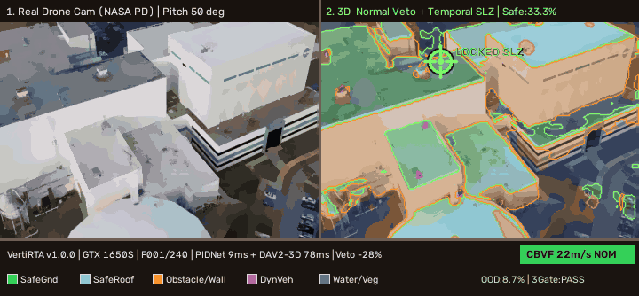
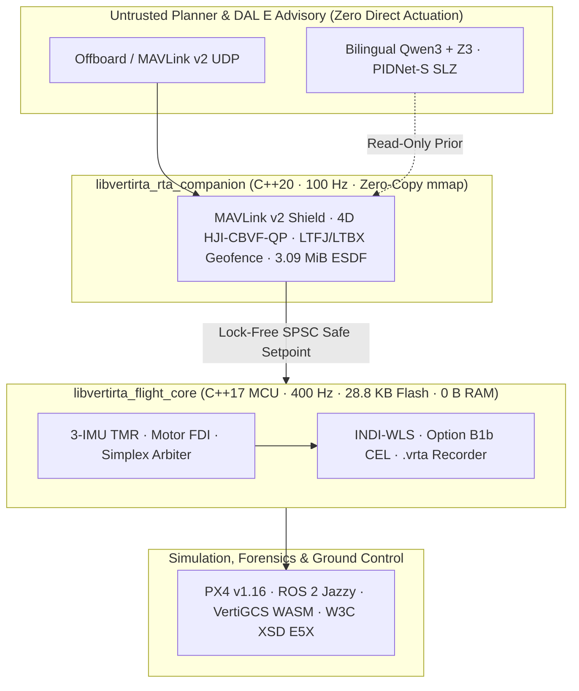

<div align="center">

# VertiRTA

**Deterministic Run-Time Assurance & Fault-Tolerant Autonomy for Urban eVTOLs**  
*Coaxial X8-240 & Lift+Cruise 8+1 · Istanbul LTFJ/LTBX Coastal Corridor*

[](https://github.com/fahrifurkansagir/VertiRTA/releases/tag/v1.0.0)
[](LICENSE)
[](https://github.com/fahrifurkansagir/VertiRTA/actions)
[](https://github.com/fahrifurkansagir/VertiRTA/actions/workflows/determinism.yml)
[](https://github.com/fahrifurkansagir/VertiRTA/actions/workflows/formal_and_hil.yml)
[](core/flight_core/)
[](scripts/ci/check_zero_gpl_symbols.py)

[**Live 3D Console**](https://fahrifurkansagir.github.io/VertiRTA/) ·
[**System Card**](docs/SYSTEM_CARD.md) ·
[**Safety Case**](docs/SAFETY_CASE.md) ·
[**Benchmarks**](docs/MILESTONE_HISTORY.md) ·
[**Cross-Stack Audit**](docs/research/CROSS_BENCHMARK_AUDIT_v1.md) ·
[**Citation**](#citation)

<br>



<sub>Real moving aerial footage (NASA Goddard, PD-USGov) running live on GTX 1650 SUPER: raw PIDNet-S v2.1 (center) vs. causal homography EMA + hysteresis (right) — <strong>-56.25%</strong> flicker, <strong>-62.15%</strong> SLZ centroid jitter, <strong>77.4 FPS</strong>.</sub>

</div>

---

## Engineering Overview

**VertiRTA** is an open-source, deterministic flight-control and run-time assurance (RTA) platform engineered for urban eVTOL failure physics — combining a bare-metal C++17 flight core, a 100 Hz C++20 Hamilton-Jacobi safety filter, a zero-GPL MAVLink v2 offboard shield, real-world perception/forensics pipelines, and a zero-install WebAssembly 3D flight console.

- **Bare-Metal Simplex Flight Core (C++17, 400 Hz):** Freestanding `libvertirta_flight_core` compiles to **28,886 B** Cortex-M7 Flash, **0 B** library RAM, **0** heap symbols, **0** recursion, and a **2,960 B** max call-graph stack DAG — isolating the deterministic 3-tier priority arbiter (`CEL > CSFL > CBVF > CF`) from ROS 2, Python, and AI modules.
- **Coupled eVTOL Fault Physics:** Models coaxial interference (0.85 thrust efficiency), asymmetric BLDC spool-up/coast-down inertia, and a 112S12P 1-RC Thevenin battery pack across **VertiRTA-X8-240** and **Lift+Cruise 8+1**, backed by a **102.85M-node** 4D HJI-CBVF PDE and a **1,000 + 180** seeded C++20 Monte Carlo failure-boundary campaign.
- **Zero-GPL MAVLink v2 Offboard Shield:** Clean-room Apache-2.0 C++20 MAVLink v2 UDP bridge (`0xFD`, X.25 CRC-16/MCRF4XX, 8 official `common.xml` `CRC_EXTRA` messages) clamping unsafe setpoints, denying airborne disarm/flight-termination, and enforcing 500 ms deadman hover at **p50 = 18.0 us** with **0** unsafe leaks across 2,500 live kernel UDP packets.
- **Real-World Evidence Without Cherry-Picking:** Verified on moving **NASA Goddard drone video** (-56.25% SLZ flicker on a 4 GB GTX 1650 SUPER), ETH Zurich **EuRoC MAV** (7/7), **PX4 ULog → W3C XSD E5X** forensics, live Istanbul METAR/Open-Meteo/ADS-B feeds, and zero-GPL **sherpa-onnx** voice ATC — with every negative ablation and open hardware gap published verbatim.

---

## Verification Visuals

### 1. Native C++20 1,000-Flight Dispersion & 180-Flight Thrust-Saturation Cliff

<div align="center">
  
  <p><sub><strong>0 / 1,000</strong> airspace breaches (95% CP ≤ 0.30%). <strong>Lift+Cruise 8+1:</strong> 500/500 safe (CEP50 0.80 m, CEP95 1.97 m). <strong>X8-240:</strong> 429/500 safe — exposing ±5 cm CG-shift tipping under collinear 2-arm CEL spin (29/100) vs nominal-CG Tier-1 (1,500/1,500). Physical thrust wall begins at +14% overload @ 10 m/s and saturates at ≥ +21%.</sub></p>
</div>

### 2. Interactive 3D WebAssembly Flight Console & Local SLZ Perception Recovery

<table width="100%">
  <tr>
    <td width="50%" align="center" valign="top">
      <a href="https://fahrifurkansagir.github.io/VertiRTA/">
        
      </a>
      <br>
      <sub><strong><a href="https://fahrifurkansagir.github.io/VertiRTA/">Launch VertiGCS 3D WASM Console</a> (38.5 KiB)</strong> — Istanbul LTFJ/LTBX corridor, live 1M/2M/CEL faults, 20-eVTOL fleet & Part-IS cyber-attack simulation.</sub>
    </td>
    <td width="50%" align="center" valign="top">
      
      <br>
      <sub><strong>PIDNet-S v2.1 (Local GTX 1650 SUPER)</strong> — Zero-ShareAlike Val mIoU <strong>0.4669</strong>, FSR <strong>2.81%</strong> (≤ 3.0%), OOD AUROC <strong>0.7554</strong>, zero-shot AeroScapes 0.2468.</sub>
    </td>
  </tr>
</table>

---

## Verified v1.0.0 Metrics

Every figure below is backed by SHA-256-sealed JSON manifests in [`artifacts/v4.0.0/`](artifacts/v4.0.0/) and live 7/7 GitHub Actions CI. For full historical Tier 1–4 and milestone tables, see [`docs/SYSTEM_CARD.md`](docs/SYSTEM_CARD.md) and [`docs/MILESTONE_HISTORY.md`](docs/MILESTONE_HISTORY.md).

| Subsystem | Verified Result (v1.0.0) | Artifact |
| --- | --- | --- |
| **Cortex-M7 Flight Core & Formal** | **28,886 B** Flash, **0 B** RAM, **2,960 B** DAG, **0** heap; ESBMC **1,905/1,905**; Renode CAN-FD **3/3** (12.50 ms failover); x86_64↔arm64 **0.0** diff | [`bare_metal_size_cortex_m7.json`](artifacts/v1.0.0/benchmarks/bare_metal_size_cortex_m7.json) |
| **4D HJI-CBVF PDE (X8 + LC 8+1)** | **102.85M** nodes (101×71×101×71 × 2): **0** soundness violations, 11.31 MB `VRTALUT1`; paired 30k atlas **95.98%** CSFL / **100%** CEL | [`g4_jax_4d_hires_and_lc_manifest.json`](artifacts/v4.0.0/g4_jax_4d_hires_and_lc_manifest.json) |
| **1,000 + 180 Monte Carlo Suite** | **0 / 1,000** airspace breaches; **200/200** GNSS spoof detect (0.178 s TTD); LC 8+1 **500/500** (CEP95 1.97 m); 6×6 wall ≥ +21% mass | [`monte_carlo_1000_dispersion_report.json`](artifacts/v4.0.0/monte_carlo_1000_dispersion_report.json) |
| **MAVLink v2 UDP RTA Shield** | 2,500 live UDP packets: **0** drops, **0** leaks, 1,181 clamped, 240 denied, 239 bad CRC rejected, **p50 = 18.0 us / p99 = 124.4 us** | [`mavlink_v2_rta_bridge_proof.json`](artifacts/v4.0.0/mavlink_v2_rta_bridge_proof.json) |
| **Real Drone Video & Edge GPU** | 240-frame NASA video: flicker **-56.25%**, centroid jitter **-62.15%**; GTX 1650S Cruise **p99 = 19.83 ms** (56.3 FPS) | [`realworld_drone_video_temporal_proof.json`](artifacts/v4.0.0/realworld_drone_video_temporal_proof.json) |
| **GNSS-Denied & Forensics** | ETH Zurich **EuRoC MAV 7/7** (0.1 s TTD); XFeat **CEP50 0.218 m**; PX4 `sample.ulg` → **W3C XSD E5X**; live Istanbul METAR/ADS-B | [`realworld_euroc_mav_gnss_audit.json`](artifacts/v4.0.0/realworld_euroc_mav_gnss_audit.json) |
| **Co-Pilot & Zero-GPL Voice** | Qwen3-4B Z3-GRPO: **100%** grammar & Z3 SAT, **82.83%** AST-STL, RAPS conformal upgrade; `sherpa-onnx` TTS **71.7 ms** (0 GPL) | [`g4_qwen3_v3_vertibench_v2_eval.json`](artifacts/v4.0.0/g4_qwen3_v3_vertibench_v2_eval.json) |
| **CI, SDK & Zero-GPL Gate** | **7/7** CI workflows green: **36/36** CTest (x86_64, arm64, ASan/TSan), `find_package(VertiRTA 1.0)`, 6/6 native SDK, **0** GPL across 23 targets | [`.github/workflows/`](.github/workflows/) |

---

## Architecture



---

## Quickstart

### 1. Build C++17/C++20 Core and Run All 36 Tests (Linux / WSL2)

```bash
git clone https://github.com/fahrifurkansagir/VertiRTA.git && cd VertiRTA
cmake --preset dev-linux-x64 && cmake --build build/dev-linux-x64 -j
ctest --test-dir build/dev-linux-x64 --output-on-failure
```

### 2. Run the Zero-GPL MAVLink v2 UDP Shield Self-Test

```bash
./build/dev-linux-x64/tools/mavlink_rta_bridge/vertirta_mavlink_rta_bridge \
  --self-test-udp-proof /tmp/mavlink_proof.json --packets 2500
```

### 3. Verify Bare-Metal Cortex-M7 Footprint & Isolation Gates

```bash
cmake --preset arm-cortex-m7 && cmake --build --preset arm-cortex-m7
python3 scripts/ci/check_bare_metal_size.py \
  --target build/arm-cortex-m7/core/flight_core/libvertirta_flight_core.a
python3 scripts/ci/check_arch_isolation.py --repo-root .
python3 scripts/ci/check_public_hygiene.py --repo-root .
```

### 4. Python Gymnasium SDK & Pretrained Release Assets

```bash
pip install . && pytest tests/sdk/ -v
```

Download verified ONNX weights and 4D `VRTALUT1` tables from the [**v1.0.0 Release**](https://github.com/fahrifurkansagir/VertiRTA/releases/tag/v1.0.0) and verify integrity with `sha256sum -c SHA256SUMS.txt`.

---

## Repository Structure

| Path | Responsibility |
| --- | --- |
| [`core/flight_core/`](core/flight_core/) | Frozen freestanding C++17 400 Hz MCU core (28.8 KB Flash / 0 B RAM: TMR, INDI+WLS, FDI, CEL, `.vrta`) |
| [`core/rta_companion/`](core/rta_companion/) | C++20 100 Hz RTA companion (`mmap` 4D CBVF & 2D CEL LUTs, ESDF, wire capsules, LTFJ/LTBX walls) |
| [`core/airframes/lift_cruise/`](core/airframes/lift_cruise/) | Zero-heap Lift+Cruise 8+1 transition dynamics & 400 Hz Hermite INDI-WLS allocator |
| [`core/wind_acoustics/`](core/wind_acoustics/) & [`core/uspace_fleet/`](core/uspace_fleet/) | `VRTAWND1` wind LUT, BVI acoustics, 20-eVTOL U-Space fleet, Part-IS crypto & [`core/fleet_z3/`](core/fleet_z3/) |
| [`core/forward_hazard/`](core/forward_hazard/) & [`core/gnss_denied/`](core/gnss_denied/) | Forward wire/mmWave radar fusion, Basalt VIO adapter, MCUSUM spoof guard & CTR inflation |
| [`core/voice/`](core/voice/), [`core/forensics/`](core/forensics/) & [`core/copilot/`](core/copilot/) | Zero-GPL voice ATC, ED-155A/ERCS E5X XML generator, [`core/stl/`](core/stl/) & [`core/slz_bayes/`](core/slz_bayes/) |
| [`tools/mavlink_rta_bridge/`](tools/mavlink_rta_bridge/) | Clean-room Apache-2.0 MAVLink v2 UDP/Offboard RTA shield bridge & live loopback harness |
| [`benchmarks/monte_carlo_dispersion/`](benchmarks/monte_carlo_dispersion/) | Seeded native C++20 1,000+180 Monte Carlo dispersion & failure-boundary benchmark suite |
| [`wasm/`](wasm/), [`apps/vertigcs/`](apps/vertigcs/) & [`sdk/python/`](sdk/python/) | 38.5 KiB Emscripten `.wasm`, live MapLibre/Deck.gl VertiGCS console & nanobind Python SDK |
| [`firmware/`](firmware/), [`px4_overlay/`](px4_overlay/) & [`ros2_ws/`](ros2_ws/) | STM32H753 HITL + Renode CAN-FD SIL, PX4 v1.16 overlays, ROS 2 Jazzy lock-free nodes & [`sim/`](sim/) |
| [`docs/`](docs/) & [`artifacts/v4.0.0/`](artifacts/v4.0.0/) | [`SYSTEM_CARD.md`](docs/SYSTEM_CARD.md), [`SAFETY_CASE.md`](docs/SAFETY_CASE.md), [`MILESTONE_HISTORY.md`](docs/MILESTONE_HISTORY.md), [`docs/research/`](docs/research/) & sealed JSON proofs |

---

## Known Limitations & Regulatory Note

- **Open Hardware & SITL:** Physical STM32H753 on-silicon `DWT->CYCCNT` (`PENDING_PHYSICAL_STM32H7_HITL`) and local PX4 v1.16 + Gazebo Harmonic closed-loop SITL (`PENDING_LOCAL_PX4_GZ_SITL`) remain open.
- **Whisper Negative Ablation:** BVI-LoRA fine-tuning degraded WER vs. Zero-Shot (13.1%–31.7% Zero-Shot retained as default).
- **Real-Video Domain Shift:** Procedurally trained `WireSeg` triggers false positives on building roofline seams in the NASA Goddard footage (240/240 conservative 15 m/s cap), and bright oblique walls motivate a 3D normal veto (`|n_z| < 0.85`).
- **Conformal Set Size & Edge GPU Bounds:** Qwen3-4B v3 conformal set size (`|C| = 7.80`) is root-caused in [`qwen3_v3_conformal_raps_diagnostic.json`](artifacts/v4.0.0/qwen3_v3_conformal_raps_diagnostic.json); TU116 Cruise VRAM delta (366 MiB) and WDDM p99 (13.36 ms) are logged verbatim. See [`OPTIONAL_G4_V1_1_BATCH_SPEC.md`](docs/research/OPTIONAL_G4_V1_1_BATCH_SPEC.md) for the v1.1 roadmap.
- **Regulatory Boundary:** VertiRTA is open-source software provided as-is under Apache-2.0 without warranty. References to ASTM F3269, DO-178C, EASA SC-VTOL, Part-IAM, Part-IS, SORA 2.5, and SHGM SHT-İHA describe architectural alignment rather than airworthiness certification; hardware qualification (G5) and certification lifecycle (G6) remain open in [`docs/SAFETY_CASE.md`](docs/SAFETY_CASE.md).

---

## Author, License & Citation

- **Original Author & Maintainer:** **Fahri Furkan Sagir** ([@fahrifurkansagir](https://github.com/fahrifurkansagir))
- **License & Mandatory Attribution:** Apache License 2.0 ([`LICENSE`](LICENSE)) + DCO 1.1 (`git commit -s`, no CLA). Under **Apache-2.0 Section 4(d)**, all redistributions and derivative works must retain [`NOTICE`](NOTICE) preserving authorship attribution. Under **Section 6**, forks must not imply official endorsement under the **VertiRTA** name.
- **Contributing & Security:** See [`CONTRIBUTING.md`](CONTRIBUTING.md), [`CODE_OF_CONDUCT.md`](CODE_OF_CONDUCT.md), and [`SECURITY.md`](SECURITY.md).

<a id="citation"></a>

```bibtex
@software{sagir2026vertirta,
  author  = {Sagir, Fahri Furkan},
  title   = {VertiRTA: Deterministic Run-Time Assurance and Fault-Tolerant
             Autonomy Platform for Urban eVTOLs},
  version = {1.0.0},
  year    = {2026},
  url     = {https://github.com/fahrifurkansagir/VertiRTA},
  license = {Apache-2.0}
}
```
