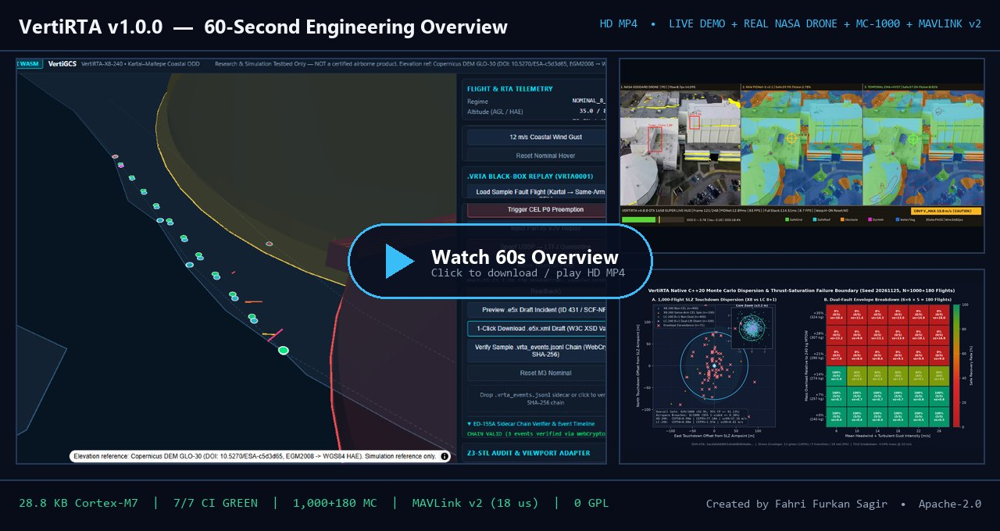
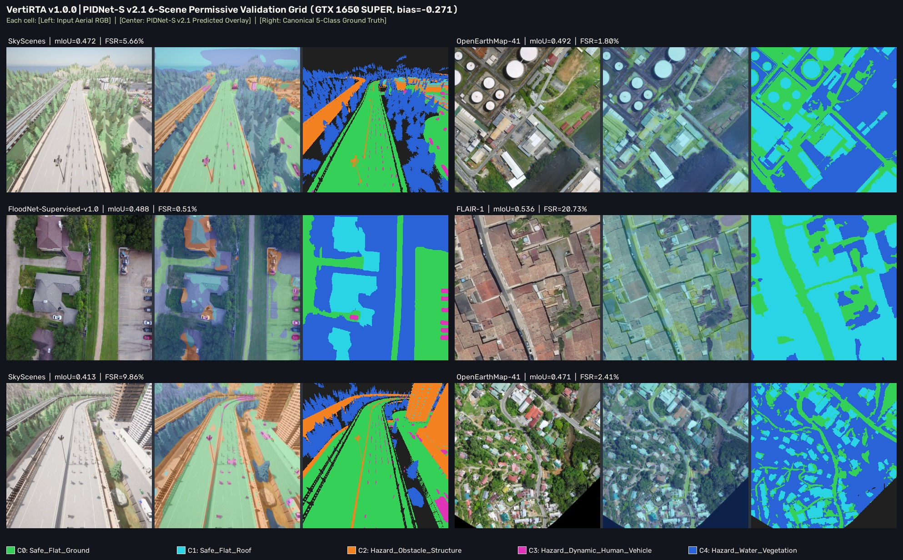
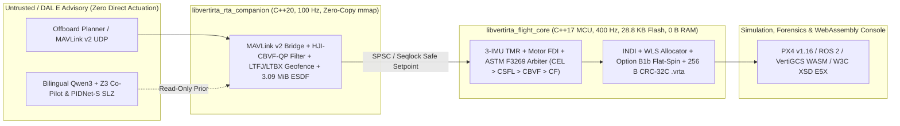

<div align="center">

# VertiRTA

**Deterministic Run-Time Assurance & Fault-Tolerant Autonomy Platform for Urban eVTOLs**  
*`VertiRTA-X8-240` Coaxial X8 & `Lift+Cruise 8+1` · Istanbul `LTFJ`/`LTBX` Coastal Corridor*

[](https://github.com/fahrifurkansagir/VertiRTA/releases/tag/v1.0.0)
[](LICENSE)
[](https://github.com/fahrifurkansagir/VertiRTA/actions)
[](https://github.com/fahrifurkansagir/VertiRTA/actions/workflows/determinism.yml)
[](https://github.com/fahrifurkansagir/VertiRTA/actions/workflows/formal_and_hil.yml)
[](core/flight_core/CMakeLists.txt)
[](scripts/ci/check_zero_gpl_symbols.py)

[**Launch Live 3D WASM Console**](https://fahrifurkansagir.github.io/VertiRTA/) ·
[**Watch 60s Overview (HD MP4)**](https://github.com/fahrifurkansagir/VertiRTA/releases/download/v1.0.0/vertirta_v1_overview_60s.mp4) ·
[**1-Page System Card**](docs/SYSTEM_CARD.md) ·
[**Safety Case**](docs/SAFETY_CASE.md) ·
[**Benchmarks**](docs/MILESTONE_HISTORY.md) ·
[**Cross-Stack Audit**](docs/research/CROSS_BENCHMARK_AUDIT_v1.md)

<br>

[](https://github.com/fahrifurkansagir/VertiRTA/releases/download/v1.0.0/vertirta_v1_overview_60s.mp4)

<sub>
  <strong>Click poster for the 60s HD Overview MP4</strong> or launch the zero-install <strong><a href="https://fahrifurkansagir.github.io/VertiRTA/">Live VertiGCS WebAssembly Sandbox</a></strong> (<code>38,470 B</code> <code>.wasm</code>, zero API tokens).<br>
  Created &amp; maintained by <strong><a href="https://github.com/fahrifurkansagir">Fahri Furkan Sagir</a></strong> · Apache-2.0 + <a href="NOTICE"><code>NOTICE</code></a> attribution · Research &amp; simulation testbed only (not certified for flight).
</sub>

</div>

---

## Why VertiRTA?

Most open-source UAV demos stop at quadrotor nominal control or unconstrained ML scripts. **VertiRTA** is an end-to-end deterministic flight-control, run-time assurance (RTA), and verification platform built around hard urban eVTOL failure physics:

- **Bare-Metal `ASTM F3269-21` Simplex Core:** Freestanding `400 Hz` C++17 `libvertirta_flight_core` compiles to **`28,886 B` Cortex-M7 Flash / `0 B` library RAM / `0` heap / `0` recursion** (`2,960 B` stack DAG) and enforces a strict 3-tier arbiter (`CEL > CSFL > CBVF > CF`) completely isolated from ROS 2, Python, or AI runtimes.
- **Physics-Honest Dual-Airframe Fault Tolerance:** Models coaxial interference (`eta_coax = 0.85`), BLDC spool inertia, and `112S12P` 1-RC Thevenin battery sag across **`VertiRTA-X8-240`** and **`Lift+Cruise 8+1`**, backed by a **`102.85M`-node** 4D Hamilton-Jacobi CBVF PDE and a **`1,000 + 180`** seeded C++20 Monte Carlo campaign that explicitly exposes physical failure cliffs.
- **Drop-In Zero-GPL MAVLink v2 Offboard Shield:** Clean-room Apache-2.0 C++20 MAVLink v2 (`0xFD`, X.25 `CRC-16/MCRF4XX`, `8` `common.xml` `CRC_EXTRA` messages) UDP bridge clamping unsafe setpoints, denying airborne disarm/flight-termination, and enforcing 500 ms deadman hover at **`p50 = 18.0 us`**.
- **Real-World Sensor, Vision & Forensics Evidence (Zero Cherry-Picking):** Verified on real moving **NASA Goddard drone footage** (`-56.25%` SLZ flicker on `GTX 1650 SUPER`), ETH Zurich **`EuRoC MAV`** (`7/7`), real **`PX4 ULog` → W3C XSD `E5X`** forensics, live Istanbul `METAR/Open-Meteo/ADS-B` feeds, and **`0`-GPL `sherpa-onnx`** voice ATC — with every negative ablation and hardware gap published verbatim.

---

## Visual Proof Gallery

| Real Moving NASA Drone Video — Causal Temporal SLZ HUD (`GTX 1650S`) | `1,000 + 180` C++20 Monte Carlo Dispersion & Failure-Boundary Cliff |
| :---: | :---: |
| <br><sub>`240` frames (`PD-USGov-NASA`): flicker **`2.19% → 0.96%` (`-56.25%`)**, SLZ jitter **`1.22 → 0.46 px` (`-62.15%`)**, `77.4 FPS` `PIDNet-S v2.1`.</sub> | <br><sub>`0/1,000` airspace breaches (`95% CP <= 0.30%`), `LC 8+1` `500/500` (`CEP95 1.97 m`), honest `X8 ±5 cm` CG cliff (`29/100`), thrust wall `>= +21%` mass.</sub> |

| Live 3D `VertiGCS` WebAssembly Console (`38.5 KiB .wasm`) | `PIDNet-S v2.1` Local `GTX 1650 SUPER` Recovery (`0.00 CU`) |
| :---: | :---: |
| <br><sub>Browser sandbox over Istanbul `LTFJ`/`LTBX`: live `1M`/`2M`/`CEL` faults, 20-eVTOL fleet & `Part-IS` cyber-attack replay ([launch](https://fahrifurkansagir.github.io/VertiRTA/)).</sub> | <br><sub>Zero-ShareAlike `Val mIoU = 0.4669`, **`FSR = 2.81% <= 3.0%`**, `OOD AUROC = 0.7554`, zero-shot `AeroScapes 0.2468`.</sub> |

---

## Verified `v1.0.0` Snapshot

All metrics below come directly from SHA-256-sealed JSON manifests in [`artifacts/v4.0.0/`](artifacts/v4.0.0/compound_fault_mission_report.json) and live `7/7` GitHub Actions CI. See [`docs/SYSTEM_CARD.md`](docs/SYSTEM_CARD.md) for the full 1-page review brief and [`docs/MILESTONE_HISTORY.md`](docs/MILESTONE_HISTORY.md) for Tier 1–4 and `v0.1.0-proto`–`v3.5.1` tables.

| Subsystem | Verified Measurement (`v1.0.0`) | Evidence |
| --- | --- | --- |
| **Bare-Metal Cortex-M7 Core & Formal/SIL** | `28,886 B` Flash / `0 B` RAM / `2,960 B` DAG / `0` heap; `ESBMC v8.7.0` **`1,905/1,905`**; Renode CAN-FD **`3/3` (`12.50 ms` failover)**; Cross-ISA `x86_64↔arm64` **`0.0` diff** | [`bare_metal_size_cortex_m7.json`](artifacts/v1.0.0/benchmarks/bare_metal_size_cortex_m7.json), [`SAFETY_CASE.md`](docs/SAFETY_CASE.md) |
| **Dual-Airframe `102.85M`-Node 4D `HJI-CBVF`** | `101×71×101×71` × 2 airframes (`X8-240` + `LC 8+1`): **`0` soundness violations**, `11.31 MB` `mmap` `VRTALUT1`; paired 30k atlas **`95.98%` CSFL / `100.0%` CEL** | [`g4_jax_4d_hires_and_lc_manifest.json`](artifacts/v4.0.0/g4_jax_4d_hires_and_lc_manifest.json), [`paired_30k_ral_stats.json`](artifacts/v3.1.0/paired_30k_ral_stats.json) |
| **`1,000 + 180` C++20 Monte Carlo Campaign** | **`0/1,000` airspace breaches**; `200/200` spoof detect (`TTD 0.178 s`); `LC 8+1` **`500/500`** (`CEP95 1.97 m`); `X8` `429/500` (`±5 cm` CG CEL cliff `29/100`); `6×6` wall **`>= +21%`** | [`monte_carlo_1000_dispersion_report.json`](artifacts/v4.0.0/monte_carlo_1000_dispersion_report.json) |
| **Zero-GPL MAVLink v2 UDP RTA Shield** | `2,500` live kernel UDP packets: **`0` drops, `0` leaks**, `1,181/1,181` clamped, `240/240` airborne disarm/term denied, `239/239` CRC rejected, **`p50 = 18.0 us / p99 = 124.4 us`** | [`mavlink_v2_rta_bridge_proof.json`](artifacts/v4.0.0/mavlink_v2_rta_bridge_proof.json), [`tools/mavlink_rta_bridge/`](tools/mavlink_rta_bridge/CMakeLists.txt) |
| **Real NASA Drone HUD & `PIDNet-S v2.1`** | `240`-frame moving drone video: flicker **`-56.25%`**, centroid jitter **`-62.15%`**; `PIDNet-S v2.1` **`Val mIoU 0.4669`**, **`FSR 2.81%`**, `OOD AUROC 0.7554`; Cruise **`19.83 ms p99` (`56.3 FPS`)** | [`realworld_drone_video_temporal_proof.json`](artifacts/v4.0.0/realworld_drone_video_temporal_proof.json), [`local_gtx1650s_pidnet_v21_recovery_metrics.json`](artifacts/v4.0.0/local_gtx1650s_pidnet_v21_recovery_metrics.json) |
| **GNSS-Denied, Forensics & Live Feeds** | ETH Zurich **`EuRoC MAV` `7/7` PASS** (`0.1 s` TTD); `XFeat` `36/36` **`CEP50 0.218 m`**; `PX4 sample.ulg` → **`W3C XSD`-valid `E5X`**; live Istanbul `METAR/Open-Meteo/adsb.lol`; `5/5` compound faults | [`realworld_euroc_mav_gnss_audit.json`](artifacts/v4.0.0/realworld_euroc_mav_gnss_audit.json), [`realworld_px4_ulog_forensics_proof.json`](artifacts/v4.0.0/realworld_px4_ulog_forensics_proof.json) |
| **Bilingual Co-Pilot & Zero-GPL Voice ATC** | 3-seed `Qwen3-4B` Z3-GRPO (`VertiBench-v2`): **Grammar `100%`**, **Z3 SAT `100%`**, **AST-STL `82.83 ± 0.71%`**, Mondrian `95.25%`, RAPS calibration upgrade; `sherpa-onnx` TTS **`71.7 ms`** (`0` GPL) | [`g4_qwen3_v3_vertibench_v2_eval.json`](artifacts/v4.0.0/g4_qwen3_v3_vertibench_v2_eval.json), [`local_voice_atc_live_proof.json`](artifacts/v4.0.0/local_voice_atc_live_proof.json) |
| **CI, Packaging & Governance** | **`7/7` GitHub Actions CI GREEN** (`36/36` CTest `x86_64`+`arm64`+ASan/TSan, `1/1` `find_package(VertiRTA 1.0)`, `6/6` native `cp312-abi3` SDK, `17/17` Vitest, `0` GPL across `23` targets) | [`.github/workflows/`](.github/workflows/m3_perception_voice_forensics.yml), [`CHANGELOG.md`](CHANGELOG.md) |

---

## Architecture at a Glance



---

## Quickstart

### 1. Build & Verify C++17/C++20 Core + `36/36` CTest (Linux / WSL2)

```bash
git clone https://github.com/fahrifurkansagir/VertiRTA.git && cd VertiRTA
cmake --preset dev-linux-x64 && cmake --build build/dev-linux-x64 -j
ctest --test-dir build/dev-linux-x64 --output-on-failure
```

### 2. Run the Zero-GPL MAVLink v2 UDP Offboard Shield Stress Proof

```bash
./build/dev-linux-x64/tools/mavlink_rta_bridge/vertirta_mavlink_rta_bridge --self-test-udp
```

### 3. Build Bare-Metal Cortex-M7 & Check Isolation / Hygiene Gates

```bash
cmake --preset arm-cortex-m7 && cmake --build --preset arm-cortex-m7
python3 scripts/ci/check_bare_metal_size.py --target build/arm-cortex-m7/core/flight_core/libvertirta_flight_core.a
python3 scripts/ci/check_arch_isolation.py --repo-root .
python3 scripts/ci/check_public_hygiene.py --repo-root .
```

### 4. Python Gymnasium SDK (`nanobind` C++ Extension) & Pretrained Weights

```bash
pip install . && pytest tests/sdk/ -v
```

Download verified ONNX weights (`pidnet_slz_v21_local_gtx_opset17.onnx`, `mlsd_wireseg_640_opset17.onnx`, `dfine_n_640_opset17.onnx`, `xfeat_512_opset17.onnx`) and 4D `HJI-CBVF` `VRTALUT1` tables from the [**`v1.0.0` GitHub Release**](https://github.com/fahrifurkansagir/VertiRTA/releases/tag/v1.0.0) and verify with `sha256sum -c SHA256SUMS.txt`.

---

## Repository Map

| Directory | Responsibility |
| --- | --- |
| [`core/flight_core/`](core/flight_core/CMakeLists.txt) | Frozen freestanding C++17 `400 Hz` MCU core (`28,886 B` Flash / `0 B` RAM, TMR, INDI+WLS, Motor FDI, CEL, `.vrta` recorder) |
| [`core/rta_companion/`](core/rta_companion/CMakeLists.txt) | C++20 `100 Hz` RTA companion (`mmap` 4D CBVF & 2D CEL LUTs, ESDF, wire capsules, `LTFJ`/`LTBX` CTR walls) |
| [`core/{airframes,wind_acoustics,uspace_fleet,fleet_z3}/`](core/airframes/lift_cruise/CMakeLists.txt) | `Lift+Cruise 8+1` transition INDI-WLS, `VRTAWND1` / BVI acoustics, 20-eVTOL U-Space + `Part-IS` crypto + two-tier Fleet Z3 |
| [`core/{forward_hazard,gnss_denied,voice,forensics,stl,copilot,slz_bayes}/`](core/gnss_denied/CMakeLists.txt) | Forward wire/radar fusion, `Basalt` VIO + MCUSUM spoof guard, Zero-GPL voice ATC, `ED-155A`/ERCS `E5X`, STL/Z3 co-pilot, 2.5D SLZ grid |
| [`tools/mavlink_rta_bridge/`](tools/mavlink_rta_bridge/CMakeLists.txt) & [`benchmarks/monte_carlo_dispersion/`](benchmarks/monte_carlo_dispersion/CMakeLists.txt) | Clean-room Apache-2.0 MAVLink v2 UDP RTA shield & `1,000+180` seeded C++20 dispersion/cliff campaign |
| [`wasm/`](wasm/build_wasm.sh), [`apps/vertigcs/`](apps/vertigcs/package.json), [`sdk/python/`](sdk/python/) & [`firmware/`](firmware/stm32h7_hitl/README.md) | `38.5 KiB` Emscripten `.wasm`, MapLibre/Deck.gl `VertiGCS`, `nanobind` Python SDK, STM32H753 HITL + Renode CAN-FD SIL |
| [`px4_overlay/`](px4_overlay/airframes/12050_gz_vertirta_x8_240), [`ros2_ws/`](ros2_ws/src/vertirta_bringup/package.xml) & [`sim/`](sim/models/vertirta_x8_240/model.sdf) | PX4 `v1.16` coaxial/transition overlays, ROS 2 Jazzy lock-free nodes, Gazebo Harmonic worlds & plugins |
| [`docs/`](docs/SYSTEM_CARD.md) & [`artifacts/v4.0.0/`](artifacts/v4.0.0/compound_fault_mission_report.json) | [`SYSTEM_CARD.md`](docs/SYSTEM_CARD.md), [`SAFETY_CASE.md`](docs/SAFETY_CASE.md) (`Sn1–Sn19`), [`MILESTONE_HISTORY.md`](docs/MILESTONE_HISTORY.md), [`CROSS_BENCHMARK_AUDIT_v1.md`](docs/research/CROSS_BENCHMARK_AUDIT_v1.md), [`OPTIONAL_G4_V1_1_BATCH_SPEC.md`](docs/research/OPTIONAL_G4_V1_1_BATCH_SPEC.md) |

---

## Honest Limitations & Non-Certification Scope

> [!IMPORTANT]
> **Research & Simulation Testbed Only — Zero Airworthiness Certification Claim.**  
> `VertiRTA` is NOT certified under DO-178C, DO-254, EASA `SC-VTOL`, `Part-IAM`, `Part-IS`, `SORA 2.5`, or `SHGM SHT-İHA`, and is NOT approved for flight on any manned or unmanned aircraft. Hardware qualification (`G5`) and certification lifecycle (`G6`) remain permanently `[UNDEVELOPED]` in [`docs/SAFETY_CASE.md`](docs/SAFETY_CASE.md).

- **Open Hardware / SITL Gaps:** Physical `STM32H753` on-silicon `DWT->CYCCNT` (`PENDING_PHYSICAL_STM32H7_HITL`) and local `PX4 v1.16 + Gazebo Harmonic` closed-loop SITL (`PENDING_LOCAL_PX4_GZ_SITL`) remain honestly open.
- **Measured ML & Silicon Bounds:** `Whisper` BVI-LoRA degraded WER vs. Zero-Shot (`13.1%–31.7%` retained as default); procedurally trained `WireSeg` triggers roofline false positives on real drone footage (`240/240` conservative `15 m/s`); oblique bright facades motivate 3D normal veto `|n_z| < 0.85`; `Qwen3-4B v3` conformal `|C| = 7.80` root-cause is documented in [`qwen3_v3_conformal_raps_diagnostic.json`](artifacts/v4.0.0/qwen3_v3_conformal_raps_diagnostic.json); `TU116` Cruise VRAM delta (`366 MiB`) and WDDM p99 (`13.36 ms`) are logged verbatim. See [`docs/research/OPTIONAL_G4_V1_1_BATCH_SPEC.md`](docs/research/OPTIONAL_G4_V1_1_BATCH_SPEC.md) for the license-clean `v1.1` roadmap.

---

## Author, Attribution, Contributing & License

- **Original Author & Maintainer:** **Fahri Furkan Sagir** ([@fahrifurkansagir](https://github.com/fahrifurkansagir))
- **License & Mandatory Attribution:** Released under the **Apache License 2.0** ([`LICENSE`](LICENSE)) with **DCO 1.1** (`git commit -s`, No Corporate CLA). Per **Apache-2.0 Section 4(d)**, all source/binary redistributions and derivative works **must retain the [`NOTICE`](NOTICE) file** preserving original authorship attribution. Per **Section 6**, forks must not imply official endorsement under the **VertiRTA** name.
- **Contributing & Security:** Please read [`CONTRIBUTING.md`](CONTRIBUTING.md), [`CODE_OF_CONDUCT.md`](CODE_OF_CONDUCT.md), and [`SECURITY.md`](SECURITY.md) before opening an issue or pull request.

```bibtex
@software{sagir2026vertirta,
  author  = {Sagir, Fahri Furkan},
  title   = {VertiRTA: Deterministic Run-Time Assurance and Fault-Tolerant Autonomy Platform for Urban eVTOLs},
  version = {1.0.0},
  year    = {2026},
  url     = {https://github.com/fahrifurkansagir/VertiRTA},
  license = {Apache-2.0}
}
```
