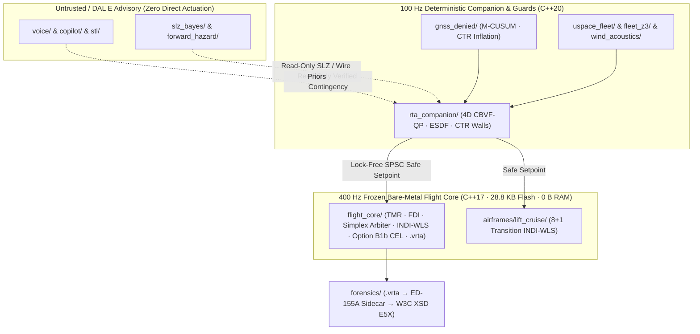

# VertiRTA Core (`core/`) — Real-Time Architecture & Isolation Map

All flight-critical and companion C++17/C++20 libraries live under `core/`, strictly partitioned along **`ASTM F3269-21`** Simplex Run-Time Assurance trust boundaries. Architectural isolation is enforced automatically in CI by [`scripts/ci/check_arch_isolation.py`](../scripts/ci/check_arch_isolation.py) (`37/37` files, `0` violations) and [`scripts/ci/check_zero_gpl_symbols.py`](../scripts/ci/check_zero_gpl_symbols.py) (`0` GPL runtime symbols).

---

## Trust Boundaries, Execution Rates & Memory Budgets

| Module | Language | Rate | Trust Level | Memory / Heap Guarantee | Responsibility |
| --- | --- | --- | --- | --- | --- |
| [`flight_core/`](flight_core/) | C++17 (freestanding) | **400 Hz** | **Trusted MCU Core** | **28,886 B** Cortex-M7 Flash, **0 B** lib RAM, **2,960 B** stack DAG, **0** heap, **0** recursion | 3-IMU TMR voter, INDI + 8×4 WLS (`StaticDaqpSolver`), Motor FDI, Option B1b flat-spin CEL, `.vrta` CRC-32C black-box recorder |
| [`rta_companion/`](rta_companion/) | C++20 | **100 Hz** | **Trusted Safety Filter** | Zero-copy `mmap` LUTs + fixed arenas (`3.094 MiB` ESDF) | 4D HJI-CBVF-QP safety filter, 2D CEL table, robocentric ESDF, wire capsules, intruder KF, `LTFJ`/`LTBX` hard CTR walls, Dryden turbulence |
| [`airframes/lift_cruise/`](airframes/lift_cruise/) | C++20 | **400 Hz** | **Trusted Secondary Airframe** | Zero heap (`0` bytes added to `flight_core`) | `VertiRTA-LC-240` (`8+1`) transition dynamics & quintic Hermite `17×12` INDI-WLS (`p99 = 0.98 us`) |
| [`gnss_denied/`](gnss_denied/) | C++20 | **10–100 Hz** | **Navigation Integrity Guard** | Fixed-size buffers, fail-closed `NaN`/non-PSD guards | 10 Hz M-CUSUM slow-ramp GNSS spoof guard + rollback, Basalt VIO adapter, visual relocalization & monotonic `3σ` CTR inflation FSM |
| [`uspace_fleet/`](uspace_fleet/) | C++20 | **20–50 Hz** | **Fleet & Cyber Boundary** | SoA `20`-aircraft arena (`0.151 ms/tick`), `libsodium >= 1.0.21` | Multi-eVTOL U-Space simulator, `Part-IS (EU) 2023/203` `40 B` header + `ReplayWindow128` + `RTO <= 10 s` FSM, `ASTM F3548-21`/`F3411-22a` DRIP |
| [`fleet_z3/`](fleet_z3/) | C++20 | **Async** | **Fleet Verification Gate** | Isolated Z3 contexts (`QF_IDL` / `QF_LRA`) | Two-tier multi-aircraft strategic deconfliction scheduler (`< 2.2 ms` `QF_IDL`) |
| [`wind_acoustics/`](wind_acoustics/) | C++20 | **10–50 Hz** | **Environment / Routing** | Zero-GPL `mmap` `VRTAWND1` LUT (air-gapped from OpenFOAM) | POD-RBF urban wake wind surrogate, BVI acoustic hemisphere, lexicographic safety-first noise-aware router |
| [`forward_hazard/`](forward_hazard/) | C++20 | **30 Hz** | **Advisory Perception (`DAL E`)** | Lock-free advisory output only | Forward wire (`M-LSD-WireSeg`) + obstacle (`D-FINE-N`) + 77 GHz mmWave radar fusion feeding `WireCapsules` |
| [`slz_bayes/`](slz_bayes/) | C++20 | **15–30 Hz** | **Advisory Perception (`DAL E`)** | `1.5625 MiB` static Bayesian grid, `> 250 ms` staleness veto | Active visual Safe Landing Zone fusion (OOD variance floor + precision cap; read-only prior to RTA) |
| [`stl/`](stl/) & [`copilot/`](copilot/) | C++20 | **Async** | **Advisory Planner (`DAL E`)** | Bounded STL monitor + fail-closed Z3 verifier (`rlimit=250k`) | Bilingual TR/EN mission DSL, GBNF grammar clamp, Z3 `QF_LRA` verification/repair, Mondrian conformal gating (`shield_active = true` immutable) |
| [`voice/`](voice/) | C++20 | **Async** | **Advisory HMI (`DAL E`)** | Zero-GPL (`sherpa-onnx`, `faster-whisper`), fail-closed `NaN` | Offline TR/EN Voice ATC pipeline, MAYDAY preemption, SNR/language Mondrian conformal voice gate |
| [`forensics/`](forensics/) | C++20 | **Post-Flight** | **Regulatory Recorder** | Deterministic ED-155A SHA-256 chain + RFC 8259 JSON parser | `.vrta_events.jsonl` hash-chained sidecar, `ERCS` risk scoring, W3C XSD-valid ECCAIRS2 `.e5x.xml` draft generator |

---

## Dependency & Dataflow Diagram

---

## Hard Architectural Locks

1. **`core/flight_core/` Never Imports `rta_companion/`, ROS 2, Z3, ONNX, or STL Heap Containers:** Compiled with `-fno-exceptions -fno-rtti` and link-trapped with `-Wl,--wrap=malloc` on both `x86_64` and `arm-none-eabi` Cortex-M7.
2. **All AI/Advisory Modules Are Strictly Read-Only (`DAL E`):** No code under `copilot/`, `slz_bayes/`, `forward_hazard/`, or `voice/` can bypass `rta_companion/` or write directly to motor/servo outputs.
3. **Zero-GPL Runtime Firewall:** Every C++ library under `core/` is strictly Apache-2.0; offline CFD (`tools/cfd_offline_gpl/`) is air-gapped across a binary `VRTAWND1` LUT boundary.

For full documentation navigation, see [`docs/README.md`](../docs/README.md).
