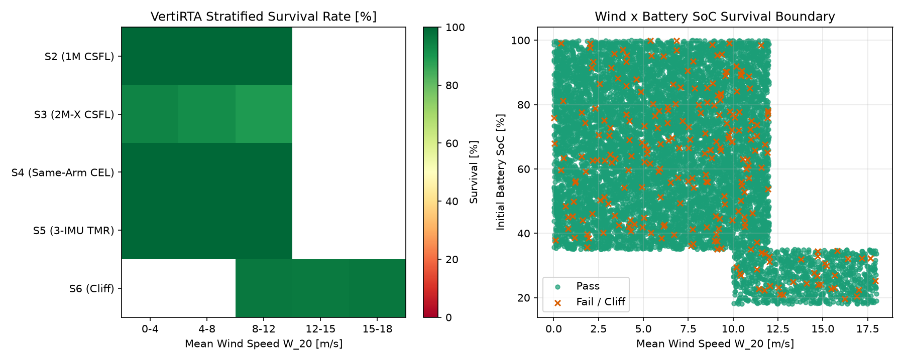
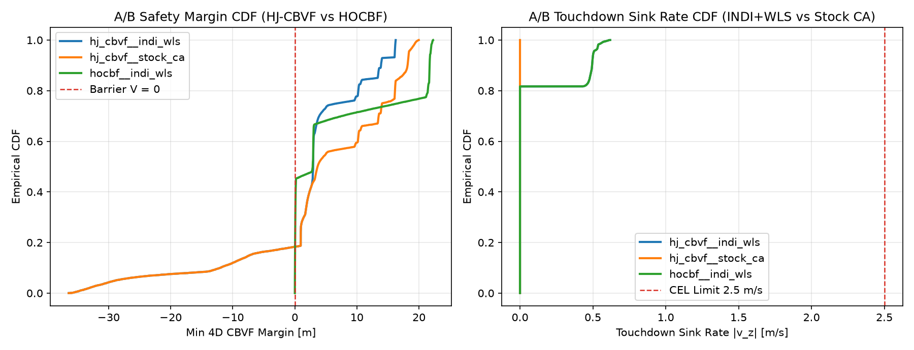

# VertiRTA — Detailed Benchmarks & Development Progression

This document holds the detailed Tier 1–4 bare-metal latency tables, 30,000-run nominal-CG atlas, and pre-1.0 development progression consolidated into **`VertiRTA v1.0.0`**. For the 1-page summary, see [`docs/SYSTEM_CARD.md`](SYSTEM_CARD.md); for raw Tier 1–4 benchmark reports, see [`BENCHMARKS.md`](../BENCHMARKS.md).

> **Attribution & Scope:** Created by **Fahri Furkan Sagir** under **Apache-2.0 + [`NOTICE`](../NOTICE)**. Open-source flight-control and run-time assurance software; references to aviation standards describe architectural alignment, not airworthiness certification.

---

## 1. Tier 1–4 Deterministic Execution & Bare-Metal Cortex-M7 Baseline

### Tier 1 — Bare-Metal ARM Cortex-M7 Footprint, Stack/DAG, Zero-Heap & Sanitizers

| Metric | Target / Tool | Measured Value | Budget / Gate | Status | Artifact |
| --- | --- | --- | --- | --- | --- |
| Cortex-M7 Flash (`.text + .data`) | `arm-none-eabi-size` (`-Os`, `11` objs) | `28,886 B` (`28.21 KiB`) | `< 262,144 B` (`256 KiB`) | `PASS` | [`bare_metal_size_cortex_m7.json`](../artifacts/v1.0.0/benchmarks/bare_metal_size_cortex_m7.json) |
| Cortex-M7 Library Static RAM (`.data + .bss`) | `arm-none-eabi-size` (caller owns static `.bss`) | `0 B` | `< 131,072 B` (`128 KiB`) | `PASS` | [`bare_metal_size_cortex_m7.json`](../artifacts/v1.0.0/benchmarks/bare_metal_size_cortex_m7.json) |
| Cortex-M7 Max Static Frame (`-fstack-usage`) | `arm-none-eabi-g++ 14.2.1` (`77` fns, `0` dynamic) | `1,496 B` | `<= 4,096 B` | `PASS` | [`stack_usage_cortex_m7.json`](../artifacts/v1.0.0/benchmarks/stack_usage_cortex_m7.json) |
| Cortex-M7 Max Call-Graph DAG (`-fcallgraph-info`) | `arm-none-eabi-g++ 14.2.1` (`98` nodes, `0` recursion) | `2,960 B` | `<= 16,384 B` | `PASS` | [`stack_usage_cortex_m7.json`](../artifacts/v1.0.0/benchmarks/stack_usage_cortex_m7.json) |
| Host x86_64 Max Frame / Call-Graph DAG | `g++ 15.2.0` (`74` fns, `105` nodes, `0` recursion) | `2,112 B` / `5,280 B` | `<= 4,096 B` / `<= 16,384 B` | `PASS` | [`stack_usage_x86_64.json`](../artifacts/v1.0.0/benchmarks/stack_usage_x86_64.json) |
| Zero-Heap Symbol Audit (x86_64 & Cortex-M7) | `nm` & `arm-none-eabi-nm` + `-Wl,--wrap=malloc` | `0` / `0` forbidden | `0` symbols | `PASS` | [`no_heap_x86_64.json`](../artifacts/v1.0.0/benchmarks/no_heap_x86_64.json), [`no_heap_cortex_m7.json`](../artifacts/v1.0.0/benchmarks/no_heap_cortex_m7.json) |
| `ASTM F3269-21` Core Isolation | `check_arch_isolation.py` (`37` files) | `0` violations | `0` violations | `PASS` | [`arch_isolation_report.json`](../artifacts/v1.0.0/benchmarks/arch_isolation_report.json) |

### Tiers 2, 3 & 4 — Deterministic `.vrta` Replay & Per-Tick Execution Latency

| Tier | Target Runner / Arch | Mode / Scope | Ticks / Frames | `mean` (us) | `p50` (us) | `p99` (us) | `p99.9` (us) | `max` (us) | Steal / Status |
| --- | --- | --- | --- | --- | --- | --- | --- | --- | --- |
| **Tier 2** | `x86_64` & `arm64` | Same-ISA 0-ULP `.vrta` Replay (`corridor_faults.vrta`, `512,128 B`, `1,400` CEL frames) | `2,000` frames (`20.0 s`) | — | — | — | — | — | `PASS` (`run1 == run2` SHA-256) |
| **Tier 2** | `x86_64 <-> arm64` CI | Cross-ISA Parity (`ubuntu-24.04` ↔ Azure Cobalt 100 `ubuntu-24.04-arm`) | `2,000` frames | — | — | — | — | — | **`PASS` (`max_abs_diff = 0.0`, `0` mode div)** |
| **Tier 3** | `x86_64` (Local WSL2) | `CLOCK_THREAD_CPUTIME_ID` | `100,000` ticks | `1.2841` | `1.2400` | `1.9000` | `11.5690` | `55.3490` | `MEASURED_LOCAL` |
| **Tier 4** | `x86_64` (Local WSL2) | `CLOCK_MONOTONIC_RAW` + `/proc/stat` | `50,000` ticks | `0.5780` | `0.5400` | `0.9500` | `1.5900` | `32.0690` | `0.0%` (`CLEAN`) |
| **Tier 3/4** | `x86_64` (`ubuntu-24.04` CI) | Callgrind `723,331 Ir/tick` + `CLOCK_MONOTONIC_RAW` | `20,000` ticks | `0.6570` | `0.6790` | `0.8430` | `4.0220` | `17.8920` | `0.0%` (`CLEAN / PASS`) |
| **Tier 3/4** | `arm64` (`ubuntu-24.04-arm`) | Azure Cobalt 100: Callgrind `604,543 Ir/tick` + `CLOCK_MONOTONIC_RAW` | `20,000` ticks | `0.7212` | `0.7200` | **`0.7360`** | **`0.8640`** | `4.1440` | `0.0%` (`CLEAN / PASS`) |

> **WCET Caveat:** User-space Linux timings are CI regression telemetry ONLY and do NOT constitute DO-178C bare-metal RTOS WCET certification evidence.

### Live Tier-1 10,000-Run 6-DOF Survival Envelope Atlas + A/B Ablations (`30,000` Simulations, Nominal CG)

| Configuration | CSFL Pool (`S2+S3+S5`, `n = 6,500`) | CSFL 95% CP Upper Fail Bound | CEL Pool (`S4` Same-Arm, `n = 1,500`) | CEL 95% CP Upper Fail Bound | Wall-Clock (`10k`) |
| --- | --- | --- | --- | --- | --- |
| **`HJ-CBVF + INDI-WLS` (Primary)** | **`96.82%`** (`6,293 / 6,500`, `k = 207`) | `0.035665` | **`100.00%`** (`1,500 / 1,500`, `k = 0`) | `0.001995` | `33.083 s` |
| `HOCBF + INDI-WLS` (CBVF Ablation) | `44.85%` | `0.561743` | `100.00%` | `0.001995` | `23.111 s` |
| `HJ-CBVF + Stock CA` (Allocation Ablation) | `96.82%` | `0.035665` | `0.00%` (`0 / 1,500` capsize) | `1.000000` | `17.667 s` |

- Exact paired 30k RA-L stats (full JAX 4D PDE): **`95.98%` CSFL** (`(3324, 0)`, `p_holm < 10^-16`) / **`100.00%` CEL** (`(1500, 0)`), logged in [`artifacts/v3.1.0/paired_30k_ral_stats.json`](../artifacts/v3.1.0/paired_30k_ral_stats.json).
- Every single failed simulation is preserved in [`artifacts/v1.0.0/tier1_atlas/failure_cliff_ledger.json`](../artifacts/v1.0.0/tier1_atlas/failure_cliff_ledger.json).

---

## 2. Internal Pre-1.0 Development Progression (Consolidated into `v1.0.0`)

All archived JSON proof directories (`artifacts/v1.0.0/`, `artifacts/v3.1.0/`, `artifacts/v3.5.1/`, `artifacts/v4.0.0/`) are retained verbatim for schema and regression-test reproducibility across the consolidated **`v1.0.0`** public release:

- **Stage 1 — Core Flight & 4-Tier Determinism (`artifacts/v1.0.0/`):** Freestanding C++17 `flight_core` (`28,886 B` Flash / `0 B` RAM) + `rta_companion`, 30,000-run Tier-1 6-DOF atlas, CI-hashed `SCSC-141C` GSN v3 safety case, PX4 v1.16 / ROS 2 Jazzy / Gazebo Harmonic overlays, and Istanbul corridor visualization.
- **Stage 2 — Advisory Co-Pilot & Visual SLZ:** Bilingual TR/EN neuro-symbolic Z3-verified co-pilot (`core/stl/`, `core/copilot/`, `VertiBench-TR/EN` `< 0.15` Jaccard ARM64 CI) + Active Visual SLZ (`core/slz_bayes/`, `1.5625 MiB` Bayesian grid, zero-ShareAlike `PIDNet-S`, kinematic EGL ablation).
- **Stage 3 — Bare-Metal Silicon SIL, Formal BMC & WASM (`artifacts/v3.1.0/`):** `STM32H753` ITCM/DTCM firmware (`ES0392 Rev 16`), Renode v1.17.0 dual-FCC OpenCyphal CAN-FD SIL (`3/3`, `12.50 ms` failover), `ESBMC v8.7.0` (`1,905/1,905`), `38,470 B` single-threaded `.wasm` + MapLibre/Deck.gl `VertiGCS`, relocatable `VertiRTAConfig.cmake` + `nanobind` SDK, non-root Docker, full `81×57×81×57` JAX 4D PDE + paired 30k RA-L statistics, and IEEE RA-L Paper 1 (`docs/paper_ral/`).
- **Stage 4 — Multi-Airframe, U-Space Fleet & Calibration (`artifacts/v3.5.1/`):** Zero-heap `Lift+Cruise 8+1` transition INDI-WLS (`0.198 m` alt err, `0.98 us` WLS p99), air-gapped OpenFOAM POD-RBF → Apache-2.0 `mmap` `VRTAWND1` (`0` GPL runtime symbols) + BVI acoustics, 20-eVTOL `FleetSimEngine` (`0.151 ms/tick`) + `Part-IS (EU) 2023/203` (`libsodium 1.0.22`, `RTO <= 10 s`) + two-tier Fleet Z3, offline bundled MapLibre worker, and calibrated `PIDNet-S v2` / `Qwen3-4B v2` models.
- **Stage 5 — `v1.0.0` Public Release Consolidation (`artifacts/v4.0.0/`):** `102.85M`-node dual-airframe JAX PDE, `PIDNet-S v2.1` local GTX 1650 SUPER recovery (`0.4669` mIoU / `2.81%` FSR / `0.7554` OOD AUROC), `EuRoC MAV 7/7`, `PX4 ULog → W3C XSD E5X`, live Istanbul feeds, Zero-GPL `sherpa-onnx` TTS (`71.7 ms`), moving NASA Goddard drone temporal SLZ HUD (`-56.25%` flicker / `-62.15%` jitter), `1,000+180` C++20 Monte Carlo dispersion & failure boundary, Zero-GPL MAVLink v2 UDP RTA shield (`p50 = 18.0 us`, `0` leaks), RAPS conformal upgrade + Qwen3 diagnostic, `docs/SYSTEM_CARD.md`, and `7/7` live CI GREEN.
