# VertiRTA — Living Safety Case & Regulatory Assurance Architecture

## Non-Compliance & Legal Scope Disclaimer

> **`VertiRTA` (`libvertirta_flight_core` + `libvertirta_rta_companion`) is an open-source research, simulation, and software-verification testbed — NOT a certified airborne product, NOT a Type Certificate (TC) or Supplemental Type Certificate (STC) basis, and NOT approved for flight on any manned or unmanned aircraft.**
>
> 1. **Zero Certification Claims:** References to EASA `SC-VTOL-02` (Issue 2, 10 Jun 2024), `MOC-1` through `MOC-5` (`MOC-5` Issue 2 FINAL, 5 Nov 2026), `Reg. (EU) 2024/1111` (Part-IAM, applicable 1 May 2025), `SORA 2.5` (`ED Decision 2025/018/R` & `ED Decision 2026/010/R`, 16 Nov 2026), `SHGM SHT-İHA` (effective 30 Jul 2026), `ASTM F3269-21`, `SAE ARP4761A / ED-135` (20 Dec 2023), `DO-178C`, `EASA AI Concept Paper Issue 02 / Proposed Issue 03` (Draft, Jun 2026), `MLEAP`, and draft `EUROCAE ED-324 / SAE ARP6983` represent **architectural design drivers and academic assurance alignment ONLY**. No artifact satisfies DO-178C, DO-254, ARP4754B, or EASA Part 21 airworthiness compliance.
> 2. **Strict Separation of Specific vs. Certified Regimes:** Under `Reg. (EU) 2019/947` Article 6 and `ED Decision 2025/018/R`, carriage of passengers is strictly excluded from `SORA 2.5` and always falls under the Certified Category. `ED Decision 2026/010/R` (16 Nov 2026) permanently retires legacy SORA 2.0 (`AMC1bis`) effective 1 Jan 2027. `VertiRTA` strictly separates:
>    - **Stage-A (25 kg Unmanned Subscale CONOPS):** Unmanned experimental testbed aligned with `SORA 2.5` (SAIL II–III over controlled or `< 50 ppl/km^2` range; **0 passengers**).
>    - **Stage-B (240 kg `VertiRTA-X8-240` Reference):** Simulated urban UAM architecture aligned with `SC-VTOL-02` Category Enhanced + `Part-IAM` design drivers.
> 3. **Honest CSFL vs. Same-Arm Dual-Loss CEL Boundary:** Single-motor (`1M`) and cross-arm dual-motor (`2M-Cross`) losses retain 4-DOF controllability and target **Continued Safe Flight and Landing (CSFL)**. **Same-arm coaxial-pair dual loss** removes all lift on one boom, abandons yaw via Option B1b active flat spin (`|Omega_z| = 2.2 rad/s`), and is **explicitly exempted from passenger-grade CSFL** — framed strictly as last-resort **Controlled Emergency Landing (CEL)** survivability.
> 4. **Statistical & Timing Scope Limits:** The 2-Tier Verification Pyramid (10,000 C++20 6-DOF + 1,000 hot-reset PX4/Gazebo + 50 EGL LiDAR) bounds *conditional* simulated recovery (`P(CSFL | fault, ODD)` on `n=650` and `P(CEL | same_arm, ODD)` on `n=150`, strictly isolated) and **never proves `<= 10^-9 / FH`** (which requires `2,995,732,273` independent zero-failure flight hours). Cloud ARM64 CI telemetry (`ubuntu-24.04-arm`) is **not** bare-metal RTOS WCET evidence.
> 5. **AI Advisory Isolation:** Both the TR/EN contingency co-pilot (`DR-6`, EASA Level 1B / DAL E) and neural SLZ perception (`DR-7`, EASA Level 1A/2A / DAL E) operate strictly outside the deterministic `ASTM F3269-21` RTA boundary with **zero closed-loop actuation authority**.

---

## 1. Regulatory Baseline & Turkish Operational Hook (`SHGM SHT-İHA`)

All normative document dates and binding-vs-draft statuses are locked centrally in `docs/standards_registry.yaml`. Beyond European `SC-VTOL-02` / `MOC-5` (5 Nov 2026 — mandating continuous fly-by-wire latent-fault monitoring under `MOC 5 VTOL.2300`, directly motivating our 400 Hz 3-IMU TMR cross-monitor) and `Part-IAM` (`UAM.OP.VCA.190/.191/.192/.195` performance-based energy reserves), the Turkish operational context is grounded in **SHGM `SHT-İHA` (effective 30 Jul 2026)**:

- A `240 kg` vertical-lift platform maps directly to weight class **`M3` (`>= 150 kg`)**, requiring type-airworthiness rigor, `P2` operational licensing, Remote ID, and mandatory integration with **`İHATTYS`** (`ihatakip.shgm.gov.tr`) active physical geofencing (Md. 23/2) across Green/Orange/Red airspace volumes.
- Consequently, `VertiRTA`'s Maltepe–Dragos–Kartal coastal corridor stays strictly west of `29.1900° E` (clear of the real AIP Turkey `LTFJ` Sabiha Gökçen 5 NM + `J2` CTR wall and south of `LTBX` Samandıra military CTR) and enforces both CTR boundaries as deterministic hard barriers (`verification/ODD.yaml`).

---

## 2. `ASTM F3269-21` 3-Tier Simplex RTA Architecture & Switching Invariants

`libvertirta_flight_core` implements an `ASTM F3269-21` multi-monitor Simplex RTA boundary separating untrusted Complex Functions (`CF`) from verified deterministic Recovery Control Functions (`RCF-CSFL`, `RCF-CEL`) via a strict 3-tier priority arbiter (`CEL > CSFL > CBVF > CF`):

| Priority | Triggering Monitor | Arbiter State | Latching & Return Invariant |
| --- | --- | --- | --- |
| **1 (Highest)** | `M1` (400 Hz FDI): Same-arm dual coaxial loss | `LATCHED_CEL` | **Irreversible in flight** (switches in `<= 1` tick / `2.5 ms`); bypasses 4-DOF CBVF-QP into Option B1b flat-spin descent (`V_2D` braking LUT). |
| **2** | `M1` (1M / 2M-Cross / TMR quarantine) or `M3` (10 Hz `Part-IAM` reserve breach) | `LATCHED_CSFL` | **Latched until ground maintenance reset**; 4-DOF reconfigured INDI+WLS + immediate diversion to reachable alternate vertiport. |
| **3** | `M2` (100 Hz HJI-CBVF-QP envelope / CTR barrier) | `ACTIVE_CBVF` | **Reversible with anti-chatter dwell & hysteresis**: returns to `CF` iff `t - t_engage >= 1.0 s`, `h(x) >= eps_enter + 0.05`, and `dh/dt > 0`. |
| **Outside RTA** | `DR-6` (TR/EN Co-Pilot) & `DR-7` (Neural SLZ) | `ADVISORY_ONLY` | Read-only telemetry snapshots (`ZERO` actuation write path); bounded below `Proposed Issue 03` IDAL C (ML) / IDAL D (LLM) draft ceilings at DAL E. |

---

## 3. CI-Linked `SCSC-141C` GSN v3 Living Safety Case

Generated deterministically from `verification/gsn/safety_case_gsn.yaml` via `verification/gsn/build_gsn.py`. Hardware qualification (`G5`) and certification lifecycle (`G6`) are programmatically locked as `undeveloped: true`.

```mermaid
%% VertiRTA SCSC-141C GSN v3 Living Safety Case | release=v1.0.0 (2026-11-25)
flowchart TD
    G1["G1: VertiRTA-X8-240 RTA software and simulation testbed upholds specified safety, conditional fault-recovery, and determinism invariants inside ODD.yaml."]
    C1(["C1: ODD.yaml (v1.0.0) & Maltepe-Dragos-Kartal Coastal Corridor bounded by LTFJ/LTBX CTR walls"])
    C2(["C2: Non-Compliance Disclaimer: Zero certification claim; strict Stage-A SORA 2.5 vs Stage-B SC-VTOL-02 separation"])
    A1(["A1: Simulated plant & fault models are representative within ODD.yaml (no ED-342 / MOC 4 VTOL.2500(b) rig credit claimed)"])
    S1[/"S1: Decompose argument across (1) ASTM F3269-21 RTA & AI isolation, (2) Stratified MC Atlas, (3) 4-Tier Determinism CI, and (4) Explicit Undeveloped hardware/TC gaps."/]
    G2["G2: Deterministic ASTM F3269-21 RTA core enforces 400 Hz 3-IMU TMR, 100 Hz HJI-CBVF-QP bounds, Part-IAM energy reserve, and strict DR-6/DR-7 AI isolation."]
    G3["G3: 2-Tier Verification Pyramid (10k 6-DOF + 1k hot-reset PX4/Gazebo + 50 EGL LiDAR) bounds conditional CSFL (n=650) and same-arm CEL (n=150) recovery and logs every cliff."]
    J1(["J1: Monte Carlo bounds conditional recovery only (<0.30% at n=1000, k=0); NEVER proves 10^-9/FH (requires ~3.00e9 FH)."])
    G4["G4: libvertirta_flight_core passes all 4-Tier Determinism CI gates (0-heap, static stack DAG, Cortex-M7 <256K/<128K, 0-ULP Same-ISA, <1e-12 Cross-ISA, work units & transparent steal)."]
    G5["G5 [UNDEVELOPED]: Physical hardware qualification (motor/ESC <= 1.58e-5/FH, boom CCF segregation, dissimilar 3-IMU, 1oo3 COM-MON / low-lambda FCC, dual isolated HV packs) satisfies DO-254/SC-VTOL-02."]
    G6["G6 [UNDEVELOPED]: DO-178C DAL A software lifecycle, bare-metal RTOS WCET proof, and EASA/SHGM type certification (or Stage-A SORA 2.5 authorization) are completed."]
    Sn1(("Sn1: AI Read-Only & Symbol Isolation Report<br/>[81b5dd7af0d3]"))
    Sn2(("Sn2: RTA FSM Hysteresis & Latch Unit Tests<br/>[f32fd1a2e1d0]"))
    Sn3(("Sn3: ODD.yaml & Part-IAM Reserve Validation<br/>[ee90ea4f7917]"))
    Sn4(("Sn4: Tier-1 10k 6-DOF Clopper-Pearson Summary<br/>[5ed4bba011c9]"))
    Sn5(("Sn5: Tier-2 1k Stratified Atlas S1..S6 Report<br/>[PENDING_LOCAL_PX4_GZ_SITL]"))
    Sn6(("Sn6: Tier-3 50 EGL LiDAR & Cliff Ledger<br/>[PENDING_LOCAL_PX4_GZ_SITL]"))
    Sn7(("Sn7: 0-Heap, Stack DAG & Cortex-M7 <256K/128K<br/>[950f9821abbc]"))
    Sn8(("Sn8: .vrta 0-ULP Same-ISA & <1e-12 Cross-ISA<br/>[f7dd4e2bdaf3]"))
    Sn9(("Sn9: THREAD_CPUTIME & perf/callgrind Ir/tick<br/>[c08da5de22cf]"))
    Sn10(("Sn10: MONOTONIC_RAW Tail & Steal Transparency<br/>[4e21d42b8bbe]"))
    G1 -.-> C1
    G1 -.-> C2
    G1 -.-> A1
    G1 --> S1
    S1 --> G2
    S1 --> G3
    S1 --> G4
    S1 --> G5
    S1 --> G6
    G2 --> Sn1
    G2 --> Sn2
    G2 --> Sn3
    G3 -.-> J1
    G3 --> Sn4
    G3 --> Sn5
    G3 --> Sn6
    G4 --> Sn7
    G4 --> Sn8
    G4 --> Sn9
    G4 --> Sn10
    style G5 fill:#FFF3CD,stroke:#D93025,stroke-dasharray: 5 5
    style G6 fill:#FFF3CD,stroke:#D93025,stroke-dasharray: 5 5
    style Sn1 fill:#E8F0FE,stroke:#1A73E8
    style Sn2 fill:#E8F0FE,stroke:#1A73E8
    style Sn3 fill:#E8F0FE,stroke:#1A73E8
    style Sn4 fill:#E8F0FE,stroke:#1A73E8
    style Sn5 fill:#E8F0FE,stroke:#1A73E8
    style Sn6 fill:#E8F0FE,stroke:#1A73E8
    style Sn7 fill:#E8F0FE,stroke:#1A73E8
    style Sn8 fill:#E8F0FE,stroke:#1A73E8
    style Sn9 fill:#E8F0FE,stroke:#1A73E8
    style Sn10 fill:#E8F0FE,stroke:#1A73E8
```

<!-- GSN:BEGIN -->

<!-- GSN:END -->

---

## 4. Pre-1.0 Multi-Aircraft & Formal Supplemental Verification Evidence (Consolidated into `v1.0.0`)

The frozen `v1.0.0` `SCSC-141C` GSN skeleton above (`Sn1–Sn10`, with **`G5 [UNDEVELOPED]`** and **`G6 [UNDEVELOPED]`** permanently locked) is supplemented by live verified multi-aircraft, bare-metal SIL, and GPU evidence consolidated into `v1.0.0`, with **`0 B` added to `libvertirta_flight_core.a`** (`28,886 B` Cortex-M7 Flash / `0 B` RAM / `2,960 B` DAG / `0` heap):

| Supplemental Evidence Node | Scope & Artifact / Gate | Verified Measurement | Honest Assurance Boundary |
| --- | --- | --- | --- |
| **`Sn11` — Supplemental BMC (`ESBMC v8.7.0`)** | `.github/workflows/formal_and_hil.yml` (`ubuntu-24.04` x86_64 `--32`) | `6/6` direct-source harnesses (`tmr_voter`, `indi_wls`, `motor_fdi`, `coax_envelope`, `daqp_qp`, `cbvf_filter`), **`1,905 / 1,905`** properties `VERIFICATION SUCCESSFUL` (`0` failed); `Cppcheck 2.22.0` (`8/8`) + `clang-tidy` | Supplemental Engineering Verification ONLY (zero `DO-330` TQL-5 TQSP or certified `MISRA C++:2023` claim) |
| **`Sn12` — Dual-FCC CAN-FD SIL (`Renode v1.17.0`)** | `firmware/renode_cyphal/` (`libcanard` + `o1heap v3.0.0` `32 KiB` DTCM outside `flight_core`) | **`3 / 3` scenarios PASS**, active-to-standby takeover **`12.50 ms < 20.0 ms`**, `4` babbling-idiot CRC rejects; STM32H753 ELF (`36,624 B` ITCM / `43,708 B` Flash / `0` veneers, `ES0392 Rev 16`) | Functional & Protocol SIL ONLY — NOT cycle-accurate hardware WCET (`Physical STM32H753 DWT->CYCCNT` remains **`PENDING_PHYSICAL_STM32H7_HITL`** inside `G5`) |
| **`Sn13` — Real 4D JAX PDE & Paired 30k Atlas** | `artifacts/v3.1.0/{jax_4d_cbvf_l4_manifest,paired_30k_ral_stats}.json` (`sha256: 946db73b...`, `2772c2c4...`) | `81×57×81×57` WENO5/TVD-RK3 PDE (`soundness_passed: true`, `eps_grid=[0.880..0.687] m`); exact paired `30,000`-sim atlas (`57.86 s`): **`95.98%`** CSFL (`(3324,0)`, `p_holm < 10^-16`) / **`100.00%`** CEL (`(1500,0)`, `0.50 m/s` IQM `|v_z|`), `309` cliffs logged | Bounds conditional simulated recovery inside `ODD.yaml` ONLY; never proves `<= 10^-9 / FH` |
| **`Sn14` — `M2` Zero-GPL, `Part-IS` & Fleet Z3** | `.github/workflows/m2_uspace_and_physics.yml` (`x86_64` + `arm64`), `scripts/ci/check_zero_gpl_symbols.py` | **`0` GPL violations across `20` targets + `core/`**; `25/25` root CTests; `Lift+Cruise 8+1` (`0` heap, `79.07%` hover OEI); `FleetSimEngine` `0.151 ms/tick` (`< 500 ms` P0 CEL); `Part-IS (EU) 2023/203` `40 B` header + `ReplayWindow128` + immutable `libsodium-1.0.22` (`RTO <= 10 s`); separate-context Fleet Z3 (`QF_IDL 1.81 ms` + `QF_LRA < 25 ms`, `100%` SMT-LIB2 parity) | Research protocol/simulation testbed ONLY (`NIS2 != Part-IS`; zero certified USSP, `Part-IS` ISMS, or `SC-VTOL` approval); official DHMİ AIP `LTBX` ARP confirmed **`40°59'26"N, 029°12'58"E`** with 28-day AIRAC expiry metadata in `config/istanbul_ltfj_airspace.yaml` |

---

## 5. `v1.0.0` Stable Release Supplemental Verification Evidence (`2026-11-25`, `artifacts/v4.0.0/`)

The `v1.0.0` stable public release and post-1.0 local hardening append verified multi-domain autonomy, real-world telemetry, and edge-silicon evidence (`Sn15–Sn20`) while keeping `libvertirta_flight_core.a` (`28,886 B` Flash / `0 B` static RAM) byte-identical and **`G5 [UNDEVELOPED]` / `G6 [UNDEVELOPED]`** permanently locked (not a certified airborne product; zero airworthiness certification claim):

| Supplemental Evidence Node (`v1.0.0`) | Verified Artifact(s) (`artifacts/v4.0.0/`) | Ground-Truth Measurement | Honest Assurance Boundary |
| --- | --- | --- | --- |
| **`Sn15` — `102.85M`-Node Dual-Airframe JAX 4D PDE & Compound Faults** | `g4_jax_4d_hires_and_lc_manifest.json`, `compound_fault_mission_report.json` | `101×71×101×71` (`51.42M` nodes/airframe × 2 = `102.85M` nodes) for `X8-240` + `Lift+Cruise 8+1`: **`0` violations** (`soundness_passed: true`, `hover_nom_ge_oei_max_viol_m = 0.0`); **`5 / 5` compound 6-axis fault scenarios PASS** (`545.68 ms`) | Bounds simulated conditional recovery inside `ODD.yaml` ONLY; does not substitute for physical flight-test or `DO-178C` verification |
| **`Sn16` — GNSS-Denied `EuRoC MAV`, `XFeat` & Forward-Wire Vision** | `realworld_euroc_mav_gnss_audit.json`, `g4_pidnet_v21_xfeat_metrics.json`, `g4_forward_wire_metrics.json` | Quarantined zero-shot ETH Zurich `EuRoC MAV V1_01_easy` (`29,120` IMU rows): **`7 / 7` gates PASS** (`0` clean false alarms, `TTD = 0.1 s`, `0.137 m` rollback, monotonic `3σ` CTR inflation `6.00 -> 8.84 m`, `0` CTR breaches); Kartal `XFeat` `36/36` RANSAC **`CEP50 = 0.218 m`**; Forward-Wire **`clDice = 0.9644`** | `EuRoC` is quarantined zero-shot eval only (`CC BY-SA 4.0`, zero training); Forward-Wire trained on `800` procedural Apache-2.0 frames (`0` real TTPLA); advisory/companion scope only |
| **`Sn17` — Bilingual `Qwen3-4B` Z3-GRPO, `PIDNet-S v2.1` Recovery & Zero-GPL Voice** | `g4_qwen3_v3_vertibench_v2_eval.json`, `g4_realworld_eval_report.json`, `local_gtx1650s_pidnet_v21_recovery_metrics.json`, `local_voice_atc_live_proof.json`, `g4_whisper_bvi_lora_eval.json` | 3-seed `Qwen3-4B` (`VertiBench-v2`, `Jaccard 0.0707`): **Grammar `100%`**, **Z3 SAT `100%`**, **AST-STL `82.83 ± 0.71%`**, SNR-Mondrian **`95.25%`**, live BF16 **`4 / 4` adversarial reject**; Local `GTX 1650S` `PIDNet-S v2.1` recovery: **`Val mIoU = 0.4669`, `FSR = 2.81%`, `OOD AUROC = 0.7554`, `AeroScapes = 0.2468`** (superseding G4 Ep-2 collapse `0.1696`); `sherpa-onnx v2.0.3` **`0` GPL, `TTFA p50 = 71.7 ms`**, `24/24` Z3 SAT | Strictly `DAL E` advisory outside the deterministic `ASTM F3269-21` RTA boundary (`0` closed-loop actuation path); Whisper BVI-LoRA negative ablation vs. Zero-Shot and `VertiBench-v2` programmatic provenance logged transparently |
| **`Sn18` — Real `PX4 ULog -> E5X`, Live Istanbul Feeds & `TU116` Edge Gate** | `realworld_px4_ulog_forensics_proof.json`, `realworld_istanbul_live_feed_audit.json`, `gtx1650s_m3_timesliced_edge_gate.json` | Real `PX4 ULog` (`sample.ulg`, `68.83 s`) -> `400` `.vrta` frames + ED-155A sidecar -> **`W3C XSD`-valid `E5X`** (`SCF-NP`, `ERCS I5`, `Barrier-8 = 0`, `DRAFT_INCIDENT_ONLY`, `0` hallucinations); live Istanbul `METAR/Open-Meteo/adsb.lol` (`10` aircraft, `0` well-clear violations, `all_gates_passed: true`); `GTX 1650 SUPER` Cruise **`19.83 ms p99 / 56.25 FPS`** | Draft forensic pipeline only (never auto-classifies accidents/serious incidents); live feed audit is NOT for operational navigation; `TU116` `366.0 MiB` cruise VRAM delta and `13.36 ms` terminal WDDM p99 logged verbatim as soft-gate bounds (`G5`/`G6` remain `[UNDEVELOPED]`) |
| **`Sn19` — `1,000+180` MC Dispersion, Real NASA Drone HUD, MAVLink v2 UDP Shield & RAPS Diagnostic** | `monte_carlo_1000_dispersion_report.json`, `realworld_drone_video_temporal_proof.json`, `mavlink_v2_rta_bridge_proof.json`, `qwen3_v3_conformal_raps_diagnostic.json` | `0/1,000` airspace breaches; `LC-240 8+1` `500/500` (`CEP50 0.80 m / CEP95 1.97 m`); `X8-240` `429/500` (`29/100` `±5 cm` CG-shifted CEL cliff, `6×6` thrust cliff `+14% @ 10 m/s`, wall `>= +21%`); NASA Goddard `240`-frame video flicker `-56.25%` (`2.19% -> 0.96%`), SLZ jitter `-62.15%`, `77.35 FPS`; MAVLink v2 UDP `2,500` pkts (`0` drops/leaks, `1,181/1,181` clamped, `240/240` disarm/term denied, `239/239` CRC rejected, `p50 18.0 / p99 124.4 us`); `Qwen3-4B v3` `|C|=7.80` root-cause (`RC1–RC4`) + `Mondrian-RAPS` unit-tested | Exposes `X8-240` `±5 cm` CG-shift CEL authority cliff, real-video oblique-wall & roofline WireSeg false positives, and `Qwen3-4B v3` conformal set-size gap (synthetic RAPS math proof is NOT a live LLM score); `G5`/`G6` remain permanently `[UNDEVELOPED]` |
| **`Sn20` — Local Hardening, 4-Scene 3D/Motion Veto, Real TEIAS WireSeg/D-FINE v1.1, `6/6` `TU116` Edge Gate, Exact Local Qwen3 Conformal & Quarantined `UAVScenes`** | `realworld_multivideo_stress_proof.json`, `local_gtx1650s_forward_wire_v2_metrics.json`, `realworld_drone_video_temporal_proof.json`, `local_gtx1650s_qwen3_v3_conformal_raps.json`, `realworld_uavscenes_zeroshot_eval.json`, `local_voice_atc_live_proof.json`, `gtx1650s_m3_timesliced_edge_gate.json` | Fail-closed C++20/Python/Docker hardening (`36/36` CTest, `6/6` Debug ASan+UBSan, `18/18` Vitest, `11/11` native M1–M3 sdist SDK; CBVF/ESDF/CTR/Radar `NaN` fail-closed, 1-to-1 spatial radar track association, C++ `safe_logit_bias_delta` + `Apply3DNormalAndOodVeto`, MAVLink `LOCAL_NED`/`FORCE_SET`/grounded-disarm + `#![forbid(unsafe_code)]` Rust pilot `2,500/2,500` `p50=18.0 us/p99=105.6 us`, `X8` rigid-body `cg_u ∈ [-3.50, +1.00] cm` proof); 4-scene / `720`-frame real drone stress test (`12/12` PASS) with Apache-2.0 `Depth-Anything-V2-Small` continuous `0–90°` nadir/oblique 3D normal + OOD + rigid-surface homography residual motion veto (`25.5%` urban facades vetoed, `0.17%` nadir false veto, coastal crashing surf `44.2% -> 4.8%`, `180/180` in-domain horizon scan `0` FP boxes); MIT TEIAS + rooftop hardneg WireSeg/D-FINE v1.1 (NASA `0/240` crop / `11/240` full); **`TU116` `6/6` Hardware Gates PASS** (`Peak VRAM 286.0 MiB < 300 MiB`, `Cruise 274 MiB / 12.30 ms p99`, `Terminal 9.07 ms p99 / 125.7 FPS`); exact FP32 local `Qwen3-4B v3` GBNF-tree (`837.5 MiB`, zero quantization loss: Lang-APS ECE `0.0321` / `96.00%` cov, Lang-LAC `|C| = 2.502` / `40.0%` singl., SNR-LAC `|C| = 2.058` / `45.5%` singl.); quarantined `UAVScenes` (`300f/20` scenes, `mIoU 0.2259`, `FSR 12.55%`); `faster-whisper-large-v3-turbo` TR WER `12.58%–27.81%`, `24/24` Z3 SAT | All ML/perception/voice modules remain strictly `DAL E` advisory with `0` actuation authority; `X8-240` `cg_u` boundary, `ICG Drone` (`PENDING_EVAL_ONLY_REAL_IMAGERY`), `PENDING_PHYSICAL_STM32H7_HITL`, `PENDING_LOCAL_PX4_GZ_SITL`, and **`G5 [UNDEVELOPED]` / `G6 [UNDEVELOPED]`** remain open and permanently locked |
