# VertiRTA — Living Safety Case & Regulatory Assurance Architecture

## Non-Compliance & Legal Scope Disclaimer

> **`VertiRTA` (`libvertirta_flight_core` + `libvertirta_rta_companion`) is an open-source research, simulation, and software-verification testbed — NOT a certified airborne product, NOT a Type Certificate (TC) or Supplemental Type Certificate (STC) basis, and NOT approved for flight on any manned or unmanned aircraft.**
>
> 1. **Zero Certification Claims:** References to EASA `SC-VTOL-02` (Issue 2, 10 Jun 2024), `MOC-1` through `MOC-5` (`MOC-5` Issue 2 FINAL, 5 Nov 2026), `Reg. (EU) 2024/1111` (Part-IAM, applicable 1 May 2025), `SORA 2.5` (`ED Decision 2025/018/R` & `ED Decision 2026/010/R`, 16 Nov 2026), `SHGM SHT-İHA` (effective 30 Jul 2026), `ASTM F3269-21`, `SAE ARP4761A / ED-135` (20 Dec 2023), `DO-178C`, `EASA AI Concept Paper Issue 02 / Proposed Issue 03` (Draft, Jun 2026), `MLEAP`, and draft `EUROCAE ED-324 / SAE ARP6983` represent **architectural design drivers and academic assurance alignment ONLY**. No artifact satisfies DO-178C, DO-254, ARP4754B, or EASA Part 21 airworthiness compliance.
> 2. **Strict Separation of Specific vs. Certified Regimes:** Under `Reg. (EU) 2019/947` Article 6 and `ED Decision 2025/018/R`, carriage of passengers is strictly excluded from `SORA 2.5` and always falls under the Certified Category. `ED Decision 2026/010/R` (16 Nov 2026) permanently retires legacy SORA 2.0 (`AMC1bis`) effective 1 Jan 2027. `VertiRTA` strictly separates:
>    - **Stage-A (25 kg Unmanned Subscale CONOPS):** Unmanned experimental testbed aligned with `SORA 2.5` (SAIL II–III over controlled or `< 50 ppl/km^2` range; **0 passengers**).
>    - **Stage-B (240 kg `VertiRTA-X8-240` Reference):** Simulated urban UAM architecture aligned with `SC-VTOL-02` Category Enhanced + `Part-IAM` design drivers.
> 3. **Honest CSFL vs. Same-Arm Dual-Loss CEL Boundary:** Single-motor (`1M`) and cross-arm dual-motor (`2M-Cross`) losses retain 4-DOF controllability and target **Continued Safe Flight and Landing (CSFL)**. **Same-arm coaxial-pair dual loss** removes all lift on one boom, abandons yaw via Option B1b active flat spin (`|Omega_z| = 2.2 rad/s`), and is **explicitly exempted from passenger-grade CSFL** — framed strictly as last-resort **Controlled Emergency Landing (CEL)** survivability.
> 4. **Statistical & Timing Scope Limits:** The 2-Tier Verification Pyramid (10,000 C++20 6-DOF + 1,000 hot-reset PX4/Gazebo + 50 EGL LiDAR) bounds *conditional* simulated recovery (`P(CSFL | fault, ODD)` on `n=650` and `P(CEL | same_arm, ODD)` on `n=150`, strictly isolated) and **never proves `<= 10^-9 / FH`** (which requires `2,995,732,273` independent zero-failure flight hours). Cloud ARM64 CI telemetry (`ubuntu-24.04-arm`) is **not** bare-metal RTOS WCET evidence.
> 5. **AI Advisory Isolation:** Both the TR/EN contingency co-pilot (`DR-6`, EASA Level 1B / DAL E) and neural SLZ perception (`DR-7`, EASA Level 1A/2A / DAL E) operate strictly outside the deterministic `ASTM F3269-21` RTA boundary with **zero closed-loop actuation authority**.

---

## 1. Regulatory Baseline & Turkish Operational Hook (`SHGM SHT-İHA`)

All normative document dates and binding-vs-draft statuses are locked centrally in `docs/standards_registry.yaml`. Beyond European `SC-VTOL-02` / `MOC-5` (5 Nov 2026 — mandating continuous fly-by-wire latent-fault monitoring under `MOC 5 VTOL.2300`, directly motivating our 400 Hz 3-IMU TMR cross-monitor) and `Part-IAM` (`UAM.OP.VCA.190/.191/.192/.195` performance-based energy reserves), the Turkish operational context is grounded in **SHGM `SHT-İHA` (effective 30 Jul 2026)**:

- A `240 kg` vertical-lift platform maps directly to weight class **`M3` (`>= 150 kg`)**, requiring type-airworthiness rigor, `P2` operational licensing, Remote ID, and mandatory integration with **`İHATTYS`** (`ihatakip.shgm.gov.tr`) active physical geofencing (Md. 23/2) across Green/Orange/Red airspace volumes.
- Consequently, `VertiRTA`'s Maltepe–Dragos–Kartal coastal corridor stays strictly west of `29.1900° E` (clear of the real AIP Turkey `LTFJ` Sabiha Gökçen 5 NM + `J2` CTR wall and south of `LTBX` Samandıra military CTR) and enforces both CTR boundaries as deterministic hard barriers (`verification/ODD.yaml`).

---

## 2. `ASTM F3269-21` 3-Tier Simplex RTA Architecture & Switching Invariants

`libvertirta_flight_core` implements an `ASTM F3269-21` multi-monitor Simplex RTA boundary separating untrusted Complex Functions (`CF`) from verified deterministic Recovery Control Functions (`RCF-CSFL`, `RCF-CEL`) via a strict 3-tier priority arbiter (`CEL > CSFL > CBVF > CF`):

| Priority | Triggering Monitor | Arbiter State | Latching & Return Invariant |
| --- | --- | --- | --- |
| **1 (Highest)** | `M1` (400 Hz FDI): Same-arm dual coaxial loss | `LATCHED_CEL` | **Irreversible in flight** (switches in `<= 1` tick / `2.5 ms`); bypasses 4-DOF CBVF-QP into Option B1b flat-spin descent (`V_2D` braking LUT). |
| **2** | `M1` (1M / 2M-Cross / TMR quarantine) or `M3` (10 Hz `Part-IAM` reserve breach) | `LATCHED_CSFL` | **Latched until ground maintenance reset**; 4-DOF reconfigured INDI+WLS + immediate diversion to reachable alternate vertiport. |
| **3** | `M2` (100 Hz HJI-CBVF-QP envelope / CTR barrier) | `ACTIVE_CBVF` | **Reversible with anti-chatter dwell & hysteresis**: returns to `CF` iff `t - t_engage >= 1.0 s`, `h(x) >= eps_enter + 0.05`, and `dh/dt > 0`. |
| **Outside RTA** | `DR-6` (TR/EN Co-Pilot) & `DR-7` (Neural SLZ) | `ADVISORY_ONLY` | Read-only telemetry snapshots (`ZERO` actuation write path); bounded below `Proposed Issue 03` IDAL C (ML) / IDAL D (LLM) draft ceilings at DAL E. |

---

## 3. CI-Linked `SCSC-141C` GSN v3 Living Safety Case

Generated deterministically from `verification/gsn/safety_case_gsn.yaml` via `verification/gsn/build_gsn.py`. Hardware qualification (`G5`) and certification lifecycle (`G6`) are programmatically locked as `undeveloped: true`.

```mermaid
%% VertiRTA SCSC-141C GSN v3 Living Safety Case | commit=bootstrap
flowchart TD
    G1["G1: VertiRTA-X8-240 RTA software and simulation testbed upholds specified safety, conditional fault-recovery, and determinism invariants inside ODD.yaml."]
    C1(["C1: ODD.yaml (v1.0.0) & Maltepe-Dragos-Kartal Coastal Corridor bounded by LTFJ/LTBX CTR walls"])
    C2(["C2: Non-Compliance Disclaimer: Zero certification claim; strict Stage-A SORA 2.5 vs Stage-B SC-VTOL-02 separation"])
    A1(["A1: Simulated plant & fault models are representative within ODD.yaml (no ED-342 / MOC 4 VTOL.2500(b) rig credit claimed)"])
    S1[/"S1: Decompose argument across (1) ASTM F3269-21 RTA & AI isolation, (2) Stratified MC Atlas, (3) 4-Tier Determinism CI, and (4) Explicit Undeveloped hardware/TC gaps."/]
    G2["G2: Deterministic ASTM F3269-21 RTA core enforces 400 Hz 3-IMU TMR, 100 Hz HJI-CBVF-QP bounds, Part-IAM energy reserve, and strict DR-6/DR-7 AI isolation."]
    G3["G3: 2-Tier Verification Pyramid (10k 6-DOF + 1k hot-reset PX4/Gazebo + 50 EGL LiDAR) bounds conditional CSFL (n=650) and same-arm CEL (n=150) recovery and logs every cliff."]
    J1(["J1: Monte Carlo bounds conditional recovery only (<0.30% at n=1000, k=0); NEVER proves 10^-9/FH (requires ~3.00e9 FH)."])
    G4["G4: libvertirta_flight_core passes all 4-Tier Determinism CI gates (0-heap, static stack DAG, Cortex-M7 <256K/<128K, 0-ULP Same-ISA, <1e-12 Cross-ISA, work units & transparent steal)."]
    G5["G5 [UNDEVELOPED]: Physical hardware qualification (motor/ESC <= 1.58e-5/FH, boom CCF segregation, dissimilar 3-IMU, 1oo3 COM-MON / low-lambda FCC, dual isolated HV packs) satisfies DO-254/SC-VTOL-02."]
    G6["G6 [UNDEVELOPED]: DO-178C DAL A software lifecycle, bare-metal RTOS WCET proof, and EASA/SHGM type certification (or Stage-A SORA 2.5 authorization) are completed."]
    Sn1(("Sn1: AI Read-Only & Symbol Isolation Report<br/>[PENDING@bootstrap]"))
    Sn2(("Sn2: RTA FSM Hysteresis & Latch Unit Tests<br/>[PENDING@bootstrap]"))
    Sn3(("Sn3: ODD.yaml & Part-IAM Reserve Validation<br/>[ee90ea4f7917]"))
    Sn4(("Sn4: Tier-1 10k 6-DOF Clopper-Pearson Summary<br/>[PENDING@bootstrap]"))
    Sn5(("Sn5: Tier-2 1k Stratified Atlas S1..S6 Report<br/>[PENDING@bootstrap]"))
    Sn6(("Sn6: Tier-3 50 EGL LiDAR & Cliff Ledger<br/>[PENDING@bootstrap]"))
    Sn7(("Sn7: 0-Heap, Stack DAG & Cortex-M7 <256K/128K<br/>[PENDING@bootstrap]"))
    Sn8(("Sn8: .vrta 0-ULP Same-ISA & <1e-12 Cross-ISA<br/>[PENDING@bootstrap]"))
    Sn9(("Sn9: THREAD_CPUTIME & perf/callgrind Ir/tick<br/>[PENDING@bootstrap]"))
    Sn10(("Sn10: MONOTONIC_RAW Tail & Steal Transparency<br/>[PENDING@bootstrap]"))
    G1 -.-> C1
    G1 -.-> C2
    G1 -.-> A1
    G1 --> S1
    S1 --> G2
    S1 --> G3
    S1 --> G4
    S1 --> G5
    S1 --> G6
    G2 --> Sn1
    G2 --> Sn2
    G2 --> Sn3
    G3 -.-> J1
    G3 --> Sn4
    G3 --> Sn5
    G3 --> Sn6
    G4 --> Sn7
    G4 --> Sn8
    G4 --> Sn9
    G4 --> Sn10
    style G5 fill:#FFF3CD,stroke:#D93025,stroke-dasharray: 5 5
    style G6 fill:#FFF3CD,stroke:#D93025,stroke-dasharray: 5 5
    style Sn1 fill:#E8F0FE,stroke:#1A73E8
    style Sn2 fill:#E8F0FE,stroke:#1A73E8
    style Sn3 fill:#E8F0FE,stroke:#1A73E8
    style Sn4 fill:#E8F0FE,stroke:#1A73E8
    style Sn5 fill:#E8F0FE,stroke:#1A73E8
    style Sn6 fill:#E8F0FE,stroke:#1A73E8
    style Sn7 fill:#E8F0FE,stroke:#1A73E8
    style Sn8 fill:#E8F0FE,stroke:#1A73E8
    style Sn9 fill:#E8F0FE,stroke:#1A73E8
    style Sn10 fill:#E8F0FE,stroke:#1A73E8
```

<!-- GSN:BEGIN -->

<!-- GSN:END -->
