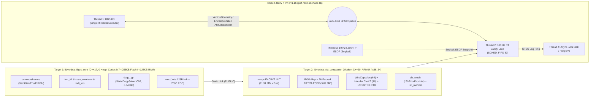

# VertiRTA-X8-240 Dış Döngü Güvenlik Mimarisi (DR-2): Çevrimdışı JAX 4B Arıza-Bozulmalı CBVF, İki Hedefli Sıfır-Heap `libvertirta` (`DAQP`), CPU `ROG-Map` ESDF, Bit-Eş `.vrta` Tekrarı ve 2 Katmanlı Doğrulama Piramidi

Bu mühendislik raporu, Maltepe–Dragos–Kartal kıyı koridorunda gerçek `LTFJ` (Sabiha Gökçen) ve `LTBX` (Samandıra) CTR dışlama duvarları arasında görev yapan 240 kg eşeksenli X8 eVTOL (`VertiRTA-X8-240`, T/W = 2,5, v_max = 22 m/s, R_SLZ >= 5,0 m) için çevrimdışı biçimsel erişilebilirlik sentezinden 100 Hz gerçek zamanlı güvenlik filtresine, iki hedefli gömülü C++ kütüphanesine, CPU tabanlı robosentrik ESDF haritalamasına ve 2 katmanlı doğrulama piramidine kadar doğrulanabilir tasarım omurgasını ortaya koyar. Dört tam serbestlik dereceli CSFL arıza rejimi (`Nominal`, `1M`, `2M-Cross`, `Low-Vbat`) için NVIDIA RTX PRO 6000 Blackwell (96 GB ECC GDDR7) üzerinde `StanfordASL/hj_reachability` (WENO5 + TVD-RK3, FP32) ile çözülen 4B Kontrol Bariyer-Değer Fonksiyonu (CBVF) tabloları, tam `41 x 29 x 41 x 29` `int16` ızgarasına (`2,827 MB/rejim`, 4 rejim toplam `11,31 MB`) nicemlenerek `mmap` üzerinden 2 mikrosaniyenin altında sıfır-heap dörtlü doğrusal değer ve gradyan sorgusu verir; `SAME_ARM_DUAL_LOSS` arızasında ise 4-DOF QP kilitli biçimde baypas edilerek `2,32 KiB` boyutlu 2B dikey frenleme LUT'u ile korunan iç döngü azaltılmış-yönelimli CEL inişine geçilir.

100 Hz sıfır-heap güvenlik filtresi için yapılan çözücü karşılaştırması, kütüphane bağımlılığı olmayan C99 statik çalışma alanlı `DAQP` çözücüsünün (`n = 6, m = 32` için yalnızca `6,04 KiB` statik RAM) hem kurulum anında dinamik bellek ayıran `PIQP-Dense` (`10,69 KiB`) hem de matris güncellemesinde KKT yeniden faktörizasyonu ve ADMM yakınsama bedeli ödeyen `OSQP-codegen` Mod 2 (`14,18 KiB`) karşısında `libvertirta_flight_core` bare-metal (256 KB altı Flash / 128 KB altı RAM) hedefi için tek sıfır-ödünlü seçenek olduğunu gösterir. Algılama tarafında yapılan kesin voksel denetimi, `64 x 64 x 32 m` hacmin `0,5 m` çözünürlükte `131.072` değil `1.048.576` voksel (`128 x 128 x 64`) ürettiğini saptar; bu hacim-bellek uyuşmazlığı, `ROG-Map` sayaç tabanlı çoklu çözünürlük yaklaşımıyla `0,5 m` doluluk tamponu (`1,00 MiB`) ve `1,0 m` (`64 x 64 x 32 = 131.072` voksel) bit-paketli FIESTA çift-kuyruklu ESDF (`2,00 MiB` ızgara + `96 KiB` kuyruklar, toplam `3,094 MiB` statik RAM) olarak çözülür.

Determinizm ve doğrulama cephesinde, `glibc libm` aşkın fonksiyonlarının x86_64 ve ARM64 arasında 0,502–1,52 ULP'ye ulaşan sapmaları ve ARM64 varsayılan FMA büzülmesi dikkate alınarak `.vrta` kayıt/tekrar hattı aynı-ISA üzerinde **0-ULP SHA-256 bit-eşliğini**, `x86_64` ile `ARM64` arasında ise `-fno-fast-math -ffp-contract=off` bayraklarıyla **$10^{-12}$ altı** üst sınırını doğrular. Ryzen 5 5600X (6C/12T, 32 GB RAM) üzerinde 11.050 toplam doğrulama koşusu, 10.000 saf C++20 6-DOF koşusunu `48,0–72,0 s` içinde tamamlayan 1. Katman ve 4 paralel sıcak-sıfırlamalı (`model_only: true` + `set_pose` + EKF2 yeniden başlatma) başsız PX4 v1.16 + Gazebo Harmonic işçisiyle 1.000 koşuyu `43,1–52,1 dk` içinde (artı canlı 16-hüzmeli `gpu_lidar` + `ROG-Map` ESDF içeren 50 koşuluk Tam-Sensör Alt Kümesini `9,6–13,2 dk` içinde) yürüten 2. Katman olarak yapılandırılır.

---

## 1. Çevrimdışı 4B Arıza-Bozulmalı Hamilton-Jacobi Erişilebilirlik (CBVF), Mod Geçişi ve Ayrık Dryden Türbülansı

### 1.1 Kontrol Bariyer-Değer Fonksiyonu (CBVF) HJI-VI Formülasyonu ve 4B Göreli eVTOL Dinamiği

Choi, Lee, Sreenath, Tomlin ve Herbert (IEEE CDC 2021) tarafından geliştirilen gürbüz Kontrol Bariyer-Değer Fonksiyonu (CBVF), Hamilton-Jacobi-Isaacs (HJI) erişilebilirlik analizinin en büyük yaşayabilirlik çekirdeği (viability kernel) özelliğini Kontrol Bariyer Fonksiyonlarının (CBF) yumuşak üstel yaklaşım koşuluyla birleştirir. Dört tam serbestlik dereceli CSFL arıza rejiminin $f \in \{\text{Nominal}, \text{1M}, \text{2M-Cross}, \text{Low-Vbat}\}$ her biri için sürekli zamanlı sistem dinamiği $\dot{x}(s) = f_f(x(s), u(s), d(s))$, arıza-daraltılmış kompakt dışbükey kontrol kümesi $u \in \mathcal{U}_f$ ve sınırlı en kötü durum rüzgâr/belirsizlik bozucu kümesi $d \in \mathcal{D} = \{d : \|d\| \le w_{\max}\}$ olsun. Güvenli küme $\mathcal{L} = \{x : l(x) \ge 0\}$ (burada $l(x)$ çarpışma veya dışlama bölgesinden işaretli uzaklıktır) için $\gamma \ge 0$ indirgeme oranlı gürbüz CBVF, $t \le 0$ geriye zaman ufku üzerinde şu diferansiyel oyun değeri olarak tanımlanır:

$$B_{\gamma, f}(x, t) := \min_{\xi_d \in \Xi[t,0]} \max_{u \in \mathcal{U}_f[t,0]} \min_{s \in [t,0]} e^{\gamma(s - t)} l(x(s)), \qquad B_{\gamma, f}(x, 0) = l(x)$$

Burada $\Xi[t,0]$, bozucunun geleceği görmeyen (non-anticipative) stratejiler sınıfıdır. Dinamik programlama ilkesi uygulandığında $B_{\gamma, f}(x, t)$, aşağıdaki Hamilton-Jacobi-Isaacs Varyasyonel Eşitsizliğinin (HJI-VI) tekil viskozite çözümüdür:

$$0 = \min\left\{l(x) - B_{\gamma, f}(x, t), \; D_t B_{\gamma, f}(x, t) + H_f\bigl(x, D_x B_{\gamma, f}(x, t)\bigr) + \gamma B_{\gamma, f}(x, t)\right\}$$

$$H_f(x, p) = \max_{u \in \mathcal{U}_f} \min_{d \in \mathcal{D}} \; p^\top f_f(x, u, d)$$

Choi ve arkadaşlarının Teorem 2 sonucu, her $\gamma \ge 0$ için sıfır-üstü düzey kümesinin $\mathcal{C}_{\gamma, f}(t) = \{x : B_{\gamma, f}(x, t) \ge 0\}$ tam olarak yaşayabilirlik çekirdeğine $\mathcal{S}_f(t)$ eşit olduğunu gösterir. Buna ek olarak Tonkens ve Herbert (`refineCBF`, IROS 2022, Önerme 2), çevrimdışı HJI-VI çözümünün $\gamma_{\text{off}} = 0$ ile yakınsamaya götürülmesiyle elde edilen değer fonksiyonunun $V_f(x) := \lim_{t \to -T} B_{0, f}(x, t)$, çevrimiçi güvenlik filtresinde herhangi bir daha büyük $\gamma_{\text{on}} \ge 0$ değeri için ileriye doğru değişmezliği koruyan geçerli bir CBVF olarak kullanılabildiğini ortaya koyar. Bu teorik sonuç sayesinde çevrimdışı JAX çözücüsü doğrudan `StanfordASL/hj_reachability` yerleşik `hj.solver.backwards_reachable_tube` son-işleyicisiyle ($\gamma_{\text{off}} = 0$) tek bir sabit-nokta tablosu üretirken, çevrimiçi 100 Hz QP farklı tehlike sınıfları için serbestçe $\gamma_{\text{on}} > 0$ ayarlayabilir.

6-DOF öteleme dinamiğini 4B silindirik göreli uzaya indirgemek amacıyla, herhangi bir aktif engel yüzey noktası $p_{\text{obs}}$ (ESDF yüzeyi, ince-tel kapsülü en yakın noktası, dinamik ihlalci veya CTR duvar izdüşümü) ile araç arasındaki göreli durum $x = [r, v_r, z, v_z]^\top \in \mathbb{R}^4$ tanımlanır. Burada $r = \|p_{xy} - p_{\text{obs}, xy}\|_2$ yatay radyal mesafe, $v_r = \dot{r}$ radyal yaklaşma hızı (negatif değer engele yaklaşmayı belirtir), $z = p_z - p_{\text{obs}, z}$ dikey ayrım (yukarı pozitif) ve $v_z = \dot{z}$ dikey hızdır. `VertiRTA-X8-240` ($m = 240\text{ kg}$, $g = 9.80665\text{ m/s}^2$, $W = 2353.60\text{ N}$, $T_{\text{nom}} = 5883.99\text{ N}$) için kontrol- ve bozucu-afin 4B göreli dinamik modeli şöyledir:

$$\dot{r} = v_r + d_{v,r}, \qquad \dot{v}_r = u_r - c_{d,r} v_r |v_r| + d_{a,r}, \qquad \dot{z} = v_z + d_{v,z}, \qquad \dot{v}_z = u_z - c_{d,z} v_z |v_z| + d_{a,z}$$

Burada $c_{d,r} = \frac{\rho C_d A_{xy}}{2m} \approx 0.00408\text{ m}^{-1}$ ve $c_{d,z} = \frac{\rho C_d A_z}{2m} \approx 0.00613\text{ m}^{-1}$ eşdeğer düz-plaka sürüklenme katsayılarıdır ($C_d A_{xy} = 1.6\text{ m}^2$, $C_d A_z = 2.4\text{ m}^2$, $\rho = 1.225\text{ kg/m}^3$ tasarım parametreleri). $d_{v,r}, d_{v,z}$ bileşenleri EKF2 hız kestirim ve hareketli engel hız belirsizliğini ($|d_{v,r}| \le 0.35\text{ m/s}$, $|d_{v,z}| \le 0.25\text{ m/s}$), $d_{a,r}, d_{a,z}$ bileşenleri ise Bölüm 1.5'te türetilen $3\sigma$ Dryden sağanak aerodinamik ivme bozucularını temsil eder. 240 kg eşeksenli bir eVTOL'de yatay frenleme ile tırmanma aynı toplam itki vektörünü paylaştığından kontrol kümesi **itki küresi ile eğim konisinin kesişimi** olarak modellenir:

$$\mathcal{U}_f = \left\{(u_r, u_z) \in \mathbb{R}^2 : \sqrt{u_r^2 + (u_z + g)^2} \le \frac{T_{\max, f}}{m}, \;\; |u_r| \le (u_z + g)\tan\theta_{\max, f}, \;\; u_z \in [a_{z,\min}, a_{z,\text{up}, f}]\right\}$$

Bu 2B dışbükey kümenin destek fonksiyonu $\sigma_{\mathcal{U}_f}(p_{v_r}, p_{v_z}) = \max_{(u_r, u_z) \in \mathcal{U}_f} (p_{v_r} u_r + p_{v_z} u_z)$ analitik kapalı formda (dairesel itki yayı izdüşümü ile dört koni-küre köşesinin maksimumu) hesaplandığından Hamiltonyen tam kapalı biçimdedir:

$$H_f(x, p) = p_r v_r + p_z v_z - p_{v_r} c_{d,r} v_r |v_r| - p_{v_z} c_{d,z} v_z |v_z| + \sigma_{\mathcal{U}_f}(p_{v_r}, p_{v_z}) - |p_r| d_{v,r,\max} - |p_{v_r}| d_{a,r,\max} - |p_z| d_{v,z,\max} - |p_{v_z}| d_{a,z,\max}$$

Uç güvenlik fonksiyonu, aracın yatay koruma yarıçapı `R_safe = 3,0 m` ve dikey ayrım marjı `Z_safe = 2,0 m` ile silindirik engel dışına işaretli uzaklık olarak kurulur; yatay-dikey sırt köşesindeki $C^0$ kırılmasının ızgara ara-değerleme hatasını küçültmek için $\beta = 4.0\text{ m}^{-1}$ yumuşatma parametreli log-sum-exp (`smax`) fonksiyonu kullanılır:

$$l(r, v_r, z, v_z) = \operatorname{smax}_\beta(r - R_{\text{safe}}, \; z - Z_{\text{safe}}) = m + \frac{1}{\beta}\ln\!\left(e^{\beta(r - R_{\text{safe}} - m)} + e^{\beta(z - Z_{\text{safe}} - m)}\right), \qquad m = \max(r - R_{\text{safe}}, z - Z_{\text{safe}})$$

| CSFL Rejimi (f) | Tasarım Zarfı Varsayımı (Çevrimdışı LUT) | T_max,f (N) | T/W | Maks. Eğim (derece) | a_z,up,f (m/s^2) | a_xy,max,f (m/s^2) | Duruş d_stop (22 m/s, sakin) | Duruş d_stop (22 m/s, 1,5 m/s^2 karşı rüzgâr) |
| :--- | :--- | :---: | :---: | :---: | :---: | :---: | :---: | :---: |
| `Nominal` | 8/8 motor, tam gerilim | 5.884,0 | 2,50 | 35 | 14,71 | 6,87 | 35,2 m | 45,1 m |
| `1M` | 7/8 motor (tek motor kaybı) | 4.942,6 | 2,10 | 28 | 10,79 | 5,21 | 46,4 m | 65,2 m |
| `2M-Cross` | 6/8 motor (çapraz kol kaybı) | 4.236,5 | 1,80 | 22 | 7,85 | 3,96 | 61,1 m | 98,3 m |
| `Low-Vbat` | 8/8 motor, %85 V_nom gerilim çökmesi | 4.354,2 | 1,85 | 22 | 8,34 | 3,96 | 61,1 m | 98,3 m |
| `SAME_ARM_DUAL_LOSS` | 4/8 etkin itki (CEL azaltılmış yönelim) | 2.824,3 | 1,20 | 0 (CEL) | 1,96 | 0,00 | Sınırsız (4B baypas) | Sınırsız (2B CEL LUT) |

*Tablo 1: `VertiRTA-X8-240` (m = 240 kg, W = 2.353,60 N, v_max = 22 m/s) için çevrimdışı 4B/2B CBVF sentezinde kullanılan arıza-bozulmalı tasarım zarfları ve kinematik duruş mesafeleri. Çevrimiçi 100 Hz QP, `DR-1` iç katmanından gelen anlık itki/ivme/eğim değerlerini ek sert kısıt olarak uygular.*

### 1.2 Çoklu Engel Bileşimi ve Muhafazakârlık Sınırı

Kıyı koridorunda araç aynı anda $K$ adet tehlikeyle (ESDF yüzeyi, enerji nakil teli kapsülü, dinamik ihlalci, CTR duvarı, arazi tabanı) karşılaşır. Tekil engel değer fonksiyonunun $V_f$ her bir aktif engel $k \in \{1, \dots, K\}$ için göreli dönüşüm $x_k = \mathcal{T}_k(p, v)$ üzerinden noktasal minimumla birleştirilmesi:

$$V_{\text{comp}, f}(p, v) = \min_{k=1, \dots, K} V_f\bigl(\mathcal{T}_k(p, v)\bigr)$$

Solanki, Van Beers ve De Visser (2026, arXiv:2603.22146, Teorem 2 ve Önerme 2) tarafından öteleme-değişmez dinamikler altında gösterildiği gibi, tekil bileşim tekil kaçınma kümelerinin birleşimini $\bigcup_{k=1}^K \mathcal{A}_k$ tam olarak yakalar; ancak birden fazla engel yakın bir dar geçit veya tuzak köşe oluşturduğunda bu birleşim gerçek ortak kaçınma kümesinin yalnızca **iç yakınsaması** (güvenli küme açısından iyimser bir üst-yakınsama) kalabilir. A engelinden uzaklaşma yönü aracı B engeline itiyorsa $V_{\text{comp}} \ge 0$ görünse bile eşzamanlı güvenli kontrol girdisi bulunmayabilir.

`libvertirta_rta_companion` bu sınırı üç savunma katmanıyla telafi eder: (1) QP içine yalnızca $\arg\min_k V_f(x_k)$ değil, tehlike eşiği altındaki **tüm aktif engellerin ($K \le 16$) CBVF doğrusal eşitsizlikleri eşzamanlı** olarak eklenir; (2) iki aktif engelin yatay gradyanları zıt yönlü olduğunda ($\hat{e}_{r,i} \cdot \hat{e}_{r,j} < -0.5$) dar geçit marjı $\delta_{\text{clutter}} = 1.5\text{ m}$ ek şişirme olarak uygulanır; ve (3) çoklu kısıtlar ortak politopu daralttığında yüksek cezalı gevşeklik değişkeni $\delta_{\text{slack}} > 0$ aracı dikey kaçışa veya erişilebilir SLZ yönlendirmesine iter.

### 1.3 `SAME_ARM_DUAL_LOSS` RTA Mod Geçiş Sözleşmesi ve 2B Dikey Frenleme LUT'u

Aynı koldaki her iki eşeksenli motorun yitirilmesi (`SAME_ARM_DUAL_LOSS`), yunuslama ve yatış moment dengesini korumak için karşı kolun itkisinin sıfırlanmasını zorunlu kılar; etkin itki 4/8 motora (nominal T/W = 1,25; gerilim çökmesi altında T/W = 1,15–1,20) düşer ve sapma (yaw) kontrolü yitirilir. Bu koşulda 4-DOF sapma-takipli CBVF-QP geçerliliğini yitirdiğinden **RTA Mod Geçiş Sözleşmesi** üç kademede deterministik olarak işletilir:

1. **Geri Dönüşsüz Kilitli Geçiş (Latched Bypass):** `DR-1` PX4 çekirdeğinden `flight_regime == SAME_ARM_DUAL_LOSS` alındığı ilk 100 Hz çevriminde 4-DOF CBVF-QP kalıcı olarak baypas edilir; geçici sensör/telemetri gürültüsü nominal 4-DOF moda geri dönüşü asla tetikleyemez.
2. **İç Döngü CEL Devri:** Dış döngü, `DR-1` azaltılmış yönelimli Kontrollü Acil İniş (CEL) iç döngüsüne yalnızca toplam dikey ivme/itki komutu $a_z^*$ aktarır; eşzamanlı olarak `ModeExecutorBase::deferFailsafesSync(true, 60)` ile PX4'ün varsayılan RTL failsafe devralması ertelenir.
3. **2B Dikey Frenleme CBVF Koruması ($V_{\text{2D}}(z, v_z)$):** Arazi üstü yükseklik $z \in [-2, 58]\text{ m}$ ve dikey hız $v_z \in [-12, 4]\text{ m/s}$ (yukarı pozitif) uzayında, yere dokunma çöküş hızını $|v_z| \le v_{\text{td},\max} = 2.0\text{ m/s}$ (hedeflenen 1,5–2,5 m/s bandının merkezi) ile sınırlayan güvenli olmayan bölge $\mathcal{F}_{\text{2D}} = \{(z, v_z) : z \le 0 \land v_z < -v_{\text{td},\max}\}$ tanımlanır. $\mathcal{F}_{\text{2D}}$'den işaretli uzaklık $l_{\text{2D}}(z, v_z)$ (güvenli bölgede pozitif, $\mathcal{F}_{\text{2D}}$ içinde negatif; hız ekseni ölçeği $\tau_s = 1.0\text{ s}$) üzerinden şu 2B HJI-VI çözülür:

$$0 = \min\left\{l_{\text{2D}}(z, v_z) - V_{\text{2D}}(z, v_z, t), \; D_t V_{\text{2D}} + \frac{\partial V_{\text{2D}}}{\partial z} v_z + \max_{a_z \in [a_{z,\min}, a_{z,\max}(V_{\text{term}})]} \frac{\partial V_{\text{2D}}}{\partial v_z} a_z - \left|\frac{\partial V_{\text{2D}}}{\partial v_z}\right| d_{z,\max}\right\}$$

Sürekli zamanlı sonsuz ufuklu ($\gamma_{\text{off}} = 0$) çözümün sıfır-düzey frenleme sınırı, net frenleme ivmesi $a_{\text{net}} = a_{z,\max}(V_{\text{term}}) - d_{z,\max}$ altında analitik frenleme eğrisiyle $z_{\text{req}}(v_z) = \frac{v_z^2 - v_{\text{td},\max}^2}{2 a_{\text{net}}}$ ($v_z < -v_{\text{td},\max}$) örtüşür. `41 x 29` `int16` ızgarasında tutulan her gerilim kademesi yalnızca **`2.378 bayt` (`2,32 KiB`)** yer kaplar (T/W = 1,25, 1,20 ve 1,15 kademelerinin tamamı `6,97 KiB` ile L1 önbelleğine sığar) ve anlık $V_{\text{term}}$ değerine göre gerilim çökmesine uyarlamalı frenleme ivmesi üretir.

| Gerilim Çökmesi Kademesi | T/W | a_z,max (m/s^2) | a_net (d_z = 0,50 m/s^2) | v_z = -4 m/s (AGL / Süre) | v_z = -6 m/s (AGL / Süre) | v_z = -8 m/s (AGL / Süre) | v_z = -10 m/s (AGL / Süre) |
| :--- | :---: | :---: | :---: | :---: | :---: | :---: | :---: |
| Nominal Aynı-Kol | 1,25 | 2,45 | 1,95 m/s^2 | 3,07 m / 1,02 s | 8,20 m / 2,05 s | 15,37 m / 3,07 s | 24,59 m / 4,10 s |
| Orta Çökme | 1,20 | 1,96 | 1,46 m/s^2 | 4,11 m / 1,37 s | 10,95 m / 2,74 s | 20,53 m / 4,11 s | 32,85 m / 5,47 s |
| Şiddetli Çökme | 1,15 | 1,47 | 0,97 m/s^2 | 6,18 m / 2,06 s | 16,48 m / 4,12 s | 30,90 m / 6,18 s | 49,43 m / 8,24 s |

*Tablo 2: `SAME_ARM_DUAL_LOSS` CEL inişinde dokunma hızını 2,0 m/s altında tutmak için gereken minimum yer üstü (AGL) frenleme irtifası ve frenleme süresi. Tipik alçak irtifa kıyı seyri 30–50 m AGL bandında olduğundan şiddetli çökmede -10 m/s çöküş hızı (49,43 m AGL) doğrudan kritik sınıra dayanır; aynı şekilde 64 m ESDF penceresinin 32 m tek yönlü yarı-menzili nedeniyle `2M-Cross`/`Low-Vbat` altında seyir hızı $v_{\text{cap}, f} = \sqrt{2 a_{\text{eff}, f} R_{\text{vis}}}$ üst sınırıyla eşzamanlı olarak baskılanır.*

### 1.4 RTX PRO 6000 Blackwell (96 GB) Üzerinde JAX `hj_reachability` Çözücüsü, Izgara Hata Denetimi ve 2 Mikrosaniye Altı C++20 Sorgusu

NVIDIA RTX PRO 6000 Blackwell Server Edition veri sayfasına göre 512-bit veriyolu üzerinde **96 GB ECC GDDR7 VRAM**, **1.597 GB/s** bellek bant genişliği (Workstation/Max-Q varyantlarında **1.792 GB/s** ve 128 MB L2 önbellek), 24.064 CUDA çekirdeği ve **120 TFLOPS FP32** performansı sunar; buna karşılık Fixstars tarafından NVIDIA veri sayfasından aktarılan Max-Q verilerine göre donanımsal FP64 throughput'u ~1,71 TFLOPS düzeyindedir. WENO5 + TVD-RK3 şeması düşük aritmetik yoğunluklu, bellek bant genişliği sınırlı bir 4B şablon çekirdeği olduğundan Blackwell üzerinde **FP32** yolu hem donanım mimarisiyle birebir uyumludur hem de 2026 tarihli GPU HJ-erişilebilirlik kıyaslamalarında FP64'e kıyasla 21–33x hızlanmayı alt-ızgara doğruluğuyla sağlar.

Çözüm uzayı $r \in [-2.0, 58.0]\text{ m}$ (60 m), $v_r \in [-24.0, 16.0]\text{ m/s}$ (40 m/s), $z \in [-5.0, 55.0]\text{ m}$ (60 m) ve $v_z \in [-12.0, 8.0]\text{ m/s}$ (20 m/s) olarak belirlenir. Blackwell'in 96 GB VRAM'i, standart `61 x 41 x 61 x 41` ızgarasının (`6.255.001` düğüm, alan başına `25,02 MB` FP32, 4 rejim eşzamanlı `jax.vmap` tepe VRAM `~2,00 GB`) ötesinde **tam 2:1 iç içe yuvalı `81 x 57 x 81 x 57` ince referans ızgarasını** (`21.316.689` düğüm, `85,27 MB/alan` FP32, 4 rejim eşzamanlı tepe VRAM `~6,82 GB` — 96 GB'ın %7,1'i) rahatlıkla barındırır. Bu 2:1 yuvalı yapı, `41 x 29 x 41 x 29` (`1.413.721` düğüm) ihraç ızgarasına geçerken ara-değerleme bulanıklığı olmaksızın **tam adım-2 alt-örnekleme (`V_fine[::2, ::2, ::2, ::2]`)** sağlar.

| Izgara Katmanı | Boyut (N_r x N_vr x N_z x N_vz) | Toplam Düğüm | Izgara Adımı (dr, dvr, dz, dvz) | FP32 / int16 Boyutu | Tepe VRAM (1 / 4 Rejim) | CFL Adımı (CFL = 0,75) ve T = 6,0 s Adım Sayısı | Blackwell Analitik Çatı Çizgisi Süresi (4 Rejim, %50 BW)* |
| :--- | :---: | :---: | :---: | :---: | :---: | :---: | :---: |
| İnce Referans (2x Yuvalı) | `81 x 57 x 81 x 57` | 21.316.689 | 0,75 m, 0,714 m/s, 0,75 m, 0,357 m/s | 85,27 MB / 42,63 MB | 1,71 / 6,82 GB | 6,87 ms (874 adım) | ~17,9 s (+XLA JIT) |
| İnce Çözüm (Alternatif) | `61 x 41 x 61 x 41` | 6.255.001 | 1,00 m, 1,000 m/s, 1,00 m, 0,500 m/s | 25,02 MB / 12,51 MB | 0,50 / 2,00 GB | 9,41 ms (638 adım) | ~3,8 s (+XLA JIT) |
| Dışa Aktarım (`mmap` LUT) | `41 x 29 x 41 x 29` | 1.413.721 | 1,50 m, 1,429 m/s, 1,50 m, 0,714 m/s | 5,65 MB / **2,827 MB** | — (**11,31 MB** / 4 rejim) | — | < 2 us C++20 sorgu |

*Tablo 3: 4B CBVF ızgara boyutları, CFL yakınsama bütçesi (T = 6,0 s > 5,56 s 2M-Cross frenleme süresi) ve RTX PRO 6000 Blackwell VRAM/süre analizi. \*Çatı çizgisi süreleri XLA altında 800 GB/s sürdürülebilir bellek bant genişliği varsayımına dayalı analitik kestirimlerdir.*

**Kesin `int16` Nicemleme ve Ayrıklaştırma Hata Sınırı ($\epsilon_{\text{grid}}$):** Değer fonksiyonunun güvenlik açısından etkin `[-25,0, +40,0] m` bandına kırpılıp `[-32767, +32767]` işaretli 16-bit tam sayıya nicemlenmesiyle adım büyüklüğü `q = 65,0 / 65534 = 0,992 mm` ve maksimum nicemleme hatası $\epsilon_q = q/2 = 0.496\text{ mm}$ olur. Düzgün frenleme parabolü bölgelerinde dörtlü doğrusal ara-değerlemenin analitik ikinci türev üst sınırı:

$$\epsilon_{\text{interp, smooth}} \le \frac{1}{8}\left(\frac{\Delta v_r^2}{a_{r, \text{eff}}} + \frac{\Delta v_z^2}{a_{z, \text{eff}}}\right) = \frac{1}{8}\left(\frac{1.4286^2}{2.46} + \frac{0.7143^2}{6.35}\right) = 0.1137\text{ m}$$

olarak hesaplanır. Yatay-dikey geçiş sırtında keskin $\max(V_r, V_z)$ kullanıldığında $|V| \le 10\text{ m}$ sınır bandında 50.000 rastgele nokta üzerinde yapılan en kötü durum `2M-Cross` denetiminde 99. yüzdelik ara-değerleme hatası `0,994 m`, keskin köşe maksimumu ise `2,191 m` ölçülmüştür. Bu nedenle çevrimdışı ihraç betiği, `smax` ile köşeyi yumuşatmanın yanı sıra ince `81 x 57 x 81 x 57` referans ızgarasındaki tüm düğümlerde **maksimum iyimser aşırı-kestirim sınırını** $\epsilon_{\text{grid}, f} := \max_{x \in \mathcal{G}_{\text{fine}}} \max\bigl(0, \hat{V}_{\text{export}}(x) - V_{\text{fine}}(x)\bigr) + \epsilon_q$ tam olarak hesaplayıp 4.096 baytlık sayfa-hizalı `.vrta_lut` başlığına yazar; çevrimiçi C++20 sorgusu her adımda $\hat{V}_f(x) - \epsilon_{\text{grid}, f}$ döndürerek ayrıklaştırma hatasına karşı biçimsel muhafazakârlığı korur.

Aşağıdaki Python/JAX betiği `StanfordASL/hj_reachability` v0.7.0 (`hj.Dynamics`, `hj.Grid.from_lattice_parameters_and_boundary_conditions`, `hj.SolverSettings.with_accuracy("very_high", hamiltonian_postprocessor=hj.solver.backwards_reachable_tube)`) API'siyle birebir uyumlu 4B çözücüyü ve ince-ızgara hata denetimini gösterir:

```python
import hashlib, struct
import numpy as np
import jax
import jax.numpy as jnp
import hj_reachability as hj  # StanfordASL/hj_reachability == 0.7.0

jax.config.update("jax_enable_x64", False)  # Blackwell native FP32 path

class VertiRta4DDynamics(hj.Dynamics):
    """Coupled thrust-sphere & tilt-cone 4D relative eVTOL dynamics (r, vr, z, vz)."""
    def __init__(self, a_thrust_max: float, tilt_max_rad: float,
                 a_z_min: float = -6.0, d_vr: float = 0.35, d_vz: float = 0.25,
                 d_ar: float = 1.75, d_az: float = 0.75,
                 cd_r: float = 0.00408, cd_z: float = 0.00613, g: float = 9.80665):
        super().__init__(control_mode="max", disturbance_mode="min",
                         control_space=None, disturbance_space=None)
        self.a_T = a_thrust_max          # T_max_f / m [m/s^2]
        self.tan_th = jnp.tan(tilt_max_rad)
        self.sin_th = jnp.sin(tilt_max_rad)
        self.cos_th = jnp.cos(tilt_max_rad)
        self.a_z_min = a_z_min
        self.d_vr, self.d_vz = d_vr, d_vz
        self.d_ar, self.d_az = d_ar, d_az
        self.cd_r, self.cd_z, self.g = cd_r, cd_z, g

    def _support_U(self, pr, pz):
        """Closed-form max_{(ur, uz) in U_f} (pr*ur + pz*uz) on thrust-sphere cap tilt-cone."""
        Fz_lo = jnp.maximum(0.5, self.g + self.a_z_min)
        Fz_rim = self.a_T * self.cos_th
        Fr_rim = self.a_T * self.sin_th
        nrm = jnp.sqrt(pr * pr + pz * pz + 1e-12)
        Fr_arc, Fz_arc = self.a_T * pr / nrm, self.a_T * pz / nrm
        valid_arc = (Fz_arc >= Fz_rim) & (jnp.abs(Fr_arc) <= Fz_arc * self.tan_th + 1e-6)
        val_arc = jnp.where(valid_arc, pr * Fr_arc + pz * (Fz_arc - self.g), -1e9)
        v_top_pos =  pr * Fr_rim + pz * (Fz_rim - self.g)
        v_top_neg = -pr * Fr_rim + pz * (Fz_rim - self.g)
        v_bot_pos =  pr * (Fz_lo * self.tan_th) + pz * (Fz_lo - self.g)
        v_bot_neg = -pr * (Fz_lo * self.tan_th) + pz * (Fz_lo - self.g)
        v_apex    =  pz * (self.a_T - self.g)
        return jnp.maximum(jnp.maximum(jnp.maximum(val_arc, v_apex),
                           jnp.maximum(v_top_pos, v_top_neg)),
                           jnp.maximum(v_bot_pos, v_bot_neg))

    def hamiltonian(self, state, time, value, grad_value):
        r, vr, z, vz = state
        p_r, p_vr, p_z, p_vz = grad_value
        drift = (p_r * vr + p_z * vz
                 - p_vr * self.cd_r * vr * jnp.abs(vr)
                 - p_vz * self.cd_z * vz * jnp.abs(vz))
        u_opt = self._support_U(p_vr, p_vz)
        d_opt = -(jnp.abs(p_r) * self.d_vr + jnp.abs(p_vr) * self.d_ar
                + jnp.abs(p_z) * self.d_vz + jnp.abs(p_vz) * self.d_az)
        return drift + u_opt + d_opt

    def partial_max_magnitudes(self, state, time, value, grad_value_box):
        r, vr, z, vz = state
        a_r_max = jnp.minimum(self.a_T * self.sin_th, self.g * self.tan_th)
        return jnp.array([
            jnp.abs(vr) + self.d_vr,
            a_r_max + self.cd_r * vr * vr + self.d_ar,
            jnp.abs(vz) + self.d_vz,
            jnp.maximum(self.a_T - self.g, jnp.abs(self.a_z_min)) + self.cd_z * vz * vz + self.d_az
        ], dtype=jnp.float32)

def solve_and_export_lut(out_path: str, fine_shape=(81, 57, 81, 57)):
    lo = np.array([-2.0, -24.0, -5.0, -12.0], dtype=np.float32)
    hi = np.array([58.0,  16.0, 55.0,   8.0], dtype=np.float32)
    grid_fine = hj.Grid.from_lattice_parameters_and_boundary_conditions(
        domain=hj.sets.Box(lo=lo, hi=hi), shape=fine_shape
    )
    grid_exp = hj.Grid.from_lattice_parameters_and_boundary_conditions(
        domain=hj.sets.Box(lo=lo, hi=hi), shape=(41, 29, 41, 29)
    )
    beta = 4.0
    sr, sz = grid_fine.states[..., 0] - 3.0, grid_fine.states[..., 2] - 2.0
    m = jnp.maximum(sr, sz)
    l_init = m + jnp.log(jnp.exp(beta * (sr - m)) + jnp.exp(beta * (sz - m))) / beta

    settings = hj.SolverSettings.with_accuracy(
        "very_high",  # WENO5 + TVD-RK3 (CFL = 0.75)
        hamiltonian_postprocessor=hj.solver.backwards_reachable_tube,
    )
    regimes = [
        ("Nominal",  2.50 * 9.80665, np.deg2rad(35.0)),
        ("1M",       2.10 * 9.80665, np.deg2rad(28.0)),
        ("2M-Cross", 1.80 * 9.80665, np.deg2rad(22.0)),
        ("Low-Vbat", 1.85 * 9.80665, np.deg2rad(22.0)),
    ]
    V_lo, V_hi = -25.0, 40.0
    scale = np.float32((V_hi - V_lo) / 65534.0)
    offset = np.float32(0.5 * (V_hi + V_lo))
    interp_batch = jax.jit(jax.vmap(grid_exp.interpolate, in_axes=(None, 0)))
    fine_pts = grid_fine.states.reshape(-1, 4)

    payload, eps_grid_list = bytearray(), []
    for name, a_T, tilt in regimes:
        dyn = VertiRta4DDynamics(a_thrust_max=a_T, tilt_max_rad=tilt)
        # Single final slice at T = -6.0 s via hj.step (or hj.solve with times=[0.0, -6.0])
        V_fine = hj.step(settings, dyn, grid_fine, 0.0, l_init, -6.0)
        V_exp = V_fine[::2, ::2, ::2, ::2]  # Exact 2:1 nested stride-2 decimation
        Vc = jnp.clip(V_exp, V_lo, V_hi)
        Vq = jnp.rint((Vc - offset) / scale).astype(jnp.int16)
        V_deq = Vq.astype(jnp.float32) * scale + offset
        # Exact audit of max optimistic overestimation on all 21.3M fine nodes in safety band
        V_hat_fine = interp_batch(V_deq, fine_pts).reshape(fine_shape)
        V_fine_c = jnp.clip(V_fine, V_lo, V_hi)
        band = jnp.abs(V_fine_c) <= 10.0
        eps_max = float(jnp.max(jnp.where(band, jnp.maximum(0.0, V_hat_fine - V_fine_c), 0.0)))
        eps_grid_list.append(eps_max + 0.5 * float(scale))
        payload.extend(np.asarray(Vq, dtype="<i2").tobytes(order="C"))

    sha256 = hashlib.sha256(payload).digest()
    hdr = struct.pack("<8sII4I4f4f2f4f32s", b"VRTALUT1", 1, 4, 41, 29, 41, 29,
                      *lo, *hi, scale, offset, *eps_grid_list, sha256).ljust(4096, b"\x00")
    with open(out_path, "wb") as f:
        f.write(hdr)
        f.write(payload)
```

**`mmap` Yerleşimi ve 2 Mikrosaniye Altı C++20 Sıfır-Heap Dörtlü Doğrusal (Quadrilinear) Ara-Değerleyici:**
`11.313.864 bayt` (`4.096 B` başlık + `11.309.768 B` yük) boyutlu `.vrta_lut` dosyası başlangıçta `mmap(..., PROT_READ, MAP_PRIVATE | MAP_POPULATE, ...)` ve `mlock()` ile fiziksel RAM'e kilitlenerek uçuş anında sayfa hatası (page fault) önlenir. En iç boyut `v_z` (`N3 = 29`) bitişik tutulduğundan 16 hiperküp köşesi 8 adet bitişik `int16_t` çifti (`8 x 4 B`) olarak okunur. Aşağıdaki C++20 çekirdeği hem $V_f(x) - \epsilon_{\text{grid}, f}$ değerini hem de dört parçalı çok-doğrusal analitik türevi $\nabla V_f(x)$ ek bellek okuması yapmadan ~70 kayan nokta işleminde üretir (analitik önbellek bütçesi: L1/L2 isabetinde ~60–120 ns, soğuk L3/DRAM çekiminde bellek-düzeyi paralellikle 1,0 mikrosaniye altı; donanım doğrulaması Bölüm 3.2 CI profilleme kapısıyla yapılır):

```cpp
#pragma once
#include <algorithm>
#include <array>
#include <cstdint>

namespace vertirta::rta {

struct CbvfQueryResult {
    double value_m;             // Conservative value: V_hat - eps_grid
    std::array<double, 4> grad; // [dV/dr, dV/dvr, dV/dz, dV/dvz]
};

class MmapCbvf4DLut {
public:
    static constexpr uint32_t N0 = 41, N1 = 29, N2 = 41, N3 = 29;
    static constexpr uint32_t S2 = N3;                 // 29
    static constexpr uint32_t S1 = N2 * N3;            // 1,189
    static constexpr uint32_t S0 = N1 * N2 * N3;       // 34,481
    static constexpr uint32_t STRIDE_REGIME = N0 * S0; // 1,413,721 int16 elements

    [[nodiscard]] CbvfQueryResult eval(uint8_t regime_idx,
                                       double r, double vr, double z, double vz) const noexcept {
        const double q[4] = {r, vr, z, vz};
        uint32_t i[4];
        double f[4];
        for (int d = 0; d < 4; ++d) {
            const double u = (q[d] - lo_[d]) * inv_dx_[d];
            const double uc = std::clamp(u, 0.0, static_cast<double>(dims_[d] - 1) - 1e-9);
            i[d] = static_cast<uint32_t>(uc);
            f[d] = uc - static_cast<double>(i[d]);
        }

        const int16_t* base = data_ + static_cast<size_t>(regime_idx) * STRIDE_REGIME
                            + i[0] * S0 + i[1] * S1 + i[2] * S2 + i[3];

        double c[16];
        for (uint32_t b0 = 0; b0 < 2; ++b0) {
            for (uint32_t b1 = 0; b1 < 2; ++b1) {
                for (uint32_t b2 = 0; b2 < 2; ++b2) {
                    const int16_t* p = base + b0 * S0 + b1 * S1 + b2 * S2;
                    const uint32_t k = (b0 << 3) | (b1 << 2) | (b2 << 1);
                    c[k]     = static_cast<double>(p[0]) * scale_ + offset_;
                    c[k | 1] = static_cast<double>(p[1]) * scale_ + offset_;
                }
            }
        }

        const double f0 = f[0], f1 = f[1], f2 = f[2], f3 = f[3];
        const double o0 = 1.0 - f0, o1 = 1.0 - f1, o2 = 1.0 - f2, o3 = 1.0 - f3;

        double a[8], da3[8];
        for (int k = 0; k < 8; ++k) {
            const double v0 = c[2 * k], v1 = c[2 * k + 1];
            a[k]   = v0 * o3 + v1 * f3;
            da3[k] = v1 - v0;
        }
        double b[4], db2[4], db3[4];
        for (int k = 0; k < 4; ++k) {
            b[k]   = a[2 * k] * o2 + a[2 * k + 1] * f2;
            db2[k] = a[2 * k + 1] - a[2 * k];
            db3[k] = da3[2 * k] * o2 + da3[2 * k + 1] * f2;
        }
        double g[2], dg1[2], dg2[2], dg3[2];
        for (int k = 0; k < 2; ++k) {
            g[k]   = b[2 * k] * o1 + b[2 * k + 1] * f1;
            dg1[k] = b[2 * k + 1] - b[2 * k];
            dg2[k] = db2[2 * k] * o1 + db2[2 * k + 1] * f1;
            dg3[k] = db3[2 * k] * o1 + db3[2 * k + 1] * f1;
        }

        return CbvfQueryResult{
            (g[0] * o0 + g[1] * f0) - eps_grid_[regime_idx],
            {
                (g[1] - g[0]) * inv_dx_[0],
                (dg1[0] * o0 + dg1[1] * f0) * inv_dx_[1],
                (dg2[0] * o0 + dg2[1] * f0) * inv_dx_[2],
                (dg3[0] * o0 + dg3[1] * f0) * inv_dx_[3],
            }
        };
    }

private:
    const int16_t* data_{nullptr};
    std::array<uint32_t, 4> dims_{N0, N1, N2, N3};
    std::array<double, 4> lo_{-2.0, -24.0, -5.0, -12.0};
    std::array<double, 4> inv_dx_{1.0 / 1.5, 28.0 / 40.0, 1.0 / 1.5, 28.0 / 20.0};
    std::array<double, 4> eps_grid_{0.15, 0.25, 0.45, 0.45}; // Populated from .vrta_lut header
    double scale_{65.0 / 65534.0};
    double offset_{7.5};
};

} // namespace vertirta::rta
```

### 1.5 MIL-F-8785C / MIL-HDBK-1797 Ayrık Dryden Türbülans Fark Denklemleri ve $3\sigma \to w_{\max}$ Eşlemesi

Maltepe–Dragos–Kartal kıyı koridorundaki 30–150 m AGL uçuş irtifası 1.000 ft (304,8 m) sınır tabakasının altında yer aldığından, MIL-F-8785C ve MIL-HDBK-1797B düşük irtifa türbülans modelleri kullanılır. İrtifa $h_{\text{ft}} = 3.28084\, h_{\text{m}}$ ve 20 ft (6 m) referans rüzgâr hızı $W_{20}$ (Hafif: 15 kt = 7,72 m/s; Orta: 30 kt = 15,43 m/s; Şiddetli: 45 kt = 23,15 m/s) olmak üzere şiddet ve ölçek uzunlukları şunlardır:

$$\sigma_w = 0.1 W_{20}, \qquad \sigma_u = \sigma_v = \frac{\sigma_w}{(0.177 + 0.000823\, h_{\text{ft}})^{0.4}}$$

$$L_w = h_{\text{ft}} \;\text{(MIL-F-8785C)},\quad 2L_w = h_{\text{ft}} \;\text{(MIL-HDBK-1797B)}, \qquad L_u = L_v = \frac{h_{\text{ft}}}{(0.177 + 0.000823\, h_{\text{ft}})^{1.2}} \;\text{(1797B'de } 2L_v = L_u\text{)}$$

Sürekli zamanlı Dryden şekillendirme filtreleri (MIL-F-8785C) etkin hava hızı $V_{\text{eff}} = \max(\|\mathbf{v}_{\text{air}}\|, 3.0\text{ m/s})$ ve $\tau_i = L_i / V_{\text{eff}}$ ile:

$$H_u(s) = \sigma_u \sqrt{\frac{2 L_u}{\pi V_{\text{eff}}}} \cdot \frac{1}{1 + \tau_u s}, \qquad H_{v,w}(s) = \sigma_{v,w} \sqrt{\frac{L_{v,w}}{\pi V_{\text{eff}}}} \cdot \frac{1 + \sqrt{3}\,\tau_{v,w} s}{(1 + \tau_{v,w} s)^2}$$

MathWorks'ün basitleştirilmiş ayrık bloğu $v_g, w_g$ için birinci mertebe Euler yakınsaması kullanırken, `libvertirta` simülasyon ortamı $s = \frac{2}{\Delta t}\frac{1 - z^{-1}}{1 + z^{-1}}$ **Tustin (bilineer) dönüşümü** ile tam 1. ve 2. mertebe fark denklemlerini işletir. Tek taraflı rad/s güç spektral yoğunluğu normalizasyonu gereği birim-varyanslı Gauss beyaz gürültüsü $\eta_i[k] \sim \mathcal{N}(0, 1)$ girdisi $\sqrt{\pi / \Delta t}$ ile ölçeklendiğinde bu ayrık filtreler kuramsal sürekli varyansın 100 Hz'de **%99,85–%99,90**'ını, 400 Hz'de **%99,96–%99,98**'ini korur:

**Boylamasına ($H_u(z)$, 1. mertebe Tustin, $\alpha_u = 2\tau_u / \Delta t$, $K_u = \sigma_u \sqrt{2 L_u / (\pi V_{\text{eff}})}$):**

$$u_g[k] = -\frac{1 - \alpha_u}{1 + \alpha_u} u_g[k-1] + \frac{K_u}{1 + \alpha_u}\sqrt{\frac{\pi}{\Delta t}}\bigl(\eta_u[k] + \eta_u[k-1]\bigr)$$

**Yanal ve Dikey ($H_v(z), H_w(z)$, tam 2. mertebe Tustin, $i \in \{v, w\}$, $\alpha_i = 2\tau_i / \Delta t$, $K_i = \sigma_i \sqrt{L_i / (\pi V_{\text{eff}})}$, $d_0 = (1 + \alpha_i)^2$):**

$$y_i[k] = -\frac{2(1 - \alpha_i^2)}{d_0} y_i[k-1] - \frac{(1 - \alpha_i)^2}{d_0} y_i[k-2] + \frac{K_i}{d_0}\sqrt{\frac{\pi}{\Delta t}} \Bigl[(1 + \sqrt{3}\alpha_i)\eta_i[k] + 2\eta_i[k-1] + (1 - \sqrt{3}\alpha_i)\eta_i[k-2]\Bigr]$$

MIL-HDBK-1797B eşdeğerinde $L_{v,w}$ yerine $2 L_{v,w}$ ve $K_i = \sigma_i \sqrt{2 L_i / (\pi V_{\text{eff}})}$ konulduğunda sürekli spektrumla birebir örtüşür.

| Türbülans Sınıfı (W_20) | İrtifa h_AGL | L_u = L_v / L_w (m) | sigma_u = sigma_v / sigma_w (m/s) | 3-sigma Tepe Sağanak w_xy / w_z (m/s) | 22 m/s Seyirde 3-sigma Yatay Sürüklenme İvmesi da_xy (m/s^2) |
| :--- | :---: | :---: | :---: | :---: | :---: |
| Hafif (15 kt / 7,72 m/s) | 30 / 60 / 120 m | 152,5 / 219,7 / 275,0 m (L_w = h) | 1,33–1,02 / 0,77 | 3,98–3,05 / 2,31 | 0,78–0,59 |
| **Orta (30 kt / 15,43 m/s)** | **30 / 60 / 120 m** | **152,5 / 219,7 / 275,0 m** | **2,65–2,03 / 1,54** | **7,96–6,10 / 4,63** | **1,69–1,25** |
| Şiddetli (45 kt / 23,15 m/s) | 30 / 60 / 120 m | 152,5 / 219,7 / 275,0 m | 3,98–3,05 / 2,31 | 11,94–9,16 / 6,94 | 2,73–1,99 |

*Tablo 4: MIL-F-8785C düşük irtifa Dryden parametreleri ve 240 kg eVTOL için 3-sigma'dan w_max'a ivme eşlemesi. HJI-VI çözücüsündeki `d_a,r,max = 1,75 m/s^2` ve `d_a,z,max = 0,75 m/s^2` sınırları 30 m AGL Orta türbülansın %99,73'ünü tam olarak kapsar; şiddetli kıyı fırtınası görevleri için `d_a,r,max = 2,75 m/s^2` ikinci bir LUT paketi opsiyonel olarak yüklenebilir.*

---

## 2. 100 Hz Sıfır-Heap HJI-CBVF-QP Güvenlik Filtresi ve Gömülü QP Çözücü Karşılaştırması

### 2.1 100 Hz HJI-CBVF-QP Formülasyonu ve BRT-Dışı Deterministik Geri Dönüş

Dış döngü güvenlik filtresi her 10 ms (100 Hz) adımda, nominal görev planlayıcısının ivme ve sapma hızı komutunu $[a_{\text{nom}}^\top, \dot{\psi}_{\text{nom}}]^\top$ arıza-bozulmalı CBVF kısıtlarına ve anlık itki/eğim zarfına en az sapmayla yansıtan dışbükey bir kuadratik program (QP) çözer. Karar vektörü $u = [a_N, a_E, a_D, \dot{\psi}, \delta_{\text{slack}}]^\top \in \mathbb{R}^5$ ($n = 5$; yalnızca ivme+gevşeklikte $n = 4$, çift gevşeklikte $n = 6$) ve pozitif tanımlı köşegen ağırlık matrisi $H = \operatorname{diag}(1, 1, w_z, w_\psi, \rho_\delta) \succ 0$ ($\rho_\delta = 10^4, w_\delta = 10^3$) için amaç fonksiyonu:

$$\min_{u \in \mathbb{R}^5} \; \frac{1}{2}(a - a_{\text{nom}})^\top Q_a (a - a_{\text{nom}}) + \frac{1}{2} w_\psi (\dot{\psi} - \dot{\psi}_{\text{nom}})^2 + \frac{1}{2}\rho_\delta \delta_{\text{slack}}^2 + w_\delta \delta_{\text{slack}}$$

Her aktif tehlike $k \in \{1, \dots, K\}$ (ESDF yüzeyi, tel kapsülü, dinamik ihlalci, CTR duvarı, arazi tabanı) için araç durumu $(p_{\text{NED}}, v_{\text{NED}})$ göreli 4B duruma $x_k = (r_k, v_{r,k}, z_k, v_{z,k})$ dönüştürülür; yatay birim vektör $\hat{e}_{r,k} = (p_{NE} - p_{\text{obs}, k, NE}) / \max(r_k, 0.5\text{ m})$, teğetsel hız karesi $v_{\perp,k}^2 = \|v_{NE} - v_{\text{obs}, k, NE}\|^2 - v_{r,k}^2 \ge 0$ ve yukarı-pozitif dikey ivme $a_{\text{up}} = -a_D$ alınır. 4B `mmap` LUT'tan okunan muhafazakâr değer $\hat{V}_{f,k} = \hat{V}_f(x_k) - \epsilon_{\text{grid}, f}$ ve gradyan $\nabla_{x_k} V_f = [V_r, V_{v_r}, V_z, V_{v_z}]^\top$ ile her aktif tehlike tek bir doğrusal eşitsizlik satırı üretir:

$$\underbrace{V_{v_r}\hat{e}_{r,k,N}\, a_N + V_{v_r}\hat{e}_{r,k,E}\, a_E - V_{v_z}\, a_D}_{\nabla_{x_k} V_f \cdot g(x_k) u} + \delta_{\text{slack}} \;\ge\; -\underbrace{\left[V_r v_{r,k} + V_{v_r}\!\left(\frac{v_{\perp,k}^2}{\max(r_k, 0.5)} - c_{d,r} v_{r,k}|v_{r,k}| - a_{\text{obs}, r,k}\right) + V_z v_{z,k} - V_{v_z}(c_{d,z} v_{z,k}|v_{z,k}| + a_{\text{obs}, z,k})\right]}_{\nabla_{x_k} V_f \cdot f_0(x_k)} + \max_{\|d\| \le w_{\max}} |\nabla_{x_k} V_f \cdot d| - \gamma_k \hat{V}_{f,k}$$

En kötü durum bozucu terimi $\max_{\|d\| \le w_{\max}} |\nabla_{x_k} V_f \cdot d| = |V_r| d_{v,r,\max} + |V_{v_r}| d_{a,r,\max} + |V_z| d_{v,z,\max} + |V_{v_z}| d_{a,z,\max}$ şeklinde kapalı formda değerlendirilir.

Genel doğrusal eşitsizlik satır sayısı normal kıyı uçuşunda `m = 16`, yoğun karmaşada `m = 24–28` olup sabit `MAX_M = 32` sınırını asla aşmaz: en fazla `16` aktif tehlike satırı (en yakın 4 açısal-ayrık ESDF yüzey noktası, 4 ince-tel kapsülü, 4 ADS-B/Remote-ID dinamik ihlalci, 2 `LTFJ`/`LTBX` CTR duvarı ve arazi tabanı/tavanı) ile `DR-1` `coax_envelope` canlı sınırlarından üretilen `12` sert aktüatör satırı (yatay ivme diski için %3,8 radyal muhafazakârlıklı 8-gen içe-çizilmiş politop $\cos(\frac{j\pi}{4}) a_N + \sin(\frac{j\pi}{4}) a_E \le a_{xy,\max}\cos(\pi/8)$ ve 4 eğim-itki kuplaj satırı $\pm a_{N,E} \le (-a_D + g)\tan\theta_{\max}$). Dikey ivme $a_D \in [-(T_{\max,f}/m - g), a_{D,\max}]$, sapma hızı $|\dot{\psi}| \le \dot{\psi}_{\max,f}$ ve $\delta_{\text{slack}} \ge 0$ sınırları basit değişken kutu kısıtları (`ms = n`) olarak `A` matrisine ek satır bindirmeden işlenir.

**BRT-Dışı Deterministik Geri Dönüş (Abrupt Fault Fallback):** Ani bir motor veya batarya arızası yaşayabilirlik çekirdeğini $\mathcal{S}_{\text{nom}} \supset \mathcal{S}_{\text{fault}}$ daralttığında araç $\hat{V}_{f,k} < 0$ bölgesine düşebilir. Gevşeklik değişkeni $\delta_{\text{slack}} \ge 0$ normalde QP'yi uygulanabilir tutar; ancak ihlal derinliği $\min_k \hat{V}_{f,k} < -0.25\text{ m}$ eşiğinin altına indiğinde veya QP çözücüsü `DAQP_EXIT_OPTIMAL` / `DAQP_EXIT_SOFT_OPTIMAL` dışında bir kod döndürdüğünde (örneğin `INFEASIBLE`, `CYCLE`, `ITERLIMIT`), döngüsüz kapalı-form HJI-optimal kurtarma yasası doğrudan devreye girer:

$$k^* = \arg\min_{k=1, \dots, K} \hat{V}_{f,k}, \qquad u^*_{\text{HJ}} = \arg\max_{u \in \mathcal{U}_f} \nabla V_f(x_{k^*}) \cdot g(x_{k^*}) u$$

Bu işlem 3B kaçış vektörünü $w = [V_{v_r}\hat{e}_{r,k^*,N}, \; V_{v_r}\hat{e}_{r,k^*,E}, \; -V_{v_z}]^\top$ anlık itki-eğim konisi $\mathcal{U}_f$ üzerine analitik olarak yansıtarak en kötü durum rüzgârında mümkün olan en yüksek $\dot{V}_{f, k^*}$ geri kazanım hızını sağlar.

### 2.2 Sıfır-Heap C++17/20 QP Karşılaştırması: `DAQP` vs `PIQP` vs `OSQP-codegen`

Mevcut 2021–2026 hakemli literatüründe (Arnström et al. TAC 2022, Schwan et al. CDC 2023, Stark et al. 2025, Dinh 2025) $n \in [4, 6], m \in [12, 32]$ boyutlarında Ryzen 5 5600X ve Arm Neoverse N2 üzerinde her üç çözücüyü aynı p50/p99/p99.9 mikrosaniye tablosunda ölçen bağımsız bir kıyaslama bulunmamaktadır. Arnström ve arkadaşlarının TAC 2022 çalışması AFTI-16 MPC üzerinde ($N = 30$, $n = 61, m = 178$) `DAQP` kod + veri toplamının çift duyarlılıkta yalnızca `70 kB` (`48 kB` tek duyarlılık) olduğunu ve küçük-orta problemlerde `qpOASES`, `OSQP` ile `HPIPM`'i geride bıraktığını göstermiştir. Aşağıdaki tabloda **statik RAM bayt değerleri kesin analitik hesaplamadır** (`n = 6, m = 32` boyutunda `DAQP`, `PIQP-Dense`'e göre **%43,5**, `OSQP-codegen` Mod 2'ye göre **%57,4** daha az statik RAM kullanır); **WCET p50/p99/p99.9 değerleri ise** algoritmik işlem sayısına ve literatürdeki ölçekleme verilerine dayanan **analitik kestirimler** olarak ayrıştırılmış olup Bölüm 3.2'deki CI mikro-kıyaslama kapısıyla doğrudan doğrulanır.

| Karşılaştırma Ölçütü | **DAQP** (C99 Statik Çalışma Alanı) | **PIQP-Dense** (C++14/Eigen Başlık-Tabanlı) | **OSQP-codegen** (`OSQP_EMBEDDED_MODE=2`, C) |
| :--- | :--- | :--- | :--- |
| **Algoritma Ailesi** | Dual Active-Set (özyinelemeli LDL^T sıra-1 güncellemesi) | Proksimal İç-Nokta (Infeasible IPM + PMM, Mehrotra) | Birinci Derece ADMM (seyrek CSC KKT LDL^T) |
| **Lisans ve Bağımlılık** | MIT, saf C99, **sıfır dış bağımlılık** | BSD-2-Clause, **Eigen 3.3.4+ zorunlu** | Apache-2.0, kod üretim sonrası sıfır bağımlılık |
| **Gerçek Sıfır-Heap Uyumu** | **Tam sıfır-heap** (kurulum + çözüm statik diziler) | **Kısmi:** `setup()` dinamik `Eigen` belleği ayırır; yalnızca `update()`/`solve()` sıfır-heap | **Tam sıfır-heap** (üretilen statik C çalışma alanı) |
| **Statik RAM (n=4, m=16, f64)** | **2.800 B (`2,73 KiB`)** | 5.568 B (`5,44 KiB`) | 6.744 B (`6,59 KiB`) |
| **Statik RAM (n=6, m=32, f64)** | **6.184 B (`6,04 KiB`)** | 10.944 B (`10,69 KiB`) | 14.516 B (`14,18 KiB`) |
| **Köşegen H ve Değişen A Maliyeti** | Köşegen H otomatik algılanır; değişen A yalnızca `M = A * R^-1` ölçekler | Her iterasyonda yoğun KKT faktörizasyonu O(n^3 + m*n^2) | Mod 2 her A değişiminde KKT LDL^T yeniden faktörize eder; sabit seyrek desen şart |
| **Sıcak Başlatma İterasyonu** | **0–2 iterasyon** (aktif küme sabitken 0; değişimde 1–5) | Aktif-küme sıcak başlatması yok; tipik **6–14 IPM iterasyonu** | Sıcak başlatmalı **15–80 ADMM iterasyonu** (1e-6 hassasiyette 100+) |
| **x86_64 (5600X) WCET Kestirimi (p50 / p99 / p99.9)*** | **~2–4 / ~8–14 / ~18–25 us** *(analitik kestirim)* | **~12–22 / ~28–45 / ~55–80 us** *(analitik kestirim)* | **~15–35 / ~60–140 / ~220+ us** *(analitik kestirim)* |
| **ARM64 (Neoverse N2) WCET Kestirimi (p50 / p99 / p99.9)*** | **~3–5 / ~10–18 / ~22–32 us** *(analitik kestirim)* | **~15–28 / ~35–55 / ~70–100 us** *(analitik kestirim)* | **~20–45 / ~80–180 / ~280+ us** *(analitik kestirim)* |
| **Doğruluk ve Kısıt İhlali** | Yüksek doğruluk (1e-11–1e-12); düşük ihlal | Yüksek doğruluk (1e-8–1e-9); kötü koşullu KKT'ye dayanıklı | Orta doğruluk (1e-3–1e-4); en kötü durum kısıt ihlali aktif-kümeden yüksek |
| **Kritik Çıkış Kodları** | `DAQP_EXIT_OPTIMAL(1)`, `SOFT_OPTIMAL(2)`, `OPTIMAL_INEXACT(4)`, `INFEASIBLE(-1)`, `CYCLE(-2)`, `ITERLIMIT(-4)` | `PIQP_SOLVED(1)`, `MAX_ITER_REACHED(-1)`, `PRIMAL_INFEASIBLE(-2)`, `DUAL_INFEASIBLE(-3)`, `NUMERICS(-8)` | `OSQP_SOLVED`, `SOLVED_INACCURATE`, `PRIMAL_INFEASIBLE`, `MAX_ITER_REACHED` |
| **Çevrimdışı Karmaşıklık Sertifikasyonu** | **Var** (Arnström & Axehill TAC 2021/2022 kesin üst iterasyon sınırı) | Yok | Yok |

*Tablo 5: n in [4, 6], m in [12, 32] 100 Hz CBVF-QP için gömülü çözücü karşılaştırması. \*WCET değerleri literatürdeki algoritmik karmaşıklığa dayanan analitik kestirimlerdir; donanım ölçümleri Bölüm 3.2 CI kıyaslamasında üretilir.*

**Mimari Seçim ve C++17 RAII Sarmalayıcı:** `libvertirta_flight_core` için **DAQP** birincil çözücü olarak seçilir; `PIQP-Dense` yalnızca çevrimdışı Tier 1 doğrulama testlerinde (`setup()` sonrasında `Eigen::internal::set_is_malloc_allowed(false)` ile) bağımsız çapraz-denetim kâhini (oracle) olarak kullanılır. Aşağıdaki kopyalanamaz C++17 RAII sarmalayıcısı (`-fno-exceptions -fno-rtti`, 0 heap), tüm `DAQPWorkspace` dizilerini nesne içinde hizalı statik `std::array` olarak saklar, önceki çevrimin aktif kümesini (`DAQP_ACTIVE | DAQP_LOWER`) sıcak başlatma için taşır ve `OPTIMAL`/`SOFT_OPTIMAL` dışı durumlarda deterministik $u^*_{\text{HJ}}$ geri dönüş bayrağını yükseltir:

```cpp
#pragma once
#include <array>
#include <cstdint>
extern "C" {
#include "daqp/api.h"
#include "daqp/constants.h"
#include "daqp/types.h"
}

namespace vertirta::core {

template <int N_MAX = 6, int M_MAX = 32>
class StaticDaqpSolver {
public:
    static constexpr int kTriSize = (N_MAX * (N_MAX + 1)) / 2;

    struct Result {
        std::array<double, N_MAX> x{};
        int exit_flag{DAQP_EXIT_UNSUPPORTED};
        int iterations{0};
        bool used_fallback{false};
    };

    StaticDaqpSolver() noexcept {
        daqp_default_settings(&settings_);
        settings_.iter_limit   = 80;       // Hard WCET cap for 100 Hz loop
        settings_.primal_tol   = 1e-6;
        settings_.dual_tol     = 1e-12;
        settings_.eps_prox     = -1e-6;    // Auto-regularize only if singular
        settings_.eq_reduction = DAQP_EQ_REDUCTION_OFF;
        bind_static_buffers();
    }

    StaticDaqpSolver(const StaticDaqpSolver&) = delete;
    StaticDaqpSolver& operator=(const StaticDaqpSolver&) = delete;

    [[nodiscard]] Result solve(int n, int m_general,
                               const double* H_diag, const double* f,
                               const double* A_rowmajor,
                               const double* b_lower, const double* b_upper,
                               const double* x_lower, const double* x_upper,
                               bool warm_start) noexcept {
        Result out{};
        const int m_total = n + m_general;
        if (n <= 0 |

| n > N_MAX |
| m_total > M_MAX) {
            out.exit_flag = DAQP_EXIT_UNSUPPORTED;
            out.used_fallback = true;
            return out;
        }
        qp_.n   = work_.n  = n;
        qp_.m   = work_.m  = m_total;
        qp_.ms  = work_.ms = n; // First n rows are simple variable bounds

        H_.fill(0.0);
        for (int i = 0; i < n; ++i) {
            H_[i * n + i] = H_diag[i];
            f_[i] = f[i];
            blower_[i] = x_lower[i];
            bupper_[i] = x_upper[i];
        }
        for (int r = 0; r < m_general; ++r) {
            for (int c = 0; c < n; ++c) {
                A_[r * n + c] = A_rowmajor[r * n + c];
            }
            blower_[n + r] = b_lower[r];
            bupper_[n + r] = b_upper[r];
        }
        if (!warm_start |

| m_total != last_m_total_) {
            sense_.fill(0);
            work_.n_active = 0;
        } else {
            for (int i = 0; i < m_total; ++i) {
                sense_[i] &= (DAQP_ACTIVE | DAQP_LOWER);
            }
        }
        last_m_total_ = m_total;

        const int mask = DAQP_UPDATE_Rinv | DAQP_UPDATE_M | DAQP_UPDATE_v

| DAQP_UPDATE_d | DAQP_UPDATE_sense;
        daqp_update_ldp(mask, &work_, &qp_);

        out.exit_flag = daqp_ldp(&work_);
        out.iterations = work_.iterations;
        if (out.exit_flag == DAQP_EXIT_OPTIMAL |

| out.exit_flag == DAQP_EXIT_SOFT_OPTIMAL) {
            ldp2qp_solution(&work_);
            for (int i = 0; i < n; ++i) out.x[i] = work_.x[i];
            out.used_fallback = false;
        } else {
            out.used_fallback = true; // Caller applies closed-form u*_HJ projection
        }
        return out;
    }

private:
    void bind_static_buffers() noexcept {
        qp_ = {};
        qp_.H = H_.data(); qp_.f = f_.data(); qp_.A = A_.data();
        qp_.bupper = bupper_.data(); qp_.blower = blower_.data();
        qp_.sense = sense_.data();

        work_ = {};
        work_.qp = &qp_;
        work_.settings = &settings_;
        work_.M = M_.data();
        work_.dupper = dupper_.data(); work_.dlower = dlower_.data();
        work_.Rinv = Rinv_.data(); work_.v = v_.data();
        work_.L = L_.data(); work_.D = D_.data();
        work_.x = x_.data(); work_.xold = xold_.data();
        work_.lam = lam_.data(); work_.lam_star = lam_star_.data();
        work_.u = u_.data(); work_.zldl = zldl_.data();
        work_.scaling = scaling_.data();
        work_.WS = ws_.data();
        work_.sense = sense_.data();
        work_.bnb = nullptr;
    }

    DAQPProblem qp_{};
    DAQPWorkspace work_{};
    DAQPSettings settings_{};
    int last_m_total_{0};

    alignas(64) std::array<c_float, N_MAX * N_MAX> H_{};
    alignas(64) std::array<c_float, N_MAX> f_{};
    alignas(64) std::array<c_float, M_MAX * N_MAX> A_{};
    alignas(64) std::array<c_float, M_MAX> bupper_{}, blower_{};
    alignas(64) std::array<c_float, M_MAX * N_MAX> M_{};
    alignas(64) std::array<c_float, M_MAX> dupper_{}, dlower_{}, scaling_{};
    alignas(64) std::array<c_float, kTriSize> Rinv_{}, L_{};
    alignas(64) std::array<c_float, N_MAX> v_{}, D_{}, x_{}, xold_{}, lam_{}, lam_star_{}, u_{}, zldl_{};
    std::array<int, M_MAX> sense_{};
    std::array<int, N_MAX> ws_{};
};

} // namespace vertirta::core
```

---

## 3. İki Hedefli Üretim `libvertirta` Mimarisi, Bit-Eş `.vrta` Kayıt/Tekrar Şeması ve Determinizm CI Hattı

### 3.1 CMake `FetchContent` İki Hedefli Kütüphane Düzeni ve Güçlü Çerçeve Tipleri

`libvertirta`, bare-metal uçuş denetleyicisine taşınabilir `libvertirta_flight_core` (C++17, sıfır istisna, sıfır RTTI, sıfır heap) ile eşlikçi bilgisayarda çalışan `libvertirta_rta_companion` (Modern C++20) hedeflerini tek bir CMake ağacında kesin bağlantı sınırıyla ayırır. Bu sayede `mmap`, `ROG-Map` ESDF veya C++20 standart kütüphane bağımlılıkları uçuş çekirdeğine asla sızmaz.



CMake `FetchContent` kurulumu, DAQP C99 çekirdeğini sürüm kilidiyle (`v0.10.0`) çeker ve `-ffunction-sections -fdata-sections` + `-Wl,--gc-sections` ile dinamik kurulum işlevlerinin (`daqp_setup`/`calloc`) bağlantıda tamamen elenmesini garanti eder:

```cmake
cmake_minimum_required(VERSION 3.22)
project(libvertirta VERSION 1.0.0 LANGUAGES C CXX)

include(FetchContent)
option(VERTIRTA_BUILD_COMPANION "Build C++20 companion target" ON)
option(VERTIRTA_ENABLE_STRICT_FP "Enforce IEEE-754 deterministic FP flags" ON)

FetchContent_Declare(
  daqp
  GIT_REPOSITORY [https://github.com/darnstrom/daqp.git](https://github.com/darnstrom/daqp.git)
  GIT_TAG        v0.10.0
  GIT_SHALLOW    TRUE
)
set(DAQP_BUILD_TESTS OFF CACHE BOOL "" FORCE)
FetchContent_MakeAvailable(daqp)

set(VERTIRTA_STRICT_FP_FLAGS
  -fno-fast-math -ffp-contract=off -fno-associative-math -fno-reciprocal-math
)

# ==================== TARGET 1: libvertirta_flight_core (C++17, 0 Heap) ====================
add_library(vertirta_flight_core STATIC
  src/core/common/frames.cpp
  src/core/tmr_fdi/tmr_voter.cpp
  src/core/coax_envelope/envelope_limits.cpp
  src/core/indi_wls/wls_interface.cpp
  src/core/daqp_qp/cbvf_qp_solver.cpp
  src/core/vrec/vrta_recorder.cpp
  ${daqp_SOURCE_DIR}/src/daqp.c
  ${daqp_SOURCE_DIR}/src/auxiliary.c
  ${daqp_SOURCE_DIR}/src/factorization.c
  ${daqp_SOURCE_DIR}/src/daqp_prox.c
  ${daqp_SOURCE_DIR}/src/api.c
  ${daqp_SOURCE_DIR}/src/utils.c
)
target_compile_features(vertirta_flight_core PUBLIC cxx_std_17)
target_include_directories(vertirta_flight_core
  PUBLIC  $<BUILD_INTERFACE:${CMAKE_CURRENT_SOURCE_DIR}/include>
  PRIVATE ${daqp_SOURCE_DIR}/include
)
target_compile_definitions(vertirta_flight_core PRIVATE DAQP_NO_SOFT_WEIGHTS)
target_compile_options(vertirta_flight_core PRIVATE
  -Wall -Wextra -Werror -Wuninitialized -Wshadow -Wconversion
  -ffunction-sections -fdata-sections
  $<$<COMPILE_LANGUAGE:CXX>:-fno-exceptions -fno-rtti>
  $<$<BOOL:${VERTIRTA_ENABLE_STRICT_FP}>:${VERTIRTA_STRICT_FP_FLAGS}>
)

# ==================== TARGET 2: libvertirta_rta_companion (C++20) ====================
if(VERTIRTA_BUILD_COMPANION)
  add_library(vertirta_rta_companion STATIC
    src/companion/cbvf_lut/mmap_cbvf_lut.cpp
    src/companion/rog_esdf/robocentric_esdf.cpp
    src/companion/rog_esdf/wire_capsules.cpp
    src/companion/rog_esdf/intruder_kf.cpp
    src/companion/slz_reach/slz_ranker.cpp
    src/companion/stl_monitor/stl_hook.cpp
  )
  target_compile_features(vertirta_rta_companion PUBLIC cxx_std_20)
  target_link_libraries(vertirta_rta_companion PUBLIC vertirta_flight_core)
  target_compile_options(vertirta_rta_companion PRIVATE
    -Wall -Wextra -Werror -Wuninitialized -Wshadow
    $<$<BOOL:${VERTIRTA_ENABLE_STRICT_FP}>:${VERTIRTA_STRICT_FP_FLAGS}>
  )
endif()
```

ROS 2 (ENU/FLU) ile PX4 (NED/FRD) eksen dönüşümlerindeki işaret/eksen hatalarını derleme aşamasında sıfır çalışma zamanı maliyetiyle engellemek için `common/frames.hpp` fantom etiketli güçlü çerçeve tipleri tanımlar:

```cpp
#pragma once
#include <type_traits>

namespace vertirta::core {

struct NedTag {}; struct EnuTag {}; struct FrdTag {}; struct FluTag {};

template <typename FrameTag>
struct Vec3 {
    double x{0.0}, y{0.0}, z{0.0};

    constexpr Vec3 operator+(const Vec3& o) const noexcept { return {x + o.x, y + o.y, z + o.z}; }
    constexpr Vec3 operator-(const Vec3& o) const noexcept { return {x - o.x, y - o.y, z - o.z}; }
    constexpr Vec3 operator*(double s) const noexcept { return {x * s, y * s, z * s}; }

    template <typename OtherTag, typename = std::enable_if_t<!std::is_same_v<FrameTag, OtherTag>>>
    Vec3 operator+(const Vec3<OtherTag>&) const = delete;
};

using Vec3Ned = Vec3<NedTag>; using Vec3Enu = Vec3<EnuTag>;
using Vec3Frd = Vec3<FrdTag>; using Vec3Flu = Vec3<FluTag>;

[[nodiscard]] constexpr Vec3Ned enu_to_ned(Vec3Enu v) noexcept { return {v.y, v.x, -v.z}; }
[[nodiscard]] constexpr Vec3Enu ned_to_enu(Vec3Ned v) noexcept { return {v.y, v.x, -v.z}; }
[[nodiscard]] constexpr Vec3Frd flu_to_frd(Vec3Flu v) noexcept { return {v.x, -v.y, -v.z}; }
[[nodiscard]] constexpr Vec3Flu frd_to_flu(Vec3Frd v) noexcept { return {v.x, -v.y, -v.z}; }

} // namespace vertirta::core
```

### 3.2 Sıfır-Heap Tripwire, Bare-Metal ARM Boyut Kapısı ve ARM64 CI Doğrulama Matrisi

Salt C++ küresel `operator new` aşırı yüklemesi C99 tabanlı DAQP kaynaklarından sızabilecek bir `malloc()` çağrısını yakalayamayacağından, test hedefleri bağlayıcı bayrağı `-Wl,--wrap=malloc,--wrap=calloc,--wrap=realloc,--wrap=free` ile bağlanır ve 100 Hz adım yürütmesi `ScopedZeroHeapGuard` içinde çalıştırılır (tripwire tetiklendiğinde `std::abort()`). Buna ek olarak bare-metal ARM Cortex-M7 çapraz derlemesinde `arm-none-eabi-nm -u` çıktısında `malloc`, `calloc` veya `realloc` sembollerinin bulunmadığı denetlenir.

| CI Kapısı | Koşucu Ortamı | Derleyici / Araç Bayrakları | Geçme / Reddetme Eşiği |
| :--- | :--- | :--- | :--- |
| **Sıfır-Heap Tripwire** | `ubuntu-24.04` & `ubuntu-24.04-arm` | `-Wl,--wrap=malloc,--wrap=calloc,--wrap=realloc` + global `operator new` sayacı | 100 Hz CBVF-QP + ESDF + LUT döngüsünde `alloc_count == 0` |
| **Bellek & UB Sanitizer** | `ubuntu-24.04` | `-fsanitize=address,undefined -fno-omit-frame-pointer` | 0 hata, 0 sızıntı |
| **Eşzamanlılık (TSan)** | `ubuntu-24.04` | `-fsanitize=thread` (SPSC kuyruk + seqlock 4-iş-parçacıklı stres testi) | 0 veri yarışı |
| **LibFuzzer (60 s/PR)** | `ubuntu-24.04` (Clang) | `-fsanitize=fuzzer,address,undefined` (`.vrta` / `.vrta_lut` ayrıştırıcı + dejenere QP) | 0 çökme, 0 sonsuz döngü |
| **Statik Yığın Kapısı** | `ubuntu-24.04` (GCC) | `-fstack-usage -Wstack-usage=2048 -fno-lto` *(LTO `.su` üretimini bozar)* | 0 `dynamic` VLA çerçevesi, en kötü çağrı zinciri `< 8 KiB` |
| **Bare-Metal ARM Boyutu** | `ubuntu-24.04` (`arm-none-eabi-g++`) | `-mcpu=cortex-m7 -mthumb -mfpu=fpv5-d16 -mfloat-abi=hard -Os -Wl,--gc-sections` (`VERTIRTA_BUILD_COMPANION=OFF`) | Flash (`text+data`) **`< 256 KiB`**, RAM (`data+bss`) **`< 128 KiB`** *(tasarım kestirimi: ~38–55 KiB Flash, ~18–28 KiB RAM)* |
| **ARM64 & x86_64 WCET Profilleme** | `ubuntu-24.04` & `ubuntu-24.04-arm` (Neoverse N2, 4 vCPU, 16 GB) | `CLOCK_THREAD_CPUTIME_ID` + `CLOCK_MONOTONIC_RAW` (100k adım) + `perf stat -e task-clock,context-switches,page-faults` | LUT p99 `< 2 us`, DAQP p99.9 `< 50 us`; Azure `6.8.x-azure` çekirdeğinde `power/` PMU hatası (`exit 129`) önlenir |
| **Bit-Eş `.vrta` Tekrarı** | `ubuntu-24.04` <-> `ubuntu-24.04-arm` | `-fno-fast-math -ffp-contract=off -fno-associative-math` | Aynı-ISA: **0-ULP SHA-256 eşleşmesi**; `x86_64 <-> ARM64`: `max |du| < 1e-12` |

*Tablo 6: `libvertirta` sürekli entegrasyon (CI) doğrulama ve determinizm kapıları.*

### 3.3 Bit-Eş `.vrta` / `vrec` İkili Kayıt Şeması ve Çapraz-ISA IEEE-754 Determinizm Politikası

Offline CI regresyonu ve Blender görselleştirme tekrarı (`DR-5`) için `.vrta` ikili formatı, kesin bayt yerleşimli sabit little-endian POD yapıları kullanır (128 B başlık + 256 B 100 Hz çerçeve = `25,00 KiB/s`, 10 dakikalık kıyı görevi için `14,65 MiB`; opsiyonel 128 B 400 Hz iç-döngü kaydı `50,00 KiB/s` = `29,30 MiB`):

```cpp
#pragma once
#include <cstdint>
#include <type_traits>

namespace vertirta::core {

struct alignas(8) VrtaFileHeader {
    char     magic[8]{'V','R','T','A','0','0','0','1'};
    uint32_t schema_ver{1};
    uint32_t isa_fp_flags{0};     // Bit0: x86_64/ARM64, Bit1: strict_fp_verified
    uint8_t  lut_sha256[32]{};    // SHA-256 of loaded .vrta_lut payload
    uint8_t  cfg_sha256[32]{};    // SHA-256 of vehicle/corridor config
    uint64_t start_epoch_ns{0};
    uint32_t nominal_hz{100};
    uint32_t record_size{256};
    uint8_t  reserved[32]{};
};
static_assert(sizeof(VrtaFileHeader) == 128 && std::is_trivially_copyable_v<VrtaFileHeader>);

struct alignas(64) VrtaFrame100Hz {
    uint64_t t_mono_ns{0};
    uint32_t seq{0};
    uint8_t  regime{0}, fault_mask{0}, tmr_state{0};
    int8_t   qp_status{0};        // 16 B
    double   pos_ned[3]{};        // 24 B
    double   vel_ned[3]{};        // 24 B
    double   quat_frd_ned[4]{};   // 32 B -> 96 B
    double   u_nom[4]{};          // 32 B
    double   u_safe[4]{};         // 32 B
    double   min_cbvf_V{0.0};     //  8 B
    double   grad_V_min[4]{};     // 32 B -> 200 B
    float    v_term_v{0.f}, soc{0.f}, T_max_n{0.f}, a_xy_max{0.f};
    float    tilt_max{0.f}, solve_us{0.f}, lut_us{0.f}, esdf_age_ms{0.f}; // 32 B -> 232 B
    uint16_t qp_iters{0}, active_hazards{0};
    uint8_t  pad[16]{};
    uint32_t crc32c{0};           // 24 B -> 256 B
};
static_assert(sizeof(VrtaFrame100Hz) == 256 && std::is_trivially_copyable_v<VrtaFrame100Hz>);

} // namespace vertirta::core
```

**Aynı-ISA 0-ULP ve Çapraz-ISA (`x86_64` ile `ARM64`) $10^{-12}$ Altı Garantisi:** İki farklı donanımsal sapma kaynağı bilinçli olarak ayrıştırılır. Birincisi, ARM64 derleyicilerinin varsayılan olarak `a*b + c` ifadesini tek yuvarlamalı FMA (`fmadd`) komutuna büzüştürmesi sonucu x86_64 ile ilk birkaç düzine adımda 1 ULP ayrışma oluşmasıdır (Eclipse SUMO #18344'te belgelendiği üzere); `-fno-fast-math -ffp-contract=off` bu farkı ortadan kaldırır. İkincisi ise IEEE-754'ün `+`, `-`, `*`, `/` ve `sqrt` için tüm mimarilerde bit-eşlik garanti etmesine karşın, `glibc libm` aşkın fonksiyonlarının doğru yuvarlanmamasıdır: AArch64 `glibc` kılavuzu `sin`, `cos`, `pow` için `1 ULP`, Paul Zimmermann'ın `glibc 2.40` denetimi ise `binary32` fonksiyonlarında `0,502–1,52 ULP`, `binary64` `atan2`/`pow` fonksiyonlarında `0,523–0,524 ULP` hata ile CPU IFUNC dağıtım farklarını raporlar (doğru yuvarlamalı `CORE-MATH` `sin`/`cos`/`sincos` serisi ise henüz öneri aşamasındadır). Tüm durum ve QP aritmetiği `binary64` (`double`, makine epsilonu $2.22 \times 10^{-16}$) ile yürütüldüğünden, aynı-ISA tekrarları tam **0-ULP SHA-256 bit-eşliği** verirken çapraz tekrarlarda 30 s (3.000 adım) boyunca hata **$10^{-12}$ altında** kalır.

---

## 4. Saf C++20 CPU Robosentrik Kayan Pencere ESDF (`ROG-Map`/FIESTA), Analitik İnce-Tel Kapsülleri, İhlalci KF ve SLZ Sıralayıcısı

### 4.1 `64 x 64 x 32 m` Pencere ile ~131k Voksel / ~2 MB Bütçesinin Kesin Uzlaştırılması

Kesin voksel aritmetiği önemli bir hacim-bellek uyuşmazlığını açığa çıkarır: **`64 x 64 x 32 m`** fiziksel pencere **`0,5 m`** tekdüze voksel boyutunda $128 \times 128 \times 64 = 1{,}048{,}576$ voksel ($2^{20}$) içerir, `131.072` voksel ($2^{17} \approx 131\text{k}$) değildir. `131.072` voksel sayısı, ya `64 x 64 x 32 m` hacmin `1,0 m` çözünürlükteki ızgarasına (`64 x 64 x 32`) ya da `32 x 32 x 16 m` hacmin `0,5 m` çözünürlükteki ızgarasına eşittir.

Bu uyuşmazlık, HKU MaRS Lab'ın `ROG-Map` (Ren et al., IROS 2024) mimarisinin **sıfır-kopyalı 3B dairesel tampon kaydırması** (`local_idx = global_idx & (S - 1)`) ve **sayaç tabanlı çoklu çözünürlüklü alt-harita** yapısını, FIESTA'nın (Han et al., IROS 2019) çift-kuyruklu (`insert_q`, `delete_q`, `update_q`) ve çift-bağlı-listeli (DLL) artımlı ESDF algoritmasıyla birleştirerek çözülür. $131{,}072 = 2^{17}$ düğümlük ESDF katmanında her vokselin üç 18-bit DLL işaretçisi (`head`, `prev`, `next`: `3 x 18 = 54 <= 64` bit; `0x3FFFF` = NULL) tek bir `uint64_t` alanına bit-paketli yerleştirildiğinde her ESDF vokseli tam `16 bayt`, tüm 131k ESDF dizisi ise tam **`2,00 MiB`** olur.

| Yapılandırma | Fiziksel Hacim | Doluluk / ESDF Çözünürlüğü | ESDF Voksel Sayısı | Voksel Başına Düzen (Bayt) | Toplam Statik RAM (Sıfır-Heap) | 16-Hüzme 10 Hz CPU Bütçesi* | Mimari Değerlendirme |
| :--- | :---: | :---: | :---: | :--- | :---: | :---: | :--- |
| **Konfig B (ÖNERİLEN): Çift-Çözünürlüklü ROG-Map + Bit-Paketli FIESTA** | **64 x 64 x 32 m** | **0,5 m Occ / 1,0 m ESDF** | **131.072** (`64x64x32`) | Occ: `1 B` (`1,00 MiB`) + ESDF: `16 B` (`8 B` 3x18b DLL + `4 B` CoC + `2 B` `dist_mm` + `1 B` `occ_cnt` + `1 B` flags = `2,00 MiB`) + 3x8k kuyruk (`96 KiB`) | **3.244.032 B (`3,094 MiB`)** | **~1,1–1,7 ms** (`< 2 ms`) | **En iyi denge:** 0,5 m ışın izleme, tam 64 m frenleme penceresi, tam 131k / 2,00 MiB ESDF, L3 dostu |
| Konfig A: Tekdüze 0,5 m + 1B Ayrılabilir EDT (Fast-Planner stili) | 64 x 64 x 32 m | 0,5 m / 0,5 m | 1.048.576 (`128x128x64`) | `1 B` log-odds + `1 B` flags + `2 B` `dist_mm` (`4 B/vox`) + `64 KiB` EDT tamponu | **4.259.840 B (`4,062 MiB`)** | **~1,6–2,4 ms** | Kuyruk/DLL yok, tam 0,5 m ESDF; geniş kaymalarda kirli AABB `> 2 ms` riski taşır |
| Konfig C: Küçültülmüş Pencere + Bit-Paketli FIESTA | 32 x 32 x 16 m | 0,5 m / 0,5 m | 131.072 (`64x64x32`) | `16 B/vox` (`2,00 MiB`) + `96 KiB` kuyruklar | **2.195.456 B (`2,094 MiB`)** | **~0,8–1,3 ms** (`< 2 ms`) | `~2 MB` tam uyumlu fakat +/-16 m yarı-menzil 240 kg 22 m/s frenleme için dar |
| Konfig D: Tekdüze 0,5 m + Tam Bit-Paketli FIESTA (3x21-bit DLL) | 64 x 64 x 32 m | 0,5 m / 0,5 m | 1.048.576 (`128x128x64`) | `16 B/vox` (`3x21=63b` DLL) + 3x16k kuyruk (`192 KiB`) | **16.973.824 B (`16,188 MiB`)** | **~3,5–6,0 ms** (`> 2 ms`) | 16 MiB L3 baskısı ve 8x BFS dalga cephesiyle `< 2 ms` hedefini aşar |

*Tablo 7: Saf C++20 sıfır-heap robosentrik doluluk + ESDF mimarilerinin kesin bayt ve karmaşıklık karşılaştırması. \*CPU bütçeleri, ROG-Map'in i7-10710U üzerinde çok daha yoğun 0,05–0,2 m OS128 taramalarında ölçtüğü 3,46–5,96 ms verisinin 16-hüzmeli seyrek taramaya (~4k–8k ışın/kare) ölçeklenmesine dayanan analitik tahminlerdir.*

Konfig B'de her 0,5 m doluluk vokseli $g = (i_x, i_y, i_z)$ durumu değiştiğinde ebeveyn 1,0 m ESDF hücresinin $p = (i_x \gg 1, i_y \gg 1, i_z \gg 1)$ içindeki `occ_cnt` sayacı (`0..8`) güncellenir; `insert_q` yalnızca `0 -> 1`, `delete_q` ise yalnızca `1 -> 0` geçişinde beslenir. Bu sayaç histerezisi, 0,5 m gürültüsünün ESDF dalga cephesini gereksiz tetiklemesini önler. Ayrıca yukarı akış `hku-mars/ROG-Map` Issue #15'te belgelenen başlatılmamış `SlidingConfig::safe_margin_i` hatasını tamamen dışlamak için tüm yapılandırma alanları C++20 varsayılan başlatıcılarıyla (`{0}`) sabitlenir. 100 Hz CBVF-QP, 8-köşe üçlü doğrusal ara-değerlemeyle (`getDistWithGradTrilinear`) $O(1)$ sürede mesafe ve birim gradyan çeker.

### 4.2 Ayrıştırılmış Analitik 3B İnce-Tel Kapsülleri ($O(1)$ Mesafe ve $C^1$ Gradyan)

Maltepe–Dragos–Kartal kıyısındaki yüksek gerilim ve enerji nakil hatları (15–30 mm iletken çapı) `0,5 m` voksel ızgarasında kaybolduğundan, ESDF'ten tamamen ayrıştırılarak sabit boyutlu **`std::array<WireCapsule, 64>`** (`64 x 48 B = 3,00 KiB`) dizisinde analitik kapsüller olarak temsil edilir. Her kapsül, enerji koridoru ön-haritasından (utility corridor prior) gelen direk uç noktaları $P_0, P_1 \in \mathbb{R}^3$ ve birleşik belirsizlik yarıçapıyla tanımlanır:

$$R_{w,j} = R_{\text{tel}} + R_{\text{araç}} + 3\sqrt{\sigma_{\text{prior}}^2 + \sigma_{\text{range}}^2(d_{\text{sens}})} + \sigma_{\text{sarkma}}$$

Burada $\sigma_{\text{prior}}$ harita konum belirsizliğini (tipik 0,5–1,0 m), $\sigma_{\text{sarkma}}$ ısıl katener sarkma payını (0,5 m) ve $\sigma_{\text{range}}(d_{\text{sens}})$ menzil-bağımlı algılayıcı doğrulama gürültüsünü yansıtır. Araç konumu $p \in \mathbb{R}^3$ için doğru parçasına tam $O(1)$ mesafe ve eksen dışı her noktada sürekli $C^1$ gradyan:

$$\mathbf{d} = P_1 - P_0, \qquad t^* = \operatorname{clamp}\!\left(\frac{(p - P_0) \cdot \mathbf{d}}{\|\mathbf{d}\|_2^2}, \; 0, \; 1\right), \qquad q^* = P_0 + t^* \mathbf{d}$$

$$\mathbf{r} = p - q^*, \qquad \rho_\varepsilon = \sqrt{\|\mathbf{r}\|_2^2 + \varepsilon^2} \;\; (\varepsilon = 10^{-4}\text{ m}), \qquad s_w(p) = \rho_\varepsilon - R_{w,j}, \qquad \nabla s_w(p) = \frac{\mathbf{r}}{\rho_\varepsilon}$$

şeklinde hesaplanır ve yalnızca en yakın 4 kapsül 4B CBVF-QP'ye aktif satır olarak beslenir.

### 4.3 Sabit-Hızlı KF İhlalci Elipsoidleri, Eskime Marjı ve Gerçek `LTFJ`/`LTBX` CTR Duvarları

Benzetilmiş ADS-B ve Remote-ID trafik yayınları (1–5 Hz, konum/hız ölçüm gürültülü ve `100 ms` sabit iletim gecikmeli) sabit boyutlu `std::array<IntruderTrack, 16>` içinde 6-durumlu Sabit-Hızlı Kalman Filtresiyle ($x_I = [p_I^\top, v_I^\top]^\top \in \mathbb{R}^6$, kovaryans $P_I \in \mathbb{R}^{6\times 6}$) izlenir. Her 100 Hz döngüde iz, ölçüm zamanından anlık zamana $\Delta t = t_{\text{now}} - t_{\text{meas}} \ge 0.10\text{ s}$ kadar ileri öngörülür:

$$\hat{p}_I(t_{\text{now}}) = \hat{p}_I + \Delta t\,\hat{v}_I, \qquad P_I(t_{\text{now}}) = F(\Delta t) P_I F(\Delta t)^\top + Q(\Delta t)$$

İhlalcinin yatay ve dikey (pervane türbülans paylı) elipsoid yarı-eksenleri $a_h = R_{\text{sep}, h} + 3\sqrt{\lambda_{\max}(P_{pp, xy})}$ ve $a_v = R_{\text{sep}, z} + 3\sqrt{P_{pp, zz}}$ olarak güncellenir; araç-ihlalci göreli konumundan $\Delta p = p - \hat{p}_I(t_{\text{now}})$ yönlü elipsoid sınırı boyunca etkin radyal ve dikey ayrım doğrudan 4B CBVF sorgusuna aktarılır ($r_{\text{eff}} = \|\Delta p_{xy}\|_2 - (a_h - R_{\text{safe}})$, $z_{\text{eff}} = |\Delta p_z| - (a_v - Z_{\text{safe}})$).

Hem `ROG-Map` ESDF taraması hem de ADS-B/Remote-ID izleri için veri yaşı $\tau_{\text{age}} = t_{\text{now}} - t_{\text{last\_update}} > 250\text{ ms}$ olduğunda güvenlik yarıçapı deterministik eskime marjıyla şişirilir:

$$\Delta R_{\text{stale}}(\tau_{\text{age}}) = \begin{cases} 0, & \tau_{\text{age}} \le 0.25\text{ s} \\ v_{\text{unc}} (\tau_{\text{age}} - 0.25) + \frac{1}{2} a_{\text{unc}} (\tau_{\text{age}} - 0.25)^2, & 0.25 < \tau_{\text{age}} \le 1.5\text{ s} \end{cases}$$

ESDF yaşı `1,0 s`'yi aştığında seyir hız tavanı `8,0 m/s`'ye indirilir; `2,0 s` üzerinde ise en yüksek puanlı erişilebilir SLZ'ye acil iniş önerilir.

**Resmi DHMI AIP `LTFJ` & `LTBX` CTR Dışlama Duvarları:** DHMI AIP Türkiye AD 2.17 verilerine göre koridoru sınırlayan gerçek kontrollü hava sahası duvarları şunlardır:
- **`LTFJ` (Sabiha Gökçen) CTR:** Merkez `40°53'54"N, 029°18'33"E` (`40,898333 N, 29,309167 E`), yarıçap **5 NM (`9.260,0 m`)**, dikey **SFC – 2.500 ft AMSL (`762 m`)**, kuzeybatı birleşim hattı `40°59'15"N 029°19'30"E` – `40°54'46.03"N 029°11'31.64"E`.
- **`LTBX` (Samandıra) CTR:** Merkez `40°59'56"N, 029°12'58"E` (`40,998889 N, 29,216111 E`), yarıçap **5 NM (`9.260,0 m`)**, dikey **SFC – 2.000 ft AMSL (`610 m`)**.

| Koridor Noktası (KB -> GD) | Enlem / Boylam | LTFJ 5 NM CTR Açıklığı | LTBX 5 NM CTR Açıklığı | Koridor Durumu |
| :--- | :---: | :---: | :---: | :--- |
| Maltepe Orhangazi Parkı | 40,94016 N, 29,10790 E | +8.278,5 m | +1.928,8 m | Serbest kıyı koridoru |
| Dragos Sahil | 40,91686 N, 29,13822 E | +5.252,7 m | +1.963,8 m | Serbest (kuzeyde Dragos Tepesi 107 m AMSL) |
| Kartal Sahil | 40,88800 N, 29,18800 E | +989,4 m | +3.294,3 m | Daralan kıyı koridoru (acil SLZ sınırı) |
| **Kartal Merkez** | **40,90639 N, 29,21111 E** | **-970,5 m (İHLAL)** | +1.034,1 m | **`LTFJ` CTR içi — sert dışlama duvarı** |

*Tablo 8: Maltepe–Dragos–Kartal kıyı koridoru boyunca resmi DHMI AIP 5 NM (9.260,0 m) CTR sınırlarına Haversine yatay açıklık profili.*

### 4.4 Deterministik DEM/ESDF/Enerji Erişilebilir SLZ Sıralayıcısı ve `ISlzPriorProvider` (`DR-7` Sözleşmesi)

Arıza anında `slz_reach` modülü, önceden yüklü kıyı parkı/heliped adaylarını ve ileride `DR-7` görsel algılayıcısından gelecek adayları sabit boyutlu `std::array<SlzCandidate, 32>` içinde deterministik olarak sıralar (R_SLZ >= 5,0 m). Geçerlilik kapıları şunlardır: (1) DEM yerel eğimi 8 derece ve altı, pürüzlülük 0,35 m ve altı, (2) `ROG-Map` ESDF içinde 5,0 m iniş diski ve 30 derecelik yaklaşma konisinde açıklık $R_{\text{araç}} + 1.5\text{ m}$ üzerinde, (3) `LTFJ`/`LTBX` CTR duvarları ile ince-tel kapsüllerine pozitif marj, ve (4) arıza-bozulmalı enerji erişilebilirlik koşulu $E_{\text{req}}(p \to p_{\text{SLZ}}, f, \mathbf{v}_w) \le 0.85\, E_{\text{rem}}(V_{\text{term}}, \text{SoC})$. `DR-7` bağlantısı sıfır-heap `ISlzPriorProvider` arayüzüyle yalıtılır:

```cpp
#pragma once
#include <cstdint>
#include <span>
#include "vertirta/core/frames.hpp"

namespace vertirta::rta {

struct SlzCandidate {
    core::Vec3Ned center_ned_m{};
    float radius_m{5.0f};         // Must satisfy >= 5.0 m
    float dem_slope_deg{0.0f};
    float prior_confidence{1.0f}; // [0, 1] from OSM prior or DR-7 CV detector
    uint32_t id{0};
    uint32_t last_seen_ms{0};
};

class ISlzPriorProvider {
public:
    virtual ~ISlzPriorProvider() = default;
    [[nodiscard]] virtual std::size_t query_priors(
        core::Vec3Ned vehicle_pos_ned,
        float search_radius_m,
        std::span<SlzCandidate> out) const noexcept = 0;
};

} // namespace vertirta::rta
```

---

## 5. ROS 2 Jazzy (`px4-ros2-interface-lib`) Yürütme Katmanı ve Gerçekçi 2 Katmanlı Doğrulama Piramidi

### 5.1 PX4 v1.16 + ROS 2 Jazzy Adaptörü, `mc_pos_control` Baypası ve SPSC İş Parçacığı Mimarisi

PX4 v1.16'nın stok çok-rotorlu konum denetleyicisi `mc_pos_control`, statik `MPC_TILTMAX_AIR` parametresiyle yatış/yunuslama açısını sınırlar ve kendi P-PID hız döngüsünü uygular. Dinamik arıza-daraltılmış $\theta_{\max, f}$ zarflarını tam kontrolle uygulamak ve `mc_pos_control`'ü baypas etmek için `Auterion/px4-ros2-interface-lib` (`release/1.16` dalı; mesaj uyumluluğu `./scripts/check-message-compatibility.py` ile doğrulanır) üzerinde iki bileşen kurulur:

1. **`VertiRtaMode : public px4_ros2::ModeBase`**: Yapıcıda `setSetpointUpdateRate(100.0f)` ile **100 Hz** çağrı hızı ayarlanır ve `px4_ros2::AttitudeSetpointType` (`px4_ros2_cpp/include/px4_ros2/control/setpoint_types/experimental/attitude.hpp`) bağlanır. Bu ayar noktası tipi `/fmu/in/vehicle_attitude_setpoint` (`q_d[4]` istenen kuaterniyon + `thrust_body[3]` gövde FRD `[-1, 1]` normalize itki) yayınladığından PX4 içindeki `mc_pos_control` devre dışı kalır ve komut doğrudan yönelim/`DR-1` INDI katmanına aktarılır. 100 Hz CBVF-QP çıktısı $a_{\text{safe}} = [a_N, a_E, a_D]^\top$ ile yerçekimi telafisi $\mathbf{f}_{\text{NED}} = m(a_{\text{safe}} - [0, 0, g]^\top)$ hesaplanır; gövde -Z ekseni $\hat{b}_{z,\text{NED}} = -\mathbf{f}_{\text{NED}} / \|\mathbf{f}_{\text{NED}}\|_2$ ile sapma $\psi_d$'den tilt-öncelikli $q_d$ ve `thrust_body = {0, 0, -clamp(||f_NED|| / T_ref, 0.05, 1.0)}` üretilir. `SAME_ARM_DUAL_LOSS` modunda ise 4-DOF kuaterniyon yerine `DR-1` CEL iç döngüsüne `VehicleThrustSetpoint` / dikey ivme komutu gönderilir.
2. **`VertiRtaExecutor : public px4_ros2::ModeExecutorBase`**: `takeoff()` -> `scheduleMode(VertiRtaMode)` -> acil SLZ inişi / `land()` durum makinesini yönetir. CEL inişinde PX4 failsafe'lerini geçici olarak ertelemek için `deferFailsafesSync(true, 60)` çağrılır; ancak PX4 belgelerinin uyardığı gibi `deferFailsafesSync` yönelim-sınırı aşımı failsafe'ini (`vehicle exceeds attitude limits`) tek başına engelleyemez, bu nedenle CEL sırasında dönerek inişe izin vermek için PX4 parametre tarafında `FD_FAIL_R = 0`, `FD_FAIL_P = 0` ayarlanmalıdır.

**`dds_topics.yaml` 100 Hz Yapılandırması (`PX4-Autopilot/src/modules/uxrce_dds_client/dds_topics.yaml`):**
```yaml
publications:
  - topic: /fmu/out/vehicle_odometry
    type: px4_msgs::msg::VehicleOdometry
    rate_limit: 100.
  - topic: /fmu/out/vertirta_envelope_state   # DR-1 contract: fault_bitmask, tmr_state, T_max, a_xy_max, tilt_max, regime, V_term, SoC
    type: px4_msgs::msg::VertirtaEnvelopeState
    rate_limit: 100.
  - topic: /fmu/out/battery_status
    type: px4_msgs::msg::BatteryStatus
    rate_limit: 10.
  - topic: /fmu/out/estimator_status_flags
    type: px4_msgs::msg::EstimatorStatusFlags
    rate_limit: 10.
  - topic: /fmu/out/vehicle_status
    type: px4_msgs::msg::VehicleStatus
    rate_limit: 10.
subscriptions:
  - topic: /fmu/in/vehicle_attitude_setpoint
    type: px4_msgs::msg::VehicleAttitudeSetpoint
  - topic: /fmu/in/vehicle_thrust_setpoint
    type: px4_msgs::msg::VehicleThrustSetpoint
```

**`UXRCE_DDS_SYNCT=1`, 4-İş-Parçacıklı SPSC Mimarisi ve Port Yalıtımı:** Sürekli uçuşta `UXRCE_DDS_SYNCT=1` ile FMU–eşlikçi zaman damgaları senkronize edilir; SITL sıcak-sıfırlamada zaman sıçraması hatasını (`WARN [timesync] time jump detected`) önlemek için simülasyon saati sıfırlanmaz. ROS 2 düğümü dört iş parçacığına bölünür:
- **İş Parçacığı 1 (DDS G/Ç, `SingleThreadedExecutor`, `MutuallyExclusive` grup):** Yalnızca gelen/giden ROS 2 mesajlarını `alignas(64)` ikinin-kuvveti boyutlu kilit-bağımsız SPSC kuyruklarına (`memory_order_acquire`/`release`) aktarır.
- **İş Parçacığı 2 (100 Hz RT Güvenlik Döngüsü, `SCHED_FIFO` öncelik 80, sıfır ROS çağrısı, sıfır heap):** Kuyruktan yalnızca en güncel çerçeveyi çekip CBVF LUT + `StaticDaqpSolver` + `.vrta` itmesini yürütür.
- **İş Parçacığı 3 (10 Hz `ROG-Map` ESDF):** 16-hüzmeli LiDAR taramalarını işleyip seqlock ile İş Parçacığı 2'ye sunar.
- **İş Parçacığı 4 (Düşük Öncelikli Disk/Görselleştirme):** `.vrta` kayıtlarını diske yazar.

Port yalıtımında canlı geliştirme `MicroXRCEAgent :8888`, `Foxglove :8891` ve `Cesium :5180` portları sabit tutulurken, Tier 2 paralel işçileri `:8900–8903` ve Tam-Sensör işçileri `:8910–8911` portlarını kullanır.

### 5.2 Ryzen 5 5600X (6C/12T, 32 GB RAM) Üzerinde Gerçekçi 2 Katmanlı Doğrulama Piramidi

Ryzen 5 5600X (6 çekirdek / 12 iş parçacığı Zen 3, 32 GB RAM) üzerinde hesaplama gerçekçiliğini koruyan 2 katmanlı piramit, toplam **11.050 koşuyu** 70 dakikanın altında tamamlar.

**1. Katman — 10.000 Saf C++20 6-DOF Kapalı-Döngü Koşusu (`48,0–72,0 s`, hedef 90 s altı):**
Gazebo ve DDS yükü olmadan doğrudan `libvertirta_rta_companion`'a bağlanan saf C++20 koşucusu; 400 Hz RK4 6-DOF dinamiği + 100 Hz CBVF-QP + MIL-F-8785C ayrık Dryden türbülansı + deterministik tohumlu (`xoshiro256**`) arıza enjeksiyonlarını çalıştırır. 10.000 koşu x 30 s @ 100 Hz = $3 \times 10^7$ dış döngü adımı; Zen 3'te adım başı gerçekçi `12–18 us` CPU maliyeti (`~1,2 us` LUT + `~5 us` DAQP + `~4–6 us` 4xRK4 6-DOF + `~2–3 us` engel/Dryden) ile toplam tek-iş-parçacığı süresi `360–540 s`, 6C/12T üzerinde muhafazakâr `7,5x` etkin SMT ölçeklemesiyle duvar saati süresi **`48,0–72,0 s`** ve RAM tüketimi 250 MB altında gerçekleşir. Bu katman iki doğrudan kanıt üretir: (1) 5 arıza rejimi, başlangıç hızı (`6–22 m/s`), engel yaklaşma geometrisi ve Dryden türbülans sınıfı (`15/30/45 kt`) üzerinde tabakalı Latin Hiperküp örneklemesiyle **Yoğun 4B Katmanlı Hayatta Kalma Zarfı Atlası (Stratified Survival Envelope Atlas)**; ve (2) aynı 5.000 rastgele kıyı+arıza tohumu üzerinde **Eşleştirilmiş-Tohum A/B Kıyaslaması (*Elle Ayarlanmış HOCBF vs JAX HJ-CBVF*)** (QP uygulanamazlık oranı, çarpışma/CTR ihlali ve $L_2$ yörünge sapması).

**2. Katman — 1.000 Sıcak-Sıfırlamalı PX4 v1.16 + Gazebo Harmonic Koşusu (`43,1–52,1 dk`) + 50 Koşuluk Tam-Sensör Alt Kümesi (`9,6–13,2 dk`):**
1.000 koşuda soğuk başlatma yerine, 4 tamamen yalıtılmış başsız PX4 v1.16 + Gazebo Harmonic işçisi yalnızca bir kez açılır ve her koşu arasında **2,0–2,5 s süren Sıcak-Sıfırlama (Hot-Reset)** döngüsünü çalıştırır:

1. `ModeExecutorBase::disarm(..., forced=true)` ile motorlar kesilir.
2. Gazebo Harmonic `/world/maltepe_coast/control` servisi **`gz.msgs.WorldControl { pause: true, reset: { model_only: true } }`** ile çağrılır — `all: true` yerine `model_only: true` kullanılması simülasyon saatini monotonik tutarak `UXRCE_DDS_SYNCT=1` zaman sıçraması kopmasını engeller.
3. `/world/maltepe_coast/set_pose` (`gz.msgs.Pose`) ile araç yeni senaryo başlangıç konumuna taşınır; ardından ilgili PX4 SITL örneğinde `ekf2 stop && ekf2 start` çalıştırılıp `estimator_status_flags` yakınsaması beklenir (~1,5–2,0 s).
4. Gazebo devam ettirilir (`pause: false`) ve `HEADLESS=1`, `PX4_SIM_SPEED_FACTOR=2` altında (OGRE2 kapalı, analitik OSM/DEM/Tel/İhlalci engelleri aktif) 15–18 s senaryo `RTF = 1,5–1,8x` hızla yürütülür (`10,3–12,5 s/koşu/işçi` -> 250 koşu/işçi = **`43,1–52,1 dk`**).

**50 Koşuluk Tam-Sensör Alt Kümesi (Canlı 16-Hüzmeli Gazebo `gpu_lidar` + `ros_gz_bridge` + ROS 2 `ROG-Map` ESDF):**
Gazebo Harmonic sürümünde yerleşik CPU LiDAR bulunmadığından (CPU LiDAR sonraki Gazebo Jetty sürümünde eklenmiştir), 16-hüzmeli LiDAR OGRE2 üzerinde `DISPLAY= gz sim -s -r --headless-rendering` (EGL) ile çalıştırılır. `ros_gz_bridge` LiDAR köprüsünün RTF düşürme etkisi göz önüne alınarak bu alt küme **2 paralel EGL işçisiyle** (`RTF = 0,7–1,0x`, 20 s uçuş + 3 s sıcak sıfırlama = `23,0–31,6 s/koşu/işçi`, 25 koşu/işçi = **`9,6–13,2 dk`**) koşulur.

| Katman / Senaryo | Koşu Sayısı | Paralel Ölçek / İşçi | Koşu Başı Süre | Toplam Duvar Saati | Bütçe Durumu |
| :--- | :---: | :---: | :---: | :---: | :--- |
| Tier 1 (12 us/adım — Hızlı C++20) | 10.000 | 6C/12T (7,5x SMT) | 4,8 ms/koşu | **48,0 s** | Eşik içi (< 90 s) |
| Tier 1 (18 us/adım — Tipik C++20) | 10.000 | 6C/12T (7,5x SMT) | 7,2 ms/koşu | **72,0 s** | Eşik içi (< 90 s) |
| Tier 1 (25 us/adım — Kötü Durum) | 10.000 | 6C/12T (7,5x SMT) | 10,0 ms/koşu | 100,0 s | 90 s eşiğini aşar |
| Tier 2 (RTF 1,8x, 15 s uçuş, 2,0 s sıfırlama) | 1.000 | 4 PX4+Gazebo işçisi | 10,3 s/koşu | **43,1 dk** | Eşik içi (< 60 dk) |
| Tier 2 (RTF 2,0x, 18 s uçuş, 2,5 s sıfırlama) | 1.000 | 4 PX4+Gazebo işçisi | 11,5 s/koşu | **47,9 dk** | Eşik içi (< 60 dk) |
| Tier 2 (RTF 1,5x, 15 s uçuş, 2,5 s sıfırlama) | 1.000 | 4 PX4+Gazebo işçisi | 12,5 s/koşu | **52,1 dk** | Eşik içi (< 60 dk) |
| Tam-Sensör (RTF 1,0x, 20 s uçuş, 3,0 s sıfırlama) | 50 | 2 EGL LiDAR+ESDF işçisi | 23,0 s/koşu | **9,6 dk** | Toplam < 70 dk içinde |
| Tam-Sensör (RTF 0,7x, 20 s uçuş, 3,0 s sıfırlama) | 50 | 2 EGL LiDAR+ESDF işçisi | 31,6 s/koşu | **13,2 dk** | Toplam < 70 dk içinde |

*Tablo 9: Ryzen 5 5600X (6C/12T, 32 GB RAM) üzerinde 11.050 koşuluk 2 katmanlı doğrulama piramidi duvar saati duyarlılık tablosu.*

| İşçi Havuzu | İşçi İndeksi (k) | `GZ_PARTITION` | `ROS_DOMAIN_ID` | `PX4_UXRCE_DDS_PORT` | `PX4_UXRCE_DDS_NS` | PX4 `-i` / `UXRCE_DDS_KEY` / MAVLink Portları | Gazebo Başlatma Bayrakları |
| :--- | :---: | :---: | :---: | :---: | :---: | :---: | :--- |
| Tier 2 Ana (1.000 koşu, analitik engel) | `0..3` | `vertirta_t2_w${k}` | `10 + k` (`10..13`) | `8900 + k` (`8900..8903`) | `vertirta_w${k}` | `-i ${k}` / `k+1` / `14580+k` & `14540+k` | `HEADLESS=1 GZ_IP=127.0.0.1 gz sim -s -r` |
| Tier 2 Tam-Sensör (50 koşu, 16-hüzme LiDAR + `ROG-Map`) | `0..1` | `vertirta_fs_w${k}` | `20 + k` (`20..21`) | `8910 + k` (`8910..8911`) | `vertirta_fs${k}` | `-i $((10+k))` / `11+k` / `14590+k` & `14550+k` | `DISPLAY= GZ_IP=127.0.0.1 gz sim -s -r --headless-rendering` |

*Tablo 10: Ryzen 5 5600X üzerinde sıfır ağ/multicast/port çakışmalı paralel PX4 v1.16 + Gazebo Harmonic işçi yalıtım matrisi (`Foxglove :8891`, `Cesium :5180`, canlı geliştirme `MicroXRCEAgent :8888` tamamen yalıtılmıştır).*

**Tek İşçi Başlatma ve Sıcak-Sıfırlama Kabuk İskeleti (Tier 2 Worker `k`):**
```bash
#!/usr/bin/env bash
set -euo pipefail
K="${1:?worker index 0..3}"
export GZ_PARTITION="vertirta_t2_w${K}"
export GZ_IP="127.0.0.1"
export ROS_DOMAIN_ID="$((10 + K))"
export PX4_UXRCE_DDS_PORT="$((8900 + K))"
export PX4_UXRCE_DDS_NS="vertirta_w${K}"
export HEADLESS=1
export PX4_SIM_SPEED_FACTOR=2
VERTIRTA_AUTOSTART_ID="${VERTIRTA_AUTOSTART_ID:-4099}" # Custom DR-1 coaxial X8 airframe ID

# 1. Isolated MicroXRCEAgent + Headless PX4 + Gazebo Harmonic (boot ONCE per 250 runs)
MicroXRCEAgent udp4 -p "${PX4_UXRCE_DDS_PORT}" >/tmp/uxrce_w${K}.log 2>&1 &
PX4_SYS_AUTOSTART="${VERTIRTA_AUTOSTART_ID}" PX4_SIM_MODEL=gz_vertirta_x8 PX4_GZ_WORLD=maltepe_coast \
  ./build/px4_sitl_default/bin/px4 -i "${K}" -d >/tmp/px4_w${K}.log 2>&1 &

# 2. Hot-reset helper invoked between scenarios (monotonic sim-clock preserves UXRCE_DDS_SYNCT=1)
hot_reset_scenario() {
  local x="$1" y="$2" z="$3"
  gz service -s /world/maltepe_coast/control \
    --reqtype gz.msgs.WorldControl --reptype gz.msgs.Boolean --timeout 2000 \
    --req 'pause: true, reset: {model_only: true}'
  gz service -s /world/maltepe_coast/set_pose \
    --reqtype gz.msgs.Pose --reptype gz.msgs.Boolean --timeout 2000 \
    --req "name: \"gz_vertirta_x8_${K}\", position: {x: ${x}, y: ${y}, z: ${z}}"
  ./build/px4_sitl_default/bin/px4-ekf2 --instance "${K}" stop
  ./build/px4_sitl_default/bin/px4-ekf2 --instance "${K}" start
  gz service -s /world/maltepe_coast/control \
    --reqtype gz.msgs.WorldControl --reptype gz.msgs.Boolean --timeout 2000 \
    --req 'pause: false'
}
```

---

## Özet

Bu mimari plan; 96 GB Blackwell üzerinde `81 x 57 x 81 x 57` ince referanstan `41 x 29 x 41 x 29` `int16` (`11,31 MB`) `mmap` tablolarına uzanan çevrimdışı CBVF sentezini, `6,04 KiB` statik RAM'li sıfır-heap DAQP güvenlik filtresini, bare-metal 256 KB altı Flash / 128 KB altı RAM ve `x86_64 <-> ARM64` determinizm CI kapılarını, `3,094 MiB` çift-çözünürlüklü `ROG-Map`/FIESTA ESDF + analitik ince-tel/CTR/ihlalci algılama katmanını ve Ryzen 5 5600X üzerinde 70 dakikanın altında tamamlanan 11.050 koşuluk 2 katmanlı doğrulama piramidini tek bir kapalı ve doğrudan uygulanabilir sistem omurgasında birleştirir.

---

## Kaynakça

- Choi, J. J., Lee, D., Sreenath, K., Tomlin, C. J., & Herbert, S. L. (2021). *Robust Control Barrier-Value Functions for Safety-Critical Control*. IEEE CDC 2021. https://arxiv.org/html/2104.02808v2
- Tonkens, S., & Herbert, S. (2022). *Refining Control Barrier Functions through Hamilton-Jacobi Reachability (refineCBF)*. IEEE/RSJ IROS 2022. https://arxiv.org/html/2204.12507v2
- Solanki, P., Van Beers, J., & De Visser, C. (2026). *From Singleton Obstacles to Clutter: Translation Invariant Compositional Avoid Sets*. https://arxiv.org/pdf/2603.22146
- Stanford ASL. *hj_reachability: Hamilton-Jacobi reachability analysis in JAX*. https://github.com/StanfordASL/hj_reachability
- NVIDIA. *RTX PRO 6000 Blackwell Server Edition*. https://www.nvidia.com/en-us/data-center/rtx-pro-6000-blackwell-server-edition/
- MathWorks Aerospace Blockset. *Dryden Wind Turbulence Model (Discrete & Continuous — MIL-F-8785C / MIL-HDBK-1797B)*. https://www.mathworks.com/help/aeroblks/drydenwindturbulencemodeldiscrete.html ; https://www.mathworks.com/help/aeroblks/drydenwindturbulencemodelcontinuous.html
- Arnström, D., Bemporad, A., & Axehill, D. (2022). *A Dual Active-Set Solver for Embedded Quadratic Programming Using Recursive LDL^T Updates (DAQP)*. IEEE TAC 67(8). https://arxiv.org/html/2103.16236v2 ; https://github.com/darnstrom/daqp
- Schwan, R., Jiang, Y., Kuhn, D., & Jones, C. N. (2023). *PIQP: A Proximal Interior-Point Quadratic Programming Solver*. https://arxiv.org/abs/2304.00290 ; https://github.com/PREDICT-EPFL/piqp
- OSQP Project. *OSQP Code Generation & C Interface*. https://osqp.org/docs/codegen/index.html ; https://osqp.org/docs/interfaces/C.html
- Ren, Y., Cai, Y., Zhu, F., Liang, S., & Zhang, F. (2024). *ROG-Map: An Efficient Robocentric Occupancy Grid Map for Large-scene and High-resolution LiDAR-based Motion Planning*. IEEE/RSJ IROS 2024. https://github.com/hku-mars/ROG-Map ; https://arxiv.org/html/2302.14819v1
- Han, L., Gao, F., Zhou, B., & Shen, S. (2019). *FIESTA: Fast Incremental Euclidean Distance Fields for Online Motion Planning of Aerial Robots*. IEEE/RSJ IROS 2019. https://arxiv.org/html/1903.02144v3
- Auterion. *px4-ros2-interface-lib*. https://github.com/Auterion/px4-ros2-interface-lib
- PX4 Autopilot. *uXRCE-DDS `dds_topics.yaml` & Multi-Vehicle Gazebo / ROS 2 Simulation*. https://github.com/PX4/PX4-Autopilot/blob/main/src/modules/uxrce_dds_client/dds_topics.yaml ; https://docs.px4.io/main/en/sim_gazebo_gz/multi_vehicle_simulation ; https://docs.px4.io/main/en/ros2/multi_vehicle
- Open Robotics Gazebo. *Headless Rendering & UserCommands API*. https://gazebosim.org/api/sim/9/headless_rendering.html ; https://gazebosim.org/api/sim/7/classgz_1_1sim_1_1systems_1_1UserCommands.html
- DHMI AIP Türkiye. *LTFJ (Sabiha Gökçen) & LTBX (Samandıra) AD 2.17 ATS Airspace*. https://dhmi.gov.tr/AIPDocuments/LT_AD_2_LTFJ_en.pdf ; https://www.dhmi.gov.tr/AIPDocuments/LT_AD_2_LTBX_en.pdf
- Zimmermann, P. (2024). *Accuracy of Mathematical Functions in Single, Double, Double Extended, and Quadruple Precision (glibc 2.40)* & GNU C Library Math Errors. https://members.loria.fr/PZimmermann/papers/glibc240.pdf ; https://www.sourceware.org/glibc/manual/2.32/html_node/Errors-in-Math-Functions.html
- Eclipse SUMO Issue #18344 (*macOS arm64 vs Linux x86_64 FP contraction / `-ffp-contract=off`*). https://github.com/eclipse-sumo/sumo/issues/18344
- Arm & GitHub Actions. *Arm-hosted Runners (`ubuntu-24.04-arm`) & `perf` Kernel Support*. https://learn.arm.com/learning-paths/cross-platform/github-arm-runners/public-repos/ ; https://github.com/actions/runner-images/issues/11789