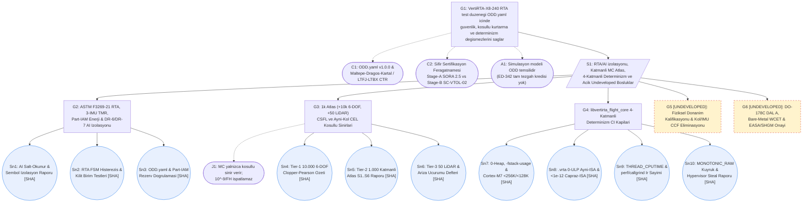

# VertiRTA İçin Havacılık Sertifikasyonu, Çalışma Zamanı Güvencesi ve Deterministik Doğrulama Mimarisi

Bu mühendislik güvence mimarisi, açık kaynaklı çift hedefli C++ kütüphanesi `VertiRTA`'nın (`libvertirta_flight_core` ve `libvertirta_rta_companion`) simüle edilmiş İstanbul kıyı koridorunda (Maltepe-Dragos-Kartal; doğuda `LTFJ` ve kuzeyde `LTBX` CTR sınır duvarlarıyla çevrili) tam ölçekli 240 kg ($T/W = 2{,}5$) 8 rotorlu koaksiyel (`VertiRTA-X8-240`) eVTOL arıza toleranslı otonomi test düzeneği için yasal açıdan tutarlı düzenleyici çerçevesini, güvenlik davası yapısını, istatistiksel Monte Carlo metodolojisini ve bulut-ARM64 determinizm protokolünü kesinleştirir. Mimarinin değişmez temel ilkesi sıfır sahte uyumluluk iddiasıdır: `VertiRTA` bir tip sertifikası (TC), uçuşa elverişlilik onayı veya uçuşa hazır yazılım ürünü değildir; `SAFETY_CASE.md`, `ODD.yaml` ve CI çıktılarındaki tüm iddialar yalnızca doğrulanan yazılım değişmezleri ve simülasyon koşullu olasılıkları içinde kalır, doğrulanmamış donanım ve sertifikasyon bileşenleri ise SCSC GSN v3 standardı uyarınca açıkça "Geliştirilmemiş (Undeveloped)" olarak işaretlenir.

Kasım 2026 itibarıyla yürürlükteki Avrupa Havacılık Emniyeti Ajansı (EASA) mevzuatına göre iki kesin hukuki ve fiziksel sınır kilitlenmiştir. Birincisi, yolcu taşıyan operasyonlar `Reg. (EU) 2019/947` Madde 6 uyarınca istisnasız **Sertifikalı Kategori (Certified Category)** kapsamındadır ve Specific Kategori `SORA 2.5` kapsamı dışındadır; dolayısıyla `VertiRTA`, 25 kg insansız alt ölçekli uçuş testi CONOPS'unu (Aşama-A, `SORA 2.5` SAIL II-III) tam ölçekli 240 kg Sertifikalı UAM mimari tasarım hedeflerinden (Aşama-B, `SC-VTOL-02` Kategori Enhanced ve `Part-IAM`) kesin biçimde ayırır. İkincisi, koaksiyel X8 topolojisinde tek motor ve çapraz kol çift motor kayıpları tam 4 serbestlik dereceli (4-DOF) **Güvenli Uçuş ve İnişe Devam (CSFL)** hedefine haritalanabilirken, aynı kol üzerindeki çift koaksiyel motor kaybı statik moment dengesi kaybı nedeniyle yolcu düzeyinde CSFL kapsamından çıkarılır ve yalnızca son çare **Kontrollü Acil İniş (CEL)** indirgenmiş tutum hayatta kalma modu olarak çerçevelenir.

Yapay zekâ izolasyonu ve istatistiksel doğrulama taraflarında da aynı katı disiplin uygulanır. EASA `AI Concept Paper Proposed Issue 03` (Haziran 2026) taslak değerlendirmeleri denetimli makine öğrenmesi için IDAL C ve büyük hazır dil modelleri (LLM) için IDAL D tavanı öngördüğünden, TR/EN acil durum yardımcı pilotu (`DR-6`) ve sinirsel güvenli iniş alanı (SLZ) algılaması (`DR-7`) deterministik `ASTM F3269-21` RTA sınırının kesin olarak dışında, Seviye 1B/2A emniyet-kritik olmayan danışman işlevler olarak yalıtılır. Benzer biçimde, 1.000 koşullu katmanlı Monte Carlo (MC) atlası sıfır hata gözlemlendiğinde yalnızca koşullu kurtarma başarısızlığı için %95 tek yönlü Clopper-Pearson üst sınırının %0,2991 (< %0,30) olduğunu gösterir; `SC-VTOL` Kategori Enhanced'ın $10^{-9}/\text{FH}$ katastrofik hedefini asla kanıtlamaz, çünkü sıfır hatayla $10^{-9}/\text{FH}$ istatistiksel ispatı tam 2.995.732.357 bağımsız uçuş saati (341.744,5 kesintisiz uçuş yılı) gerektirir.

---

## 1. 2024-2026 Düzenleyici ve Standart Çerçevesi: Birincil Kaynak Doğrulamalı Hükümler Matrisi

Kasım 2026 itibarıyla yürürlükte olan bağlayıcı mevzuat ile kamuoyu danışma veya taslak aşamasında bulunan rehber dokümanların ayrıştırılması, her denetimde ilk kontrol edilen tutarlılık ölçütüdür. Özellikle `Proposed Issue 03`, `NPA 2025-07` ve `ED-324/ARP6983` gibi henüz kesinleşmemiş metinler bağlayıcı uyumluluk şartı değil ileriye dönük mimari tasarım girdisi olarak referanslanır; ayrıca Ekim 2024 tarihli `Easy Access Rules (EAR) for small category VCA` derlemesinin yalnızca `SC-VTOL-02` ile `MOC-1`-`MOC-3`'ü içerdiği, `MOC-4` ve `MOC-5`'in ayrı nihai yayınlar olarak birlikte okunması gerektiği açıkça kayıt altına alınır.

| Alan | Belge Kodu ve Sürümü | Tarih ve Kasım 2026 Statüsü | Kritik Hükümler ve Sayısal Sınırlar | VertiRTA Mimari Etkisi |
| --- | --- | --- | --- | --- |
| **VCA İlk Uçuşa Elverişlilik** | EASA `SC-VTOL-02` (Issue 2) | 10 Haziran 2024 (Yürürlükte; geçerliliği korunan güncel sürüm) | MCTOM <= 5.700 kg, <= 9 yolcu, V_NO <= 250 KCAS; `VTOL.2005` Cat. Enhanced (CSFL) vs Basic (CEL); `VTOL.2510(a)(1)` Tek Arıza Kuralı + Extremely Improbable; `VTOL.2510(c)` servis içi izleme; `VTOL.2517` EWIS; `VTOL.2555` ED-155 kayıtçı | Aşama-B 240 kg mimari referans çerçevesi; `.vrta` uçuş kayıtçı determinizmi ve CSFL/CEL ayrımının düzenleyici kaynağı |
| **VCA Uyumluluk Yöntemleri (1-3)** | `MOC SC-VTOL` Iss. 2; `MOC-2` Iss. 3; `MOC-3` Iss. 2 + `EAR for small category VCA` | 12 May 2021 / 22 Ara 2022 / Haz 2023 (Ekim 2024 EAR derlemesi) | `MOC VTOL.2510` Tablo 1: Cat. Enhanced <= 10^-9/FH (FDAL A); Basic 7-9 yolcu <= 10^-9 (A), 2-6 yolcu <= 10^-8 (B), 0-1 yolcu <= 10^-7 (C); `MOC VTOL.2510.6` 11 Fail-Safe tasarım ilkesi; CFP ve CMP tanımları; DO-178C / AMC 20-115D | Mini-FHA şiddet/olasılık eşikleri, FDAL/IDAL dağılımı ve CMP bazlı performans düşüşü modellemesi |
| **VCA Uyumluluk Yöntemi 4** | EASA `MOC-4 SC-VTOL` (Issue 2 - FINAL) | 11 Temmuz 2025 (Nihai Yayın; Ekim 2024 EAR derlemesine ek okunur) | CTOL eşikleri (> 45 kt(A) kalkış/iniş, > 60 kt(A) acil iniş); `MOC VTOL.2105` performans ve ESS erişilebilir güç; `MOC 5 VTOL.2500(b)` uçuş rehberliği; AMC 20-136A yıldırım; AMC 20-158A / DO-160G Cat L HIRF; `MOC VTOL.2525` ESD | ESS batarya gerilim/güç erişimi sınırları ve `ODD.yaml` çevresel kısıtlarının yapılandırılması |
| **VCA Uyumluluk Yöntemi 5** | EASA `MOC-5 SC-VTOL` (Issue 2 - FINAL) | Nihai Yayın (5 Kasım 2026; Iss. 1 danışması 18 Tem-10 Eki 2025) | `MOC 5 VTOL.2300` FBW gizli/uyuyan (latent) arızalar (katastrofik çift arızada gizli arızadan kaçınma, periyodik kontrol yerine sürekli izleme); `MOC 4 VTOL.2500(b)` simülasyon tezgâhı/rig kredisi; `MOC VTOL.2240(d)` yüksek enerjili parça (Basic 1-2 PRA muafiyeti); EUROCAE `ED-342` (Ağu/Eyl 2026) simülasyon rehberi | 3-IMU TMR sürekli çapraz arıza izleme gerekçesi (uyuyan arıza engelleme) ve simülasyon kredisi sınırlaması |
| **UAM Operasyonları (Part-IAM)** | `Reg. (EU) 2024/1111` + `ED Decisions 2025/010-012/R` | Kabul: 10 Nis 2024 (RG: 23 May 2024); Uygulama: 1 May 2025; AMC/GM: 8 Tem 2025 | `UAM.OP.VCA.190/.191/.192/.195`: Sabit dakika yerine **performans tabanlı son enerji rezervi** (CMP altında LDP'den pas geçme); karar noktasında (PoC) > 1 erişilebilir güvenli iniş/divert seçeneği; "MINIMUM FUEL" bildirimi; `UAM.POL.VCA.135` 10,7 m (35 ft) mania kleransı | `libvertirta_rta_companion` 10 Hz enerji rezervi ve alternatif vertiport erişilebilirlik monitörü + `ODD.yaml` rezerv eşikleri |
| **Specific Kategori UAS (SORA 2.5)** | `Reg. (EU) 2019/947` + `ED Decision 2025/018/R` + `EAR UAS` Haz 2026 + `ED Decision 2026/010/R` | SORA 2.5: 15/29 Eyl 2025 (Düzeltme: 12 Ara 2025 Amdt. 4); Amdt. 5 (`2026/010/R`): 16/20 Kas 2026 | Madde 6: Yolcu taşıma her zaman Certified; Kantitatif iGRC (1-10), M1A/M1B/M1C/M2 azaltımları, 17 OSO, SAIL I-VI (Final GRC > 7 -> Certified); **`ED Decision 2026/010/R` ile SORA 2.0 (`AMC1bis`) 1 Ocak 2027'den itibaren yürürlükten kalkar**, PDRA'lar SORA 2.5'e güncellenir ve `EUROCAE ED-318` (GeoJSON/REST coğrafi bölge, 30 Kas 2026) benimsenir | Yalnızca Aşama-A 25 kg insansız alt ölçekli uçuş testi CONOPS'u için geçerlidir; Aşama-B yolcu mimarisiyle karıştırılması yasaktır |
| **Çalışma Zamanı Güvencesi (RTA)** | `ASTM F3269-21` (Committee F38.01) | 2021 (Kasım 2026 itibarıyla yürürlükteki güncel sürüm; DOI `10.1520/F3269-21`) | Simplex RTA mimarisi: Karmaşık İşlev (CF), Çoklu Emniyet Monitörü (SM), benzersiz kaynak seçimi/öncelik hakemliği, Kurtarma Kontrol İşlevi (RCF), kararlı anahtarlama/çatırdama önleme, zamanlama/gecikme marjları (Ek X4) | `libvertirta_flight_core` 400 Hz TMR + 100 Hz HJI-CBVF-QP + CSFL/CEL öncelik anahtarı mimari şablonu |
| **EASA Yapay Zekâ Çerçevesi** | `AI Roadmap 2.0`; `AI Concept Paper Iss. 02`; `NPA 2025-07` (`DS.AI`); `Proposed Iss. 03` | Roadmap: 10 May 2023; Iss. 02: 6 Mar 2024; `NPA 2025-07`: 10 Kas 2025 (**Taslak**); `Proposed Iss. 03`: 3 Haz 2026 (**Öneri**) | 4 Güvenilirlik Yapı Taşı; Seviye 1A/1B, 2A/2B, 3A/3B; `Proposed Iss. 03` Seviye 2B/3A/3B için bağımsız **Operational Oversight System (OOS)** (`DHO-01..07`); Tablo 2 öneri tavanları: Denetimli ML <= **IDAL C**, Büyük OTS/LLM <= **IDAL D** (TQL 5), katastrofik işlevlere atanamaz | `DR-6` (LLM) ve `DR-7` (sinirsel SLZ) işlevlerinin RTA sınırının dışında Seviye 1B/2A danışman (<= DAL D/E) olarak yalıtılması |
| **ML Öğrenme Güvencesi ve ODD** | EASA `MLEAP` Final Raporu (`MLEAP-D4 Iss. 01`); EUROCAE `ED-324` / SAE `ARP6983` | `MLEAP`: 31 May 2024 (Nihai Araştırma Raporu); `ED-324/ARP6983`: Kasım 2026 itibarıyla **Taslak** (hedef yayın 31 Ara 2026) | W-biçimli öğrenme güvencesi (Sistem / AI Bileşen / Öğe seviyeleri); Sistem **OD** ile AI bileşeni **ODD** izlenebilirliği (`SURK-DA-03`: sahne, çevre, dinamik, işletim parametreleri + veri dağılımları + ODD sınır izleme) | `ODD.yaml` şemasının yapısal temeli; yayımlanmamış `ED-324/ARP6983` taslağına uyumluluk iddiası yapılmaması |
| **Sistem Emniyet Değerlendirmesi** | `SAE ARP4761A` / `EUROCAE ED-135` (ve `ARP4754B / ED-79B`) | 20 Aralık 2023 (Yürürlükteki yetkili sürüm) | FHA, PSSA, SSA, FTA, FMEA/FMES, CCA (ZSA/PRA/CMA); yeni yöntemler: **MBSA**, **STPA** kapalı çevrim analizi, kademeli arıza analizi ve atmosferik nötron tekil olay etkileri (SEE) | Mini-FHA, FTA kesim kümesi ayrıştırması (donanım lambda vs yazılım DAL) ve ortak neden arızası (beta-faktör) denetimi |
| **Yapılandırılmış Güvenlik Davası** | SCSC `GSN Community Standard Version 3` (`SCSC-141C`) | 4 Mayıs 2021 (Güncel sürüm; DOI `10.65391/r1386`; `ISO 15026-2:2022` uyumlu) | Goal (`G`), Strategy (`S`), Solution (`Sn`), Context (`C`), Assumption (`A`), Justification (`J`); `SupportedBy` / `InContextOf`; `Undeveloped` ve `Uninstantiated` belirteçleri | Git commit SHA ve CI kanıt yapraklarına (`Sn1..Sn10`) bağlı YAML-to-Mermaid yaşayan güvenlik davası |

Bu düzenleyici matris, 2026 sonbaharı itibarıyla eVTOL emniyet belgelerinde sıkça görülen üç denetim hatasını doğrudan kapatır. İlk olarak, `MOC-5 SC-VTOL` içindeki fly-by-wire gizli arıza hükümleri (`MOC 5 VTOL.2300`), bir uçuştan fazla süreyle gizli kalıp ikinci bir arızayla katastrofik etkiye yol açabilecek uyuyan arızaların periyodik bakım kontrolleri yerine sürekli izleme ve ikaz ile önlenmesini ister; bu durum 400 Hz 3-IMU TMR oylayıcımızın yalnızca aktif arıza izolasyonu değil sürekli çapraz uyuyan arıza tespiti de yapmasını zorunlu kılar. İkinci olarak, `ED Decision 2026/010/R` ile eski `SORA 2.0` (`AMC1bis`) metodolojisi 1 Ocak 2027'den itibaren yeni operasyon izinlerinde tamamen yürürlükten kalkacağından, Aşama-A insansız alt ölçekli CONOPS'un eski 24-OSO'lu SORA 2.0 çerçevesine dayanması hemen geçersizleşecektir. Üçüncü olarak, `MOC-5` nihai yayınının 5 Kasım 2026 tarihli güncellemeleriyle ilgili `ED-342` atfı gibi henüz EASA'nın konsolide EAR kitabına işlenmemiş detaylar ile taslak aşamasındaki `ED-324/ARP6983` ve öneri aşamasındaki `AI Concept Paper Proposed Issue 03` belgeleri bağlayıcı kural gibi sunulmamalıdır.

---

## 2. Yasal Sınır Mimarisi: SORA 2.5 - SC-VTOL Ayrımı ve CSFL - Aynı Kol CEL Sınırı

### Kopyalanmaya Hazır Uyumsuzluk ve Yasal Kapsam Feragatnamesi (`Non-Compliance & Legal Scope Disclaimer`)

> **`VertiRTA` (`libvertirta_flight_core` + `libvertirta_rta_companion`) is an open-source research, simulation, and software-verification testbed - NOT a certified airborne product, NOT a Type Certificate (TC) or Supplemental Type Certificate (STC) basis, and NOT approved for flight on any manned or unmanned aircraft.**
>
> 1. **Zero Certification Claims:** References in this repository to EASA `SC-VTOL-02` (Issue 2), `MOC-1` through `MOC-5 SC-VTOL`, `Reg. (EU) 2024/1111` (Part-IAM), `SORA 2.5` (`ED Decision 2025/018/R` & `2026/010/R`), `ASTM F3269-21`, `SAE ARP4761A/ED-135`, `DO-178C`, `EASA AI Concept Paper Issue 02 / Proposed Issue 03`, `MLEAP`, and draft `EUROCAE ED-324 / SAE ARP6983` represent **architectural design drivers and academic assurance alignment ONLY**. No artifact in this repository satisfies DO-178C, DO-254, ARP4754B, or EASA Part 21 airworthiness compliance, nor has any artifact been reviewed or accepted by EASA, SHGM, FAA, or any National Aviation Authority (NAA).
> 2. **Strict Separation of Specific vs. Certified Regimes:** Under `Reg. (EU) 2019/947` Article 6 and `ED Decision 2025/018/R`, carriage of passengers is strictly excluded from `SORA 2.5` and always falls under the Certified Category. `VertiRTA` never blends Specific-Category (`SORA 2.5`) and Certified-Category (`SC-VTOL-02`) rules on the same operation:
>    - **Stage-A (25 kg Unmanned Subscale CONOPS):** Strictly unmanned experimental flight-test reference aligned with `SORA 2.5` (SAIL II-III over controlled or lightly populated test ranges; zero passengers).
>    - **Stage-B (240 kg `VertiRTA-X8-240` Reference):** Strictly simulated architectural testbed aligned with `SC-VTOL-02` Category Enhanced / `Part-IAM` design objectives.
> 3. **Honest CSFL vs. Same-Arm CEL Boundary:** On the 8-rotor coaxial X8 topology, **1-motor** and **cross-arm 2-motor** losses preserve 4-DOF controllability and target Continued Safe Flight and Landing (**CSFL**). **Same-arm dual coaxial-pair loss** removes all lift on one boom, induces uncontrollable static moment imbalance without yaw abandonment, and is **explicitly exempted from passenger-grade CSFL**; it is framed solely as a last-resort **Controlled Emergency Landing (CEL)** reduced-attitude survivability fallback. Furthermore, illustrative FTA cut-sets demonstrate that an unmodified COTS X8 coaxial airframe exceeds the `<= 10^-9 / FH` Category Enhanced catastrophic threshold on same-arm dual failures unless component reliability and arm-level common-cause segregation are independently engineered and qualified.
> 4. **Statistical & Timing Scope Limits:** The 1,000-run Stratified Survival Atlas bounds *conditional* simulated recovery rates (`P(CSFL | fault, ODD)` / `P(CEL | same_arm_dual, ODD)`) and **never proves** `<= 10^-9 / FH` airworthiness probability. Execution metrics collected on virtualized GitHub Actions (`ubuntu-24.04-arm` / `ubuntu-24.04`) represent CI regression telemetry, **not** bare-metal RTOS Worst-Case Execution Time (WCET) certification evidence.
> 5. **AI Advisory Isolation:** Any LLM contingency co-pilot (`DR-6`) or neural landing-zone perception (`DR-7`) module operates strictly outside the deterministic `ASTM F3269-21` RTA boundary as a non-safety-critical advisory function (EASA Level 1B / 2A, zero closed-loop actuation authority).

### Specific Kategori (`SORA 2.5`) ve Sertifikalı Kategori (`SC-VTOL-02` / `Part-IAM`) Yasal Çelişki Analizi

Aynı yolcu taşıyan eVTOL operasyonunda Specific Kategori `SORA 2.5` mekanizmalarını (örneğin SAIL IV-VI veya M1/M2 yer riski azaltımlarını) `SC-VTOL-02` gereksinimleriyle harmanlamak, Avrupa Birliği havacılık hukuku açısından giderilemez bir yetki ve hedef güvenlik düzeyi (TLOS) çelişkisidir. `Reg. (EU) 2019/947` Madde 6 (`Reg. (EU) 2019/945` Madde 40 ile birlikte okunduğunda) insan taşımasının istisnasız Sertifikalı Kategoriye girdiğini hükme bağlar; `ED Decision 2025/018/R` eki de insan taşımasının SORA kapsamı dışında olduğunu açıkça belirtir. Buna ek olarak `SORA 2.5`, üçüncü şahıs yer riski için $10^{-6}\text{ ölüm/FH}$ ve öz-ayırma altında havada çarpışma için $10^{-7}/\text{FH}$ düzeyinde bir hedef emniyet düzeyi (TLOS) ile $\text{Final GRC} \le 7$ / SAIL VI tavanı üzerine kuruludur; buna karşılık sıkışık kentsel alanlar üzerinde veya ticari yolcu taşımacılığında `SC-VTOL-02` Kategori Enhanced $\le 10^{-9}/\text{FH}$ katastrofik olasılık, Tek Arıza Kuralı ve CSFL zorunluluğu getirir.

#### SORA 2.5 Adım #2 Kantitatif Başlangıç Yer Riski Sınıfı (iGRC) Matrisi

| Azami Nüfus Yoğunluğu (Operasyon + Yer Riski Tamponu) | <= 1 m (<= 25 m/s) | <= 3 m (<= 35 m/s) | <= 8 m (<= 75 m/s) | <= 20 m (<= 120 m/s) | <= 40 m (<= 200 m/s) |
| --- | --- | --- | --- | --- | --- |
| Kontrollü Alan (0) | 1 | 1 (Aşama-A) | 2 | 3 | 3 |
| < 5 kişi/km^2 | 2 | 3 (Aşama-A) | 4 | 5 | 6 |
| < 50 kişi/km^2 | 3 | 4 (Aşama-A) | 5 | 6 | 7 |
| < 500 kişi/km^2 | 4 | 5 | 6 | 7 | 8 |
| < 5.000 kişi/km^2 | 5 | 6 | 7 | 8 | 9 |
| < 50.000 kişi/km^2 | 6 | 7 | 8 | 9 | 10 |
| > 50.000 kişi/km^2 | 7 | 8 | SORA Dışı (Certified) | SORA Dışı (Certified) | SORA Dışı (Certified) |

#### SORA 2.5 Adım #7 Final GRC x Residual ARC -> SAIL I-VI Matrisi ve Certified Duvarı

| Final GRC (Azaltım Sonrası) | ARC-a (Atipik / Ayrılmış) | ARC-b (Düşük Trafik) | ARC-c (Orta Trafik) | ARC-d (Yüksek Trafik) |
| --- | --- | --- | --- | --- |
| Final GRC <= 2 | SAIL I | SAIL II | SAIL IV | SAIL VI |
| Final GRC 3 | SAIL II (Aşama-A) | SAIL II (Aşama-A) | SAIL IV | SAIL VI |
| Final GRC 4 | SAIL III (Aşama-A) | SAIL III (Aşama-A) | SAIL IV | SAIL VI |
| Final GRC 5 | SAIL IV | SAIL IV | SAIL IV | SAIL VI |
| Final GRC 6 | SAIL V | SAIL V | SAIL V | SAIL VI |
| Final GRC 7 | SAIL VI | SAIL VI | SAIL VI | SAIL VI |
| Final GRC > 7 | Certified | Certified | Certified | Certified |

`SORA 2.5` Adım #3'te yer riski azaltımları sırasıyla `M1(A)` (Bina/sığınak koruması: Düşük -1, Orta -2), `M1(B)` (Uzay-zaman operasyonel kısıtları: Orta -1 [en az 1 yoğunluk bandı / ~%90 azaltım], Yüksek -2 [en az 2 yoğunluk bandı / ~%99 azaltım]), `M1(C)` (Taktik yer gözlemi: Düşük -1) ve `M2` (Çarpma dinamiği azaltımı: Orta -1, Yüksek -2; Yüksek sağlamlıkta 3 mertebe / %99,9 azaltım kanıtlanırsa -3) şeklinde sayısal sırada uygulanır. Çifte sayımı önlemek için **`M1(A)` Orta sağlamlık ile hiçbir `M1(B)` azaltımı birleştirilemez** (`M1(A)` Düşük ile `M1(B)` birleştirilebilir). `M2` kritik alan hesabında temel azaltılmamış kritik alanlar 1 m için 6,5 m^2, 3 m için 65 m^2 ve 8 m için 650 m^2 olarak sabitlenmiştir. Aşama-A 25 kg insansız alt ölçekli prototip (<= 3 m, <= 35 m/s), kontrollü test sahasında (`iGRC = 1`) veya < 50 kişi/km^2 kırsal test koridorunda (`iGRC = 4`; `M1(B)` Orta + `M1(C)` Düşük ile `Final GRC = 2`) ve `ARC-a/b` hava sahasında **SAIL II veya SAIL III** düzeyinde kalarak 17 OSO (`OSO #01-#09, #13, #16-#20, #23, #24`) sağlamlık şartlarını karşılayabilir. Buna karşılık, Maltepe-Dragos-Kartal yoğun kentsel kıyı koridorunda `LTFJ`/`LTBX` CTR duvarlarına komşu yolcu taşıyan 240 kg `VertiRTA-X8-240` konsepti hem Madde 6 yolcu kısıtı hem de kentsel operasyon niteliği nedeniyle bütünüyle `SC-VTOL-02` Sertifikalı Kategori rejimindedir.

| Karşılaştırma Boyutu | Aşama-A: Specific Kategori (`SORA 2.5`) | Aşama-B: Certified Kategori (`SC-VTOL-02` + `Part-IAM`) |
| --- | --- | --- |
| **Yasal Dayanak (Kasım 2026)** | `Reg. (EU) 2019/947` Madde 11, `ED Decision 2025/018/R` (Amdt. 4), `EAR UAS` Haz 2026, `ED Decision 2026/010/R` (Amdt. 5; SORA 2.0 1 Oca 2027'de silinir) | `Reg. (EU) 2018/1139`, `SC-VTOL-02` Issue 2 (10 Haz 2024), `MOC-1..5 SC-VTOL`, `Reg. (EU) 2024/1111` (Part-IAM, 1 May 2025) + `ED Decisions 2025/010-012/R` |
| **VertiRTA Platform Kapsamı** | 25 kg insansız alt ölçekli uçuş testi CONOPS'u (<= 3 m, <= 35 m/s, **sıfır yolcu**) | 240 kg `VertiRTA-X8-240` (T/W = 2,5) tam ölçekli simülasyon / mimari referans (yolcu/kentsel UAM tasarım hedefleri) |
| **Güvenlik Hedefi (TLOS / Olasılık)** | Yer riski < 10^-6 ölüm/FH, MAC < 10^-7/FH; 17 OSO (SAIL I-VI); SAIL III-IV (`SC Light-UAS Medium Risk`), SAIL V-VI (`SC Light-UAS High Risk`) | **Cat. Enhanced:** Katastrofik <= 10^-9/FH (FDAL A), Tehlikeli <= 10^-7/FH (FDAL B), Majör <= 10^-5/FH (FDAL C), Tek Arıza Kuralı + **CSFL**; **Cat. Basic:** 0-1 pax <= 10^-7 (C), 2-6 pax <= 10^-8 (B), 7-9 pax <= 10^-9 (A) + **CEL** |
| **Operasyonel Hava Sahası ve Enerji** | Operasyonel hacim + acil durum hacmi + yer riski tamponu; `EUROCAE ED-318` coğrafi bölge verisi | `UAM.OP.VCA.190/.191/.192/.195`: CMP altında performans tabanlı son rezerv + PoC noktasında > 1 güvenli iniş/alternatif vertiport + "MINIMUM FUEL" |
| **Yolcu Taşıma Hukuki Statüsü** | **Kesinlikle Yasak** (`Reg. 2019/947` Madde 6 ve `ED Decision 2025/018/R` açık dışlaması) | **Zorunlu Rejim** (Ticari yolcu taşımacılığı veya sıkışık alan üstü uçuşta Kategori Enhanced mecburidir) |

İkincil sektör özetlerinde 17 OSO tablosunun bazı küçük hücrelerinde uyuşmazlık bulunduğu gözlemlenmiştir (örneğin bir ikincil özette `OSO #04` SAIL IV için M, bir diğerinde `OSO #06` SAIL I için M yazılırken, yetkili JARUS/UK CAA belgeleri `OSO #06` SAIL I'i **NR** ve `OSO #04` SAIL IV'ü **L** olarak verir). Bu nedenle Aşama-A saha test başvurularında ikincil özetler yerine doğrudan EASA `AMC1 to Article 11` (Issue 1, Amendment 5) resmi OSO tablosu esas alınmalıdır.

### CSFL ve Aynı Kol Çift Koaksiyel Kayıp (CEL) Fiziksel ve Düzenleyici Sınırı

8 rotorlu koaksiyel X8 mimarisinde (`VertiRTA-X8-240`, 4 kol x 2 zıt yönlü rotor, nominal $T/W = 2{,}5$) itki kayıpları fiziksel kontrol edilebilirlik bakımından keskin bir ayrım gösterir. Koaksiyel dizilim, kompakt ayak izinde yüksek itki yoğunluğu sağlarken (~%5-15 pervane akış girişimi verim kaybı ve kol uçlarında yüksek ısıl yoğunlaşma pahasına), kol düzeyinde topolojik bir uçurum barındırır:

| Arıza Topolojisi (8 Rotorlu Koaksiyel X8) | Kalan Aktif Rotor ve Nominal Geometrik T/W | Kontrol Edilebilirlik (DOF) | Düzenleyici Sınıflandırma (`SC-VTOL-02`) | VertiRTA RTA Kurtarma Politikası |
| --- | --- | --- | --- | --- |
| **Tek Motor / ESC Kaybı** (8 senaryo; üst veya alt) | 7 rotor; 7/8 * 2,5 = **2,19** (trim ve akış girişimi değişimi dahil pozitif dikey marj korunur) | **Tam 4-DOF** (İtki, Yatış, Yunuslama, Sapma tam kontrol altında) | **Kategori Enhanced - CSFL** (`VTOL.2000(b)(3)`, `VTOL.2005(b)(1)`) | `RCF-CSFL` (Öncelik 2, uçuş boyu kilitli): Rekonfigüre tahsis + kısıtlı zarfta en yakın alternatif vertiporta yönlendirme |
| **Çapraz Kol 2 Motor Kaybı** (28 ikiliden 24'ü; iki farklı kolda birer motor) | 6 rotor (her 4 kolda >= 1 aktif motor); 6/8 * 2,5 = **1,875** | **Tam 4-DOF** (4 kolda pozitif kaldırma korunur; aynı yönlü çift kayıpta azalan sapma otoritesi ODD içinde sınırlı) | **Kategori Enhanced - CSFL** (CMP düşürülmüş performans zarfı içinde vertiporta devam) | `RCF-CSFL` (Öncelik 2, uçuş boyu kilitli): Hız/yatış sınırlamalı 4-DOF tahsis + zorunlu en yakın vertiport/FATO inişi |
| **Aynı Kol Çift Koaksiyel Kayıp** (28 ikiliden 4'ü: M1&M5, M2&M6, M3&M7 veya M4&M8) | 6 rotor, ancak **bir kolda sıfır itki** (üçgen destek dışına düşen ağırlık merkezi) | **İndirgenmiş Tutum / 3-DOF Gevşetilmiş Alçalma** (Sapma kontrolü terk edilir; gövde birincil eksen etrafında kontrollü dönerken itki vektörü eğilerek alçalış kontrol edilir) | **Yolcu CSFL'den AÇIKÇA MUAF - Yalnızca Son Çare CEL / Hayatta Kalınabilir Acil İniş** (`VTOL.2000(b)(4)`, `MOC VTOL.2510` ekstrem düşük olasılıklı hayatta kalma prosedürü) | `RCF-CEL` (Öncelik 1, geri dönüşsüz kilitli): 400 Hz'de 1 döngüde (<= 2,5 ms) sapma serbest bırakmalı indirgenmiş tutum alçalma kontrolüne geçiş + acil alçalma |

Bu ayrımın zorunluluğu hem uçuş mekaniğinden hem de mevzuat tanımlarından doğar. Aynı koldaki her iki rotor kaybedildiğinde kalan 3 kolun ağırlık merkezi etrafında statik denge kurabilmesi için arızalı kolun karşısındaki kolun itkisi sıfıra yaklaştırılmak zorundadır; bu noktada 4-DOF sabit sapmalı uçuş fiziksel olarak çöker ve araç yalnızca Mueller ve D'Andrea'nın indirgenmiş tutum periyodik denge çözümüyle gövde-sabit bir eksen etrafında dönerek kontrollü alçalma gerçekleştirebilir. Sürekli sapma dönmesi altındaki bir alçalma, `VTOL.2000(b)(3)` hükmündeki *"olağanüstü pilotaj becerisi veya gücü gerektirmeden bir vertiporta kontrollü uçuş ve inişe devam"* tanımını karşılayamaz. Dolayısıyla Kategori Enhanced açısından bu senaryo CSFL ile değil, Bölüm 4'teki FTA kesim kümesi analizinde gösterileceği üzere olay olasılığını $\le 10^{-9}/\text{FH}$ altına itecek kol düzeyinde donanım kalifikasyonu ve fiziksel izolasyonla (ek olarak EASA'nın `MOC VTOL.2510` içinde önerdiği ekstrem düşük olasılıklı hayatta kalma prosedürü olarak CEL ile) ele alınabilir.

---

## 3. ASTM F3269-21 Simplex RTA ve EASA AI İzolasyon Mimarisi

`VertiRTA` yazılım mimarisi, karmaşık veya geleneksel DO-178C/DO-254 doğrulaması pratik olmayan işlevleri doğrulanmış deterministik bir emniyet monitörü ve kurtarma denetleyicisi içine hapseden **`ASTM F3269-21`** çoklu-monitörlü Simplex RTA mimarisini uygular. Aynı mimari, `EASA AI Concept Paper Proposed Issue 03` (Haziran 2026) tarafından gelişmiş otomasyon için tanımlanan teknolojik/işlevsel bağımsızlık ve bağımsız durum temsili ilkeleriyle (`Operational Oversight System / OOS`, `DHO-01..07`) kavramsal olarak hizalanarak sinirsel ve LLM tabanlı tüm bileşenleri kapalı çevrim aktüasyon yolunun tamamen dışında tutar.

Deterministik RTA çekirdeği (`libvertirta_flight_core`) ile yardımcı işlevler (`libvertirta_rta_companion`) arasındaki veri akışı tek yönlü ve kesin bir güven duvarıyla bölünür. 400 Hz 3-IMU TMR oylayıcısı doğrulanmış durum kestirimini eşzamanlı olarak üç paralel kola iletir: (1) nominal görev performansını yürüten güvenilmeyen Karmaşık İşlev (`CF`), (2) birbirinden bağımsız üç paralel Emniyet Monitörü (`M1` 400 Hz İtki/Sensör Arıza İzolasyonu, `M2` 100 Hz HJI-CBVF-QP Zarf/CTR Bariyeri ve `M3` 10 Hz `Part-IAM` Enerji Rezervi Monitörü) ve (3) önceden doğrulanmış iki Kurtarma Kontrol İşlevi (`RCF-CSFL` 4-DOF ve `RCF-CEL` Aynı Kol). Tüm monitör bayrakları benzersiz kaynak seçimi yapan Öncelik Hakemi ve Histerezisli RTA Anahtarında birleşerek 8 rotorlu X8 aktüatörlerine tek bir deterministik komut hattı üretir. Bu RTA sınırının dışında yer alan `DR-6` (TR/EN LLM Yardımcı Pilot) ve `DR-7` (Sinirsel SLZ Algılama) modülleri ise yalnızca salt okunur telemetri alır; aktüatörlere veya RTA durum makinesine hiçbir yazma yetkisi yoktur ve ürettikleri tüm öneriler insan pilot onay kapısından geçtikten sonra deterministik RTA çekirdeği tarafından bağımsız biçimde doğrulanır.

| ASTM F3269-21 / EASA AI Rolü | VertiRTA Bileşeni ve Hedef Kütüphane | Döngü Hızı | Güven Sınırı ve Aktüasyon Yetkisi | Hedef Güvence Rolü (Tasarım Referansı) |
| --- | --- | --- | --- | --- |
| **Assured Data Prep (Doğrulanmış Veri)** | 3-IMU TMR (2oo3) Oylayıcı ve Uyuyan Arıza İzleyici (`libvertirta_flight_core`) | 400 Hz | RTA İçi - Tekil güvenilir durum kaynağı (`MOC 5 VTOL.2300` hizalı) | FDAL A / IDAL A referans hedefi (sıfır-heap, deterministik) |
| **Complex Function (CF - Güvenilmeyen)** | Nominal Görev / Yörünge Kontrolcüsü (`libvertirta_rta_companion` -> arayüz) | 100-400 Hz | RTA İçi (Sınırlandırılmış) - Yalnızca tüm monitörler yeşilken geçer | IDAL D eşdeğeri (NASA eVTOL RTA DAL bölme ilkesi) |
| **Safety Monitor Sub-Function M1** | İtki ve Sensör Arıza Tespit/İzolasyon Monitörü (`libvertirta_flight_core`) | 400 Hz | RTA İçi - Öncelik 1 (Aynı Kol) ve Öncelik 2 (1M / Çapraz 2M / TMR) tetikleyicisi | FDAL A / IDAL A referans hedefi |
| **Safety Monitor Sub-Function M2** | HJI-CBVF-QP Zarf ve `LTFJ`/`LTBX` CTR Bariyer Monitörü (`libvertirta_flight_core`) | 100 Hz | RTA İçi - Öncelik 3 güvenlik filtresi (sabit iterasyon sınırı, histerezisli) | FDAL A / IDAL A referans hedefi |
| **Safety Monitor Sub-Function M3** | `Part-IAM` (`UAM.OP.VCA.191/.192/.195`) Enerji ve Alternatif Vertiport Monitörü (`libvertirta_rta_companion` + çekirdek bayrağı) | 10 Hz | RTA Sınırı - CMP son rezerv ve PoC sonrası >= 2 alternatif erişim kontrolü | FDAL B / IDAL B referans hedefi |
| **Recovery Control Functions (RCF)** | `RCF-CSFL` (4-DOF) ve `RCF-CEL` (Aynı Kol İndirgenmiş Tutum) (`libvertirta_flight_core`) | 400 Hz | RTA İçi - Anahtar üzerinden doğrudan 8-rotor aktüatör komutu | FDAL A / IDAL A referans hedefi |
| **RTA Switch & Priority Arbiter** | Benzersiz Kaynak Seçimi, Kilitleme ve Histerezis FSM (`libvertirta_flight_core`) | 400 Hz | RTA İçi - Katı öncelik (CEL > CSFL > CBF > CF) | FDAL A / IDAL A referans hedefi |
| **Advisory AI (EASA Seviye 1B)** | `DR-6` TR/EN Acil Durum Yardımcı Pilotu (LLM, RTA Dışı) | <= 1 Hz | **RTA Dışı - Salt Okunur Telemetri, Sıfır Aktüasyon Yetkisi**, Pilot Onay Kapısı | **DAL E** (`Proposed Iss. 03` LLM IDAL D tavanının altında) |
| **Advisory AI (EASA Seviye 1A/2A)** | `DR-7` Sinirsel SLZ Algılama (CV, RTA Dışı) | <= 15 Hz | **RTA Dışı - Salt Okunur Aday Koordinat**, Sıfır Doğrudan Rehberlik Yazımı | **DAL E / <= IDAL D** (`Proposed Iss. 03` Denetimli ML IDAL C tavanının altında) |

### Anahtarlama, Öncelik Hakemliği ve Histerezis Değişmezleri (`ASTM F3269-21`)

`ASTM F3269-21`, çoklu monitörlü bir RTA sisteminde Emniyet Monitörünün benzersiz bir kaynak seçimi (`unique RTA Source Selection`) üretmesini, ayrıca Karmaşık İşlev (`CF`) ile Kurtarma İşlevi (`RCF`) arasında kararlı geçiş ve çatırdama (chattering) önleme kurallarının açıkça tanımlanmasını gerektirir. Standart belirli sayısal eşikler dayatmaz; güvenlik marjlarının ve bekleme sürelerinin risk değerlendirmesiyle başvuru sahibi tarafından belirlenmesini öngörür. `libvertirta_flight_core` içinde bu kurallar üç kademeli katı öncelik sırasıyla zorlanır:

1. **Öncelik 1 - Aynı Kol Çift Koaksiyel Kayıp (Geri Dönüşsüz Kilitli / `LATCHED_CEL`):** 400 Hz itki arıza monitörü (`M1`) herhangi bir kolda hem üst hem alt motor kaybını doğruladığında, öncelik hakemi en fazla 1 döngüde (2,5 ms içinde) `RCF-CEL` indirgenmiş tutum alçalma moduna geçer. Durum uçuş boyunca geri dönüşsüz olarak kilitlenir; `RCF-CSFL` veya `CF`'ye dönüş kesinlikle yasaktır.
2. **Öncelik 2 - Tek Motor, Çapraz Kol Çift Motor veya `Part-IAM` Rezerv İhlali (Uçuş Boyu Kilitli / `LATCHED_CSFL`):** `M1` tek veya çapraz kol çift itki kaybı saptadığında yahut `M3` kalan kullanılabilir enerjinin `UAM.OP.VCA.191/.192` son rezerv + en yakın alternatif vertiport sınırına indiğini belirlediğinde, sistem `RCF-CSFL` moduna kilitlenir. NASA eVTOL RTA operasyonel güvenlik ilkesiyle uyumlu olarak, yer bakım kontrolü ve sıfırlaması yapılmadan nominal `CF`'ye geri dönülmez.
3. **Öncelik 3 - HJI-CBVF-QP Zarf ve CTR Coğrafi Çit Müdahalesi (Histerezis ve Bekleme Süresi Kilitli Geri Dönüşlü):** İtki ve sensör sağlığı tam iken, 100 Hz `M2` monitörü güvenlik değeri $h(x)$ için giriş eşiğini aştığında ($h(x) \le \epsilon_{\text{enter}}$) minimal müdahaleli güvenlik filtresini devreye alır. Çatırdamayı ve Zeno geçişlerini önlemek amacıyla `CF`'ye geri devir ancak aşağıdaki zaman ve durum marjı koşulları eşzamanlı sağlandığında gerçekleşir (`VertiRTA` başlangıç tasarım parametreleri: asgari bekleme süresi $T_{\text{dwell}} = 1{,}0\text{ s}$ ve asgari histerezis bandı $\Delta_{\text{hyst}} = 0{,}05$):

$$t - t_{\text{engage}} \ge T_{\text{dwell}} \quad \land \quad h(x) \ge \epsilon_{\text{exit}} = \epsilon_{\text{enter}} + \Delta_{\text{hyst}} \quad \land \quad \dot{h}(x) > 0$$

`ASTM F3269-21` Ek X4 zamanlama ve gecikme rehberliği uyarınca, sensör örneklemesi, monitör hesaplaması, anahtarlama ve aktüatör tepkisi toplam gecikmesi $T_{\text{RTA}} = T_{\text{sense}} + T_{\text{mon}} + T_{\text{switch}} + T_{\text{act}}$ dikkate alınarak giriş eşiği $\epsilon_{\text{enter}}$ muhafazakâr bir tamponla geri çekilir.

### EASA Yapay Zekâ Sınıflandırması ve `DR-6` / `DR-7` İzolasyon Sözleşmesi

`EASA AI Roadmap 2.0` (Mayıs 2023), `AI Concept Paper Issue 02` (Mart 2024) ve `Proposed Issue 03` (Haziran 2026) belgeleri yapay zekâ uygulamalarını Seviye 1A (insan büyütme), Seviye 1B (karar/eylem seçiminde bilişsel destek), Seviye 2A (insan-AI işbirliği), Seviye 2B (ortak karar/kısmi yetki devri), Seviye 3A (insan tarafından geçersiz kılınabilir ileri otomasyon) ve Seviye 3B (insan gözetimi olmadan ileri otomasyon) olarak sınıflandırır. Sektörel teknik analizlerde EASA `Proposed Issue 03` Tablo 2'den aktarılan öneri tavanlarına göre, milyarlarca parametresi ve eğitim verisi süreç kontrolüne elverişli olmayan büyük hazır dil modelleri (LLM) için azami güvenilirlik tavanı **IDAL D** (araç yeterliliği **TQL 5**), denetimli öğrenme bileşenleri için ise **IDAL C** olarak öngörülmekte ve bu tavanların katastrofik arıza koşullarına katılan işlevlere atanamayacağı vurgulanmaktadır.

Bu çerçevede `VertiRTA`, her iki yapay zekâ bileşenini de önerilen tavanların altında tutarak mimari güvence sağlar. `DR-6` (TR/EN acil durum yardımcı pilotu) yalnızca 1 Hz salt okunur durum özeti tüketen **EASA Seviye 1B / DAL E** danışman işlevdir; şema doğrulaması başarısız olursa veya 2.500 ms zaman aşımına uğrarsa çıktısı atılır ve pilota deterministik AFM kontrol listesi sunulur. `DR-7` (sinirsel SLZ algılama) ise **EASA Seviye 1A/2A / IDAL D veya altı (DAL E danışman)** olarak yalnızca aday iniş bölgelerini ve belirsizlik katmanını görselleştirir; `DR-7` tamamen devre dışı kalsa, ODD dışına çıksa veya Marmara Denizi üzerinde hatalı açık alan üretse bile, deterministik RTA çekirdeği önceden tanımlı `Part-IAM` alternatif vertiport veritabanına ve deterministik geometrik LiDAR eğim/engel kontrolüne dayanarak emniyeti tek başına sürdürür.

### MLEAP W-Biçimli Süreçle Uyumlu Makinece Okunabilir `ODD.yaml` Şeması

EASA `MLEAP` Final Raporu (Mayıs 2024) ve `AI Concept Paper Proposed Issue 03` (`Objective SURK-DA-03`), sistem düzeyindeki **Operasyonel Alan (OD)** ile AI bileşeni düzeyindeki **Operasyonel Tasarım Alanı (ODD)** arasında izlenebilir bir hiyerarşi (sahne öğeleri, çevresel öğeler, dinamik öğeler, sistem işletim parametreleri, beklenen girdi dağılımları ve ODD dışı davranış kuralları) öngörür. Aşağıdaki makinece okunabilir `ODD.yaml` şeması doğrudan depoda sürüm kontrolüne alınabilir; şemadaki sayısal zarf eşikleri (rüzgâr, hamle, hız, CTR tamponu, SoC eşikleri ve sensör yoğunluğu) sertifikalı uçuş testi verisi değil, `VertiRTA`'nın yapılandırılabilir başlangıç simülasyon tasarım parametreleridir:

```yaml
schema_version: "vertirta.odd/v1.0.0"
parameter_provenance: "CONFIGURABLE_SIMULATION_DESIGN_BASELINE_NOT_CERTIFIED_AFM_DATA"
alignment_references:
  - "EASA MLEAP Final Report (MLEAP-D4 Issue 01, May 2024) - W-Shaped Process"
  - "EASA AI Concept Paper Issue 02 (Mar 2024) & Proposed Issue 03 (Jun 2026, SURK-DA-03)"
  - "EASA SC-VTOL-02 (Issue 2, Jun 2024) & Reg. (EU) 2024/1111 (Part-IAM)"
  - "EASA SORA 2.5 (ED Decision 2025/018/R & 2026/010/R) [Stage-A Unmanned ONLY]"
compliance_claim: "NONE_RESEARCH_TESTBED_ONLY"

# 1. SYSTEM-LEVEL OPERATIONAL DOMAIN (OD) - ConOps Traceable
operational_domain:
  od_id: "OD-VERTIRTA-IST-COAST-01"
  corridor_name: "Istanbul Maltepe - Dragos - Kartal Coastal Simulation Corridor"
  regulatory_stage_split:
    stage_a_subscale_unmanned:
      regime: "Specific Category (SORA 2.5, SAIL II-III)"
      mtom_kg: 25.0
      max_characteristic_dim_m: 2.2
      max_speed_mps: 25.0
      passengers: 0
      ground_environment: "Controlled ground area or < 50 ppl/km2 test range"
    stage_b_fullscale_reference:
      regime: "Certified Category Design Driver (SC-VTOL-02 Cat. Enhanced + Part-IAM)"
      aircraft_id: "VertiRTA-X8-240"
      mtom_kg: 240.0
      propulsion_topology: "8-rotor coaxial X8 (4 booms x 2 counter-rotating)"
      nominal_thrust_to_weight: 2.5
      passengers_reference: "Simulated UAM payload/occupant mass envelope"
      status: "SIMULATION_ARCHITECTURAL_TESTBED_ONLY"

  scenery_elements:
    geofence_crs: "WGS84 / EPSG:4326"
    corridor_bounding_box:
      lat_deg: [40.8750, 40.9350]
      lon_deg: [29.1150, 29.2100]
    altitude_agl_m: [0.0, 150.0]
    hard_keep_out_zones:
      - id: "CTR-LTFJ-EAST"
        type: "Controlled Airspace Wall (LTFJ CTR)"
        enforcement: "Deterministic 100 Hz HJI-CBVF-QP Hard Barrier"
        design_buffer_m: 150.0
      - id: "CTR-LTBX-NORTH"
        type: "Controlled Airspace Wall (LTBX CTR)"
        enforcement: "Deterministic 100 Hz HJI-CBVF-QP Hard Barrier"
        design_buffer_m: 150.0
    designated_vertiports_and_alternates:
      # Aligned with Reg. (EU) 2024/1111 Part-IAM (> 1 safe landing option reachable at PoC)
      primary_vertiports: ["VP_MALTEPE_COAST", "VP_KARTAL_MARINA"]
      contingency_diversion_fatos: ["ALT_DRAGOS_PROMENADE", "ALT_CEVIZLI_PAD"]
      min_reachable_alternates_past_poc: 2

  environmental_elements:
    mean_wind_mps:
      range: [0.0, 12.0]
      distribution: "Uniform LHS across Atlas strata"
      excluded: "> 12.0 m/s"
    turbulence_gust_mps:
      model: "Dryden continuous + discrete 1-cos gust"
      peak_gust_range_mps: [0.0, 8.0]
      max_combined_wind_mps: 18.0
    ambient_temperature_c: [-10.0, 40.0]
    air_density_kg_m3: [1.10, 1.34]
    visibility_vfr_m: ">= 5000 (Daylight VMC baseline)"
    icing_conditions: "EXCLUDED (Non-FIKI reference)"
    precipitation: "None to light rain (heavy convective cells EXCLUDED)"

  dynamic_elements:
    airspeed_horizontal_mps: [0.0, 22.0]
    vertical_speed_mps: [-6.0, 6.0]
    bank_pitch_limit_deg:
      nominal_cf: 25.0
      degraded_csfl: 18.0
      last_resort_cel: "Reduced-attitude primary-axis tilt <= 20 deg (yaw abandoned)"
    fault_topologies_in_od:
      - id: "FLT_NONE"
        expected_outcome: "Nominal Mission"
      - id: "FLT_1M"
        description: "Any single motor/ESC loss (1 of 8)"
        expected_outcome: "CSFL (4-DOF, vertiport landing)"
      - id: "FLT_2M_CROSS"
        description: "Any cross-arm dual motor/ESC loss (24 pairs)"
        expected_outcome: "CSFL (4-DOF, immediate alternate vertiport diversion)"
      - id: "FLT_2M_SAME_ARM"
        description: "Same-arm coaxial-pair loss (4 pairs)"
        expected_outcome: "CEL_ONLY (Last-resort reduced-attitude descent; EXEMPT from CSFL)"
      - id: "FLT_IMU_1OF3"
        description: "Single IMU fault (hardover, bias ramp, freeze, noise step)"
        expected_outcome: "CSFL (400 Hz 3-IMU TMR isolation <= 10 ms)"

  operating_parameters:
    battery_soc_pct:
      dispatch_range: [35.0, 100.0]
      part_iam_final_reserve_floor_pct: 15.0  # Baseline CMP go-around + alternate margin
      minimum_fuel_alert_trigger_pct: 20.0    # UAM.OP.VCA.195 declaration threshold
    rta_loop_rates_hz:
      flight_core_tmr_and_fdi: 400
      hji_cbvf_qp_monitor: 100
      part_iam_energy_monitor: 10
    switching_invariants:
      cel_latching: "IRREVERSIBLE_IN_FLIGHT"
      csfl_latching: "LATCHED_UNTIL_MAINTENANCE_RESET"
      cbf_dwell_time_s: 1.0
      cbf_hysteresis_margin_min: 0.05

# 2. AI/ML CONSTITUENT ODDs - Strictly Isolated Outside ASTM F3269 RTA
ai_constituent_odds:
  - constituent_id: "AI-CONST-DR6-COPILOT"
    easa_ai_level: "Level 1B (Cognitive Assistance - Advisory Only)"
    target_dal_ceiling: "DAL E / Non-Safety-Critical (Below Proposed Iss. 03 LLM IDAL D ceiling)"
    rta_isolation: "STRICT_OUTSIDE_RTA_READ_ONLY_TELEMETRY"
    actuation_authority: "ZERO"
    input_domain:
      languages: ["tr", "en"]
      telemetry_schema: "vertirta_status_v1 (read-only snapshot at 1 Hz)"
      max_latency_budget_ms: 2500
    ood_detection_and_fallback:
      trigger: "Schema validation failure, timeout > 2500 ms, or unsupported language/intent"
      action: "Discard advisory output; display deterministic AFM checklist to pilot"

  - constituent_id: "AI-CONST-DR7-SLZ-PERCEPTION"
    easa_ai_level: "Level 1A / 2A (Human Augmentation / Cooperation - Advisory Only)"
    target_dal_ceiling: "DAL E / Advisory (Below Proposed Iss. 03 Supervised ML IDAL C ceiling)"
    rta_isolation: "STRICT_OUTSIDE_RTA_NO_DIRECT_GUIDANCE_WRITE"
    actuation_authority: "ZERO"
    scenery_and_sensor_attributes:
      solar_elevation_deg: [15.0, 75.0]
      surface_types_in_odd: ["asphalt_pad", "concrete_rooftop", "flat_coastal_park"]
      excluded_surfaces: ["open_water_marmara", "dense_tree_canopy", "sloped_roof_gt_10deg"]
      sensor_input_distribution:
        rgb_resolution: "1280x720 @ 15 Hz, blur_laplacian_var >= 80"
        lidar_return_density_pts_m2: ">= 25.0 within 60 m slant range"
      altitude_valid_agl_m: [10.0, 120.0]
    ood_detection_and_fallback:
      runtime_ood_monitor: "Input blur/illumination check + ensemble epistemic uncertainty threshold"
      action: "Suppress neural SLZ overlay; deterministic RTA relies exclusively on pre-surveyed Part-IAM vertiports & deterministic geometric LiDAR slope/clearance check"
```

---

## 4. ARP4761A/ED-135 Mini-FHA, İllüstratif FTA Kesim Kümeleri ve CI Bağlantılı GSN Güvenlik Davası

### Başlangıç `SAE ARP4761A / EUROCAE ED-135` Mini-FHA Tablosu

Aşağıdaki Fonksiyonel Tehlike Değerlendirmesi (FHA), `SAE ARP4761A / EUROCAE ED-135` (20 Aralık 2023) sürecini `SC-VTOL-02` Kategori Enhanced güvenlik hedefleriyle (`VTOL.2510` / `MOC VTOL.2510` Tablo 1) eşleştirir. Tablo, hem fiziksel bileşen arızalarını hem de `ARP4761A` ile öne çıkan kapalı çevrim kontrol etkileşimi ve yapay zekâ danışman arıza modlarını kapsar.

| FHA ID | Uçak / Sistem İşlevi | Arıza Koşulu | Kritik Uçuş Fazı | Uçak ve Yolcu/Üçüncü Şahıs Etkisi | Şiddet Sınıfı (`SC-VTOL` Cat. Enh.) | Olasılık / FDAL Hedefi | Tasarım / RTA Azaltımı ve Tespit Mekanizması |
| --- | --- | --- | --- | --- | --- | --- | --- |
| **FHA-01** | İtki ve Kaldırma Üretimi | Tek motor veya ESC'nin tam itki kaybı (8'den 1'i) | Kalkış (TDP sonrası), Seyir, Yaklaşma | Artık 2,19 nominal geometrik T/W ile 4-DOF kontrol korunur; iş yükü artar, en yakın vertiporta yönlendirme gerekir (**CSFL**) | **Major** (Mitigasyon sonrası; mitigasyonsuz Katastrofik) | <= 10^-5/FH (FDAL C; kurtarma mantığı **FDAL A**) | 400 Hz FDI + `RCF-CSFL` rekonfigüre tahsis; Tek Arıza Kuralı sağlanır |
| **FHA-02** | İtki ve Kaldırma Üretimi | Çapraz kol çift motor/ESC kaybı (24 ikiliden 1'i) | Seyir, Yaklaşma | Artık 1,875 nominal geometrik T/W ile 4-DOF korunur; performans ve sapma marjı daralır, acil alternatif vertiport inişi gerekir (**CSFL**) | **Hazardous** (Kısıtlı marjla CSFL) | <= 10^-7/FH (FDAL B; kurtarma mantığı **FDAL A**) | 400 Hz FDI + `RCF-CSFL` kısıtlı zarf (<= 18 derece yatış) + 10 Hz `Part-IAM` acil divert |
| **FHA-03** | İtki ve Kaldırma Üretimi | Aynı kol çift koaksiyel motor kaybı (4 koldan 1'inde tam itki kaybı) | Tüm Uçuş Fazları | Statik moment dengesi ve 4-DOF kaybı; sapma terk edilerek indirgenmiş tutumla kontrollü alçalma (**Yalnızca CEL**, yolcu CSFL ihlali) | **Catastrophic** (Cat. Enhanced CSFL başarısızlığı) | <= 10^-9/FH (FDAL A) + Tek Arıza / Ortak Neden Yasağı | `RCF-CEL` son çare hasar azaltma; 10^-9/FH için kol-düzeyi fiziksel izolasyon ve kalifiye donanım şart (GSN'de Undeveloped) |
| **FHA-04** | Ataletsel Tutum/Hız Algılama | Tek IMU arızası (sabitlenme, kayma, adım veya gürültü patlaması) | Tüm Uçuş Fazları | 400 Hz 3-IMU TMR (2oo3) oylayıcısı arızalı kanalı <= 10 ms içinde izole eder; uçuşa etkisi ihmal edilebilir | **Minor** (TMR aktif iken; tek IMU'da Katastrofik) | <= 10^-3/FH (FDAL D; TMR oylayıcısı **FDAL A**) | 400 Hz 3-IMU TMR oylayıcısı + sürekli uyuyan arıza izleme (`MOC 5 VTOL.2300`) |
| **FHA-05** | Ataletsel Tutum/Hız Algılama | Eşzamanlı veya gizli + aktif >= 2/3 IMU kaybı (ortak neden dahil) | Tüm Uçuş Fazları | Güvenilir tutum/açısal hız kestirimi kaybı -> kontrol kaybı (LOC-I) | **Catastrophic** | <= 10^-9/FH (FDAL A) | Farklı MEMS üretim partileri, bağımsız güç/SPI hatları (CCF beta <= 10^-4) + uçuş içi sürekli çapraz izleme (`MOC 5 VTOL.2300`) |
| **FHA-06** | Uçuş Kontrol ve RTA Hesaplama | Uçuş kontrol bilgisayarı (FCC) tam kaybı veya RTA anahtarının yanlış/kilitli geçişi | Tüm Uçuş Fazları | Kontrol otoritesi kaybı veya arızalı CF'nin RTA tarafından durdurulamaması -> LOC-I / CTR ihlali | **Catastrophic** | <= 10^-9/FH (FDAL A) + Tek Arıza Yasağı | Donanımda >= Çift-Çift COM-MON veya Tripleks FCC (GSN Undeveloped); yazılımda `libvertirta_flight_core` 0-heap, sabit yığın, bounded QP ve öncelik hakemi |
| **FHA-07** | Yüksek Gerilim Enerji Depolama | Tüm HV batarya gücünün kaybı veya kontrolsüz ısıl kaçak (thermal runaway) | Tüm Uçuş Fazları | Tüm 8 rotorda itki kaybı -> kontrolsüz çarpma veya uçak içi yangın | **Catastrophic** | <= 10^-9/FH (FDAL A) + Tek Arıza Yasağı | Fiziksel/ısıl izole çift bağımsız HV batarya paketi + düşük gerilim ayrı aviyonik barası (`VTOL.2525`, `VTOL.2325`) |
| **FHA-08** | Enerji Yönetimi ve Seyrüsefer | `Part-IAM` son enerji rezervinin tükenmesi veya erişilebilir vertiport kalmaması | Seyir, Yaklaşma | Alternatif FATO'ya ulaşamama, pas geçme enerjisinin kalmaması -> zorunlu arazi inişi | **Hazardous** (Tükenme halinde **Catastrophic**) | <= 10^-7/FH (FDAL B) / <= 10^-9/FH (FDAL A) | 10 Hz `UAM.OP.VCA.191/.192/.195` performans tabanlı rezerv monitörü + PoC öncesi zorunlu divert + "MINIMUM FUEL" uyarısı |
| **FHA-09** | Hava Sahası Muhafazası (Geofence) | `LTFJ` / `LTBX` CTR duvarlarının veya irtifa/hız zarfının ihlali | Seyir, Yönlendirme | Kontrollü trafik bölgesine izinsiz giriş (havada çarpışma riski) veya yapısal limit aşımı | **Hazardous** (MAC senaryosunda **Catastrophic**) | <= 10^-7/FH (FDAL B) / <= 10^-9/FH (FDAL A) | 100 Hz HJI-CBVF-QP güvenlik bariyeri + 150 m deterministik CTR tamponu + histerezisli geri devir |
| **FHA-10** | Danışman AI (`DR-6` LLM / `DR-7` SLZ CV) | Halüsinasyonlu acil durum önerisi, yanlış/su üstü SLZ adayı veya yazılım çökmesi | Acil Durum, İniş Yaklaşması | Danışman arayüzü karar destek kalitesi düşer; deterministik uçuş kontrolü ve RTA bundan etkilenmez | **Minor / No Safety Effect** (İzolasyon varsayımı altında) | <= 10^-3/FH (DAL D/E) | Mimari güvenlik duvarı: salt okunur telemetri, sıfır aktüasyon yazma yolu, pilot onay kapısı + deterministik RTA doğrulaması |

### İllüstratif FTA Kesim Kümesi Analizi: Donanım Arıza Oranı Sınırları ve Yazılım Mimarisinin Ayrılması

`ARP4761A` ve `DO-178C` uyarınca **yazılım hataları sistematik tasarım hatalarıdır ve hiçbir zaman üstel bir rastgele arıza oranı ($\lambda_{\text{sw}}$) ile FTA'ya girilmez**. Yazılım katkısı, Geliştirme Güvence Düzeyi (FDAL/IDAL), deterministik bellek/iterasyon sınırları ve doğrulama kanıtlarıyla yönetilir; aşağıdaki nicel FTA kesim kümeleri ise **yalnızca birincil literatürden derlenen illüstratif donanım arıza oranlarını** (`VertiRTA`'ya özgü kalifiye tedarikçi verisi değildir) kullanarak fiziksel mimari darboğazları ortaya koyar.

İllüstratif donanım taban değerleri birincil literatürden şöyle alınmıştır: `NASA/CR-2019-220217` eVTOL FMECA çalışmasından elektrik motoru tork kaybı $\lambda_{\text{motor}} = 9{,}24 \times 10^{-5}/\text{FH}$, ESC güç kaybı $\lambda_{\text{esc}} = 2{,}70 \times 10^{-4}/\text{FH}$ (toplam bağımsız tek rotor kanalı $\lambda_{\text{ch}} = 3{,}624 \times 10^{-4}/\text{FH}$) ve HV batarya paketi tam kaybı $\lambda_{\text{batt}} = 1{,}00 \times 10^{-6}/\text{FH}$; havacılık seyrüsefer literatüründen taktik sınıf MEMS IMU MTBF = 100.000 saat ($\lambda_{\text{imu}} = 1{,}00 \times 10^{-5}/\text{FH}$); uçuş kontrol bilgisayarı literatüründen tekil (simplex) FCC taban oranı $\lambda_{\text{fcc}} = 1{,}00 \times 10^{-4}/\text{FH}$. $T$ saatlik uçuş maruziyetinde (standart $T = 1{,}0\text{ saat}$ ve 15 dakikalık kent içi uçuş $T_{\text{hop}} = 0{,}25\text{ saat}$) iki bağımsız kanalın aynı uçuşta eşzamanlı kaybı için uçuş saati başına ortalama olasılık $P_{\text{mission}}/T \approx (\lambda T)^2 / T = \lambda^2 T$ olarak hesaplanır:

$$\text{Aynı Kol Çift Kayıp (Bağımsız, 4 kol):}\quad \bar{R}_{\text{same\_indep}} = 4 \cdot \lambda_{\text{ch}}^2 \cdot T$$

$$\text{Aynı Kol Çift Kayıp (Kol Ortak Neden } \beta_{\text{arm}} \text{ ile):}\quad \bar{R}_{\text{same\_CCF}} = 4 \cdot \beta_{\text{arm}} \cdot \lambda_{\text{ch}}$$

$$\text{3-IMU TMR } (\ge 2\text{-of-3 Kayıp}):\quad \bar{R}_{\text{TMR}} = 3 \cdot \lambda_{\text{imu}}^2 \cdot T + \beta_{\text{imu}} \cdot \lambda_{\text{imu}}$$

#### İllüstratif Minimal Kesim Kümesi Oranları (`VertiRTA-X8-240`, Literatür Donanım Tabanı)

| Kesim Kümesi / Donanım Yolu | Hesaplama Formülü | Oran (1/FH) | Cat. Enhanced (<= 10^-9/FH) Değerlendirmesi |
| --- | --- | --- | --- |
| Tek Rotor Kanalı (8'den 1'i, T = 1 s) | 8 * lambda_ch * T | 2,90e-3 | 4-DOF CSFL ile Azaltılır |
| Tekil (Simplex) FCC Donanımı | lambda_fcc | 1,00e-4 | Tek Arıza İhlali (100.000x Aşım) |
| Aynı Kol Çift Kayıp + CCF (beta = 0,05) | 4 * beta * lambda_ch | 7,25e-5 | 72.480x Aşım (Yalnızca Son Çare CEL) |
| Çapraz Kol 2 Motor (24 ikili, T = 1 s) | 24 * lambda_ch^2 * T | 3,15e-6 | 4-DOF CSFL ile Azaltılır |
| Tek HV Batarya Paketi | lambda_batt | 1,00e-6 | Tek Arıza İhlali (1.000x Aşım) |
| Aynı Kol Çift Kayıp (Bağımsız, T = 1 s) | 4 * lambda_ch^2 * T | 5,25e-7 | 525x Aşım (Yalnızca Son Çare CEL) |
| Aynı Kol Çift Kayıp (Bağımsız, T = 15 dk) | 4 * lambda_ch^2 * 0,25 | 1,31e-7 | 131x Aşım (Yalnızca Son Çare CEL) |
| Çift Bağımsız FCC (T = 1 s) | lambda_fcc^2 * T | 1,00e-8 | 10x Aşım (Tripleks veya daha düşük lambda şart) |
| 3-IMU TMR (>= 2/3 Bağımsız, T = 1 s) | 3 * lambda_imu^2 * T | 3,00e-10 | <= 10^-9/FH Sağlar (CCF beta <= 10^-4 şartıyla) |
| Çift İzole HV Batarya Paketi (T = 1 s) | lambda_batt^2 * T | 1,00e-12 | <= 10^-9/FH Sağlar (Isıl/elektriksel izolasyonla) |
| Tripleks FCC (3 Bağımsız Kanal, T = 1 s) | lambda_fcc^3 * T^2 | 1,00e-12 | <= 10^-9/FH Sağlar (CCF izolasyonuyla) |

Bu nicel kesim kümesi analizi, bir baş sistem emniyeti mühendisinin denetimde odaklanacağı üç fiziksel mimari gerçeği sayılarla ortaya koyar. İlk olarak, literatürdeki erken-nesil/COTS motor+ESC kanal güvenilirliğiyle ($\lambda_{\text{ch}} = 3{,}624 \times 10^{-4}/\text{FH}$) 4 koldaki bağımsız aynı kol çift kayıp oranı 1 saatlik uçuşta $5{,}25 \times 10^{-7}/\text{FH}$, 15 dakikalık kent içi uçuşta $1{,}31 \times 10^{-7}/\text{FH}$ çıkarak $\le 10^{-9}/\text{FH}$ hedefini yüzlerce kat aşar; kol üzerinde paylaşımlı HV barası, soğutma veya pervane kırığı çarpması gibi $\beta_{\text{arm}} = 0{,}05$ düzeyinde bir ortak neden eklendiğinde oran $7{,}25 \times 10^{-5}/\text{FH}$'ye (72.480 kat aşım) sıçrar. Gerçek bir sertifikalı X8 platformunun bağımsız aynı kol çift kayıpta $\le 10^{-9}/\text{FH}$ sınırını sağlayabilmesi için her bir motor+ESC kanalının $\lambda_{\text{ch}} \le 1{,}58 \times 10^{-5}/\text{FH}$ ($T = 1\text{ s}$) veya $\le 3{,}16 \times 10^{-5}/\text{FH}$ ($T = 15\text{ dk}$) düzeyinde kalifiye edilmesi ve kol düzeyindeki ortak nedenlerin `MOC VTOL.2510.6` izolasyon ilkeleriyle ortadan kaldırılması zorunludur. İkinci olarak, 100.000 saat MTBF'li üç taktik MEMS IMU'nun bağımsız 2oo3 kayıp oranı $3{,}00 \times 10^{-10}/\text{FH}$ ($T = 1\text{ s}$) ile $\le 10^{-9}/\text{FH}$ hedefini karşılasa da, paylaşımlı SPI veri yolu, aynı silikon üretim partisi veya gövde titreşim rezonansı kaynaklı $\beta_{\text{imu}} > 10^{-4}$ ortak neden ($\beta_{\text{imu}} = 10^{-3} \Rightarrow 10^{-8}/\text{FH}$, $\beta_{\text{imu}} = 10^{-2} \Rightarrow 10^{-7}/\text{FH}$) bu güvenilirliği hızla bozar. Üçüncü olarak, tekil FCC ($10^{-4}/\text{FH}$) ve tekil HV batarya ($10^{-6}/\text{FH}$) hem Tek Arıza Kuralını hem $10^{-9}/\text{FH}$ hedefini ihlal ettiğinden, gerçek uçuş donanımında en az tripleks/fail-op-fail-safe (veya dual-dual COM-MON) FCC ile ısıl ve elektriksel olarak izole çift HV batarya paketi zorunludur.

### SCSC GSN v3 CI Bağlantılı Yaşayan Güvenlik Davası (YAML ve Mermaid)

Nimrod incelemesinde eleştirilen "kendini doğrulayan sahte güvenlik davası" tuzağından kaçınmak için, tepe hedef `G1` asla uçağın sertifikalı veya uçuşa hazır olduğunu iddia etmez. `G1`, yalnızca `VertiRTA` yazılım ve simülasyon test düzeneğinin `ODD.yaml` içindeki deterministik RTA, koşullu kurtarma ve yürütme değişmezlerini doğruladığını savunur; fiziksel donanım kalifikasyonu (`G5`) ve sertifikasyon yaşam döngüsü (`G6`) SCSC GSN v3 standardına uygun biçimde açıkça **`undeveloped: true`** olarak bırakılır. Her kanıt yaprağı (`Sn1..Sn10`) CI iş akışının commit özetine (`GITHUB_SHA`) ve SHA-256 doğrulama özetine doğrudan bağlanır.

```yaml
gsn_version: "SCSC-141C-v3"
safety_case_id: "VERTIRTA-LSC-v1.0"
ci_binding_template:
  git_commit_sha: "${GITHUB_SHA}"
  workflow_run_id: "${GITHUB_RUN_ID}"
  artifact_manifest_sha256: "${MANIFEST_SHA256}"

nodes:
  - id: G1
    type: Goal
    text: "VertiRTA-X8-240 RTA yazilim ve simulasyon test duzenegi, ODD.yaml sinirlari icinde belirlenmis guvenlik, kosullu ariza kurtarma ve yurutme determinizmi degismezlerini saglar."
    in_context_of: [C1, C2, A1]
    supported_by: [S1]

  - id: C1
    type: Context
    text: "ODD.yaml (v1.0.0) & Maltepe-Dragos-Kartal Koridoru (LTFJ/LTBX CTR duvarlari)"
  - id: C2
    type: Context
    text: "Yasal Kapsam Feragatnamesi: Sifir sertifikasyon iddiasi; Stage-A (SORA 2.5) vs Stage-B (SC-VTOL-02) ayrimi"
  - id: A1
    type: Assumption
    text: "Simulasyon fizigi ve ariza enjeksiyon modelleri ODD icinde temsilidir (ED-342 / MOC 4 VTOL.2500(b) tam donanim tezgahi kredisi iddia edilmez)"

  - id: S1
    type: Strategy
    text: "Alt-hedefleri (1) ASTM F3269 RTA & AI izolasyonu, (2) Kosullu Monte Carlo kurtarma, (3) 4-Katmanli determinizm ve (4) Acikca isaretlenmis gelistirilmemis donanim/TC bosluklari uzerinden ayristir."
    supported_by: [G2, G3, G4, G5, G6]

  - id: G2
    type: Goal
    text: "Deterministik ASTM F3269-21 RTA cekirdegi, 3-IMU TMR izleme, HJI-CBVF-QP siniri, Part-IAM enerji rezervi ve DR-6/DR-7 AI izolasyonunu mimari olarak zorlar."
    supported_by: [Sn1, Sn2, Sn3]

  - id: G3
    type: Goal
    text: "Katmanli 1.000-kosuluk Atlas (+10k 6-DOF +50 LiDAR), ODD icinde CSFL (1M, Capraz 2M, TMR) ve son care CEL (Ayni Kol 2M) kosullu kurtarma sinirlarini olcer ve tum ariza ucurumlarini raporlar."
    in_context_of: [J1]
    supported_by: [Sn4, Sn5, Sn6]

  - id: J1
    type: Justification
    text: "1.000 MC kosusu yalnizca kosullu kurtarma ust sinirini (<%0,30 @ k=0) verir; 10^-9/FH kaniti olarak kullanilmaz."

  - id: G4
    type: Goal
    text: "libvertirta_flight_core 4-katmanli CI determinizm kapilarini (0-heap, yigin/Flash/RAM, 0-ULP Ayni-ISA, <1e-12 Capraz-ISA, komut sayisi ve saydam steal-time) gecer."
    supported_by: [Sn7, Sn8, Sn9, Sn10]

  - id: G5
    type: Goal
    undeveloped: true
    text: "Fiziksel donanim kalifikasyonu (motor/ESC <= 1.58e-5/FH, kol CCF eliminasyonu, dissimilar 3-IMU, tripleks FCC, izole cift HV batarya) DO-254/SC-VTOL-02 uyumludur."
  - id: G6
    type: Goal
    undeveloped: true
    text: "DO-178C DAL A yazilim yasam dongusu, bare-metal RTOS WCET ispati ve EASA/SHGM tip sertifikasyonu (veya Stage-A SORA 2.5 operasyon izni) tamamlanmistir."

  # CI-Automated Solution Leaves (Sn1..Sn10)
  - { id: Sn1,  type: Solution, ci_job: "static-arch-check",   artifact: "artifacts/${GITHUB_SHA}/arch_isolation_report.json",    hash_field: "sha256" }
  - { id: Sn2,  type: Solution, ci_job: "rta-fsm-unit-tests",  artifact: "artifacts/${GITHUB_SHA}/rta_hysteresis_latch_junit.xml", hash_field: "sha256" }
  - { id: Sn3,  type: Solution, ci_job: "odd-schema-validate", artifact: "artifacts/${GITHUB_SHA}/odd_part_iam_validation.json",   hash_field: "sha256" }
  - { id: Sn4,  type: Solution, ci_job: "atlas-tier1-10k",     artifact: "artifacts/${GITHUB_SHA}/tier1_10k_clopper_pearson.json", hash_field: "sha256" }
  - { id: Sn5,  type: Solution, ci_job: "atlas-tier2-1k",      artifact: "artifacts/${GITHUB_SHA}/tier2_1k_stratified_atlas.json", hash_field: "sha256" }
  - { id: Sn6,  type: Solution, ci_job: "atlas-tier3-lidar50", artifact: "artifacts/${GITHUB_SHA}/tier3_50_lidar_cliff_ledger.json", hash_field: "sha256" }
  - { id: Sn7,  type: Solution, ci_job: "tier1-structural",    artifact: "artifacts/${GITHUB_SHA}/noheap_stack_cortexm7_size.json", hash_field: "sha256" }
  - { id: Sn8,  type: Solution, ci_job: "tier2-vrta-replay",   artifact: "artifacts/${GITHUB_SHA}/vrta_0ulp_and_cross_isa.json",    hash_field: "sha256" }
  - { id: Sn9,  type: Solution, ci_job: "tier3-work-units",    artifact: "artifacts/${GITHUB_SHA}/cputime_perf_or_callgrind.json",  hash_field: "sha256" }
  - { id: Sn10, type: Solution, ci_job: "tier4-wallclock",     artifact: "artifacts/${GITHUB_SHA}/monotonic_raw_steal_report.json", hash_field: "sha256" }
```

YAML kaynağından CI sırasında otomatik türetilen ve `SAFETY_CASE.md` içine gömülen GSN Mermaid hiyerarşisi şöyledir:



---

## 5. 1.000 Koşuluk Katmanlı Arıza Hayatta Kalma Atlası: Deneysel Tasarım ve İstatistiksel İspat Sınırları

### Üç Kademeli Simülasyon Hiyerarşisi ve Katmanlı Latin Hiperküp (LHS) Tasarımı

Çok boyutlu parametre uzayında (arıza topolojisi, rüzgâr hamlesi, batarya SoC, hız ve enjeksiyon zamanı) tekdüze rastgele örnekleme, nadir ancak yüksek riskli köşe noktalarını seyrek bırakır. Bu zafiyeti gidermek için `VertiRTA` üç kademeli bir doğrulama hiyerarşisi uygular. Kademe-1 ($N_1 = 10.000$ koşu), saf C++ 6-DOF gövde dinamiği üzerinde `libvertirta_flight_core` ile yüksek yoğunluklu sınır haritalama ve arıza uçurumu (failure-cliff) taraması yapar. Kademe-2 ($N_2 = 1.000$ koşu), tam kapalı çevrim `libvertirta_flight_core` + `libvertirta_rta_companion` + Maltepe-Dragos-Kartal CTR duvarları + Dryden/1-cos rüzgâr hamlesi + batarya gerilim çökmesi + 3-IMU arıza modelleri üzerinde altı katmana ayrılır; her katman içinde sürekli parametreler (rüzgâr 0-12 m/s, hamle 0-8 m/s, SoC %35-100 [S6'da %18-35], hız 0-22 m/s, enjeksiyon zamanı) sabitlenmiş deterministik tohumlarla **ayrık Latin Hiperküp Örneklemesi (LHS)** üzerinden dağıtılır. Kademe-3 ($N_3 = 50$ koşu) ise Kademe-2'nin en zorlu 25 sınır vakası ile 25 temsili senaryosunda tam geometrik LiDAR nokta bulutu ve `DR-7` danışman izolasyonu stres testini yürütür.

| Katman ID | Senaryo ve Arıza Topolojisi | Hedef Sonuç Kriteri | Koşu (n) | k = 0 Tek Yönlü %95 CP p_fail <= | k = 0 Tek Yönlü %95 P_surv >= | k = 0 Çift Yönlü %95 CP Üstü | k = 0 Çift Yönlü %95 Wilson Üstü |
| --- | --- | --- | --- | --- | --- | --- | --- |
| **S1** | Nominal Taban (Arızasız; rüzgâr x SoC x hız LHS) | Nominal Görev | 100 | %2,95 | %97,05 | %3,62 | %3,70 |
| **S2** | Tek Motor / ESC Kaybı (8 rotor dengeli dağılım) | **CSFL** (4-DOF, vertiport) | 250 | %1,19 | %98,81 | %1,46 | %1,51 |
| **S3** | Çapraz Kol 2 Motor Kaybı (24 ikili dengeli dağılım) | **CSFL** (4-DOF, alternatif) | 250 | %1,19 | %98,81 | %1,46 | %1,51 |
| **S4** | Aynı Kol Çift Koaksiyel Kayıp (4 kol dengeli) | **Yalnızca CEL** (indirgenmiş tutum) | 150 | %1,98 | %98,02 | %2,43 | %2,50 |
| **S5** | 3-IMU TMR Arıza Enjeksiyonu (donma/kayma/adım/gürültü) | **CSFL** (<= 10 ms izolasyon) | 150 | %1,98 | %98,02 | %2,43 | %2,50 |
| **S6** | Bileşik Uçurum Stresi (Arıza + azami hamle + düşük SoC + CTR sınırı) | Uçurum Keşfi (CSFL / CEL ayrı) | 100 | %2,95 | %97,05 | %3,62 | %3,70 |
| **Havuz CSFL** | Birleşik Arıza Toleranslı CSFL (`S2 + S3 + S5`) | P(CSFL \| fault, ODD) | **650** | **%0,4598** | **%99,5402** | %0,5659 | %0,5875 |
| **Tam Atlas** | Tüm Kademe-2 Katmanları (`S1..S6` birleşik rapor; S4 ayrı dipnotlu) | Koşullu Zarf Özeti | **1.000** | **%0,2991** | **%99,7009** | %0,3682 | %0,3827 |
| **Kademe-1** | Hızlı 6-DOF Tarama | Sınır Haritalama | **10.000** | **%0,0300** | **%99,9700** | %0,0369 | %0,0384 |
| **Kademe-3** | Tam LiDAR Alt Kümesi | Algılama İzolasyonu | **50** | **%5,8155** | **%94,1845** | %7,1122 | %7,1348 |

Tablodaki tüm sınırlar $\alpha = 0{,}05$ (%95 güven düzeyi) için kesin Beta dağılımı ters kümülatif fonksiyonu (Clopper-Pearson) ve Wilson skor denklemleriyle hesaplanmıştır.

### Kesin İstatistiksel Raporlama Formülleri

Her katman ve her havuz için gözlemlenen başarısızlık sayısı $k$ ve bağımsız koşu sayısı $n$ ($\hat{p} = k/n$) olmak üzere üç güven aralığı eşzamanlı olarak raporlanır:

1. **Tek Yönlü %95 Clopper-Pearson (Kesin) Başarısızlık Üst Sınırı** (ve eşdeğer hayatta kalma alt sınırı $P_{\text{surv,min}} = 1 - p_{U,1}$):

$$p_{U,1} = B^{-1}(1 - \alpha;\, k + 1,\, n - k), \qquad k = 0 \text{ için } p_{U,1} = 1 - \alpha^{1/n}$$

Bu formül $n = 1.000$, $k = 0$ ve $\alpha = 0{,}05$ için tam $1 - 0{,}05^{1/1000} = 0{,}00299125$ (%0,2991 < %0,30) sonucunu verir.

2. **Çift Yönlü %95 Clopper-Pearson (Kesin) Güven Aralığı** ($k = 0$ iken $p_L = 0$; $k = n$ iken $p_U = 1$):

$$[p_L,\, p_U]_{\text{CP}} = \left[\, B^{-1}\!\left(\frac{\alpha}{2};\, k,\, n - k + 1\right),\; B^{-1}\!\left(1 - \frac{\alpha}{2};\, k + 1,\, n - k\right) \,\right]$$

3. **Çift Yönlü %95 Wilson Skor Aralığı** ($z = \Phi^{-1}(1 - \alpha/2) \approx 1{,}959964$):

$$[p_L,\, p_U]_{\text{Wilson}} = \frac{\hat{p} + \dfrac{z^2}{2n} \pm z\sqrt{\dfrac{\hat{p}(1-\hat{p})}{n} + \dfrac{z^2}{4n^2}}}{1 + \dfrac{z^2}{n}}$$

#### Örneklem Büyüklüğü (n) ve Hata Sayısına (k) Göre Tek Yönlü %95 Clopper-Pearson Üst Sınırları

| Bağımsız Koşu (n) | k = 0 Üst Sınır | k = 1 Üst Sınır | k = 2 Üst Sınır | k = 5 Üst Sınır |
| --- | --- | --- | --- | --- |
| 50 | %5,8155 | %9,1398 | %12,0614 | %19,8833 |
| 100 | %2,9513 | %4,6560 | %6,1619 | %10,2253 |
| 150 | %1,9773 | %3,1234 | %4,1375 | %6,8805 |
| 250 | %1,1911 | %1,8834 | %2,4968 | %4,1590 |
| 500 | %0,5974 | %0,9452 | %1,2538 | %2,0910 |
| 1.000 | %0,2991 | %0,4735 | %0,6282 | %1,0484 |
| 10.000 | %0,0300 | %0,0474 | %0,0629 | %0,1051 |
| 2.995.732.357 (Teorik 10^-9/FH) | 1,00e-9 (341.744,5 uçuş yılı) | - | - | - |

Sıfırdan fazla hata ($k > 0$) gözlendiğinde aralıklar hızla genişler: $n = 1.000$ için $k = 1$ olduğunda tek yönlü CP üst sınırı %0,4735'e (çift yönlü CP `[%0,0025, %0,5559]`, Wilson `[%0,0177, %0,5643]`), $k = 2$ için %0,6282'ye, $k = 5$ için %1,0484'e çıkar. Benzer şekilde $n = 250$ (`S2`/`S3`) katmanında $k = 1$ hata tek yönlü üst sınırı %1,19'dan %1,88'e, $k = 5$ hata %4,16'ya yükseltir.

### 1.000 Monte Carlo Koşusunun Neden Asla $10^{-9}/\text{FH}$ İspatlayamayacağının Matematiksel Kanıtı

`SAFETY_CASE.md` içinde 1.000 simülasyon koşusunun `SC-VTOL` Kategori Enhanced $10^{-9}/\text{FH}$ hedefini kanıtladığına dair herhangi bir ima, havacılık emniyeti denetiminde doğrudan ret gerekçesidir. Bunun üç temel matematiksel ve metodolojik nedeni vardır. İlk olarak, gerçek başarısızlık olasılığı $p$ olan bir Bernoulli sürecinde $n$ bağımsız denemede sıfır hata gözlemleme olasılığı $(1 - p)^n$ olup, $\alpha = 0{,}05$ güven düzeyinde $p \le 10^{-9}$ sınırını göstermek için gereken asgari sıfır-hata deneme sayısı şöyledir:

$$n \ge \left\lceil \frac{\ln(0{,}05)}{\ln(1 - 10^{-9})} \right\rceil = 2\,995\,732\,357 \approx 3{,}00 \times 10^{9}\text{ bağımsız uçuş saati}$$

Bu eşik **341.744,5 kesintisiz uçuş yılına** karşılık gelir ve 1.000 koşuluk atlas ile arasında tam **2.995.732 kat (~3,0 milyon kat)** açıklık bulunur. 10.000 koşuluk Kademe-1 taraması dahi $10^{-9}/\text{FH}$ sınırından yaklaşık 300.000 kat geridedir. İkinci olarak, arıza enjeksiyonlu Monte Carlo simülasyonu donanım arızasının oluşma sıklığını ($\lambda_{\text{fault}}$) değil, yalnızca belirli bir arıza *verildiğinde* ve sistem `ODD.yaml` *içinde iken* simüle edilen kontrolcünün koşullu kurtarma başarısını ($P(\text{CSFL} \mid F_i, \text{ODD})$ veya $P(\text{CEL} \mid \text{same\_arm}, \text{ODD})$) ölçer; toplam uçuş riskinin değerlendirilmesi ayrıca kalifiye donanım oranlarını, ortak neden analizini ve simülasyon-gerçeklik doğruluğunu (`MOC 4 VTOL.2500(b)` / `ED-342`) gerektirir. Üçüncü olarak, yazılım kusurları rastgele değil sistematiktir; örnekleme ızgarasının atladığı dar bir köşe koşulu 1.000 koşuda hiç tetiklenmese bile gerçek operasyonda kesin başarısızlığa yol açabilir.

### Zorunlu Arıza Uçurumu (Failure-Cliff) Raporlama Kuralları

Atlas sonuçlarının şeffaflığını ve denetlenebilirliğini sağlamak için şu beş raporlama kuralı CI boru hattında değiştirilemez biçimde uygulanır:

1. **Payda Kirletme Yasağı:** `S4` (Aynı Kol CEL) koşuları hiçbir zaman `S2`/`S3`/`S5` CSFL paydasına karıştırılmaz; $P(\text{CSFL} \mid \text{fault}, \text{ODD})$ ve $P(\text{CEL} \mid \text{same\_arm\_dual}, \text{ODD})$ her zaman ayrı tablolarla yayımlanır.
2. **Veri Ayıklama (Cherry-Picking) Yasağı:** Tek bir başarısızlık ($k > 0$) gözlendiğinde tohum değiştirilemez veya ODD sessizce daraltılamaz; ODD sınırı revize edilecekse `ODD.yaml` sürümü artırılır ve önceki başarısızlık sürüm notlarında kalıcı olarak saklanır.
3. **Zorunlu Arıza Uçurumu Defteri (`failure_cliff_ledger.json`):** `S1..S6` içinde başarısız olan her bir koşu için deterministik tohum, tam başlangıç durum vektörü (rüzgâr, hamle, SoC, hız, CTR mesafesi), arıza enjeksiyon zamanı/topolojisi, ihlal edilen değişmez (ör. yer temas hızı aşımı, CTR duvar ihlali, QP yakınsamama), kök neden sınıfı ve tekrar oynatılabilir `.vrta` kayıt dosyası yayımlanır.
4. **Dörtlü İstatistik Zorunluluğu:** Hiçbir katman satırı yalnızca nokta tahmini (`%100`) ile yayımlanamaz; `k/n`, tek yönlü %95 Clopper-Pearson üst sınırı, çift yönlü %95 Clopper-Pearson aralığı ve çift yönlü %95 Wilson aralığı birlikte basılır.
5. **Uçurum Sınırı Haritalaması (`S6`):** Bileşik stres katmanı (`S6`), sistemin *nerede kırıldığını* bilinçli olarak ortaya çıkarmak için tasarlanır; sıfır başarısızlık beklenmez, kırılma sınırının `ODD.yaml` dış sınırının ötesinde kaldığı belgelenir.

---

## 6. Public GitHub Actions `ubuntu-24.04-arm` 4 Katmanlı Yürütme Determinizmi Protokolü

### Doğrulanmış Koşucu Donanımı ve Sürüm Sabitlemesi (Kasım 2026)

Public GitHub depolarındaki ücretsiz standart koşucular için Kasım 2026 itibarıyla doğrulanmış donanım ve yazılım profilleri iki mimariyi kapsar. `ubuntu-24.04-arm` koşucusu **4 vCPU, 16 GB RAM, 14 GB SSD**, Ubuntu 24.04.5 LTS, Linux çekirdeği `7.0.0-1017-azure`, GCC `12.4.0 / 13.3.0 / 14.2.0`, Clang `16.0.6 / 17.0.6 / 18.1.3`, CMake `3.31.6` ve Ninja `1.13.2` ile gelir; platform kayıtlarına göre altta Microsoft **Azure Cobalt 100** (128 çekirdekli Armv9.0-A **Neoverse N2**, 128-bit SVE2) sunucu işlemcisi yer alır. Eşlenik `ubuntu-24.04` (x86_64) koşucusu da **4 vCPU, 16 GB RAM, 14 GB SSD**, Ubuntu 24.04.5 LTS, `7.0.0-1017-azure` çekirdeği ve eşleşen derleyici sürümlerini sunar. `ubuntu-latest` etiketi Kasım 2026 itibarıyla Ubuntu 26.04'e geçiş yaptığı için, tekrarlanabilirliği korumak adına tüm iş akışları açıkça `ubuntu-24.04-arm` ve `ubuntu-24.04` etiketlerine ile sabit `g++-14` derleyicisine kilitlenir.

### 4 Katmanlı Determinizm Protokolü Özellikleri

| Katman | Doğrulama Hedefi | Teknik Uygulama ve Araçlar | CI Geçiş / Kalma (Pass/Fail) Kapısı |
| --- | --- | --- | --- |
| **Katman 1: Donanımdan Bağımsız Yapısal Sınırlar** | Sıfır dinamik bellek, sınırlı yığın, sınırlı QP iterasyonu, gömülü MCU bellek bütçesi (`libvertirta_flight_core`) | Global `operator new` tuzak sembolü + `-Wl,--wrap=malloc/calloc/realloc/free`; `-fno-exceptions -fno-rtti -fno-threadsafe-statics`; `-fstack-usage -Wstack-usage=4096 -Wvla -Werror`; sabit QP iterasyon tavanı (başlangıç tasarım bütçesi `kMaxQpIterations = 40`); `arm-none-eabi-g++` (`-mcpu=cortex-m7 -mfpu=fpv5-d16 -mfloat-abi=hard -Os -ffunction-sections -fdata-sections -Wl,--gc-sections`) | Link aşamasında 0 dinamik tahsis referansı; tekil fonksiyon yığını <= 4.096 B, dinamik yığın = 0; statik çağrı yığını <= 16 KB; Cortex-M7 **Flash (`.text+.rodata`) < 256 KB**, **RAM (`.data+.bss`) < 128 KB** |
| **Katman 2: `.vrta` Deterministik Tekrar Oynatma** | Aynı mimaride bit-özdeşlik; çapraz mimaride sınırlı kayan nokta sapması ve sıfır ayrık mod sapması | `-ffp-contract=off -fno-fast-math -fno-associative-math -fno-reciprocal-math -frounding-math`; kanonik `.vrta` sensör/arıza kaydının `ubuntu-24.04-arm` üzerinde 2 kez ve `ubuntu-24.04` (x86_64) üzerinde 2 kez yürütülmesi | **Aynı-ISA:** **0-ULP** ve birebir aynı **SHA-256** özet; **Çapraz-ISA (`x86_64 <-> ARM64`):** **0 ayrık anahtar/mod sapması** VE sürekli çift duyarlıklı çıkışlarda max abs(y_arm64 - y_x86) < 1e-12 |
| **Katman 3: İş Birimi Determinizmi (`CPUTIME` + `perf`/`callgrind`)** | Sanallaştırıcı zamanlama gürültüsünden arındırılmış yürütme işi ölçümü | Harness içinde `clock_gettime(CLOCK_THREAD_CPUTIME_ID)`; çalışma zamanında `perf stat -e instructions:u,cycles:u` yoklaması; Azure Hyper-V PMU kapalıysa (`not supported` veya `perf_event_paranoid`) **otomatik olarak `valgrind --tool=callgrind` geri dönüşü** | Deterministik 1.000-adım diliminde `Ir/tick` (işlenen komut sayısı) başlangıç bütçesi altında (ör. 400 Hz çekirdek <= 150.000 `Ir/tick`, 100 Hz QP <= 1.200.000 `Ir/tick`) ve ana dal tabanına göre <= +%5 regresyon |
| **Katman 4: Saydam Duvar Saati Kuyruğu (`MONOTONIC_RAW`)** | Bulut VM üzerinde kuyruk gecikmesi gözlemi ve hipervizör çalma (steal) şeffaflığı | `clock_gettime(CLOCK_MONOTONIC_RAW)` (NTP düzeltmesinden bağımsız) ile `p50/p95/p99/p99.9/max` + `/proc/stat` `steal` sütunu + `getrusage` `ru_nivcsw` (istem dışı bağlam değişimi) eşzamanlı kaydı | Yalnızca bilgilendirici regresyon telemetrisi (`p99` yumuşak uyarı; hipervizör steal > %1 iken koşu `"NOISY_NEIGHBOR_TAINTED"` etiketlenir); **asla bare-metal WCET kapısı olarak sunulmaz** |

Katman 2'deki **Aynı-ISA 0-ULP** ile **Çapraz-ISA < $10^{-12}$** ayrımı, doğrudan sistem matematik kütüphanesi (`glibc libm`) mimari davranışından kaynaklanır. `-ffp-contract=off` bayrağı derleyicinin çarpma-toplama birleştirmelerini (FMA) engellese bile, `aarch64` ve `x86_64` üzerindeki `glibc libm` aşkın fonksiyonları (`sin`, `cos`, `exp`, `atan2`, `hypot`) donanım FMA çekirdeği (`__FP_FAST_FMA`) ile yazılım düzeltme adımları arasındaki farklılıklar nedeniyle girdilerin küçük bir bölümünde 0,5-1 ULP düzeyinde farklı bitler üretebilir. Çapraz mimaride bit-özdeşlik ancak tüm aşkın fonksiyonlar saf yazılım doğru-yuvarlamalı (correctly rounded) rutinlerle değiştirildiğinde elde edilebilir; standart `glibc libm` ile denetime dayanıklı kapı, sıfır ayrık RTA durum sapması ve < $10^{-12}$ sürekli çıkış norm sınırıdır. Benzer şekilde Katman 3'te Azure Hyper-V konuk sanal makineleri donanım PMU sayaçlarını çoğunlukla passthrough etmediğinden, `perf stat` yoklaması başarısız olduğunda deterministik komut sayımı için `valgrind --tool=callgrind` geri dönüşü zorunlu kılınmıştır.

### Katman 1 Sıfır-Heap C++ Koruma Başlığı (`flight_core_no_heap.hpp`)

```cpp
// libvertirta_flight_core/include/vertirta/flight_core_no_heap.hpp
#pragma once
#include <cstddef>
#include <new>

// Link-time hard trap: any transitive dynamic allocation inside libvertirta_flight_core
// produces an unresolved symbol error and fails CI immediately.
extern "C" void vertirta_forbidden_heap_allocation_link_trap();

inline void* operator new(std::size_t) {
    vertirta_forbidden_heap_allocation_link_trap();
    return nullptr;
}
inline void* operator new[](std::size_t) {
    vertirta_forbidden_heap_allocation_link_trap();
    return nullptr;
}
inline void* operator new(std::size_t, const std::nothrow_t&) noexcept {
    vertirta_forbidden_heap_allocation_link_trap();
    return nullptr;
}
inline void* operator new[](std::size_t, const std::nothrow_t&) noexcept {
    vertirta_forbidden_heap_allocation_link_trap();
    return nullptr;
}
// Placement new remains legal for static arena initialization:
// void* operator new(std::size_t, void* p) noexcept is standard non-allocating.
```

### Kopyalanmaya Hazır GitHub Actions CI Spesifikasyonu (`.github/workflows/determinism.yml`)

```yaml
name: VertiRTA 4-Tier Execution Determinism

on:
  push:
    branches: [main]
  pull_request:

permissions:
  contents: read

env:
  CXX_COMPILER: g++-14
  C_COMPILER: gcc-14
  STRICT_FP_FLAGS: "-O2 -ffp-contract=off -fno-fast-math -fno-associative-math -fno-reciprocal-math -frounding-math"
  CORE_HARDENING_FLAGS: "-fno-exceptions -fno-rtti -fno-threadsafe-statics -fstack-usage -Wstack-usage=4096 -Wvla -Wall -Wextra -Werror"

jobs:
  tier1_embedded_structural:
    name: "Tier 1: Zero-Heap, Stack Usage & Cortex-M7 Footprint"
    runs-on: ubuntu-24.04-arm
    steps:
      - uses: actions/checkout@v4
      - name: Install ARM Bare-Metal Toolchain
        run: |
          sudo apt-get update
          sudo apt-get install -y gcc-arm-none-eabi binutils-arm-none-eabi libnewlib-arm-none-eabi
      - name: Build libvertirta_flight_core (Host ARM64 Structural Gate)
        run: |
          cmake -B build-arm64 -G Ninja \
            -DCMAKE_CXX_COMPILER=${CXX_COMPILER} \
            -DVERTIRTA_FLIGHT_CORE_FLAGS="${STRICT_FP_FLAGS} ${CORE_HARDENING_FLAGS}" \
            -DVERTIRTA_WRAP_MALLOC=ON
          cmake --build build-arm64 --target vertirta_flight_core vertirta_replay_cli
          # Enforce zero dynamic/unbounded frames and max frame <= 4096 B across all .su files
          python3 scripts/check_stack_usage.py --build-dir build-arm64 --max-frame-bytes 4096 --max-total-bytes 16384
          # Verify zero undefined references to malloc/calloc/realloc/free in flight_core archive
          nm -u build-arm64/libvertirta_flight_core.a | grep -E '\b(malloc|calloc|realloc|free|_Znwm|_Znam)\b' && exit 1 |

| true
      - name: Cross-Compile libvertirta_flight_core for Cortex-M7 (<256KB Flash / <128KB RAM)
        run: |
          cmake -B build-cm7 -G Ninja \
            -DCMAKE_TOOLCHAIN_FILE=cmake/arm-none-eabi-cortex-m7.cmake \
            -DCMAKE_CXX_FLAGS="-mcpu=cortex-m7 -mthumb -mfpu=fpv5-d16 -mfloat-abi=hard -Os -ffunction-sections -fdata-sections -fno-exceptions -fno-rtti -ffp-contract=off -fstack-usage" \
            -DCMAKE_EXE_LINKER_FLAGS="-Wl,--gc-sections -Wl,--wrap=malloc -Wl,--wrap=calloc -Wl,--wrap=realloc -Wl,--wrap=free"
          cmake --build build-cm7 --target vertirta_flight_core_cm7.elf
          arm-none-eabi-size --format=berkeley build-cm7/vertirta_flight_core_cm7.elf | tee cm7_size.txt
          python3 scripts/check_embedded_footprint.py \
            --elf build-cm7/vertirta_flight_core_cm7.elf \
            --max-flash-bytes 262144 \
            --max-ram-bytes 131072 \
            --out tier1_structural.json
      - uses: actions/upload-artifact@v4
        with:
          name: tier1-structural-${{ github.sha }}
          path: tier1_structural.json

  tier2_3_4_matrix:
    name: "Tier 2-4: Replay, Work-Units & Monotonic Tail (${{ matrix.arch }})"
    strategy:
      fail-fast: false
      matrix:
        include:
          - arch: arm64
            runner: ubuntu-24.04-arm
          - arch: x86_64
            runner: ubuntu-24.04
    runs-on: ${{ matrix.runner }}
    steps:
      - uses: actions/checkout@v4
      - name: Install Valgrind (PMU Fallback) & Tools
        run: |
          sudo apt-get update
          sudo apt-get install -y valgrind linux-tools-common linux-tools-generic |

| sudo apt-get install -y valgrind
      - name: Build Deterministic Replay & Benchmark Binaries
        run: |
          cmake -B build-${{ matrix.arch }} -G Ninja \
            -DCMAKE_CXX_COMPILER=${CXX_COMPILER} \
            -DVERTIRTA_FLIGHT_CORE_FLAGS="${STRICT_FP_FLAGS} ${CORE_HARDENING_FLAGS}"
          cmake --build build-${{ matrix.arch }} --target vertirta_replay_cli vertirta_bench_cli
      - name: "Tier 2a: Same-ISA 0-ULP SHA-256 Bit-Identity Gate"
        run: |
          ./build-${{ matrix.arch }}/vertirta_replay_cli --input tests/golden/corridor_faults.vrta --out run1_${{ matrix.arch }}.bin
          ./build-${{ matrix.arch }}/vertirta_replay_cli --input tests/golden/corridor_faults.vrta --out run2_${{ matrix.arch }}.bin
          SHA1=$(sha256sum run1_${{ matrix.arch }}.bin | awk '{print $1}')
          SHA2=$(sha256sum run2_${{ matrix.arch }}.bin | awk '{print $1}')
          echo "Run 1 SHA256: $SHA1"
          echo "Run 2 SHA256: $SHA2"
          test "$SHA1" = "$SHA2"
      - name: "Tier 3: CLOCK_THREAD_CPUTIME_ID + perf stat / Callgrind Fallback"
        run: |
          ./build-${{ matrix.arch }}/vertirta_bench_cli --ticks 10000 --clock thread_cputime --out tier3_cputime_${{ matrix.arch }}.json
          # Probe hardware PMU availability; fall back deterministically to Callgrind on Azure Hyper-V VMs
          if perf stat -e instructions:u,cycles:u -- ./build-${{ matrix.arch }}/vertirta_bench_cli --ticks 1000 --quiet 2> perf_probe.log \
             && ! grep -qiE "not supported|not counted|permission|paranoid" perf_probe.log; then
            echo "PMU_MODE=perf_stat" | tee pmu_mode_${{ matrix.arch }}.txt
            cp perf_probe.log tier3_work_${{ matrix.arch }}.log
          else
            echo "PMU_MODE=valgrind_callgrind_fallback" | tee pmu_mode_${{ matrix.arch }}.txt
            valgrind --tool=callgrind --callgrind-out-file=callgrind_${{ matrix.arch }}.out \
              ./build-${{ matrix.arch }}/vertirta_bench_cli --ticks 1000 --quiet
            callgrind_annotate --auto=no callgrind_${{ matrix.arch }}.out > tier3_work_${{ matrix.arch }}.log
          fi
          python3 scripts/parse_work_units.py \
            --mode-file pmu_mode_${{ matrix.arch }}.txt \
            --log tier3_work_${{ matrix.arch }}.log \
            --ticks 1000 \
            --max-ir-per-tick 1200000 \
            --out tier3_work_${{ matrix.arch }}.json
      - name: "Tier 4: CLOCK_MONOTONIC_RAW Wall-Clock Tail & Hypervisor Steal Telemetry"
        run: |
          python3 scripts/run_monotonic_with_steal.py \
            --bin ./build-${{ matrix.arch }}/vertirta_bench_cli \
            --ticks 20000 \
            --out tier4_wallclock_${{ matrix.arch }}.json
      - uses: actions/upload-artifact@v4
        with:
          name: determinism-${{ matrix.arch }}-${{ github.sha }}
          path: |
            run1_${{ matrix.arch }}.bin
            tier3_cputime_${{ matrix.arch }}.json
            tier3_work_${{ matrix.arch }}.json
            tier4_wallclock_${{ matrix.arch }}.json

  tier2b_cross_isa_verify:
    name: "Tier 2b: Cross-ISA x86_64 <-> ARM64 (< 1e-12 & 0 Switch Divergence)"
    needs: tier2_3_4_matrix
    runs-on: ubuntu-24.04-arm
    steps:
      - uses: actions/checkout@v4
      - uses: actions/download-artifact@v4
        with:
          pattern: determinism-*-${{ github.sha }}
          merge-multiple: true
      - name: Verify Bounded Cross-ISA Replay Tolerance
        run: |
          python3 scripts/compare_vrta_cross_isa.py \
            --arm64 run1_arm64.bin \
            --x86 run1_x86_64.bin \
            --max-abs-tol 1e-12 \
            --require-zero-mode-divergence \
            --out tier2_cross_isa.json
      - uses: actions/upload-artifact@v4
        with:
          name: tier2-cross-isa-${{ github.sha }}
          path: tier2_cross_isa.json
```

### `BENCHMARKS.md` İçin Kopyalanmaya Hazır Hipervizör ve WCET Uyarı Metni (`Execution Environment & WCET Scope Caveat`)

> All CI execution benchmarks in this repository are collected on public GitHub-hosted virtualized runners:
> - **ARM64:** `ubuntu-24.04-arm` (Microsoft Azure Cobalt 100 / Armv9.0-A Neoverse N2, 4 vCPU, 16 GB RAM, Ubuntu 24.04.5 LTS, Azure Linux kernel).
> - **x86_64:** `ubuntu-24.04` (4 vCPU, 16 GB RAM, Ubuntu 24.04.5 LTS, Azure Linux kernel).
>
> **Strict Interpretation Rules (NO Bare-Metal WCET Claims):**
> 1. **Hypervisor Steal & Multi-Tenant Jitter:** `CLOCK_MONOTONIC_RAW` wall-clock tail latencies (`p99`, `p99.9`, `max`) measured inside multi-tenant cloud VMs include host hypervisor scheduling preemption (reported alongside `/proc/stat` CPU `steal` % and `getrusage` involuntary context switches `ru_nivcsw`). Runs exceeding `1.0%` hypervisor steal are explicitly flagged `NOISY_NEIGHBOR_TAINTED`.
> 2. **Not a Certifiable RTOS WCET Proof:** Linux user-space wall-clock measurements on virtualized Cobalt 100 / x86_64 runners are **indicative CI performance regression metrics ONLY**. They do **NOT** constitute Worst-Case Execution Time (WCET) certification evidence under DO-178C or EASA `SC-VTOL-02` / `MOC VTOL.2510`. Certifiable WCET requires deterministic bare-metal/RTOS target hardware with controlled cache/DMA partitioning, static WCET analysis, and on-target hardware trace verification.
> 3. **Hardware-Independent Structural Guarantees:** The auditable, platform-independent determinism claims of `libvertirta_flight_core` rest on **Tier 1** (zero dynamic heap allocation enforced at link time, bounded static stack frames via `-fstack-usage`, `-fno-exceptions -fno-rtti`, hard-capped QP iterations, and Cortex-M7 `< 256 KB` Flash / `< 128 KB` RAM cross-compilation), **Tier 2** (0-ULP SHA-256 bit-identical `.vrta` replay on Same-ISA; `< 1e-12` max continuous deviation and zero discrete switch divergence across `x86_64 <-> ARM64` due to host `glibc libm` transcendental ULP differences), and **Tier 3** (`CLOCK_THREAD_CPUTIME_ID` paired with deterministic instruction counts via `perf stat` or automatic `valgrind --tool=callgrind` fallback when Azure Hyper-V PMU hardware counters are unavailable).

---

## 7. Uygulama ve Denetim Kontrol Listesi

Bu güvence mimarisinin `VertiRTA` deposuna entegrasyonunda dış denetim çelişkilerini sıfırlamak için aşağıdaki beş uygulama adımı sırasıyla kapatılmalıdır:

1. **Belge Başlıklarının Kilitlenmesi:** Kopyalanmaya hazır `Non-Compliance & Legal Scope Disclaimer` bloğunu `SAFETY_CASE.md` ve `README.md` dosyalarının ilk bölümüne, `Execution Environment & WCET Scope Caveat` bloğunu ise `BENCHMARKS.md` dosyasının başına yerleştirin.
2. **Merkezi Standart Sürüm Kaydı:** `SC-VTOL-02` (10 Haz 2024), `MOC-4` (11 Tem 2025), `MOC-5` (Nihai Yayın, Kas 2026), `Reg. (EU) 2024/1111` (uygulama 1 May 2025), `ED Decision 2025/018/R` (Eyl 2025), `ED Decision 2026/010/R` (Kas 2026; SORA 2.0'ın 1 Oca 2027'de silinmesi), `AI Concept Paper Proposed Issue 03` (Haz 2026 - Öneri) ve `ED-324/ARP6983` (Taslak) statülerini tek bir merkezi YAML kaydından (`docs/standards_registry.yaml`) tüm dokümanlara üretin.
3. **Kod Düzeyinde İzolasyon Kapısı (`Sn1`):** `libvertirta_flight_core` hedefinin `DR-6` veya `DR-7` başlıklarına ve kütüphanelerine hiçbir bağımlılık (`#include` veya linker sembolü) içermediğini CMake bağımlılık grafiği ve `nm` sembol denetimiyle CI'da başarısız-kapalı (fail-closed) kilitleyin.
4. **GSN Otomatik Derleme Boru Hattı:** GSN YAML tanımını her commit sonunda CI çıktı özetleriyle (`Sn1..Sn10` SHA-256) birleştirip Mermaid diyagramını ve kanıt bağlantı tablosunu `SAFETY_CASE.md` içine otomatik işleyen bir üreteç kurun; `G5` ve `G6` düğümlerindeki `Undeveloped` işaretinin kaldırılmasını kod inceleme kuralıyla yasaklayın.
5. **Atlas ve Determinizm Regresyon Kapıları:** `.github/workflows/determinism.yml` iş akışını her PR'da çalıştırarak Katman 1-4 determinizm kanıtlarını üretin; gecelik veya sürüm etiketli iş akışlarında Kademe-1 (10.000), Kademe-2 (1.000 katmanlı `S1..S6`) ve Kademe-3 (50 LiDAR) Atlas koşularını yürütüp Clopper-Pearson/Wilson özetini ve `failure_cliff_ledger.json` dosyasını GSN yapraklarına (`Sn4..Sn6`) bağlayın.