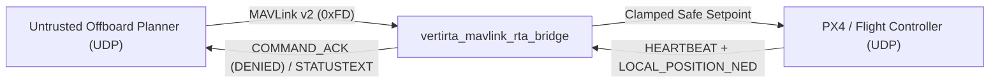

# VertiRTA MAVLink v2 Offboard RTA Shield (`tools/mavlink_rta_bridge/`)

Clean-room **Apache-2.0** C++20 MAVLink v2 UDP/Offboard Run-Time Assurance (RTA) proxy sitting inline between an untrusted offboard planner (ROS 2, Python, or companion AI) and a flight controller (`PX4` / FCU). Zero GPL, zero MAVSDK, and zero external protocol library dependencies.

---

## Wire Architecture



---

## Enforced Safety & Security Invariants

1. **Strict Wire Validation (`mavlink_v2_codec`):** Verifies `0xFD` framing, exact payload length, and X.25 `CRC-16/MCRF4XX` with official `common.xml` `CRC_EXTRA` bytes across 8 flight-critical message IDs (`HEARTBEAT`, `COMMAND_LONG`, `COMMAND_ACK`, `LOCAL_POSITION_NED`, `SET_POSITION_TARGET_LOCAL_NED`, `STATUSTEXT`, etc.). Corrupted frames are dropped fail-closed.
2. **Coordinate-Frame & Force-Mask Guard:** Enforces `MAV_FRAME_LOCAL_NED (1)` on `SET_POSITION_TARGET_LOCAL_NED` (clamping `BODY_NED` / `LOCAL_OFFSET_NED` / `GLOBAL` to safe `LOCAL_NED` hover) and rejects `FORCE_SET` bit `0x0200`.
3. **4D HJI-CBVF + Istanbul NFZ Clamping:** Routes every offboard setpoint through `libvertirta_rta_companion`'s `CbvfSafetyFilter`, enforcing `LTFJ` / `LTBX` CTR walls, Hospital keepout, plunge-rate limits, and speed ceilings.
4. **Fail-Closed Airborne Disarm / Termination Denial:** Denies `MAV_CMD_COMPONENT_ARM_DISARM` (`param1 = 0`, `NaN`, or `±Inf`) and `MAV_CMD_DO_FLIGHTTERMINATION` whenever fresh FCU `HEARTBEAT` + fresh `LOCAL_POSITION_NED` do not affirmatively confirm on-ground state — emitting explicit `COMMAND_ACK (MAV_RESULT_DENIED)` back to the offboard client.
5. **500 ms Deadman Hover:** Automatically injects a safe zero-velocity hover setpoint when offboard or FCU heartbeats time out.
6. **Loopback & LAN Bind Support:** Automatically binds `INADDR_LOOPBACK:0` for `127.0.0.0/8` loopback testing and `INADDR_ANY:0` when targeting a remote LAN `--fcu-host`.

---

## Quickstart & Live UDP Proof

```bash
# Build from repository root
cmake --preset dev-linux-x64 && cmake --build build/dev-linux-x64 --target vertirta_mavlink_rta_bridge test_mavlink_v2_rta_bridge -j

# Run Catch2 unit + negative security tests
ctest --test-dir build/dev-linux-x64 -R test_mavlink_v2_rta_bridge --output-on-failure

# Run live 2,500-packet POSIX UDP loopback proof
./build/dev-linux-x64/tools/mavlink_rta_bridge/vertirta_mavlink_rta_bridge \
  --self-test-udp-proof /tmp/mavlink_proof.json --packets 2500
```

**Verified Live Loopback Benchmark ([`artifacts/v4.0.0/mavlink_v2_rta_bridge_proof.json`](../../artifacts/v4.0.0/mavlink_v2_rta_bridge_proof.json)):** `2,500` packets (`922.56 ms`), **`0`** valid packets dropped, **`0`** unsafe packets leaked, **`1,181/1,181`** unsafe setpoints clamped, **`240/240`** airborne disarm/termination denied, **`239/239`** bad-CRC frames rejected, **`p50 = 18.0 us` / `p99 = 124.4 us`**.
